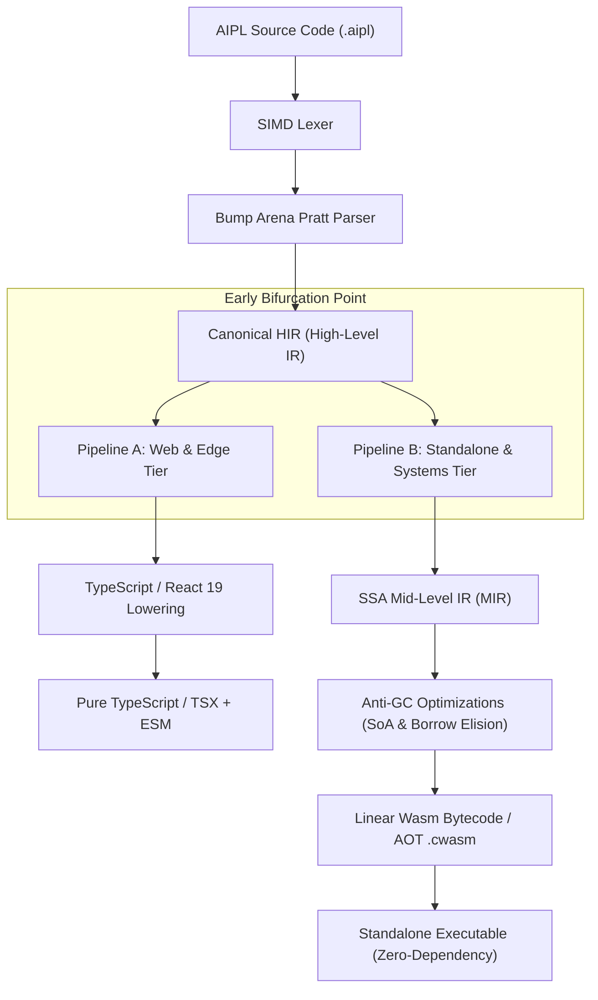

# ADR-0001: Dual-Backend Early Bifurcation at Canonical HIR

## Status
Accepted

## Date
2026-10-11

## Deciders
AIPL Architecture & Core Systems Team

## Context
AIPL targets two fundamentally distinct deployment environments:
1. **Web & Edge Environment**: Browsers, Cloudflare Workers, Node.js, Bun, Deno, where compatibility with existing JavaScript/TypeScript ecosystems, DOM/React rendering, and dynamic web standards is paramount.
2. **High-Performance Standalone Environment**: Native desktop and server binaries requiring bare-metal execution speed, zero runtime overhead, deterministic low latency, and standalone distribution without Node or browser dependencies.

Compilers typically make one of two compromises:
- *Transpilation-Only*: Target high-level JavaScript/TypeScript (e.g., CoffeeScript, PureScript, Elm). This yields poor standalone performance and inherits the JavaScript runtime garbage collector.
- *Native/LLVM-Only*: Compile everything down to machine code or WebAssembly via LLVM/Cranelift (e.g., Rust, Go, Zig). When executed in browsers, this produces massive Wasm binaries (10MB+), awkward DOM bridging (wasm-bindgen), and difficult React/UI component integration.

## Decision Drivers
- Zero-compromise developer and agent experience in both Web/React and Native CLI/GUI domains.
- Pristine, idiomatic TypeScript emission for the web tier (preserving interface contracts and TS types).
- Zero-GC, cache-optimal linear WebAssembly emission for the standalone tier.
- Maximum code reuse across the frontend, type checking, and semantic validation passes.

## Considered Options
1. **Late Bifurcation at LLVM/Cranelift IR**: Compile all code to LLVM IR, then use Emscripten / Cheerp to generate JavaScript for the web. (Rejected: Emscripten JS output is unreadable, incompatible with React 19 paradigms, and produces enormous bundles).
2. **Late Bifurcation at High-Level AST**: Fork immediately after parsing. (Rejected: Duplicates type checking, SMT refinement, name resolution, and module graph building across two parallel pipelines).
3. **Early Bifurcation at Canonical HIR**: Unify lexing, parsing, name resolution, and type checking into a single frontend producing a Canonical High-Level Intermediate Representation (Canonical HIR). Fork the pipeline at HIR into Pipeline A (TypeScript AST) and Pipeline B (MIR/LIR/Wasm).

## Decision Outcome & Rationale
**Chosen: Option 3 - Early Bifurcation at Canonical HIR.**

By bifurcating at Canonical HIR:
- The entire frontend (SIMD lexer, Pratt parser, Salsa DAG, SMT solver) runs exactly once. Both backends share 100% of syntactic and semantic error diagnostics.
- Canonical HIR preserves high-level structure (generic types, match expressions, ECS declarations) that Pipeline A can lower cleanly into TypeScript AST and React 19 JSX trees.
- Simultaneously, Pipeline B can lower Canonical HIR into SSA-form Mid-level IR (MIR), perform whole-program monomorphization, eliminate heap borrows, and emit optimal Linear WebAssembly bytecode.

## Consequences
### Positive
- Web consumers receive clean, readable, typed TypeScript with sourcemaps and zero glue runtime.
- Standalone consumers receive single-file standalone binaries with microsecond startup times.
- Front-end compiler optimizations and SMT refinement checks are implemented once and benefit both targets.

### Negative
- Compiler engineering complexity: The team must maintain two lowering backends (HIR -> TS AST vs. HIR -> MIR -> Wasm).
- Generic specialization differs: Pipeline A preserves TypeScript generics, while Pipeline B performs monomorphization.

### Neutral
- Standard library modules must provide dual implementations for target-specific facilities (e.g., DOM events vs. OS window handles).

## Implementation Notes & Validation Criteria
- Canonical HIR must not contain backend-specific constructs (no raw JS AST nodes, no Wasm virtual register indices).
- Verified via dual-target test harness: Every test in `tests/` must compile to both `--target=ts` and `--target=wasm` and produce identical execution results for standard algorithms.
