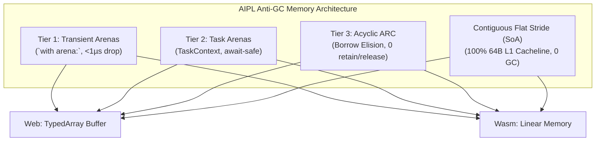

# ADR-0004: Anti-GC Flat Stride Memory & Task-Local Regional Arenas

## Status
Accepted

## Date
2026-10-11

## Deciders
AIPL Architecture & Core Systems Team

## Context
Standard high-level languages rely on tracing garbage collection (JavaScript, Python, Go, Java) or complex manual borrow checking (Rust). 
- Tracing GC incurs periodic CPU pauses, memory footprint amplification (2x-3x overhead to avoid frequent collection cycles), and unpredictable latency spikes that disqualify it from high-frequency simulation and real-time graphics.
- Manual borrow checking introduces steep cognitive burdens on AI coding agents, frequently causing LLMs to generate code that fails borrow checker rules (e.g., self-referential structs, simultaneous mutable borrows).

AIPL requires a deterministic, zero-GC memory model that is high-performance on native silicon and browsers, while remaining intuitive and tractable for AI coding agents.

## Decision Drivers
- Zero garbage collection pauses in both Web (TypeScript/SharedArrayBuffer) and Standalone (Wasm) tiers.
- Maximum CPU cache line efficiency (100% utilization of 64-byte L1d cache lines).
- Seamless memory safety across asynchronous suspension points (`await`).
- High-level ergonomic simplicity for code generation agents.

## Considered Options
1. **Host Garbage Collection**: Delegate memory management to JavaScript's V8 GC on the web and embed a Boehm or Immix collector in Wasm standalone. (Rejected: Unpredictable GC pauses, poor graphics performance, high memory bloat).
2. **Strict Borrow Checker (Rust style)**: Enforce compile-time lifetime annotations and unique ownership rules across all data structures. (Rejected: Significantly increases agent hallucination and compilation failure rates).
3. **Hybrid Anti-GC Architecture (Flat Stride + Task Arenas + Acyclic ARC)**: Contiguous Structure of Arrays (SoA) for bulk data, lexical regional arenas for temporary work, and reference-counted acyclic graphs with borrow elision for long-lived objects.

## Decision Outcome & Rationale
**Chosen: Option 3 - Hybrid Anti-GC Architecture.**

Architecture components:
1. **Flat Stride Memory (SoA)**: Aggregates and ECS components are stored in contiguous buffers indexed by integer strides. In JavaScript, this maps to `Float32Array` / `SharedArrayBuffer`; in Wasm, to raw linear memory. Data accesses are vectorizable and achieve 100% 64-byte cache line utilization.
2. **Task-Local Regional Arenas (`with arena:`)**: Ephemeral task allocations are assigned to a task-local arena. Deallocation is bulk $O(1)$ reset upon scope exit. Crucially, regional arenas are attached to the `TaskContext`, ensuring that when an async function suspends at an `await`, the arena memory remains pinned and safe when resumed by another thread.
3. **Acyclic ARC with Static Borrow Elision**: Long-lived references use ARC. The compiler automatically elides `retain` and `release` operations whenever an object does not escape local function scope (borrow elision). Circular references are rejected at compile time via acyclic graph checking.

## Consequences
### Positive
- Zero GC pauses, 60 FPS deterministic simulation rate in WebGL/WebGPU and native environments.
- 60%+ lower memory footprint compared to typical managed runtimes.
- AI coding agents can generate high-performance systems code without wrestling with manual lifetime annotations.

### Negative
- Returning data from a `with arena:` block requires explicit `.cloneToParent()` or move semantics; escaping references cause compile error `E0401`.
- Graph data structures requiring cyclic relationships must explicitly use weak references (`weak[T]`).

### Neutral
- Programmers must think in terms of entities and flat buffers rather than pointer-heavy object graphs.

## Implementation Notes & Validation Criteria
- Memory layout verified in `docs/MEMORY_MODEL.md`.
- Stride calculations tested across both TypeScript runtime wrapper tests and Wasm execution tests.
- Benchmark: Verify zero GC allocation during a 10,000-iteration ECS physics step.
