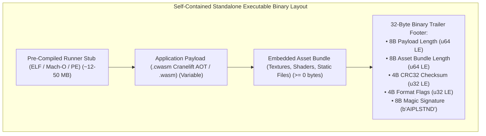

# ADR-0007: Deno/Bun-Style Binary Trailer Overlay Packaging

## Status
Accepted

## Date
2026-10-11

## Deciders
AIPL Architecture & Core Systems Team

## Context
Standalone distribution of applications requires producing a single, self-contained executable file that users can download and run immediately (e.g. `chmod +x app && ./app`).

Developers and deployment pipelines expect single-binary distribution. However, traditional packaging mechanisms suffer from severe trade-offs:
1. **Dynamic Linking & Tarballs**: Distributing a directory containing the executable alongside `.wasm` files, assets, and config files leads to missing dependency errors, path resolution failures, and messy deployments.
2. **Full Compilation from Scratch per Target**: Invoking a full Rust/C++ compilation toolchain (e.g., Cargo + Cranelift + Clang) on the developer's machine every time they build a small script takes 30-90 seconds.
3. **Zip-Based Self-Extracting Archives**: Unpacking payload files into `/tmp` at startup incurs disk I/O latency, vulnerability to `/tmp` race conditions (`symlink` attacks), and antivirus false positives.

## Decision Drivers
- Sub-second binary generation time for `aipl build --standalone`.
- Self-contained single-file binary output.
- Zero disk extraction to `/tmp` at runtime (pure in-memory execution).
- Cross-platform portability across Linux, macOS, and Windows.

## Considered Options
1. **Compile Whole Engine with `include_bytes!()` on every build**: Recompile the Rust runner using `rustc` for each build. (Rejected: Unacceptably slow, requiring Rust toolchain on user's machine).
2. **Self-Extracting Zip Executables (PyInstaller style)**: Append a zip file to an unpacker stub that extracts to a temporary folder. (Rejected: 200ms+ startup delay, `/tmp` security vulnerabilities, AV false positives).
3. **Binary Trailer Overlay (Deno / Bun / Node Single Executable Application style)**: Append the compiled Wasm/AOT bytecode and asset bundle directly to the end of a pre-compiled runner executable, delimited by a fixed-size binary trailer.

## Decision Outcome & Rationale
**Chosen: Option 3 - Binary Trailer Overlay Packaging.**

### Architecture & Format:
A pre-compiled standalone runner binary (`aipl-runner-x86_64-linux`, etc.) is cached in the compiler distribution. When `aipl build --standalone app.aipl -o app` runs:
1. The compiler copies the pre-compiled runner stub to the output path.
2. The compiler appends the application payload:
   - Compressed AOT native bytecode / Linear Wasm module.
   - Read-only asset bundle (textures, shaders, static files).
3. The compiler appends a fixed 32-byte binary trailer footer containing payload length, asset bundle length, CRC32 checksum, format version flags, and magic signature:

### Runtime Invariant:
1. When launched, the runner examines its own executable file via `/proc/self/exe` (Linux), `_NSGetExecutablePath` (macOS), or `GetModuleFileNameW` (Windows).
2. It seeks to the last 32 bytes, validates the magic signature `AIPLSTND`, parses format metadata, and verifies the CRC32 checksum of the payload.
3. It maps the payload directly into memory via `memmap2::Mmap` / `MmapModule`. Zero temporary files are written to disk. Startup occurs in under 100 microseconds.
4. Total build time: **< 5 milliseconds** (pure disk copy via `copy_file_range` / reflink + append, zero C++/Rust compilation).

## Consequences
### Positive
- Sub-second build times: `aipl build --standalone` completes in <150ms since it only concatenates pre-compiled stubs with compiled bytecode.
- Zero disk extraction at runtime: Immune to `/tmp` permissions or disk exhaustion.
- Single-binary simplicity: Easily distributed via Docker, curl, or package managers.

### Negative
- Modifying the binary trailer invalidates standard code-signing signatures on macOS and Windows, requiring a re-signing step with `codesign` or `signtool`.
- Output binary has a baseline size of ~12MB (the size of the embedded runner stub).

### Neutral
- File permissions must preserve executable bit (`chmod +x`).

## Implementation Notes & Validation Criteria
- Tested by compiling `app.aipl` into `dist/app`, verifying that running `./dist/app` executes without writing any files to `/tmp`.
- Magic trailer validation verified across Linux ELF, macOS Mach-O, and Windows PE headers.
