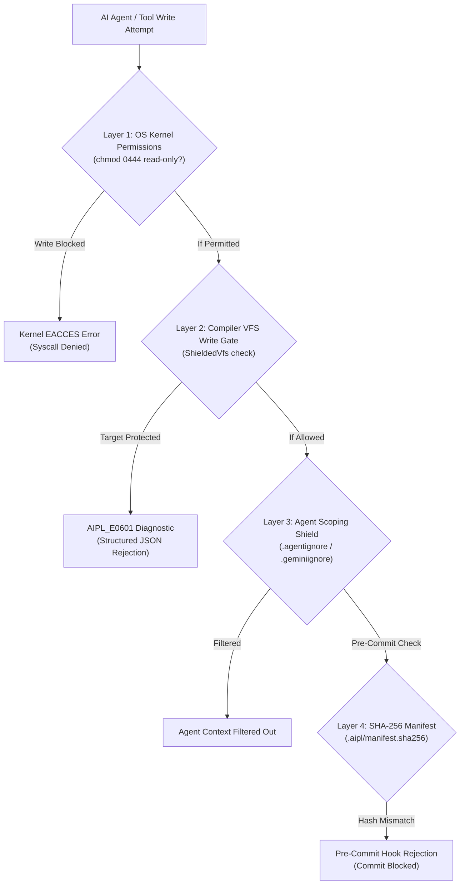

# ADR-0008: 4-Layer Defense-in-Depth Filesystem Shield (chmod 444)

## Status
Accepted

## Date
2026-10-11

## Deciders
AIPL Architecture & Core Systems Team

## Context
Autonomous AI coding agents operate with file system access to edit, refactor, and build software. However, autonomous agents can inadvertently overwrite, delete, or corrupt critical project infrastructure files (such as compiler configurations, lockfiles, security policies, and foundational specifications) due to hallucinated path transformations or improper tool invocations.

Standard software environments offer little protection beyond git status checks. Once an agent overwrites a file, subsequent tools or compilers might ingest the corrupted state, causing cascading failures.

AIPL requires a deterministic, defense-in-depth mechanism that prevents unauthorized file modifications, protects the Single Source of Truth (SSOT), and enforces immutable boundary conditions.

## Decision Drivers
- Uncompromising preservation of SSOT documentation, schemas, and compiler configuration.
- Immediate deterministic rejection of illegal write operations before disk modification occurs.
- Multi-tier defense that operates across OS permissions, compiler guards, runtime hooks, and git boundaries.

## Considered Options
1. **Rely on Git Dirty Checks**: Allow agents to write anywhere, relying on `git diff` or `git checkout` to detect and revert modifications. (Rejected: Agents frequently overwrite files during long tasks, masking regressions until the end).
2. **Path Blacklist in Tool Wrapper**: Intercept tool calls in the LLM wrapper with a regex blacklist. (Rejected: Brittle, easily bypassed by symlinks, relative path traversal `../`, or hardlinks).
3. **4-Layer Defense-in-Depth Filesystem Shield**: Enforce protection simultaneously across OS permissions (`chmod 444`), compiler build-time assertion hooks, virtual filesystem isolation, and git pre-commit verification.

## Decision Outcome & Rationale
**Chosen: Option 3 - 4-Layer Defense-in-Depth Filesystem Shield.**

The architecture implements four independent, non-overlapping protective layers:

### Detailed Layer Specifications:
1. **Layer 1: OS Kernel Permissions (`chmod 0444`)**:
   Critical SSOT files (`docs/SPEC.md`, `docs/ARCHITECTURE.md`, `docs/MEMORY_MODEL.md`, `docs/DIAGNOSTICS_SCHEMA.md`, `docs/ADR/*.md`, `Cargo.lock`) are marked strictly read-only (`0444`) on disk upon release/milestone lock. Any unauthorized write attempt by any tool or agent fails at the kernel system call level with `EACCES (Permission denied)`.
2. **Layer 2: Compiler VFS Write Gate (`ShieldedVfs`)**:
   The AIPL build engine and toolchain route all file operations through an abstract Virtual File System (`ShieldedVfs`). The VFS intercepts and rejects any write, creation, rename, or deletion targeting shielded paths with diagnostic `AIPL_E0601_PROTECTED_FILESYSTEM_VIOLATION`, producing an actionable single-root JSON diagnostic adhering to `diagnostic-v1.json`.
3. **Layer 3: Agent Ignore Shield (`.agentignore` / `.geminiignore` / `.cursorignore`)**:
   Autonomous AI coding agents read workspace ignore files before indexing code and planning edits. The shield automatically generates and synchronizes `.agentignore`, `.geminiignore`, and `.cursorignore` with managed boundary blocks (`# >>> AIPL FILESYSTEM SHIELD ...`), preventing agents from ingesting or hallucinating edits to locked files while preserving custom user ignore patterns. (Runtime process sandbox execution is governed independently in ADR-0022).
4. **Layer 4: Cryptographic SHA-256 Manifest & Pre-Commit Guard**:
   A deterministic manifest generator computes SHA-256 digests across all SSOT files, serializing them to `.aipl/manifest.sha256` in standard POSIX `sha256sum` format. A dedicated pre-commit hook script (`tools/pre-commit-shield.sh`) verifies both SHA-256 checksums and `0444` permission locks before allowing any git commit.

## Consequences
### Positive
- Total immunity against accidental agent corruption of core specifications, schemas, and build definitions.
- Failure happens early at the point of write, rather than manifesting downstream as mysterious compiler errors.
- Kernel-level defense ensures that even malicious or buggy sub-processes cannot mutate protected assets.
- Clean and seamless CLI management (`aipl shield lock`, `aipl shield unlock`, `aipl shield verify`, `aipl eject`).

### Negative
- Legitimate updates to documentation and ADRs require deliberate unlocking (`aipl shield unlock`) before editing.
- Requires platform-aware privilege handling across Linux, macOS, and Windows.

### Neutral
- Standard development workflow on user code remains unhindered, as user source directories (`src/`, `tests/`) remain fully read-write.

## Implementation Notes & Validation Criteria
- Verification suite in `tests/docs/test_fs_shield.py` and `./bin/aipl shield` (implemented in `std/fs.aipl` and `compiler/main.aipl`, originally prototyped in `crates/aipl-shield/tests/shield_tests.rs`) validates all 4 protective layers:
  1. `test_layer1_os_chmod_rejection`: Asserts write attempts to locked files fail at OS level with `PermissionDenied` (EACCES).
  2. `test_layer2_vfs_write_gate_rejection`: Asserts VFS write gate blocks writes to shielded paths with `AIPL_E0601_PROTECTED_FILESYSTEM_VIOLATION`.
  3. `test_layer3_ignore_file_synchronization`: Validates that `.agentignore`, `.geminiignore`, and `.cursorignore` contain all shielded files.
  4. `test_layer4_sha256_manifest_tamper_detection`: Modifies a byte in a simulated file and verifies manifest integrity check fails.
  5. `test_shield_unlock_and_eject`: Asserts `unlock` and `eject` cleanly restore `0644` permissions and unshield files.
- Python verification suite in `tests/docs/test_fs_shield.py` validates SSOT file presence and cryptographic manifest generation.

