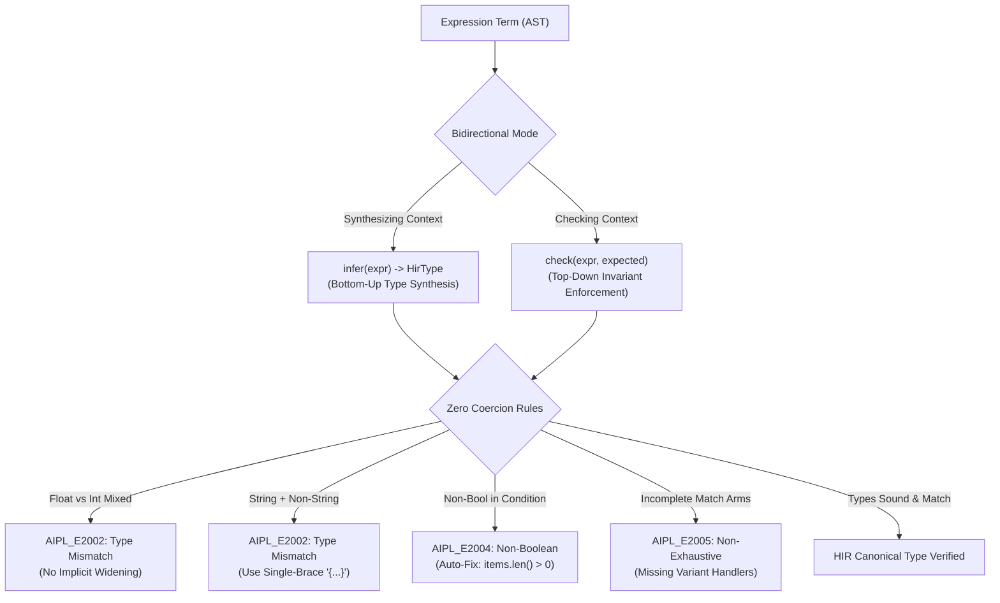

# ADR-0009: Sound Bidirectional Type Checking, Zero Implicit Coercion & Strict Boolean Invariants

## Status
Accepted

## Date
2026-10-11

## Deciders
AIPL Architecture & Core Systems Team

## Context
Mainstream programming languages frequently permit implicit type conversions, such as numeric widening (e.g. promoting `int` to `float`), string auto-concatenation (`"count: " + 5`), and truthiness coercion in control-flow statements (`if 1:`, `if "str":`, `if list:`).

While seemingly convenient for human scriptwriters, implicit coercions introduce fatal ambiguities and compounding hallucinations for AI coding agents:
1. **Silent Logic Errors**: Subtle precision losses (`float` widening of 64-bit integers) and string concatenation accidents create silent bugs that frontier LLMs cannot detect through static inspection.
2. **Truthiness Ambiguity**: Divergent truthiness conventions between languages (e.g. Python considering empty lists `[]` falsy while JavaScript considers them truthy) cause coding models to hallucinate incorrect conditional logic.
3. **Non-Exhaustive Matching**: Unhandled enum variants in `match` statements cause undefined runtime states or unexpected panics if not verified statically.

AIPL requires a deterministic, machine-tractable type system where every term has a unique, unambiguous type with zero silent coercion.

## Decision Drivers
- Absolute elimination of silent numeric precision loss and accidental string coercion.
- Machine-tractable conditional logic with identical behavior across all codegen targets (TypeScript, WebAssembly, GLSL).
- Exhaustive pattern matching guarantees over algebraic sum types (enums, Results, Options).
- Compile-time error diagnostics paired with automated, machine-applicable candidate repairs (`unified_diff`).
- Sub-millisecond typechecking velocity (<15ms per 10k statements).

## Considered Options
1. **Implicit Widening & Truthiness (C/Python/JS Style)**: Allow standard widening (`int -> float`, truthy numbers and strings). (Rejected: Major source of silent bugs and agent hallucination).
2. **Global Hindley-Milner with Unification Variables**: Full Hindley-Milner type inference (Damas-Milner algorithm W) without directionality. (Rejected: Generates cryptic "cannot unify $T_1$ with $T_2$" error messages that confuse LLMs; poor locality).
3. **Sound Bidirectional Type Checking with Zero Implicit Coercion & Strict Booleans**: Bidirectional checking (`infer` and `check`) enforcing zero numeric widening, zero string auto-coercion, strict boolean conditions, and exhaustive enum matching.

## Decision Outcome & Rationale
**Chosen: Option 3 - Sound Bidirectional Type Checking with Zero Implicit Coercion & Strict Booleans.**

Architecture:
1. **Bidirectional Type Checker (`aipl-types`)**:
   - `infer(expr) -> HirType`: Synthesizes exact canonical types from subterms.
   - `check(expr, expected)`: Propagates typing context inwards to validate literals and constructor terms.
2. **Zero Implicit Coercion Invariants (`AIPL_E2002_TYPE_MISMATCH`)**:
   - **No Numeric Widening**: Float and integer types are completely disjoint in memory. `1.0 == 1` and `let x: float = 42` are rejected. Literals must explicitly use fractional notation (`42.0`) or explicit conversions (`float(42)`).
   - **No String Auto-Coercion**: The `+` operator requires matching types; `"count: " + 5` is rejected. String formatting must utilize single-brace interpolation (`"count: {5}"`).
   - **Division Distinction**: `int / int -> int` performs integer truncation toward zero; `float / float -> float` performs IEEE-754 division. Mixed division is rejected.
3. **Strict Boolean Conditional Invariant (`AIPL_E2004_NON_BOOLEAN_CONDITION`)**:
   - Conditions in `if`, `while`, and ternary expressions MUST evaluate strictly to `HirType::Bool`.
   - Truthiness coercion is banned. The compiler synthesizes candidate repairs (e.g. `items.len() > 0`, `count != 0`).
4. **Exhaustive Pattern Matching (`AIPL_E2005_NON_EXHAUSTIVE_MATCH`)**:
   - `match` statements over sum types (enums, Result, Option, bool) verify that all declared variants are handled or an unguarded wildcard arm (`_ => ...`) exists.
   - Guarded arms (`Variant if cond => ...`) do not guarantee exhaustion.

## Consequences
### Positive
- AI coding agents receive immediate, deterministic compiler errors when types mismatch, preventing subtle runtime bugs.
- Automated candidate repairs provide ready-to-apply diffs (`count != 0`, `items.len() > 0`), enabling instant agent self-healing.
- 100% consistent semantics across Web (TypeScript) and Standalone (Wasm) tiers.
- High-velocity type checking (>10,000 expressions in <15ms).

### Negative
- Programmers and agents must write explicit `.0` for float literals (`let x: float = 42.0`).
- Guarded match arms require an explicit fallback arm.

### Neutral
- Eliminates truthiness idiom shortcuts; explicit conditions (`if len > 0:`) are required.

## Implementation Notes & Validation Criteria
- Implemented in `compiler/types.aipl` and verified via `./bin/aipl verify` (originally prototyped in `crates/aipl-types`: `src/typecheck.rs`, `src/error.rs`, `src/exhaustiveness.rs`).
- Formal rules documented in `docs/SPEC.md` Section 5.
- Complete test suite verified via `./bin/aipl test` and `pytest tests/selfhost/` (originally `crates/aipl-types/tests/typecheck_tests.rs`):
  - `test_zero_coercion_rejection`
  - `test_strict_boolean_conditionals`
  - `test_float_integer_division_distinction`
  - `test_exhaustive_enum_matching`
  - `test_bidirectional_type_inference`
  - `test_typechecker_throughput_benchmark`
