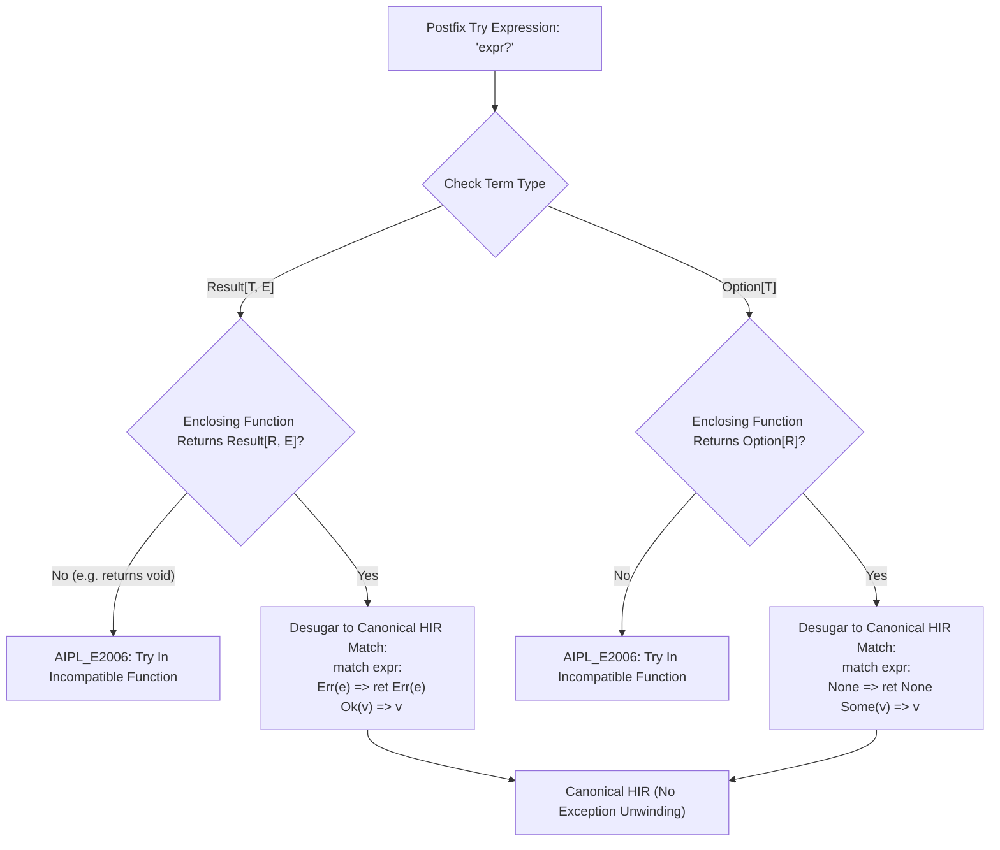

# ADR-0010: Algebraic Result[T, E], Option[T], Mandatory Unhandled Result Checking & Postfix '?' Desugaring

## Status
Accepted

## Date
2026-10-11

## Deciders
AIPL Architecture & Core Systems Team

## Context
Error handling across mainstream programming languages exhibits two problematic extremes:
1. **Implicit Exception Unwinding (Java, Python, C++, TypeScript)**:
   - Exceptions introduce invisible, out-of-band control flow branches that cannot be localized by static inspection.
   - AI coding agents routinely fail to predict when a callee throws, producing unhandled crash vectors or bloated `try { ... } catch (e) { ... }` boilerplate.
   - Exceptions require runtime unwinding infrastructure that is antithetical to deterministic flat-memory Wasm execution.
2. **Unchecked Return Codes (C, Go)**:
   - Returning error codes or tuple returns `(val, err)` allows errors to be silently dropped or forgotten.
   - Forgetting `if err != nil` produces null-dereference crashes downstream.

AIPL requires a deterministic, machine-tractable error handling architecture that guarantees at compile time that all fallible operations are handled, while keeping syntactic overhead minimal for SentencePiece 256k tokenomics.

## Decision Drivers
- **Zero Hidden Unwinding**: Eliminate exceptions, stack unwinding tables, and dynamic `try/catch` runtime penalties entirely.
- **Mandatory Handling Invariant**: Ensure that any expression returning `Result[T, E]` is handled via `?`, `match`, variable binding, or explicit discard (`let _ = ...`).
- **Token-Efficient Propagation**: Provide a 1-character postfix `?` operator that short-circuits early on error without requiring multi-line `if err != nil` boilerplate.
- **Strict Return Compatibility**: Verify at compile time that `?` is only invoked inside functions whose return type matches the error or option container.
- **Deterministic HIR Desugaring**: Lower `?` into explicit, canonical `match` statements with early returns prior to backend code generation.

## Considered Options
1. **Dynamic Exceptions (`throw` / `catch`)**: (Rejected: Invisible control flow, heavy runtime unwinding overhead, poor agent tractability).
2. **Go-Style Tuple Return `(T, error)` without Compiler Enforcement**: (Rejected: High rate of silent error suppression and token waste from `if err != nil` repetition).
3. **First-Class Algebraic `Result[T, E]` & `Option[T]` with Mandatory Checking and Postfix `?` Desugaring**: Provide built-in algebraic sum types, enforce compile-time unhandled result rejection, and desugar postfix `?` into early-return control flow.

## Decision Outcome & Rationale
**Chosen: Option 3 - Algebraic Sum Types, Mandatory Unhandled Result Checking & Postfix `?` Desugaring.**

### Key Architectural Pillars:
1. **Core Algebraic Sum Types (`HirType::Result`, `HirType::Option`)**:
   - `Result[T, E] = Ok(T) | Err(E)`: Standard sum type for fallible operations.
   - `Option[T] = Some(T) | None`: Standard sum type for optional values.
   - Built-in constructor typing:
     - `Ok(v)` infers `Result[T, Unknown]`, unifying soundly with expected `Result[T, E]`.
     - `Err(e)` infers `Result[Unknown, E]`, unifying soundly with expected `Result[T, E]`.
     - `Some(v)` infers `Option[T]`.
     - `None` infers `Option[Unknown]`.

2. **Mandatory Unhandled Result Invariant (`AIL_E1004_UNHANDLED_RESULT`)**:
   - When an expression evaluating to `HirType::Result[T, E]` occurs as a standalone expression statement (i.e. unused value), the type checker halts compilation with `AIL_E1004_UNHANDLED_RESULT`.
   - Results must be explicitly handled via:
     - Postfix `?` operator (`perform()?`)
     - `match` pattern match (`match perform(): Ok(v) => ... Err(e) => ...`)
     - Variable binding (`let res = perform()`)
     - Explicit discard acknowledgment (`let _ = perform()`)
   - Automated candidate repairs provide ready-to-apply diffs for agent self-healing.

3. **Postfix `?` Type Checking & Incompatible Function Invariant (`AIPL_E2006_TRY_IN_INCOMPATIBLE_FN`)**:
   - For `expr?` where `expr: Result[T, E]`:
     - Enclosing function return type must be `Result[R, E_ret]`, with error type `E` compatible with `E_ret`.
     - Calling `?` inside a function returning `void`, `nil`, or an incompatible error type triggers `AIPL_E2006_TRY_IN_INCOMPATIBLE_FN`.
     - The expression yields unwrapped value `T`.
   - For `expr?` where `expr: Option[T]`:
     - Enclosing function return type must be `Option[R]`.
     - Calling `?` on Option inside a function returning `void` or `Result` triggers `AIPL_E2006_TRY_IN_INCOMPATIBLE_FN`.
     - The expression yields unwrapped value `T`.

4. **Canonical HIR Desugaring Pipeline (`compiler/hir.aipl`, originally `crates/aipl-hir/src/desugar.rs`)**:
   - Postfix `?` is lowered into explicit control flow:
```aipl
// let val = expr? desugars into:
match expr:
  Err(err) => ret Err(err)
  Ok(val) =>
    let res = val
```
   - Chained calls `fetch()?.json()?.validate()?` expand into sequentially guarded branches that short-circuit on the first failure.



## Consequences
### Positive
- Zero runtime exception overhead or hidden unwinding frames in linear Wasm.
- AI coding agents cannot accidentally drop errors or fail to handle failure states.
- 1-character `?` operator reduces token consumption by over 70% compared to `if err != nil` patterns.
- Error type mismatches are detected at compile time with actionable diagnostics and candidate repairs.

### Negative
- Unused fallible operations must be explicitly discarded (`let _ = expr`), preventing lazy evaluation without intent.

## Validation Criteria
- All unhandled `Result` statements trigger `AIL_E1004_UNHANDLED_RESULT`.
- All `let val = parse()?` statements desugar into `match` with early return of `Err(e)`.
- All mismatched return contexts trigger `AIPL_E2006_TRY_IN_INCOMPATIBLE_FN`.
- Chained unwraps `fetch()?.json()?.validate()?` typecheck and short-circuit cleanly.
- 100% test pass rate across test suite via `./bin/aipl test` and `pytest tests/selfhost/` (originally `crates/aipl-types/tests/result_try_tests.rs`).
