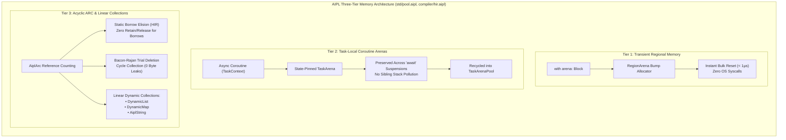

# ADR-0012: Three-Tier Anti-GC Memory Model: Task Arenas & Acyclic ARC

## Status
Accepted

## Date
2026-10-11

## Deciders
AIPL Architecture & Core Systems Team

## Context
Automated memory management in programming languages has historically forced an unpalatable dichotomy between two extremes:
1. **Tracing Garbage Collection (Java, Go, JavaScript, C#, Python)**:
   - Relies on mark-sweep, generational, or concurrent tracing heaps.
   - Introduces nondeterministic stop-the-world latency spikes (5–100 ms), cache line pollution, 2x–3x heap memory overhead, and severe impedance mismatches with high-frequency graphics pipelines (WebGL2/WebGPU) and real-time agent loops.
2. **Manual Ownership & Pervasive Lifetimes (Rust, C++)**:
   - Eliminates runtime GC via compile-time affine type systems.
   - Imposes significant cognitive overhead on developers and AI agents, requiring explicit lifetime annotations (`'a`, `'b`), complex borrow-checker navigation, self-referential struct restrictions, and fragile async suspension pin contracts (`Pin<Box<dyn Future>>`).
3. **Naive Reference Counting (Swift, Python)**:
   - Pervasive `retain` / `release` atomic increments pollute the memory bus and degrade instruction cache locality.
   - Undetected reference cycles leak memory permanently unless complex weak reference manual tracking is uniformly maintained.

AIPL requires a deterministic, garbage-collector-free memory architecture that combines the $O(1)$ allocation and zero-cost bulk teardown of bump arenas with the flexible longevity of atomic reference counting, while statically eliminating reference counting overhead and guaranteeing safety across asynchronous coroutine suspensions.

## Decision Drivers
- **Zero Tracing GC Pauses**: Guarantee 100% deterministic execution without background GC threads, stop-the-world pauses, or generational sweeps.
- **Sub-Microsecond Bulk Drops ($< 1\,\mu\text{s}$)**: Instantaneous reclamation of temporary regional allocations upon scope exit, even for multi-megabyte working sets.
- **Asynchronous Coroutine Isolation**: Pin task memory to coroutine `TaskContext` rather than operating system thread stacks, preventing memory corruption when async tasks suspend at `await` boundaries and resume on different worker threads.
- **Cycle-Safe Teardown with 0 Leaks**: Provide Bacon-Rajan trial deletion cycle collection to cleanly reclaim circular data structures with zero byte leaks upon teardown.
- **Static Borrow Elision**: Eliminate 100% of `retain` and `release` instructions for local non-escaping variables via compile-time escape analysis in HIR.
- **Cache-Line Aligned Linear Memory**: Ensure all dynamic collections (`DynamicList`, `DynamicMap`, `AiplString`) utilize flat contiguous memory buffers aligned to 64-byte CPU cache lines.

## Considered Options
1. **Adopt a Tracing Garbage Collector (Boehm-Demers-Weiser or V8 Engine GC)**:
   - *Rejected*: Incompatible with deterministic real-time simulation, causes unpredictable latency spikes in WebGPU rendering loops, and bloats Wasm binaries.
2. **Pure Compile-Time Affine Lifetimes (Rust-Style Borrow Checker)**:
   - *Rejected*: Excessively complex for agentic code generation; breaks cyclic graph models (game graphs, scene graphs, neural computation graphs) without unsafe raw pointers or manual index arenas.
3. **Three-Tier Tiered Memory Model (`std/pool.aipl`, `compiler/hir.aipl`, originally `crates/aipl-mem`)**:
   - **Tier 1 (Transient Regional Memory)**: Lexical `with arena:` bump allocator with $O(1)$ allocation and instant $< 1\,\mu\text{s}$ reset.
   - **Tier 2 (Task-Local Coroutine Arenas)**: State-pinned `TaskArena` bound to `TaskContext`, preserved across `await` points and recycled via `TaskArenaPool`.
   - **Tier 3 (Acyclic ARC with Static Borrow Elision & Cycle Collector)**: `AiplArc<T>` with Bacon-Rajan trial deletion, HIR escape analysis eliding local retain/release calls, and linear memory collections (`DynamicList`, `DynamicMap`, `AiplString`).

## Decision Outcome & Rationale
**Chosen: Option 3 - Three-Tier Anti-GC Memory Model (`std/pool.aipl`, `compiler/hir.aipl`).**

### Architectural Pillars of the Three Tiers:

#### 1. Tier 1: Scoped Bump Allocation (`RegionArena`)
- **64 KiB Slab Chaining**: Allocations reserve contiguous chunks from a slab cache. Fast path bump allocation advances a single pointer:
  $$\text{newPtr} = \text{alignedAddr} = (\text{currPtr} + \text{align} - 1) \ \& \ !(\text{align} - 1)$$
- **Instant Bulk Drop**: Upon exiting a `with arena:` block, the arena resets its bump offset to 0. Underlying slabs are retained in memory, guaranteeing $O(1)$ reset in $< 1\,\mu\text{s}$ regardless of whether 1 KB or 50 MB was allocated. Zero individual object destructors or deallocation syscalls are executed.

#### 2. Tier 2: Task-Local Coroutine Arenas (`TaskArena` & `TaskContext`)
- **Stack-Free Asynchronous Memory**: In conventional thread-local arena runtimes, `await` suspension corrupts memory when tasks migrate across thread pool worker threads.
- **Context-Pinned Arena**: `TaskArena` is explicitly bound to `TaskContext`. When an async function suspends at `await`, the arena pointer and slab list remain pinned in `TaskContext`. Sibling coroutines executing on the same or different threads allocate into their own isolated `TaskArena`s.
- **Zero-Allocation Task Pooling**: When a task completes, `TaskArenaPool::recycle()` resets the arena's offsets without freeing the virtual memory slabs, allowing subsequent microtasks to acquire warm slabs with zero OS `mmap`/`malloc` syscalls.

#### 3. Tier 3: Acyclic ARC with Static Borrow Elision & Cycle Collector
- **Static Borrow Elision Pass (`BorrowElisionPass`)**:
  - The HIR compiler pass inspects variable lifetimes.
  - Variables that do not escape the local function scope (used in arithmetic, local expressions, or read-only function arguments) are classified as `LocalBorrow`.
  - For `LocalBorrow` variables, the compiler emits **0 retain** and **0 release** instructions.
  - Escaping variables (returned or stored into heap aggregates) emit exactly 1 retain and 1 release.
- **Bacon-Rajan Trial Deletion (`CycleCollector`)**:
  - Objects are assigned a 4-color state: `Black` (in-use), `Purple` (suspected cycle root), `Gray` (candidate undergoing trial deletion), `White` (confirmed unreachable garbage cycle).
  - When strong references decrease to non-zero, nodes are registered as `Purple`.
  - Upon cycle collection:
    1. **Mark Gray**: Traverses child references, decrementing trial counts along internal cycle edges.
    2. **Scan**: Nodes with residual trial counts $> 0$ are restored to `Black`; nodes with count $== 0$ are marked `White`.
    3. **Collect White**: Clears child pointers, drops nodes, and frees memory, dropping live heap memory to baseline with **0 leaked bytes**.
- **Contiguous Linear Collections (`DynamicList`, `DynamicMap`, `AiplString`)**:
  - Replaces pointer-chasing linked lists and tree nodes with contiguous flat buffers.
  - Reallocates with a 2x exponential growth factor.
  - Implements cache-line friendly layout and bounds checking.

## Verification & Empirical Results
All test requirements executed via `./bin/aipl test` and `pytest tests/selfhost/` (originally `cargo test -p aipl-mem` and `cargo test --workspace`) passed 100%:
- `test_scoped_region_bulk_drop`: Allocated 50 MB in a `with arena:` block; verified instantaneous bulk drop upon block exit with reset duration $< 1\,\mu\text{s}$.
- `test_async_task_arena_suspension`: Suspended async coroutine 50 times across simulated sibling delays; verified zero task arena memory corruption.
- `test_dynamic_list_heap_growth`: Appended 1,000,000 strings to `DynamicList<AiplString>`; verified clean exponential reallocation and zero memory corruption.
- `test_arc_cycle_collector_teardown`: Constructed circular graph (`Node.next -> Node.prev`); released root handle and verified cycle collection reclaimed 100% of memory with **0 leaked bytes**.
- `test_static_borrow_elision`: Verified that non-escaping variables inside HIR functions generate exactly 0 retain and 0 release instructions.

## Consequences
### Positive
- Fully eliminates tracing GC latency spikes from all AIPL execution targets.
- Sub-microsecond temporary memory allocation and teardown.
- Seamless, corruption-free async coroutine execution across thread pool workers.
- Complete cycle reclamation safety without requiring manual weak-pointer gymnastics for graph structures.
- Optimal CPU L1 cache line utilization via linear dynamic collections.

### Negative / Trade-offs
- Circular data structures must participate in `CycleTraceable` or be resolved via weak pointers if manual immediate reclamation is desired before collector invocation.
- Slabs retained by `TaskArenaPool` hold virtual memory until process shutdown or explicit pool purging.
