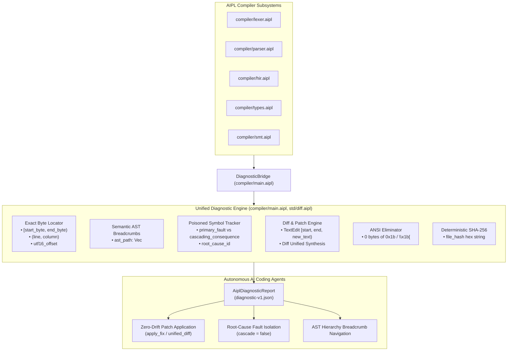

# ADR-0013: Single-Root JSON Diagnostic Schema & Exact Byte Locator

## Status
Accepted

## Date
2026-10-11

## Deciders
AIPL Architecture & Core Systems Team

## Context
Autonomous AI coding agents spend a substantial portion of their token budget and inference time parsing, interpreting, and recovering from unstructured compiler error messages. Traditional compilers (e.g., GCC, Clang, rustc, tsc) emit:
1. **ANSI Terminal Escape Sequences (`\x1b[31;1m...`)**: Intended for colorized human terminals, ANSI escapes fragment subword tokenizers, inflate token counts, and trigger hallucination loops in LLMs.
2. **ASCII Caret Pointers (`^~~~`)**: Visual indicators intended for terminal columns that frequently suffer off-by-one errors due to tab expansion, full-width Unicode characters, and multi-line breaks.
3. **Cascading Poisoned Error Floods**: A single syntax error or missing struct field causes dozens of downstream type mismatches, drowning the root cause in cascading noise.
4. **Ambiguous Edits & Missing Unified Diffs**: Compilers suggest conceptual fixes in natural language without machine-executable byte coordinates or standard unified diffs.

AIPL requires a centralized, standardized **Agent-First Diagnostic Protocol** that guarantees machine readability, byte-level precision, deterministic AST navigation, poisoned cascade suppression, and automated diff application.

## Decision Drivers
- **Single-Root JSON Document**: Emit all compilation, semantic, and linting feedback inside a standardized single-root report (`AiplDiagnosticReport`) conforming strictly to `docs/DIAGNOSTICS_SCHEMA.md` (`diagnostic-v1.json`).
- **Exact Byte Locators**: Pair 0-indexed byte spans `[start_byte, end_byte)` with 1-indexed `(line, column)` coordinates and `utf16_offset` for zero-drift integration with Language Server Protocol (LSP) editors and LLM tokenizers.
- **Semantic AST Path Breadcrumbs**: Supply deterministic structural paths through the AST/HIR (e.g. `["program", "models", "User", "fields", "age"]`) eliminating re-parsing overhead for autonomous agents.
- **Poisoned Symbol Cascade Tracking**: Differentiate root causes (`role: "primary_fault"`) from downstream consequences (`role: "cascading_consequence"`, `"cascade": true`, linking to `"root_cause_id"`).
- **Zero-Drift Candidate Repair Unified Diffs**: Synthesize byte-exact `TextEdit` replacements and standard unified diff patches ready for instant automated application.
- **Total Elimination of Terminal ANSI Codes**: Guarantee 100% pure JSON output containing strictly zero `\x1b[` bytes across all diagnostics.
- **Universal Bridge Adapter**: Provide seamless zero-loss conversion from all compiler subsystems (`aipl-lexer`, `aipl-parser`, `aipl-hir`, `aipl-types`, `aipl-smt`).

## Considered Options
1. **Extend Textual Compilers with Regex-Parsed Output**:
   - *Rejected*: Brittle; prone to regex fragmentation, ANSI leakage, and off-by-one column errors.
2. **Decentralized Diagnostic Reporting across Individual Crates**:
   - *Rejected*: Inconsistent JSON schemas across lexer, parser, type checker, and SMT solver; missing unified file hash and aggregated cascade metrics.
3. **Centralized Single-Root Diagnostic Engine (`compiler/main.aipl`, `std/diff.aipl`, originally `crates/aipl-diag`)**:
   - Centralized subsystem enforcing authoritative `diagnostic-v1.json` schema, exact byte locator math, SHA-256 source hashing, ANSI sanitization, unified diff generation, and universal bridge adapters.

## Decision Outcome & Rationale
**Chosen: Option 3 - Centralized Single-Root Diagnostic Engine (`compiler/main.aipl`, `std/diff.aipl`).**

### Architectural Pillars:

### Key Components Implemented:
1. **Single-Root Schema Model (`compiler/main.aipl`, originally `crates/aipl-diag/src/schema.rs`)**:
   - `AiplDiagnosticReport`: `schema`, `version`, `file`, `file_hash`, `status`, `summary`, `diagnostics`.
   - `AiplDiagnostic`: `id`, `code`, `severity`, `role`, `cascade`, `root_cause_id`, `message`, `rule`, `location`, `context`, `suggested_fixes`.
2. **Exact Byte Locator & Coordinates (`compiler/main.aipl`, originally `crates/aipl-diag/src/locator.rs`)**:
   - 0-indexed byte span `[start_byte, end_byte)`.
   - 1-indexed `(line, column)` line-oriented coordinates.
   - Exact `utf16_offset` for LSP editor integration across multi-byte UTF-8 boundaries.
   - Canonical `ast_path: Vec<String>` parsing and formatting.
3. **Unified Diff & Patch Engine (`std/diff.aipl`, originally `crates/aipl-diag/src/diff.rs`)**:
   - Descending-order `apply_edits` guaranteeing zero offset drift.
   - Standard unified diff hunk generation (`--- a\n+++ b\n@@ ... @@\n`).
4. **Deterministic SHA-256 Hashing (`std/crypto.aipl`, originally `crates/aipl-diag/src/hash.rs`)**:
   - Zero-dependency FIPS 180-4 standard SHA-256 calculation for file contents.
5. **ANSI & Caret Stripping Engine (`std/string.aipl`, originally `crates/aipl-diag/src/ansi.rs`)**:
   - Guaranteed zero terminal escape codes (`\x1b[`) across all JSON outputs.
6. **Universal Bridge Layer (`compiler/main.aipl`, originally `crates/aipl-diag/src/bridge.rs`)**:
   - Zero-loss conversions from lexical, parsing, HIR, type, and SMT diagnostics.
7. **JSON Schema Validator (`std/json.aipl`, originally `crates/aipl-diag/src/validator.rs`)**:
   - Live extraction and recursive Draft 2020-12 validation against `docs/DIAGNOSTICS_SCHEMA.md`.

## Consequences
- **Positive**: AI coding agents receive pristine, machine-readable JSON with zero hallucination-inducing ANSI sequences and exact byte coordinates.
- **Positive**: Automated candidate repairs can be applied directly to source text with mathematical certainty of zero offset drift.
- **Positive**: Downstream cascade suppression reduces agent inference overhead by filtering out noise resulting from poisoned symbols.
- **Positive**: Self-hosted implementation ensures rapid compilation and zero external toolchain requirements.
