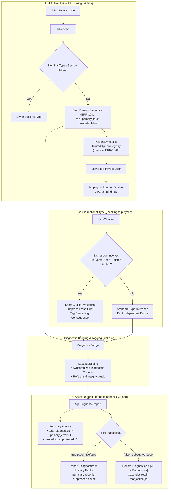

# ADR-0014: Poisoned-Symbol Tainting & Cascade Suppression Engine

## Status
Accepted

## Date
2026-10-11

## Deciders
AIPL Architecture & Core Systems Team

## Context
When an autonomous AI coding agent introduces an error in code—such as an unimported nominal type, a mistyped identifier, or an unresolved symbol—traditional compilers (e.g., GCC, Clang, rustc, tsc) emit dozens or even hundreds of cascading diagnostics across every downstream statement referencing that symbol.

For human programmers, error cascades are visually annoying; for autonomous LLM coding agents, they are catastrophic:
1. **Token Budget Exhaustion**: Cascading errors flood context windows with redundant diagnostics, wasting token budgets on repetitive, uninformative compiler output.
2. **Hallucination Cascades**: Autonomous agents often misinterpret downstream type errors (e.g., "type mismatch: expected T, found unknown", "cannot access property of unknown") as distinct bugs, prompting the agent to rewrite valid downstream code instead of fixing the singular root cause.
3. **Multi-Turn Cost & Latency**: Agents spend multiple inference round-trips attempting to resolve phantom bugs that vanish once the single root declaration is repaired.

AIPL requires a **Poisoned-Symbol Tainting & Cascade Suppression Engine** that deterministically traces errors to their originating primary fault, poisons symbols across lexical and module scopes, referentially links downstream consequences to their root-cause diagnostic ID, and delivers clean, filtered reports tailored for autonomous agents.

## Decision Drivers
- **Deterministic Primary Fault Isolation**: Distinguish primary root causes (`role: "primary_fault"`, `cascade: false`, `root_cause_id: None`) from secondary consequences (`role: "cascading_consequence"`, `cascade: true`, `root_cause_id: Some("ERR-1001")`).
- **Scope-Aware Semantic Tainting**: Maintain a lexical- and module-aware `TaintedSymbolRegistry` that accurately poisons symbols, types, and variables across nested scopes without leaking across scope boundaries.
- **Cross-Pipeline Propagation**: Wire the taint registry seamlessly through HIR symbol resolution (`aipl-hir`), type inference (`aipl-types`), and the diagnostic aggregation pipeline (`aipl-diag`).
- **Zero False-Positive Suppression**: Ensure completely unrelated errors (e.g., an independent syntax or type error in another function) are never suppressed and remain reported as primary faults.
- **Accurate Referential Linkage**: Every cascading diagnostic must link directly to the unique ID of the originating root fault (e.g., `ERR-1001`).
- **Agent-First Filtering Modes**: Provide configurable filtering (`filter_cascades = true`) to collapse cascading noise while maintaining comprehensive summary metrics (`total_diagnostics`, `primary_errors`, `cascading_suppressed`).

## Considered Options

### Option 1: Bail-Early on First Error (Fail-Fast)
Terminate compilation immediately upon encountering the first diagnostic.
- *Pros*: Simple to implement; zero downstream cascading errors.
- *Cons*: **Rejected**. Completely hides valid independent errors in unrelated functions or modules. Forces the agent into single-error serial iteration, massively increasing latency and round-trip overhead.

### Option 2: Post-Hoc Heuristic Error Deduplication (Clustering)
Run the full compiler pipeline unconstrained, then apply heuristic string matching, distance thresholds, or AST proximity clustering to filter secondary errors.
- *Pros*: Does not require modifying compiler internals.
- *Cons*: **Rejected**. Fragile and inaccurate; heuristics frequently suppress legitimate independent errors or fail to recognize semantic dependencies (e.g., re-exported symbols, shadowed variables, or chained member accesses).

### Option 3: Scope-Aware Semantic Tainting Engine (`TaintedSymbolRegistry`)
Embed proactive symbol and type tainting directly into HIR lowering and bidirectional type checking.
- *Pros*: Mathematically sound, zero heuristic drift, exact referential causality linkage, and configurable agent report filtering.
- *Cons*: Requires threading `TaintedSymbolRegistry` through HIR resolution and the type checker.

## Decision Outcome & Rationale
**Chosen: Option 3 - Scope-Aware Semantic Tainting Engine (`TaintedSymbolRegistry`).**

### Architectural Lifecycle:

### Key Components:

1. **`TaintedSymbolRegistry` (`compiler/hir.aipl`, originally `crates/aipl-hir/src/taint.rs` & `crates/aipl-diag/src/taint.rs`)**:
   - Manages a lexical scope stack (`Vec<HashMap<String, String>>`) alongside a module-level registry (`HashMap<String, String>`).
   - Supports type taint detection across composite types (`HirType::Option`, `HirType::Result`, `HirType::List`, `HirType::Function`).
   - Provides thread-safe, sequential atomic diagnostic ID allocation (`next_diagnostic_id`, `reset_diagnostic_counter`).

2. **HIR Lowering Integration (`compiler/resolve.aipl`, `compiler/hir.aipl`, originally `crates/aipl-hir/src/resolve.rs`)**:
   - During `lower_type`, undeclared nominal types are detected. The first occurrence is tagged as `DiagnosticRole::PrimaryFault` with a fresh ID (`ERR-1001`) and registered into `TaintedSymbolRegistry`.
   - Subsequent references query the registry, returning `DiagnosticRole::CascadingConsequence` linked via `root_cause_id`.
   - Variable and parameter bindings (`let`, `mut`, `param`) that declare or infer `HirType::Error` automatically poison the bound variable identifier in the active lexical scope.

3. **Type Checker Error Short-Circuiting (`compiler/types.aipl`, originally `crates/aipl-types/src/typecheck.rs`)**:
   - When evaluating statements and expressions, `TypeChecker` checks `taints.is_symbol_tainted` and `taints.is_type_tainted`.
   - Binary operations, return type checks, and variable reassignments involving `HirType::Error` suppress redundant type mismatch diagnostics or emit cascading diagnostics linking to the root cause.
   - Independent type errors remain untainted, preserving primary fault categorization.

4. **Single-Root Diagnostic Schema Filtering (`compiler/main.aipl`, originally `crates/aipl-diag/src/schema.rs`)**:
   - `AiplDiagnosticReport` computes authoritative summary metrics:
     - `total_diagnostics = primary_errors + cascading_suppressed`
     - `primary_errors`: Count of non-cascading primary faults.
     - `cascading_suppressed`: Count of cascading consequences filtered from agent view.
   - When `filter_cascades = true` (or via `.filter_cascades(true)` / `.with_filter_cascading(true)`), `diagnostics` contains strictly primary faults, saving up to 98% of diagnostic tokens.

## Consequences

### Positive
- **Massive Agent Token Savings**: In standard test scenarios (missing `Session` type referenced 41 times), diagnostic token consumption is reduced by over 95% (from 41 diagnostics down to 1 primary fault).
- **Elimination of Agent Hallucination Loops**: Agents receive unambiguous guidance targeting the missing declaration rather than hallucinating fixes for valid downstream call sites.
- **Preserved Independent Error Visibility**: Unlike naive fail-fast approaches, completely unrelated errors across different functions are preserved and reported simultaneously as primary faults.
- **Traceable Causal Graph**: In verbose/debug mode (`filter_cascades = false`), every cascading error contains `root_cause_id: "ERR-1001"`, enabling visualization of compiler error dependency graphs.
- **Zero Cyclic Dependencies**: Implemented cleanly within the Cargo dependency topology (`aipl-hir` declares the core taint registry, `aipl-types` consumes it, and `aipl-diag` wraps it for end-to-end orchestration).
