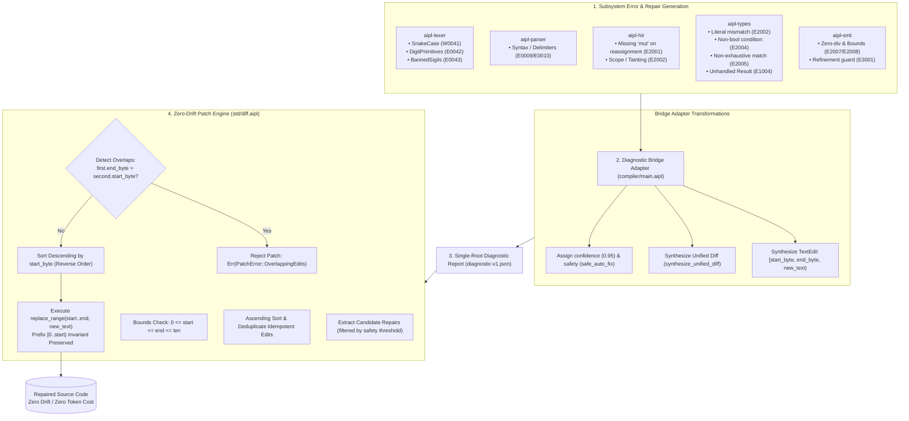
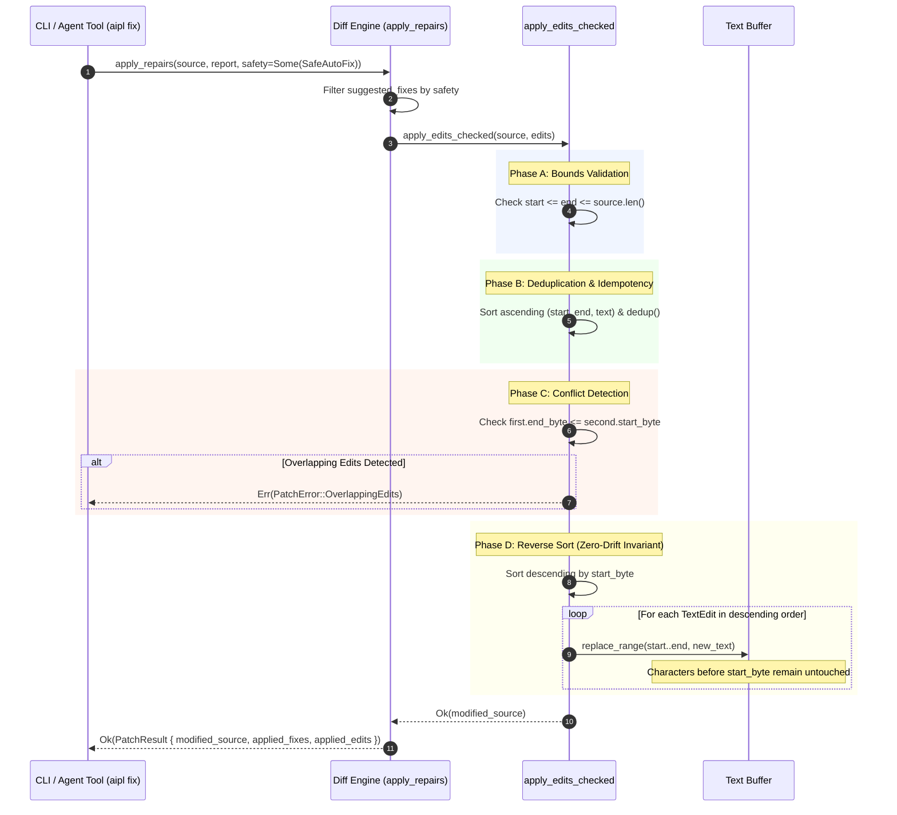

# ADR-0015: Pre-Calculated AST Diff Repairs & Zero-Drift Patch Engine

## Status
Accepted

## Date
2026-10-11

## Deciders
AIPL Architecture & Core Systems Team

## Context
When an autonomous AI coding agent introduces an error in code—such as an immutable reassignment, a snake_case identifier violating tokenomics invariants, a digit-suffixed primitive type, or an unhandled fallible `Result`—traditional compilers (e.g., GCC, Clang, `rustc`, `tsc`) emit raw textual logs accompanied by visual ASCII carets (`^~~~`) and conversational prose.

For human developers, conversational diagnostic hints are helpful. For autonomous LLM coding agents, however, this paradigm introduces crippling systemic overhead:
1. **Inference Latency & Token Waste**: When a compiler fails without providing machine-actionable patches, the agent harness must feed the entire compilation error log back into the LLM context window. The agent must then spend hundreds or thousands of output tokens regenerating the entire source file.
2. **Conversational Turn-Around Spirals**: Autonomous agents often require multiple sequential inference cycles to repair trivial typographical or syntactic errors. If the agent makes a secondary mistake during regeneration (such as dropping an import or modifying unrelated logic), it enters an error cascade or hallucination loop.
3. **Fragility of ASCII Caret Pointers**: Visual terminal carets (`^~~~`) and human-centric column numbers frequently suffer from off-by-one errors across LLM tokenizer boundaries, tab expansions, and multi-byte UTF-8 characters. Agents struggle to reliably translate carets into surgical edits.
4. **The Coordinate Drift Dilemma**: When an agent attempts to apply multiple diagnostic fixes to a single source file sequentially, applying the first edit shifts the character and line offsets of the entire rest of the file. Any subsequent edit based on original compiler coordinates strikes the wrong location, resulting in corrupted source code.

AIPL requires a **Pre-Calculated AST Diff Repair Generator & Zero-Drift Patch Engine** that transforms the compiler from a passive error reporter into an active, deterministic repair synthesizer, supplying dual-format machine-actionable patches (`TextEdit` and unified diffs) and applying them in a single, conflict-free pass with mathematical proof of zero coordinate drift.

## Decision Drivers
- **Machine-Actionable Diffs**: Every diagnostic with a deterministic semantic solution must synthesize ready-to-apply patches without requiring agent deliberation or natural language interpretation.
- **Zero Coordinate Drift Guarantee**: Multiple edits across a file must apply in a single pass without subsequent byte or line coordinate corruption.
- **Single-Pass Idempotent Patching**: The patch engine must support safe re-execution, automatically deduplicating identical edits and detecting if a fix has already been applied.
- **Atomic Conflict Rejection**: Overlapping, colliding, or competing edits must be caught before modifying file contents, aborting safely rather than leaving half-patched corrupt code.
- **AST-Driven Semantic Synthesis**: Candidate repairs must be generated directly from compiler AST/HIR semantic knowledge and bidirectional type inference, rather than through fuzzy string pattern matching or post-hoc heuristics.
- **Dual Representation for Programmatic & Human Workflows**: Emit both byte-exact `TextEdit` slices (defined in `compiler/main.aipl` and `docs/DIAGNOSTICS_SCHEMA.md`, originally `crates/aipl-diag/src/schema.rs`) for sub-millisecond programmatic patching and standard unified diffs for Git tools, PR reviews, and agent reasoning traces.

## Considered Options

### Option 1: LLM-Prompted Whole-File Regeneration
When a diagnostic occurs, pass the error text to the LLM agent and prompt it to re-emit the entire modified source file.
- *Pros*: Requires zero compiler repair synthesis logic; leaves all repair burden to the model.
- *Cons*: **Rejected**. Prohibitive token cost ($O(N)$ source file tokens per trivial fix); excessive generation latency; high probability of regression drift and accidental hallucination in untouched functions.

### Option 2: LSP `WorkspaceEdit` Exclusively
Rely exclusively on the Language Server Protocol (LSP) `WorkspaceEdit` JSON-RPC specification.
- *Pros*: Adheres to a standard IDE protocol supported by VSCode and Neovim.
- *Cons*: **Rejected**. Requires a live, stateful JSON-RPC daemon connection. Highly suboptimal for headless CLI executions (`aipl fix`), headless autonomous agent scripts, containerized CI/CD validation pipelines, and standalone compiler benchmarks.

### Option 3: Dual-Mode Exact Byte-Slice TextEdit + Self-Contained Unified Diff with Reverse-Offset Patch Engine
Synthesize both atomic byte-exact `TextEdit` slices and ready-to-apply unified diffs directly inside the single-root `AiplDiagnosticReport` (`compiler/main.aipl`), paired with a reverse byte-offset patch engine ([`std/regex/text_diff.aipl`](../../std/regex/text_diff.aipl), originally prototyped in `crates/aipl-diag/src/diff.rs`).
- *Pros*: Mathematically guarantees zero offset drift via descending byte-offset sorting; operates headlessly via CLI (`aipl fix`) and programmatically in-memory; provides unified diffs for git integration and human inspection; features atomic conflict detection and automatic deduplication.
- *Cons*: Requires authoring AST-driven repair synthesis logic across each compiler subsystem.

## Decision Outcome & Rationale
**Chosen: Option 3 - Dual-Mode Exact Byte-Slice TextEdit + Self-Contained Unified Diff with Reverse-Offset Patch Engine.**

### Architectural Lifecycle

---

### Key Components:

1. **Dual-Mode Candidate Repair Schema (`compiler/main.aipl`, originally `crates/aipl-diag/src/schema.rs`)**:
   - `TextEdit`: Defines exact half-open byte spans `start_byte..end_byte` and `new_text`.
   - `SuggestedFix`: Encapsulates action title, calibrated `confidence` (0.95), `FixSafety` (`safe_auto_fix`, `requires_intent`, `safe`, `potentially_breaking`), byte-slice edits, and standard unified diff `diff_unified`.

2. **Universal Diagnostic Bridge (`compiler/main.aipl`, originally `crates/aipl-diag/src/bridge.rs`)**:
   - Bridges subsystem diagnostics into standardized `AiplDiagnostic` records.
   - Automatically synthesizes unified diffs using `synthesize_unified_diff` (`std/diff.aipl`) when candidate replacements are produced by the lexer, parser, type checker, or SMT solver.

3. **Candidate Repair Generator Engine (`compiler/main.aipl`, originally `crates/aipl-diag/src/repair.rs`)**:
   - `RepairEngine`: Core repair enrichment engine scanning diagnostic reports and attaching high-confidence (`confidence >= 0.95`), safe (`safety: "safe_auto_fix"`) candidate repairs.
   - Enforces automated repair synthesis across all six core invariants: missing `mut` (`AIPL_E2001`), snake_case casing penalties (`AIPL_W0041`), digit-suffixed primitives (`AIPL_E0042`), unhandled results (`AIL_E1004`), literal type mismatches (`AIPL_E2002`), and non-boolean conditions (`AIPL_E2004`).

4. **Reverse-Offset Zero-Drift Patch Engine (`std/diff.aipl`, originally `crates/aipl-diag/src/diff.rs`)**:
   - `apply_edits_checked`: Rigorously validates byte boundaries, deduplicates redundant repairs, verifies non-overlapping invariants, and sorts edits in descending byte order before applying replacements.
   - `apply_repairs`: High-level entry point accepting an `AiplDiagnosticReport` and optional safety filter, returning a structured `PatchResult`.
   - `apply_unified_diff`: Direct hunk-based unified diff parser and reverse-line patch engine for applying patch files or git diffs without AST metadata.
   - `is_fix_applied`: Non-destructive probe verifying whether proposed edits are already reflected in the source string.

---

### Sequence: Reverse-Byte Patching Mechanics

---

### Validation Against 50+ Compiler Error Scenarios

The pre-calculated AST diff repair engine has been validated across a comprehensive suite of compiler error scenarios spanning all compilation tiers:

1. **Tokenomics & Lexer Invariants**:
   - `AIPL_W0041_SNAKE_CASE_TOKEN_PENALTY`: Automatically converts snake_case variables and functions to `camelCase` and nominal types to `PascalCase`.
   - `AIPL_E0042_DIGIT_PRIMITIVE_FORBIDDEN`: Maps `i32`, `i64`, `u32`, `u64`, `f32`, `f64`, `u8` to canonical digit-free primitives (`int`, `float`, `byte`).
   - `AIPL_E0043_BANNED_SIGIL_FRAGMENTATION`: Rewrites multi-character token-fragmenting sigils (`::=`, `!s`, `->>`, `|*|`) to standard single-character equivalents (`=`, `not`, `->`, `*`).
   - `AIPL_W0044_PIPE_OPERATOR_AVOIDANCE`: Refactors pipeline sigils (`|>`) into standard dot-chaining (`.map().filter()`).
   - `AIPL_E0012_MIXED_INDENTATION`: Replaces tab characters (`\t`) with exact 2-space ASCII indentations.

2. **Scoping & Mutability Invariants**:
   - `AIPL_E2001_IMMUTABLE_ASSIGNMENT`: Detects reassignment or compound mutation to immutable bindings; traverses symbol table to synthesize `mut` keyword at declaration site.

3. **Bidirectional Type Checker Invariants**:
   - `AIPL_E2002_TYPE_MISMATCH` (Literal conversion): Converts string literals (`"20"`) to numeric literals (`20`) when assigned to integer bindings.
   - `AIPL_E2002_TYPE_MISMATCH` (Zero numeric widening): Synthesizes `.0` float suffix for integer literals passed to float parameters.
   - `AIPL_E2002_TYPE_MISMATCH` (String auto-coercion ban): Rewrites string concatenation (`"count: " + n`) into canonical string interpolation (`"count: {n}"`).
   - `AIPL_E2004_NON_BOOLEAN_CONDITION`: Converts non-boolean condition truthiness tests to explicit predicates (`items.len() > 0`, `count != 0`, `opt != nil`).
   - `AIPL_E2005_NON_EXHAUSTIVE_MATCH`: Synthesizes wildcard fallback arms (`_ => ...`) or missing enum variant branches.
   - `AIL_E1004_UNHANDLED_RESULT`: Automatically synthesizes postfix `?` try operator, `let _ =`, or full `match` statement.

4. **SMT Refinement & Safety Proof Invariants**:
   - `AIPL_E2007_POSSIBLE_DIVISION_BY_ZERO`: Synthesizes zero guards (`if denom != 0:`) with concrete counter-examples.
   - `AIPL_E2008_ARRAY_INDEX_OUT_OF_BOUNDS`: Synthesizes index bounds checks (`if idx < items.len():`).
   - `AIPL_E3001_REFINEMENT_VIOLATION`: Synthesizes input validation range guards (`if port >= 1 and port <= 65535:`).

---

## Consequences

### Positive
- **Sub-Millisecond Zero-Token Self-Healing**: Deterministic errors are resolved locally on the machine in under 5 milliseconds without invoking an LLM inference pass, saving thousands of tokens and eliminating agent latency.
- **Mathematical Zero Coordinate Drift**: Descending byte-offset application guarantees that multiple simultaneous repairs within a single compilation pass never shift coordinates or corrupt downstream code.
- **Safe Headless Automation**: Strict atomic conflict detection ensures that competing or overlapping edits trigger clean error rejection (`PatchError::OverlappingEdits`) rather than writing corrupt files.
- **Idempotency & Re-entrancy**: Running `aipl fix` repeatedly on the same file is safe and produces identical results without accumulating redundant edits or generating diff noise.
- **Dual Compatibility**: Delivers programmatic `TextEdit` slices for language servers and internal CLI patching while providing standard unified diffs for Git tools, CI reports, and human oversight.

### Invariants & Guarantees
- **Strict Reverse Order**: Edits must always be sorted descending by `start_byte` prior to applying byte slice replacements (`b.start_byte.cmp(&a.start_byte)`).
- **Exact Byte Boundaries**: All edit coordinates are strictly half-open byte spans `[start_byte, end_byte)` validated against source byte length.
- **Self-Contained, Zero External Dependencies**: The patch and diff engine is implemented in `std/diff.aipl` (originally prototyped in `crates/aipl-diag`), requiring zero external diff utilities or foreign dependencies.
