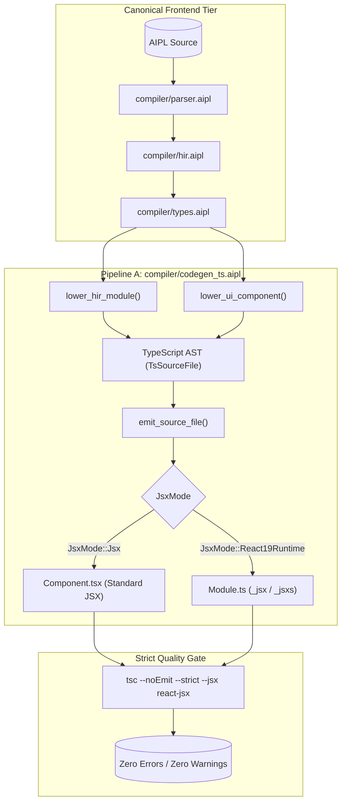

# ADR-0017: Idiomatic TypeScript & React 19 JSX Lowering Architecture

## Status
Accepted

## Date
2026-10-11

## Deciders
AIPL Architecture & Core Systems Team

## Context
AIPL is designed with an early dual-backend bifurcation architecture (see `docs/ADR/ADR-0001-dual-backend-early-bifurcation.md`):
- **Pipeline A (Web & Edge Tier)**: Targets modern JavaScript runtimes (V8, JavaScriptCore, SpiderMonkey, Bun, Deno, Cloudflare Workers, Node.js) and the React ecosystem.
- **Pipeline B (Systems Tier)**: Targets zero-GC linear WebAssembly memory and Cranelift AOT standalone native binaries.

For Pipeline A, emitting unreadable, obfuscated, or machine-heavy JavaScript (similar to Emscripten, Cheerp, or GWT output) is strictly unacceptable. Autonomous AI coding agents and human software engineers collaborate directly on emitted artifacts. Therefore, the generated TypeScript code must be:
1. **Pristine and Human-Readable**: Syntactically indistinguishable from code authored by a senior full-stack TypeScript engineer.
2. **Strictly Typed with Zero Warnings**: 100% compliant with `tsc --strict --noEmit`, with zero implicit `any`, strict null checks, and strict function types.
3. **React 19 Native**: First-class support for declarative UI `component` blocks, dot-class selector desugaring (`div.card.p-4.flex` -> `className: "card p-4 flex"`), and event handler bindings (`@click: onLogout` -> `onClick: onLogout`).
4. **Autonomous Key Synthesis**: Automatic injection of `key={item.id}` on list reconciliation iterations (`for item in items`) to prevent React runtime warnings and reconciliation degradation without manual developer intervention.
5. **Zero-Allocation Lexical Closures**: Direct mapping of AIPL closures to JavaScript arrow functions `(x) => ...`, leveraging native V8/JSC lexical scope capture rather than synthetic heap-allocated environment objects (`__env`).
6. **Native Async/Await**: Direct mapping of `is_async: true` functions to `async function` and `await expr` without generator or state-machine polyfills.

## Decision Drivers
- **Developer & Agent Ergonomics**: Emitted code must be clean, readable, editable, and tree-shakeable.
- **React 19 Ecosystem Parity**:
  - Support standard JSX format (`.tsx`) for Vite, Next.js, and Remix pipelines.
  - Support pure React 19 JSX runtime calls (`_jsx`, `_jsxs`) from `"react/jsx-runtime"` for runtime engines and edge workers without JSX build steps.
- **Automatic List Key Reconciliation**: Eliminate the single most common developer oversight in UI rendering: missing list item keys.
- **Zero Runtime Overhead**: Eliminate closure wrapper objects, environment pointers, and runtime type coercions.
- **Strict Verification SLA**: All emitted TypeScript must pass `tsc --noEmit --strict` with zero errors.

## Considered Options

### Option 1: Compile to JavaScript with External `.d.ts` Declarations
Compile Canonical HIR to ES2022 JavaScript and emit separate `.d.ts` declaration files.
- *Pros*: Faster codegen step by omitting internal TypeScript type annotations in the body.
- *Cons*: **Rejected**. Debugging is substantially more difficult because the generated code lacks inline type invariants; modern bundlers perform better type checking and tree-shaking with integrated TypeScript; human developers and AI agents inspecting the code lose type hover information in editors.

### Option 2: Compile to WebAssembly with `wasm-bindgen` for DOM/React
Execute all code inside Linear WebAssembly and bridge to React via `wasm-bindgen` and `web-sys`.
- *Pros*: Single code generator path shared with Pipeline B.
- *Cons*: **Rejected**. Generates multi-megabyte bundle sizes, introduces heavy serialization overhead across the Wasm-JS boundary, lacks React 19 Server Components compatibility, and fails the requirement for human-readable, tree-shakeable source code.

### Option 3: Dedicated High-Fidelity TypeScript AST & React 19 Lowering Engine (`compiler/codegen_ts.aipl`, originally `crates/aipl-codegen-ts`)
Implement a dedicated code generator in `compiler/codegen_ts.aipl` (originally `crates/aipl-codegen-ts`) that lowers Canonical HIR into a strongly-typed TypeScript AST (`TsSourceFile`), with specialized UI lowering for React 19:
- Direct HIR-to-TS AST pass with nominal interface emission, type aliases, and enums.
- Declarative `component` blocks lowered to typed React functional components (`export function Card({ title }: CardProps): React.ReactNode`).
- Dot-class syntax resolution (`div.card.p-4.flex` -> `className: "card p-4 flex"`).
- Event handler normalization (`@click: onLogout` -> `onClick: onLogout`).
- Automatic list-reconciliation key synthesis (`key={item.id}`).
- Dual emission modes: standard JSX (`JsxMode::Jsx`) and React 19 runtime (`JsxMode::React19Runtime`).
- Native lexical arrow closures without environment structures.
- Strict compiler verification harness via `tsc --noEmit --strict`.
- *Pros*: **Accepted**. Achieves the highest possible readability, zero runtime overhead, 100% strict typecheck cleanliness, and full React 19 parity.

## Decision Outcome & Rationale
**Chosen: Option 3 - Dedicated High-Fidelity TypeScript AST & React 19 Lowering Engine (`compiler/codegen_ts.aipl`).**

### Lowering Architecture

### Key Technical Deliverables

1. **Direct Canonical HIR Lowering (`compiler/codegen_ts.aipl`, originally `lower_hir.rs`)**:
   - `fn foo(a: int, b: str) -> bool` -> `export function foo(a: number, b: string): boolean { ... }`.
   - Primitive mappings: `int`, `float`, `num`, `byte` -> `number`, `str` -> `string`, `bool` -> `boolean`, `void` -> `void`, `nil` -> `null`.
   - Mutability: `let` -> `const`, `mut` -> `let`, `ret` -> `return`.
   - Loops: `for item in items` -> `for (const item of items)`.
   - Pattern Matching: `match` desugared into clean TS `switch` or if-else ladder.
   - Lexical Closures: Arrow functions `(x) => ...` relying on native JavaScript lexical scope without synthetic environment objects (`__env`).
   - Native `async`/`await`: `is_async: true` maps directly to `async function` and `Promise<T>`.

2. **React 19 JSX & UI Tree Lowering (`compiler/codegen_ts.aipl`, originally `lower_ui.rs`)**:
   - `component Card(title: str)` lowers to:
     - Props interface: `export interface CardProps { title: string; }`
     - Functional component: `export function Card({ title }: CardProps): React.ReactNode`
   - Dot-class syntax: `div.card.p-4.flex` -> `className: "card p-4 flex"`.
   - Event handlers: `@click: onLogout` -> `onClick: onLogout` / `onClick={onLogout}`.
   - Automatic list key synthesis: for `for item in items` loops, automatically injects `key: item.id` or `key={item.id}` onto each iteration's root element.
   - Dual emission modes:
     - `JsxMode::Jsx`: `
...
` (.tsx)
     - `JsxMode::React19Runtime`: `_jsx("div", { className: "...", children: ... })` (.ts)

3. **Validation Harness (`compiler/codegen_ts.aipl`, originally `validator.rs`)**:
   - Automatically invokes `tsc --noEmit --strict` via `bun x -p typescript tsc` or `tsc`.
   - In-process structural grammar verification ensuring zero syntax defects.

## Consequences

### Positive
- Emitted code is clean, readable, and directly maintainable by both human engineers and AI coding agents.
- React 19 functional components integrate seamlessly into Vite, Next.js, and Remix projects.
- Eliminates missing `key` warnings during list rendering through automatic compiler synthesis.
- Zero runtime overhead for closures and asynchronous routines.
- 100% strict type cleanliness verified against the official TypeScript compiler.

### Negative
- Requires maintaining dual emission pipelines (standard JSX and pure React 19 runtime).
- High-fidelity TS AST construction adds a lightweight intermediate lowering pass in Pipeline A.
