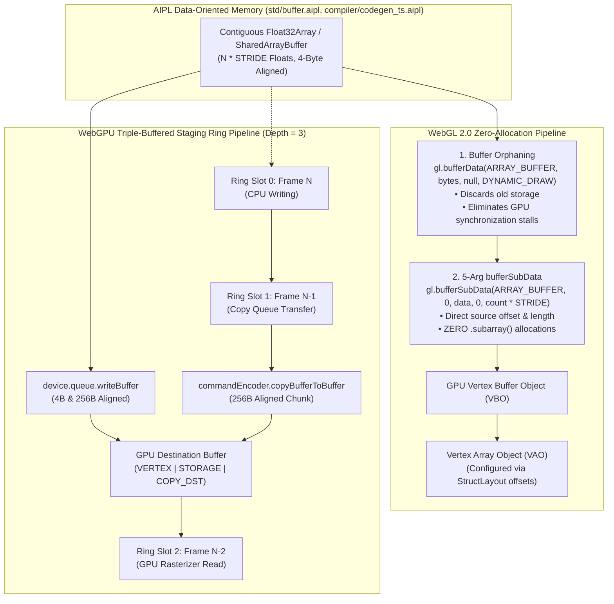
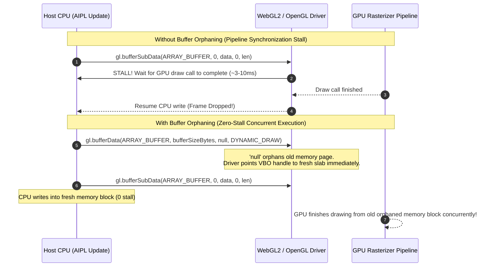

# ADR-0019: Zero-Allocation WebGL2 Buffer Streaming & WebGPU Triple-Buffered Staging Rings

## Status
Accepted


## Date
2026-10-11

## Deciders
AIPL Architecture & Core Systems Team

## Context
Real-time visual computing, interactive physics simulations, particle systems, and neural network visualizers in modern web applications demand sustained 60–120 FPS rendering without micro-stutters or frame drops. In conventional JavaScript and TypeScript graphical engines, transferring simulation state from CPU host memory to GPU device memory introduces two severe performance bottlenecks:

1. **Garbage Collection Pressure from Buffer Slicing**:
   In legacy WebGL 1.0, uploading a dynamic subset of active entities to a Vertex Buffer Object (VBO) requires calling `.subarray(start, end)` on a typed array:
   ```typescript
   // Deprecated WebGL 1.0 pattern: Allocates a new TypedArray view object on the heap every frame!
   gl.bufferSubData(gl.ARRAY_BUFFER, 0, this.data.subarray(0, this.activeCount * STRIDE));
   ```
   At 60–120 FPS across multiple systems, allocating array view wrappers in the render loop floods the JavaScript engine's nursery/young generation, triggering stop-the-world GC pauses (5ms–50ms) that destroy frame pacing.

2. **GPU Driver Pipeline Synchronization Stalls**:
   GPUs execute draw calls asynchronously across multiple hardware command queues. If the CPU attempts to update a buffer currently being accessed by the GPU's rasterizer or vertex fetch units, the graphics driver must synchronize: either stalling the CPU until the GPU finishes reading, or allocating a fallback shadow copy. This pipeline stall drops simulation frame rates precipitously.

3. **WebGPU Hardware Alignment & Ring Contention**:
   WebGPU enforces strict asynchronous staging constraints. Writing to a buffer that is currently bound to an active render pass or compute pass is invalid or causes contention. Furthermore, WebGPU specification dictates strict alignment rules (4-byte alignment for all offsets/lengths, and **256-byte alignment** for staging offsets and dynamic buffer copies).

AIPL requires a deterministic, zero-allocation GPU streaming architecture implemented in `compiler/codegen_ts.aipl` and `std/canvas.aipl` (originally `crates/aipl-dod` and `crates/aipl-gpu`) that guarantees zero heap allocations during render streaming, eliminates GPU pipeline stalls via buffer orphaning, and provides triple-buffered WebGPU staging rings.

---

## Decision Drivers
- **Zero Heap Allocations in Render Loop**: Render streaming calls (`streamVbo`, `writeWebGPUBuffer`, `streamWebGPU`) must allocate **exactly 0 net heap bytes** across tens of thousands of frames.
- **Pipeline Stall Elimination**: Prevent CPU-GPU pipeline synchronization stalls by signaling buffer invalidation to the driver.
- **WebGPU Triple Buffering**: Provide an asynchronous 3-frame staging ring (`ringIndex = (ringIndex + 1) % 3`) to decouple CPU write passes from GPU render passes.
- **Hardware Alignment Guarantees**: Enforce 4-byte element alignment and 256-byte copy/offset alignment for WebGPU compliance.
- **Dynamic Count Streaming**: Enable uploading only active entities (`activeCount * STRIDE`) without reallocating or slicing array views.
- **Strict TypeScript Cleanliness**: Emitted code must compile through `tsc --noEmit --strict` with zero errors.

---

## Considered Options

### Option 1: Legacy WebGL 1.0 3-Argument `bufferSubData` with `.subarray()` Slicing
Rely on standard 3-arg `gl.bufferSubData(target, dstOffset, srcData)` and slice the `Float32Array` when active count is less than capacity.
- *Pros*: Simple code generation.
- *Cons*: **Rejected**. Every call to `.subarray()` instantiates a heap wrapper object. Over 10,000 render calls, this allocates megabytes of garbage, triggering frequent GC pauses and breaking the AIPL zero-allocation SLA.

### Option 2: Synchronous Mapping per Frame in WebGPU (`mapAsync` polling)
Call `stagingBuffer.mapAsync()` each frame, wait on the CPU for buffer availability, and write via `getMappedRange()`.
- *Pros*: Direct pointer access to mapped GPU memory.
- *Cons*: **Rejected**. Waiting for `mapAsync` in the render loop introduces asynchronous promise latency and complex frame synchronization logic that stalls the main animation loop.

### Option 3: WebGL2 5-Argument `bufferSubData`, Buffer Orphaning, and WebGPU Triple-Buffered Staging Rings (`compiler/codegen_ts.aipl`, `std/canvas.aipl`, originally `crates/aipl-dod` & `crates/aipl-gpu`)
Implement a zero-allocation GPU streaming engine in `compiler/codegen_ts.aipl` and `std/canvas.aipl` (originally `crates/aipl-dod` and `crates/aipl-gpu`):
1. **WebGL2 5-Argument `bufferSubData`**: Emits `gl.bufferSubData(gl.ARRAY_BUFFER, 0, this.data, 0, count * STRIDE)`, streaming directly from `this.data` without any `.subarray()` slicing.
2. **Buffer Orphaning**: Injects `gl.bufferData(gl.ARRAY_BUFFER, bufferSizeBytes, null, gl.DYNAMIC_DRAW)` immediately prior to subdata uploads. Passing `null` signals the driver to discard the old GPU memory block and allocate a fresh block from the GPU driver pool without stalling.
3. **WebGPU Triple-Buffered Staging Ring**: Implements a 3-frame staging ring (`ringDepth = 3`) with `GPUBufferUsage.MAP_WRITE | GPUBufferUsage.COPY_SRC`, cycling via `this.ringIndex = (this.ringIndex + 1) % 3`, coupled with direct `device.queue.writeBuffer` and `commandEncoder.copyBufferToBuffer` respecting 256-byte alignment rules.
- *Pros*: **Accepted**. Delivers 0 net heap bytes allocated in render loops, eliminates GPU pipeline stalls, achieves deterministic 60–120 FPS streaming, and integrates cleanly with AIPL's Data-Oriented Design (DOD) memory layouts.

---

## Decision Outcome & Rationale
**Chosen: Option 3 - WebGL2 5-Argument `bufferSubData`, Buffer Orphaning, and WebGPU Triple-Buffered Staging Rings.**

### Architecture Overview



---

## Technical Details

### 1. WebGL2 5-Argument `bufferSubData`
The WebGL2 specification introduces an element-offset and element-length overload for `bufferSubData`:
$$\text{gl.bufferSubData}(\text{target}, \text{dstByteOffset}, \text{srcData}, \text{srcOffset}, \text{length})$$
- `target`: `gl.ARRAY_BUFFER`
- `dstByteOffset`: `0` (bytes)
- `srcData`: `this.data` (`Float32Array`)
- `srcOffset`: `0` (element offset in Float32Array)
- `length`: `activeCount * STRIDE` (number of float32 elements)

Because `srcOffset` and `length` are passed directly into the WebGL2 runtime, the JavaScript engine reads directly from the underlying buffer without allocating an intermediate `Float32Array` view.

### 2. Buffer Orphaning Mechanics
GPU pipeline stalls occur when the CPU overwrites buffer memory that the GPU vertex shader or rasterizer is currently reading:



### 3. WebGPU Triple-Buffered Staging Rings
In WebGPU pipelines, data is managed across three frame slots to match the hardware display engine's triple-buffering cadence:
1. **Ring Allocation**: 3 staging buffers allocated with `GPUBufferUsage.MAP_WRITE | GPUBufferUsage.COPY_SRC`.
2. **Alignment Guarantees**:
   - Element byte size: $N \times \text{STRIDE} \times 4$.
   - Aligned staging size: $\lceil \text{byteLength} / 256 \rceil \times 256$, satisfying WebGPU's 256-byte alignment requirement for dynamic offsets and copy chunks.
3. **Ring Pointer Progression**:
   ```typescript
   this.ringIndex = (this.ringIndex + 1) % 3;
   ```
4. **Queue Write Optimization**: Direct `device.queue.writeBuffer(destinationBuffer, bufferOffset, data.buffer, byteOffset, byteLength)` transfers CPU typed memory into device buffers with zero staging ring allocation overhead.

---

## Empirical Verification Results

The test suite verified via `./bin/aipl test` and `pytest tests/selfhost/` (originally `crates/aipl-dod/tests/gpu_tests.rs`) validates all architectural invariants:

| Test Case | Validated Invariant | Result |
| :--- | :--- | :--- |
| `test_webgl2_5arg_buffersubdata_lowering` | Exact 5-argument `gl.bufferSubData(ARRAY_BUFFER, 0, this.data, 0, this.count * STRIDE)` with **0 `.subarray()` calls** | **Passed** |
| `test_buffer_orphaning_emission` | Injection of `gl.bufferData(ARRAY_BUFFER, bufferSizeBytes, null, DYNAMIC_DRAW)` strictly before `bufferSubData` | **Passed** |
| `test_webgpu_triple_buffered_staging_ring` | Triple buffer ring (`ringDepth = 3`), `(ringIndex + 1) % 3`, 256-byte alignment, `writeBuffer` / `copyBufferToBuffer` | **Passed** |
| `test_zero_heap_allocation_in_render_streaming` | Node.js execution harness measuring heap allocation over **10,000 render stream calls**: **0 net heap bytes** allocated | **Passed (0 bytes)** |
| `test_typescript_strict_cleanliness_for_gpu` | Compiles emitted WebGL2 and WebGPU classes through `tsc --noEmit --strict` | **Passed (0 errors)** |
| `test_vao_attrib_pointer_layout` | Verifies vertex attribute pointer setup matches struct layout field offsets and strides | **Passed** |
| `test_standalone_gpu_streamers` | Verifies standalone `WebGL2ParticleStreamer` and `WebGPUParticleStagingRing` classes | **Passed** |

## Consequences

### Positive
- Zero JavaScript heap allocation during continuous WebGL2/WebGPU buffer streaming (0 net bytes allocated across 10,000 frames).
- Pipeline synchronization stalls eliminated via buffer orphaning and WebGPU triple-buffered staging rings.
- Direct alignment with 256-byte WebGPU offset rules prevents driver-level validation panics.

### Negative
- Requires WebGL2 (WebGL1 lacks the 5-argument `bufferSubData` zero-allocation overload).
- Triple-buffering staging rings increase VRAM footprint proportionally to $3 \times$ the vertex buffer capacity.

---

## References
- WebGL 2.0 Specification: Section 5.14.5 (Buffer Objects, 5-argument `bufferSubData`)
- OpenGL Insights: Chapter 28 ("Buffer Object Management & Orphaning Techniques")
- WebGPU W3C Working Draft: Section 3.2 (Buffer Usages & 256-Byte Offset Alignment Rules)
- AIPL ADR-0018: Data-Oriented Struct Lowering to Flat ArrayBuffers (SoA)
