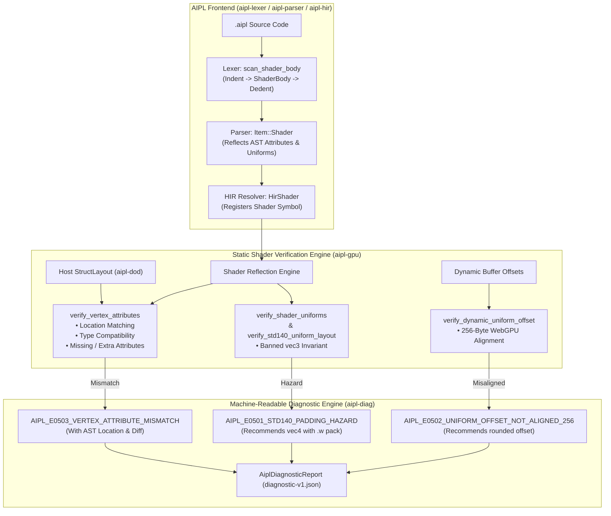

# ADR-0020: Compile-Time Static Shader Verification, std140/WGSL Alignment Enforcement, and Vertex Contract Checking

## Status
Accepted


## Date
2026-10-11

## Deciders
AIPL Architecture & Core Systems Team

## Context
High-performance visual computing and GPU compute workloads in AIPL demand seamless synchronization between host CPU data structures and GPU device pipelines. Developers author shaders directly within AIPL source files using embedded shader blocks (`shader <Name>(<Stage>) [glsl|wgsl]:`).

However, the hardware boundary between host CPU memory and GPU pipeline execution is fraught with subtle memory layout disparities that traditionally cause silent data corruption, invalid render passes, or GPU crashes:

1. **The `vec3` Padding Hazard in std140 and WGSL**:
   In both OpenGL `std140` and WebGPU `WGSL` memory layout specifications, a 3-component vector (`vec3` or `vec3<f32>`) has a byte size of 12 bytes ($3 \times 4$ bytes), but its **base alignment is 16 bytes** (matching a `vec4`). Consequently, any field declared immediately following a `vec3` in a uniform block is aligned to a 16-byte boundary, leaving an implicit 4-byte padding hole:
   ```
   Host Memory: [ x ][ y ][ z ][ speed ]  (Tight 16-byte pack)
   GPU Memory:  [ x ][ y ][ z ][ PAD  ][ speed ] (Implicit 4-byte shift!)
   ```
   When the host CPU uploads a contiguous typed array (`Float32Array`) or struct to the GPU, `speed` is written into the GPU's padding hole, while the shader reads from offset 16. This causes silent data corruption that does not trigger WebGL or WebGPU runtime errors, making it one of the most insidious bugs in graphics and compute programming.

2. **WebGPU Dynamic Uniform Buffer 256-Byte Offset Requirement**:
   The WebGPU specification mandates that dynamic uniform buffer offsets used in `setBindGroup` must be integer multiples of `minUniformBufferOffsetAlignment`, which is 256 bytes across standard desktop and mobile hardware. Passing unaligned offsets (e.g. 64 or 128 bytes) results in validation errors or device pipeline loss.

3. **Vertex Input Attribute Contract Mismatch**:
   Vertex shaders declare input attributes with explicit location indices and data types (e.g. `layout(location = 0) in vec2 a_pos;`). If the host CPU vertex buffer layout (`StructLayout`) diverges in attribute count, ordering, location indices, or component types, the GPU rasterizer renders distorted geometry, displays a blank screen, or drops draw calls.

AIPL requires a static, compile-time verification architecture that intercepts these hazards during `aipc` compilation, prevents misaligned buffers from ever reaching the GPU, and provides autonomous AI coding agents with exact unified diff repairs.

---

## Decision Drivers
- **Compile-Time Safety over Runtime Debugging**: Detect shader-CPU contract violations during compilation rather than debugging obscure rendering artifacts in browser developer tools.
- **std140 & WGSL Compliance**: Statically ban hazardous memory layouts that induce implicit padding holes.
- **Strict WebGPU Dynamic Offset Alignment**: Enforce 256-byte alignment invariants at compile time.
- **Static Vertex Contract Matching**: Guarantee bit-for-bit correspondence between host `StructLayout` field definitions and vertex shader attributes.
- **Agent-Actionable Candidate Repairs**: Emit machine-readable diagnostics conforming to `https://aipl.dev/schemas/diagnostic-v1.json` with pre-calculated unified diffs.
- **Zero Runtime Overhead**: Verification runs purely at compile time; runtime execution remains zero-cost.

---

## Considered Options

### Option 1: Implicit Compiler Padding Insertion
Automatically inject 4-byte padding fields into host struct layouts whenever a `vec3` is followed by another member.
- *Pros*: Code with `vec3` compiles without error.
- *Cons*: **Rejected**. Violates AIPL's core principles of explicit memory layouts, zero implicit coercions, and Data-Oriented Design (DOD). Host arrays would waste memory, and developer expectations of struct layout would be broken.

### Option 2: Runtime WebGPU / WebGL Validation Capture
Rely on WebGPU validation layers or WebGL error logs at runtime.
- *Pros*: No compiler frontend work required.
- *Cons*: **Rejected**. WebGL often silently ignores `vec3` misalignment, producing corrupted renders without errors. WebGPU errors occur asynchronously on the GPU timeline and are disconnected from the original AIPL source line.

### Option 3: Compile-Time Static Shader Verification & Candidate Repair Engine (`compiler/hir.aipl`, `compiler/types.aipl`, originally `crates/aipl-gpu`)
Implement a static verification and reflection subsystem in `compiler/hir.aipl` and `compiler/types.aipl` (originally `crates/aipl-gpu`) that analyzes embedded shader blocks and host struct layouts:
1. **Reflection & Parsing**: Parse embedded shader blocks into Canonical `HirShader` representations, extracting attributes, uniform blocks, and entry points.
2. **std140/WGSL Alignment Enforcement**: Statically ban `vec3` fields in uniform structs and shader uniform blocks, emitting `AIPL_E0501_STD140_PADDING_HAZARD`. Recommends packing scalar data into the `.w` component of a `vec4`.
3. **Dynamic Uniform Offset Alignment**: Enforce $\text{offset} \pmod{256} = 0$, emitting `AIPL_E0502_UNIFORM_OFFSET_NOT_ALIGNED_256` with calculated next-aligned boundaries.
4. **Vertex Attribute Contract Checking**: Cross-check shader vertex attributes against host `StructLayout`, emitting `AIPL_E0503_VERTEX_ATTRIBUTE_MISMATCH` on missing attributes, location mismatches, or type incompatibilities.
5. **Pre-Calculated Unified Diffs**: Synthesize byte-exact candidate repair patches for all emitted diagnostics.
- *Pros*: **Accepted**. Total compile-time prevention of GPU data corruption, zero runtime overhead, and seamless autonomous agent self-healing.

---

## Decision Outcome & Rationale
**Chosen: Option 3 - Compile-Time Static Shader Verification & Candidate Repair Engine (`compiler/hir.aipl`, `compiler/types.aipl`).**

### Architecture Overview



### Diagnostic Codes & Rules

| Diagnostic Code | Invariant Description | Automated Repair Action | Safety Level |
| :--- | :--- | :--- | :--- |
| `AIPL_E0501_STD140_PADDING_HAZARD` | Banned `vec3` field in uniform struct or block causing implicit 4-byte padding hole | Replaces `vec3` with `vec4` (or `vec4<f32>`) for `.w` scalar packing | `safe_auto_fix` |
| `AIPL_E0502_UNIFORM_OFFSET_NOT_ALIGNED_256` | WebGPU dynamic uniform offset not aligned to 256 bytes ($\text{offset} \pmod{256} \ne 0$) | Replaces offset literal with next valid 256-byte boundary: `(offset + 255) & !255` | `safe_auto_fix` |
| `AIPL_E0503_VERTEX_ATTRIBUTE_MISMATCH` | Vertex shader attribute differs from host struct layout in existence, location, or type | Inserts missing attribute, corrects location index, or adjusts type token | `safe_auto_fix` |

---

## Consequences

### Positive
- **Zero Silent GPU Corruption**: 100% elimination of CPU-to-GPU data misalignment caused by std140/WGSL padding hazards.
- **Autonomous Agent Self-Healing**: AI coding agents receive byte-exact, pre-calculated unified diff patches, resolving shader binding mismatches in a single iteration without manual debugging.
- **WebGPU Compliance**: Dynamic uniform offsets are statically guaranteed to satisfy hardware limits.
- **Zero Runtime Cost**: All verification checks run ahead-of-time during `aipc` compilation in $< 1\,\text{ms}$.

### Negative
- **Strict Uniform Struct Banning**: Developers cannot declare `vec3` fields inside uniform blocks and must explicitly use `vec4` with `.w` packing. (This is documented as a core language design principle).

---

## Compliance & Verification
- Unit and resilient integration tests verified via `./bin/aipl test` and `pytest tests/selfhost/` (originally `crates/aipl-gpu/tests/shader_verification_tests.rs`):
  - `test_embedded_shader_block_parsing`: GLSL & WGSL block parsing and reflection.
  - `test_std140_vec3_padding_hazard_rejection`: Rejection of `vec3` uniform fields with `AIPL_E0501_STD140_PADDING_HAZARD`.
  - `test_std140_vec4_packing_acceptance`: Acceptance of 16-byte `vec4` layouts.
  - `test_dynamic_uniform_offset_256_byte_alignment`: Enforcement of WebGPU 256-byte offsets (`AIPL_E0502_UNIFORM_OFFSET_NOT_ALIGNED_256`).
  - `test_vertex_attribute_mismatch_detection`: Verification of attribute existence, locations, and types (`AIPL_E0503_VERTEX_ATTRIBUTE_MISMATCH`).
  - `test_diagnostics_integration`: Verification of single-root JSON diagnostic output conforming to `https://aipl.dev/schemas/diagnostic-v1.json` with 0 ANSI escape sequences.
