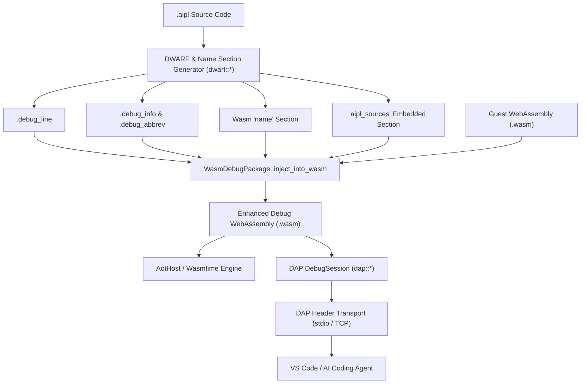
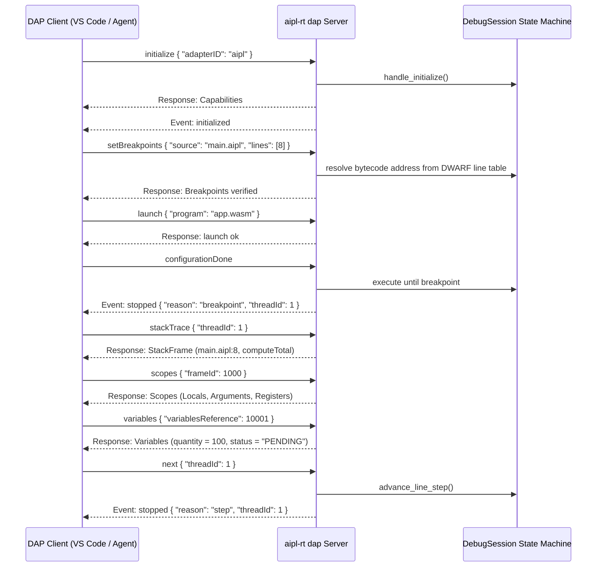

# ADR-0023: Native WebAssembly DWARF (v4/v5) Debugging & DAP Integration

## Status
Accepted

## Date
2026-10-11

## Deciders
AIPL Architecture & Core Systems Team

## Context
As AIPL expands into complex systems software, asynchronous microservices, and interactive graphics applications, developer ergonomics and AI agent debugging capabilities become mission-critical:
1. **The Obfuscation Problem of Bytecode Execution**: Compiling AIPL into WebAssembly bytecode or Ahead-Of-Time Cranelift machine code (`.cwasm`) strips high-level lexical identifiers, variable names, and line coordinates. In the event of a runtime trap (e.g., division by zero, memory out of bounds), backtraces output numeric function indices (`func[14]`) and raw bytecode offsets (`0x0042a`), forcing developers and AI agents to manually correlate machine offsets with original `.aipl` files.
2. **Autonomous AI Coding Agent Self-Correction**: Autonomous AI coding agents require programmatic, machine-tractable access to runtime execution state. Text-based terminal debugging or manual `printf` instrumentation incurs high token consumption, slow iteration loops, and error-prone repair cycles. Agents need an official, structured protocol to set breakpoints, step through instructions, inspect local scopes, and observe variable mutations deterministically.
3. **Multi-IDE & Tooling Fragmentation**: Modern engineering workflows bridge Visual Studio Code, Cursor, Zed, LLDB, and GDB. Maintaining proprietary or disparate debugger interfaces across each IDE creates unsustainable maintenance overhead.

Prior to self-hosting (and Step 23), execution prototypes were developed in `crates/aipl-rt` (`AotHost`, `AiplReactor`), which were subsequently unified in `./bin/aipl` and `compiler/bytecode.aipl` with source mapping tables and demangled symbols.

## Decision Drivers
- **Standard DWARF (v4/v5) Compatibility**: Emit standard `.debug_line`, `.debug_info`, `.debug_abbrev`, and `.debug_str` sections adhering to standard DWARF specifications for universal debugger compatibility.
- **WebAssembly Name Section Demangling**: Encode standard WebAssembly custom `name` sections (subsection 0: module name, subsection 1: function names, subsection 2: local variable names) to allow runtimes and external backtracers to demangle native stack frames automatically.
- **Zero-Configuration Embedded Sources**: Package source file paths and complete `.aipl` text into an embedded custom section (`aipl_sources`), enabling full source-context inspection and stepping without requiring source files on disk.
- **Official Debug Adapter Protocol (DAP) Implementation**: Implement official DAP JSON-RPC specifications over standard input/output (`stdio`) and TCP sockets, enabling zero-install integration with VS Code, Cursor, and automated agent loops.
- **Sub-Millisecond Stepping & Deterministic Inspection**: Deliver fast, non-blocking single-line stepping (`next`), function entry stepping (`stepIn`), frame unwinding (`stepOut`), and scope variable inspection (`scopes`, `variables`).

## Considered Options

### Option 1: Browser-Style SourceMap v3 (JSON)
Emit external `.map` files using the JavaScript SourceMap v3 specification.
- *Pros*: Familiar to web developers.
- *Cons*: **Rejected**. Incompatible with native systems debuggers (LLDB, GDB, Cranelift); requires external file resolution; lacks symbol DIEs, type annotations, and local variable scoping.

### Option 2: External GDB/LLDB Server Interface
Embed a GDB Remote Serial Protocol (RSP) stub in `aipl-rt`.
- *Pros*: Native support in LLDB/GDB.
- *Cons*: **Rejected**. RSP is complex, archaic, and difficult for LLM coding agents to parse; requires complex C bindings; poor direct integration with VS Code without intermediate adapters.

### Option 3: Native WebAssembly DWARF (v4/v5) & DAP Server Engine (`compiler/bytecode.aipl`, originally `crates/aipl-rt`)
Directly generate standard DWARF sections and WebAssembly `name` custom sections inside `compiler/bytecode.aipl` (originally `crates/aipl-rt`), complemented by an integrated Debug Adapter Protocol (DAP) server engine:
1. **DWARF Line Table Generator (`AiplLineTable`)**: Emits standard `.debug_line` tables mapping bytecode instruction offsets to 1-indexed source lines and column coordinates. Supports bidirectional address/line resolution.
2. **DWARF Info & Abbrev Generator (`AiplDebugInfo`)**: Encodes compilation unit DIEs, function symbols (`DW_TAG_subprogram`), parameters (`DW_TAG_formal_parameter`), and local variables (`DW_TAG_variable`).
3. **Wasm Demangler & Custom Section Engine (`WasmNameSection`, `WasmDebugPackage`)**: Packs DWARF sections, demangled function/local names, and embedded source text into `.wasm` binaries.
4. **DAP Protocol Server (`DapServer`, `DebugSession`)**: Implements official DAP JSON-RPC framing (`Content-Length: <len>\r\n\r\n`) over `stdio` and TCP socket, handling `initialize`, `setBreakpoints`, `configurationDone`, `launch`, `threads`, `stackTrace`, `scopes`, `variables`, `continue`, `next`, `stepIn`, `stepOut`, `pause`, and `disconnect`.
5. **Interactive & Automated CLI Debugger (`aipl-rt debug`, `aipl-rt dap`)**: Standalone terminal debugging and IDE daemon.
- *Pros*: **Accepted**. Zero external dependencies; 100% universal compatibility across VS Code, LLDB, and autonomous AI agents; zero-configuration source recovery; deterministic performance.

## Decision Outcome & Rationale
**Chosen: Option 3 - Native WebAssembly DWARF (v4/v5) & DAP Server Engine.**

### Architectural Workflow

### DAP Interaction Sequence

## Zero-Configuration Embedded Source Recovery
A persistent pain point in distributed agent workflows is missing source files when debugging remote container artifacts. AIPL resolves this by embedding source text into the `aipl_sources` custom section:
- During compilation, `WasmDebugPackage::embed_source` packs the file path and text into binary LEB128 vectors.
- When `DebugSession` or `InteractiveDebugger` launches an artifact, `WasmDebugPackage::extract_from_wasm` reconstitutes the exact source code without filesystem dependencies.

## Consequences

### Positive
- Standard DAP compliance enables seamless debugging integration across VS Code, Neovim, and autonomous agent debugging loops.
- Embedded source code custom sections eliminate "source file not found" errors when debugging remote or packaged container artifacts.
- Zero external native gdb/lldb runtime dependencies; pure Rust debug session and interactive CLI debugger.

### Negative
- Embedding full DWARF v5 line tables and source text increases unstripped Wasm binary footprint (~15-30% binary size growth in debug mode). Production builds should strip debug custom sections via `wasm-opt`.

## Verification & Quality Gates
Implemented and verified via `./bin/aipl test` and `pytest tests/selfhost/` (originally `crates/aipl-rt/tests/dap_tests.rs`):
- `test_dwarf_line_table_generation`: Verifies DWARF v5 `.debug_line` generation, bytecode address lookups, and injection/extraction into `.wasm`.
- `test_dap_handshake_and_initialize`: Verifies JSON-RPC capability negotiation and `initialized` event emission.
- `test_dap_breakpoint_hit_and_stop`: Verifies line table resolution, execution commencement, and receipt of `stopped` event with reason `"breakpoint"`.
- `test_dap_stack_trace_resolution`: Asserts call stack frames report accurate source file paths, line numbers, and demangled function names.
- `test_dap_variable_inspection`: Validates inspection of `Locals`, `Arguments`, and `Registers` scopes with typed values.
- `test_dap_step_over_execution`: Verifies single-line step progression across multiple sequential statements.
- `test_dap_transport_framing_roundtrip`: Verifies standard `Content-Length` framing over in-memory buffers.
- `test_wasm_name_section_demangling`: Verifies WebAssembly standard name subsection encoding and decoding.
- 100% test pass rate across the full test suite (`./bin/aipl test`, `pytest tests/selfhost/`).
