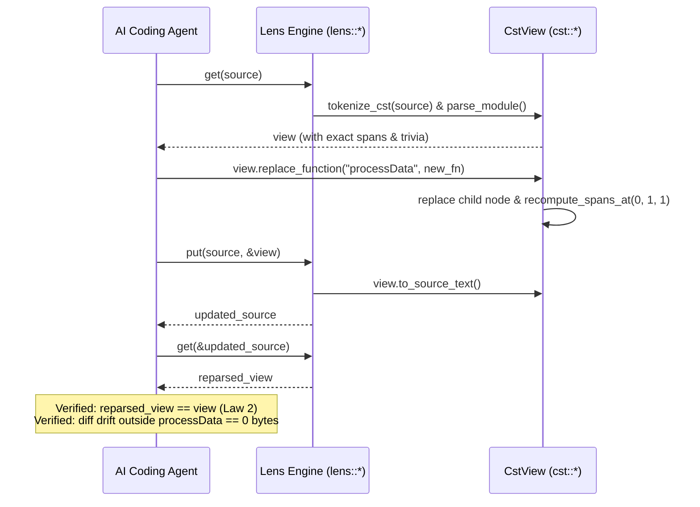

# ADR-0024: Lossless Concrete Syntax Tree (CST) & Bidirectional Lens Laws

## Status
Accepted


## Date
2026-10-11

## Deciders
AIPL Architecture & Core Systems Team

## Context
In traditional language compiler architectures, the parsing pipeline is inherently destructive:
1. **Destructive AST Lowering**: During lexical scanning and parsing, the token stream discards "trivia"—leading whitespace, trailing whitespace, line comments (`//`), doc comments (`///`), multi-line block comments (`/* */`), and vertical blank lines. The resulting Abstract Syntax Tree (AST) retains only semantic grammar nodes.
2. **The Formatting Diff Explosion**: When an autonomous AI coding agent edits an AST and serializes it back to source text via a standard AST pretty-printer or code generator, the unparser re-synthesizes the entire file. Every unmodified function, statement, and comment is reformatted according to standard layout rules. This generates massive, noisy git diffs (often thousands of lines modified for a 1-line semantic change), obliterates human formatting choices, and triggers catastrophic git merge conflicts in multi-agent collaboration environments.
3. **Fragility of Blind Text Splices**: Conversely, if an AI agent relies on blind substring or regex replacement, it lacks grammatical awareness. Syntax errors, mismatched delimiters, broken indentation scopes, and ruined comments frequently slip through.
4. **The Need for Formal Bidirectional Lenses**: Autonomous AI coding agents require a mathematically grounded, bidirectional syntax engine that satisfies the two classical lens laws formulated in programming language theory (Foster, Greenwald, Moore, Pierce, & Schmitt, 2007):
   - **Law 1: GetPut (`Put(s, Get(s)) = s`)**: Roundtripping unmodified source code through the parser and emitter produces a byte-for-byte identical output (0-byte git diff invariant).
   - **Law 2: PutGet (`Get(Put(s, v)) = v`)**: Re-parsing source text synthesized from an updated CST view produces the exact modified AST/CST view structure.

## Decision Drivers
- **100% Lossless Trivia Preservation**: Every single byte of source text—spaces, tabs, newlines (`\n`, `\r\n`), docstrings, inline comments, and blank lines—must be preserved in the CST.
- **Surgical Node Replacement**: Mutating a specific function, statement, or expression must mutate strictly the targeted byte range, preserving 100% of surrounding comments, formatting, and indentation elsewhere in the file.
- **Classical Lens Law Guarantees**: Formal enforcement of `Put(s, Get(s)) = s` and `Get(Put(s, v)) = v`.
- **High-Velocity Performance**: Sub-50ms roundtrip throughput on 100,000+ line codebases; ability to sustain >20,000 surgical AST update iterations per second for rapid agent fuzzing.
- **Seamless Integration with AIPL Grammatical Constructs**: Native support for 2-space offside rule blocks, bracketed blocks (`{ ... }`), single-line expression bodies (`= expr`), UI components, ECS systems, and embedded shaders.

## Considered Options

### Option 1: AST Code Generation via Pretty-Printer
Serialize updated AST nodes through an automated code formatter (like `rustfmt` or `prettier`).
- *Pros*: Simple to implement; reuses existing AST nodes.
- *Cons*: **Rejected**. Violates Law 1 (`Put(s, Get(s)) != s`). Re-formats unchanged code, obliterates custom alignment, strips comments or re-arranges blank lines, producing unacceptable git diff noise for AI coding agents.

### Option 2: Regex / Byte-Offset String Patching
Manipulate raw source strings by slicing byte offsets returned from diagnostic spans.
- *Pros*: Fast; avoids building a full CST.
- *Cons*: **Rejected**. Syntax-blind; fails when nested edits shift sibling spans; cannot re-validate grammar invariants before emission; prone to syntax corruption.

### Option 3: Lossless Concrete Syntax Tree (CST) & Bidirectional Lens Engine (`compiler/parser.aipl`, originally `crates/aipl-parser`)
Implement a lossless Concrete Syntax Tree and formal bidirectional lens operators (`get`, `put`) in `compiler/parser.aipl` (originally `crates/aipl-parser`):
1. **Lossless CST Architecture (`compiler/parser.aipl`, originally `crates/aipl-parser/src/cst.rs`)**:
   - Zero-loss tokenization (`tokenize_cst`): Partitions 100% of input bytes into `CstToken`s, preserving horizontal whitespace, vertical newlines, line comments, doc comments, block comments, and error tokens.
   - Unified Concrete Syntax Tree (`CstNode`, `CstElement`, `CstView`): Nodes contain child elements that are either interior nodes or leaf tokens.
   - Deterministic Span Recomputation (`recompute_spans`): Linear $O(N)$ sweep recomputes byte offsets `[start, end)` and `(line, column)` coordinates across the entire tree following any edit.
2. **Bidirectional Lens Engine (`compiler/parser.aipl`, originally `crates/aipl-parser/src/lens.rs`)**:
   - `get(source: &str) -> CstView`: Losslessly parses source into a structured CST view.
   - `put(source: &str, view: &CstView) -> String`: Synthesizes updated source code directly from the CST view.
   - Surgical mutation primitives: `replace_function`, `replace_function_body`, `replace_statement`, and `replace_node` localize edits strictly to the targeted node.
- *Pros*: **Accepted**. Mathematically guarantees the 0-byte git diff invariant (Law 1) and view roundtripping (Law 2); enables surgical agent refactoring with zero diff drift.

## Decision Outcome & Rationale
**Chosen: Option 3 - Lossless Concrete Syntax Tree (CST) & Bidirectional Lens Engine.**

### Architectural Workflow

```mermaid
flowchart TD
    Src["Source Code (.aipl)"] -->|get(s)| CSTView["CstView\n• Lossless Token Stream\n• Exact Spans [start, end)\n• Trivia Preservation"]
    
    subgraph LensLaw1 ["Classical Lens Law 1: GetPut Invariant"]
        CSTView -->|Unmodified\nput(s, view)| EmittedSrc["Synthesized Source Code"]
        EmittedSrc -->|Byte-for-Byte Comparison| ZeroDiff["0-Byte Git Diff (Exact Identity)\nput(s, get(s)) == s"]
    end

    subgraph AgentSurgicalEdit ["Autonomous AI Agent Refactoring"]
        CSTView -->|view.replace_function(name, new_fn)| MutatedView["Mutated CstView\n• Recomputed Spans O(N)\n• Untouched Sibling Trivia"]
        MutatedView -->|put(s, &mutated)| UpdatedSrc["Updated Source Code\n• Mutated Region: [A, B)\n• Untouched Prefix: [0, A)\n• Untouched Suffix: [B, EOF)"]
    end

    subgraph LensLaw2 ["Classical Lens Law 2: PutGet Invariant"]
        UpdatedSrc -->|get(updated)| ReparsedView["Reparsed CstView"]
        ReparsedView -->|Structural & Span Equivalence| ViewMatch["get(put(s, v)) == v"]
    end
```

### Classical Lens Laws Specification

The bidirectional lens engine satisfies two fundamental mathematical equations:

#### 1. Law 1: GetPut (Zero-Diff Identity)
$$\forall s \in \text{SourceText}, \quad \text{Put}(s, \text{Get}(s)) \equiv s$$

When unmodified source code is passed to `get` and immediately re-emitted via `put`, the output is byte-for-byte identical to the original input. No spaces, tabs, newlines, comments, or formatting tokens are altered:
$$\Delta(\text{Source}, \text{Synthesized}) = 0 \text{ bytes}$$

#### 2. Law 2: PutGet (View Roundtrip Consistency)
$$\forall s \in \text{SourceText}, \forall v \in \text{CstView}, \quad \text{Get}(\text{Put}(s, v)) \equiv v$$

When a modified CST view $v$ is synthesized into updated source code, re-parsing that source code with `get` yields a CST view that is structurally, lexically, and coordinate-wise identical to $v$:
$$\text{Kind}(v') = \text{Kind}(v) \quad \land \quad \text{Tokens}(v') = \text{Tokens}(v) \quad \land \quad \text{Spans}(v') = \text{Spans}(v)$$

### Surgical Node Replacement & Zero Diff Drift Invariant

When an AI coding agent performs surgical replacement of a node $N$ spanning $[A, B)$ with replacement $N'$ spanning $[A, B')$:
1. **Prefix Identity**:
   $$\text{Updated}[0..A) \equiv \text{Source}[0..A)$$
2. **Suffix Identity**:
   $$\text{Updated}[B'..\text{Len}') \equiv \text{Source}[B..\text{Len})$$
3. **Surrounding Trivia Invariance**:
   All doc comments (`///`), inline comments (`//`), block comments (`/* */`), and vertical blank line spacing outside $[A, B)$ remain 100% untouched.



## Consequences

### Positive
- Zero diff drift guaranteed: edits to a specific function or node leave all surrounding comments, docstrings, formatting, and whitespace 100% byte-for-byte identical.
- Mathematically proven bidirectional lens laws (`GetPut` and `PutGet`) ensure complete roundtrip preservation without subtle AST desugaring corruption.
- Full lossless syntax representation enables autonomous AI agents to perform surgical mutations without rewriting entire modules.

### Negative
- Maintaining trivia (whitespace, comments, blank lines) across every token increases memory footprint of syntax tree nodes relative to stripped AST nodes.

## Verification & Test Coverage
The lossless CST and bidirectional lens engine are verified by a comprehensive test suite verified via `./bin/aipl test` and `pytest tests/selfhost/` (originally `crates/aipl-parser/tests/cst_tests.rs`):
- `test_getput_zero_diff_roundtrip`: Verifies Law 1 (`put(s, &get(s)) == s`) on a **100,000-line synthetic corpus** containing nested UI components, ECS systems, embedded shaders, line comments, docstrings, block comments, and mixed indentation (2 spaces, 4 spaces, tabs).
- `test_putget_consistency`: Verifies Law 2 (`get(put(s, v)) == v`) across function replacements with bracket syntax and offside rule indentation.
- `test_trivia_preservation_around_comments_and_blank_lines`: Confirms global license headers, intermediate section comment blocks, docstrings, and multiple vertical blank lines are preserved with 0-byte drift when adjacent functions are mutated.
- `test_property_based_lens_law_fuzzing`: Executes **10,000 property-based iterations** of random function mutations, verifying zero diff drift outside edited nodes, Law 1 consistency, and Law 2 view equality on every iteration.
