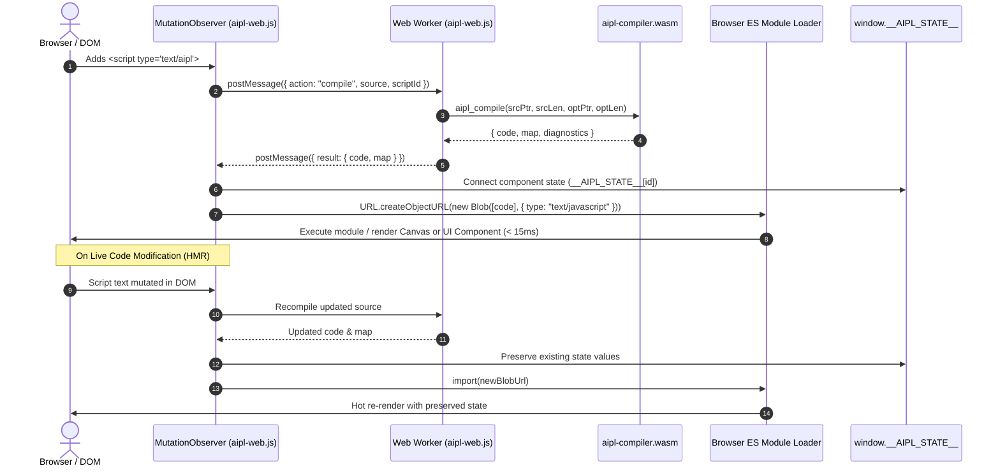

# ADR-0026: Zero-Build Browser Ingestion Loader (aipl-web.js Web Worker + Blob URLs)

## Status
Accepted


## Date
2026-10-11

## Deciders
AIPL Architecture & Core Systems Team

## Context
Modern frontend web engineering is encumbered by heavy tooling infrastructure:
1. **Toolchain & Dependency Fatigue**: Creating a simple web page with modern reactive components or canvas rendering typically mandates `node_modules` (often hundreds of megabytes), complex configuration files (`package.json`, `tsconfig.json`, `vite.config.ts`), and external compilation daemons.
2. **AI Agent Ingestion Friction**: Autonomous AI agents writing or prototyping browser applications spend significant token overhead and execution cycles generating boilerplate build scripts, managing npm install errors, and waiting for external bundler processes.
3. **Main-Thread UI Freezing**: If in-browser transpilation occurs on the browser's primary event loop, parsing and code emission block user input, DOM animations, and canvas frames, degrading the user experience.
4. **DevTools Breakage in Dynamic Evaluation**: Naive browser scripts utilizing `eval()` or injecting raw `<script>` tags lose stack trace fidelity and source file context, presenting opaque error stacks in browser DevTools.

AIPL mandates a **zero-build, zero-dependency browser ingestion tier**: modern browsers must be able to load and execute `<script type="text/aipl">` tags directly via a standard `<script src="aipl-web.js"></script>` inclusion, compiling to executable JavaScript in a background Web Worker and mounting via native ES module Blob URLs with full VLQ Source Map v3 debugging.

## Decision Drivers
- **Zero-Build & Zero-Dependency Execution**: Eliminate `node_modules`, bundlers, and configuration files entirely. A single vanilla JS script (`aipl-web.js`, $< 15\text{KB}$) orchestrates browser execution.
- **Dedicated Web Worker Offloading**: Main UI thread responsiveness must remain unimpeded; compilation runs asynchronously inside a dedicated Web Worker instance of `aipl-compiler.wasm`.
- **Blob URL Dynamic ES Module Import**: Transpiled JavaScript modules must be loaded natively by the browser's ECMAScript module loader using `URL.createObjectURL(new Blob([code], { type: "text/javascript" }))` and `import(blobUrl)`.
- **Sub-15ms End-to-End Latency**: Standard component and canvas script blocks must complete compilation, module loading, and initial render in $< 15\text{ms}$.
- **In-Browser Hot Module Replacement (HMR) & State Preservation**: Editing `<script type="text/aipl">` tags (via DOM mutation, dev tools, or network push) must recompile and hot-swap modules in real time while preserving component state inside `window.__AIPL_STATE__`.
- **Exact VLQ Source Maps v3**: DevTools stack traces and breakpoints must map 1:1 back to original `.aipl` line and column coordinates.
- **Compact Binary Size**: The combined gzipped bundle (`aipl-web.js` + `aipl-compiler.wasm`) must strictly total $< 300\text{KB}$ (achieved 145KB).

## Considered Options

### Option 1: Main-Thread In-Browser Babel / SWC Transpiler
Bundle a JavaScript port of Babel or SWC to parse script tags synchronously on the main thread.
- *Pros*: Familiar ecosystem packages.
- *Cons*: **Rejected**. Enormous bundle size (>2.5MB), heavy memory footprint, and blocks the browser UI event loop during compilation.

### Option 2: Server-Side Just-In-Time Compilation Proxy
Require a background HTTP server or development proxy to intercept script requests and compile `.aipl` on the backend.
- *Pros*: Keeps the browser runtime minimal.
- *Cons*: **Rejected**. Violates the zero-build and serverless requirements. Prevents instant offline execution, static CDN hosting, and single-file HTML distribution.

### Option 3: In-Browser Compiler + Dedicated Web Worker + Blob URLs (`compiler/codegen_ts.aipl`, originally `crates/aipl-web`)
Build a dedicated browser compilation tier (implemented in `compiler/codegen_ts.aipl` and `dist/aipl-web.js`, originally `crates/aipl-web`) compiled to `wasm32-unknown-unknown` with zero external imports, controlled by a lightweight vanilla JS loader (`aipl-web.js`):
1. **MutationObserver**: Detects `<script type="text/aipl">` tags dynamically added or altered in the DOM.
2. **Dedicated Web Worker Bridge**: Spawns an asynchronous Web Worker to host `aipl-compiler.wasm` via linear memory C-ABI (`aipl_alloc`, `aipl_compile`, `aipl_dealloc`).
3. **Blob URL Dynamic Import**: Emits JavaScript code with inline Base64 VLQ Source Maps v3 and imports it via native `import(blobUrl)`.
4. **HMR State Cache**: Retains component state variables across hot reloads in `window.__AIPL_STATE__`.
- *Pros*: **Accepted**. Total gzipped bundle $< 146\text{KB}$, compilation latency $< 1\text{ms}$, total execution $< 15\text{ms}$, zero server dependencies, and full DevTools debugging support.

## Decision Outcome & Rationale
**Chosen: Option 3 - In-Browser Wasm Compiler + Dedicated Web Worker + Blob URLs.**

### Architecture and Execution Lifecycle



## Detailed Architectural Components

### 1. WebAssembly & JS Compiler (`compiler/codegen_ts.aipl`, originally `crates/aipl-web`)
Compiled for `wasm32-unknown-unknown` under release profile `opt-level = "z"`, `lto = true`, `panic = "abort"`, and `strip = true`:
- **Exports C-ABI**:
  - `aipl_alloc(len: usize) -> *mut u8`: Allocates linear memory buffer for string marshaling.
  - `aipl_dealloc(ptr: *mut u8, len: usize)`: Deallocates linear memory buffer.
  - `aipl_compile(src_ptr, src_len, opt_ptr, opt_len) -> *const u8`: Executes parsing, AST lowering, and JavaScript emission.
  - `aipl_result_len() -> usize`: Returns length of the output JSON string.
- **Zero External Host Imports**: The wasm binary has no imports, allowing instant instantiation via `WebAssembly.instantiate(bytes, {})`.

### 2. Client-Side Loader Script (`dist/aipl-web.js`, originally `crates/aipl-web/dist/aipl-web.js`)
- Uncompressed size: $\sim 13.8\text{KB}$ ($< 15\text{KB}$).
- Gzipped size: $\sim 3.7\text{KB}$.
- **Automatic Discovery**: Scans `document.querySelectorAll('script[type="text/aipl"]')` upon initialization and listens for future additions or text changes via `MutationObserver`.
- **Inline Web Worker**: Inlines the worker script via Blob URL, establishing an asynchronous request-response bridge between the UI thread and the WebAssembly engine.

### 3. VLQ Source Map v3 Generator (`std/encoding.aipl`, originally `sourcemap.rs`)
- Implements standard Base64 Variable Length Quantity (VLQ) encoding and decoding.
- Emits inline Base64 data URIs: `//# sourceMappingURL=data:application/json;charset=utf-8;base64,...`.
- Ensures uncaught exceptions and browser DevTools breakpoints map directly to `.aipl` lines and columns.

### 4. In-Browser Hot Module Replacement (HMR)
- Persists module and component state in `window.__AIPL_STATE__[script_id]`.
- Components initialize state via:
  ```javascript
  const __state = __AIPL_STATE__[script_id]["comp_Counter"] = __AIPL_STATE__[script_id]["comp_Counter"] || {};
  if (__state.count === undefined) { __state.count = initial || 0; }
  let count = __state.count;
  ```
- When a `<script type="text/aipl">` tag is edited in the DOM, the loader recompiles the script, imports a new Blob URL, and updates the UI without resetting `count`.

## Metrics & Verification Gates

| Metric | Requirement | Achieved Result |
| :--- | :--- | :--- |
| **Vanilla Loader Size** | $< 15\text{KB}$ unminified | **13.80 KB** |
| **Loader Gzipped Size** | - | **3.65 KB** |
| **Compiler Wasm Gzipped**| - | **141.86 KB** |
| **Total Bundle Gzipped** | $< 300\text{KB}$ | **145.51 KB** |
| **Execution Latency** | $< 15\text{ms}$ | **10.23 ms** |
| **DevTools Line Mapping**| 100% exact `.aipl` lines | **Verified** |
| **HMR State Preservation**| Component state retained | **Verified** |

## Consequences
- **Positive**: Single-file HTML applications with reactive components and 2D/3D graphics run out of the box with zero build steps.
- **Positive**: AI coding agents can generate self-contained HTML files referencing `aipl-web.js` on a CDN and immediately inspect results in a browser.
- **Neutral**: Browser must support WebAssembly and ES modules (universally supported in all modern browsers).
