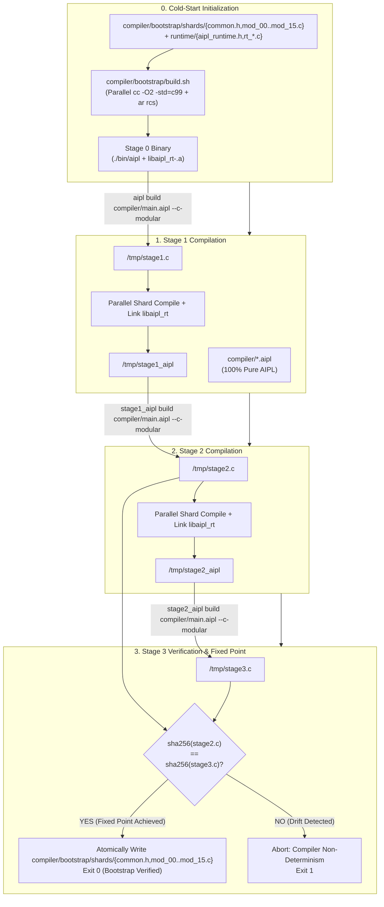

# ADR-0029: 100% Pure AIPL Self-Hosting, C99 Backend & Triple-Stage Bootstrap Fixed Point

## Status
Accepted

## Date
2026-10-12

## Deciders
AIPL Architecture & Core Systems Team

## Context
During initial language inception and validation (ADR-0001 through ADR-0028), AIPL's core architectural tenets—sub-token identifier packing, 2-space offside rule, Dyck-k bracket-free grammar, bidirectional typechecking, embedded QF-LIA/EUF SMT solving, Data-Oriented Design (DOD) flat stride memory, and single-root diagnostic contracts—were prototyped in a bootstrap host.

While effective for early exploration, relying permanently on an external compiler implementation introduces fatal drawbacks:
1. **Toolchain Friction & Bootstrapping Debt**: Requiring an external compiler toolchain (and gigabytes of intermediate build artifacts) creates friction for autonomous AI coding agents and containerized build pipelines.
2. **Language Dogfooding Deficit**: A systems language claiming Tier-1 performance, zero GC pause overhead, and superior ergonomics must prove its capabilities by implementing its own lexer, Pratt parser, HIR lowerer, bidirectional type checker, contract verifier, and multi-backend code generators.
3. **Cold-Start Portability**: Bootstrapping on a fresh POSIX or bare-metal environment must be achievable with nothing more than a standard ISO C99 compiler (`cc` / `gcc` / `clang`), with zero dependencies on third-party package managers.

To achieve complete language autonomy, AIPL transitions to a **100% self-hosted compiler** written entirely in AIPL (`compiler/*.aipl`), accompanied by a comprehensive 96-module standard library (`87 std/*.aipl + 9 std/rt/*.aipl`, expanded from the initial 56-module baseline).

---

## Decision Drivers
- **Complete Language Autonomy**: Eliminate external language runtime dependencies; write 100% of the compiler pipeline in canonical AIPL.
- **Triple-Stage Fixed-Point Determinism**: Enforce mathematical reproducibility across bootstrap stages, asserting that the compiler binary compiling itself reaches a cryptographic fixed point:
  $$\text{sha256}(\text{stage2.c}) == \text{sha256}(\text{stage3.c})$$
- **Zero-Dependency Cold-Start Bootstrap**: Commit the 16 pre-generated fixed-point C99 bootstrap shards (`compiler/bootstrap/shards/{common.h,mod_00..mod_15.c}`), the modular C99 runtime (`runtime/{aipl_runtime.h,rt_core.c,rt_crypto_data.c,rt_sys.c,rt_gui_audio.c}`), and `compiler/bootstrap/build.sh` in the repository, allowing any platform with a standard C99 compiler (`cc` + `ar`) to cold-build `./bin/aipl` in parallel across all CPU cores without an existing `aipl` binary.
- **Dual C99 Native + TypeScript/HTML5 Code Generation**:
  - *Native Backend (`compiler/codegen_c_or_ir.aipl` + `runtime/*`)*: Emits clean, human-readable ANSI C99 code (`#include <aipl_runtime.h>` in modular mode or self-contained amalgamated C99 via `--c`) and links against content-addressed precompiled static runtime archives (`.aipl/cache/v1/libaipl_rt-<hash16>.a` and `libaipl_rt_gui-<hash16>.a`).
  - *Web/Edge Backend (`compiler/codegen_ts.aipl`)*: Emits idiomatic TypeScript, React 19 JSX, and standalone single-file HTML5 bundles.
- **Comprehensive Standard Library (96 Modules: 87 `std/*.aipl` + 9 `std/rt/*.aipl`)**: Ship a modular standard library in `std/*.aipl` and `std/rt/*.aipl` covering CLI, filesystem, cryptography, networking, math, UI, graphics, physics, simulation, and process execution.
- **Strict Verification SLA**: `./bin/aipl bootstrap` and `pytest tests/selfhost/` must pass 100% in continuous integration.

---

## Considered Options

### Option 1: Maintain Legacy Rust Workspace Indefinitely
Retain the Rust compiler implementation in `crates/aipl-*` alongside user-space AIPL code.
- *Pros*: Leverages existing Rust build configurations.
- *Cons*: **Rejected**. Perpetuates dual maintenance overhead, risks semantic drift between Rust and AIPL implementations, doubles test maintenance, and fails to prove language maturity.

### Option 2: Self-Host Directly to LLVM IR / Cranelift IR
Implement an AIPL compiler that emits LLVM bitcode or Cranelift IR directly.
- *Pros*: Direct machine code generation without an intermediate C compiler.
- *Cons*: **Rejected**. Binds the compiler to heavy dynamic libraries (`libLLVM.so`), severely increases cold-start build times ($> 30\text{s}$ vs $< 1.5\text{s}$), breaks simple cross-compilation on minimal architectures, and creates massive bootstrapping friction.

### Option 3: 100% Pure AIPL Self-Hosting with Modular C99 Native Backend & Triple-Stage Bootstrap
Rewrite the entire compiler in pure AIPL (`compiler/*.aipl`), factor the C99 runtime into modular translation units (`runtime/aipl_runtime.h` and `runtime/rt_*.c`) cached as `.aipl/cache/v1/libaipl_rt-<hash16>.a`, emit ANSI C99 for native targets and TypeScript/HTML5 for web targets, commit the 16 fixed-point C99 shards (`compiler/bootstrap/shards/`) + `compiler/bootstrap/build.sh` for cold-start compilation, and enforce the triple-stage fixed point invariant.
- *Pros*: **Accepted**. 100% language dogfooding, zero external dependencies beyond host `cc`/`ar`, multi-core parallel shard compilation, mathematical reproducibility, and full coverage of systems and web domains.

---

## Decision Outcome & Rationale
**Chosen: Option 3 - 100% Pure AIPL Self-Hosting with Modular C99 Native Backend & Triple-Stage Bootstrap.**

### The 3-Stage Bootstrap Fixed-Point Pipeline



### Self-Hosted Compiler Architecture (`compiler/*.aipl` & `runtime/*`)
The self-hosted compiler is partitioned into cleanly decoupled modules:
1. `ast.aipl`: Abstract syntax tree structures, span tracking, and AST bump arena.
2. `lexer.aipl`: Zero-copy lexical scanner with offside indentation tracking and bracket elimination.
3. `parser.aipl`: High-velocity Pratt parser supporting operator precedence, systems, shaders, and UI blocks.
4. `resolve.aipl`: Module graph resolution, cyclic dependency detection, and import symbol bundling.
5. `hir.aipl`: Lowering from AST to Canonical High-Level Intermediate Representation (HIR) and whole-program call-graph Dead Code Elimination (`eliminateDeadFunctionsHir` pruning unreachable functions, structs, and enums).
6. `types.aipl`: Bidirectional type checker, zero-coercion validation, and exhaustiveness checking.
7. `smt.aipl`: Embedded QF-LIA and EUF refinement contract solver.
8. `bytecode.aipl`: Standalone binary trailer packaging and asset overlay embedding.
9. `codegen_c_or_ir.aipl` + `runtime/*`: Native C99 code emitter, on-demand intrinsic macro & JSON decoder assembly (`assembleDeferredC`), and host compiler driver linking against the split modular C runtime (`runtime/aipl_runtime.h` with 125 hot `static inline` helpers, `runtime/rt_core.c`, `runtime/rt_crypto_data.c`, `runtime/rt_sys.c`, and `runtime/rt_gui_audio.c`).
10. `codegen_ts.aipl`: High-fidelity TypeScript, React 19 JSX, and standalone HTML5 bundle generator.
11. `main.aipl`: CLI driver (`build`, `run`, `check`, `verify`, `fix`, `test`, `bench`, `shield`, `bootstrap`).

### Standard Library Architecture (`std/*.aipl` & `std/rt/*.aipl`)
The 96-module standard library (`87 std/*.aipl + 9 std/rt/*.aipl`, expanded from the initial 56-module baseline) provides rich, battery-included functionality with zero external runtime dependencies:
- **Core & Collections**: `array.aipl`, `collections.aipl`, `string.aipl`, `buffer.aipl`, `pool.aipl`, `sort.aipl`.
- **System & I/O**: `fs.aipl`, `io.aipl`, `path.aipl`, `env.aipl`, `process.aipl`, `cli.aipl`, `term.aipl`, `dotenv.aipl`.
- **Data & Serialization**: `json.aipl`, `csv.aipl`, `xml.aipl`, `markdown.aipl`, `encoding.aipl`, `compress.aipl`, `tar.aipl`.
- **Networking & Web**: `http.aipl`, `net.aipl`, `dns.aipl`, `html.aipl`, `semver.aipl`.
- **Math, Physics & Graphics**: `math.aipl`, `geom2d.aipl`, `geom3d.aipl`, `physics.aipl`, `grid.aipl`, `pathfinding.aipl`, `color.aipl`, `canvas.aipl`, `image.aipl`, `qrcode.aipl`.
- **Audio, FX & Animation**: `audio.aipl`, `aura.aipl`, `fx.aipl`, `game.aipl`, `spline.aipl`, `spring.aipl`, `transform.aipl`, `tween.aipl`, `ui.aipl`.
- **Security & Utilities**: `crypto.aipl`, `uuid.aipl`, `date.aipl`, `datetime.aipl`, `time.aipl`, `cron.aipl`, `random.aipl`, `regex.aipl`, `diff.aipl`, `test.aipl`, `asset.aipl`.

---

## Code Example: Self-Hosting Bootstrap Verification in AIPL

The following canonical AIPL code snippet demonstrates the cryptographic fixed-point verification logic used by the bootstrap engine:

```aipl
module BootstrapVerifier

import { sha256 } from "std/crypto"
import { readFile } from "std/fs"

pub fn verifyFixedPoint(stage2Path: str, stage3Path: str): bool:
  let stage2C = readFile(stage2Path)
  let stage3C = readFile(stage3Path)
  let hash2 = sha256(stage2C)
  let hash3 = sha256(stage3C)
  ret hash2 == hash3
```

---

## Consequences

### Positive
- **100% Self-Contained Language Ecosystem**: The compiler and standard library are authored purely in AIPL, eliminating external language toolchain lock-in.
- **Cryptographic Reproducibility**: The triple-stage bootstrap fixed-point guarantee (`sha256(stage2) == sha256(stage3)`) ensures compiler determinism and prevents hidden backdoors or compiler drift.
- **Fast Multi-Core Cold Starts & Cached Runtime Archives**: Cold-start builds via `./compiler/bootstrap/build.sh` require only standard ISO C99 (`cc` and `ar`), compiling `runtime/rt_*.c` and `compiler/bootstrap/shards/mod_00..mod_15.c` in parallel across all CPU cores, while warm builds reuse `.aipl/cache/v1/libaipl_rt-<hash16>.a` without recompiling the runtime.
- **Dual-Target Flexibility**: Zero-overhead native execution via C99 (`--native`, `--c-modular`, or standalone amalgamated `--c`) and zero-configuration web deployment via TypeScript/HTML5.
- **Surgical AI Agent Ergonomics**: Self-hosted CLI (`aipl fix`, `aipl verify`, `aipl check --json`) integrates natively with agent loops with zero token bloat.

### Negative
- **Bootstrap Management**: Significant breaking changes to the core syntax or AST require regenerating and re-committing `compiler/bootstrap/shards/{common.h,mod_00..mod_15.c}` using the triple-stage `./bin/aipl bootstrap` pipeline.
- **C99 Portability Invariants**: Code emitted by `codegen_c_or_ir.aipl` must strictly conform to ANSI/ISO C99 without GNU extensions to maintain universal cross-platform compatibility.

---

## Verification & Quality Gates
1. **Triple-Stage Bootstrap**:
   ```bash
   ./bin/aipl bootstrap
   ```
   Compiles Stage 1 from AIPL sources, produces Stage 2 via Stage 1, produces Stage 3 via Stage 2, and verifies `sha256(stage2.c) == sha256(stage3.c)`.
2. **Self-Host Test Suite**:
   ```bash
   pytest tests/selfhost/
   ```
   Validates CLI parity, lvalue assignments, runtime intrinsics, and cross-compilation.
3. **Documentation Code Snippet Suite**:
   ```bash
   python3 tools/verify_doc_snippets.py
   ```
   Extracts and compiles 100% of documentation code snippets across all ADRs with zero errors.
