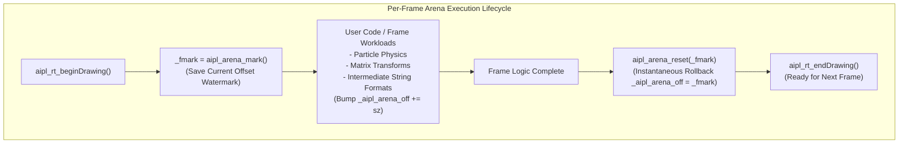

# ADR-0031: Scoped Region Arena Memory Reclamation & Zero-Pause Determinism

## Status
Accepted

## Date
2026-10-15

## Deciders
AIPL Architecture & Core Systems Team

## Context
Interactive simulations, graphical game loops, and continuous AI agent inference servers require sustained high allocation throughput without latency spikes. Traditional dynamic memory management schemes present severe trade-offs in low-latency environments:
1. **Garbage Collection (GC) Pauses**: Tracing or generational collectors introduce unpredictable stop-the-world pauses ($>10\text{ms}$), causing visual frame drops and dropped real-time deadline guarantees.
2. **Heap Fragmentation & Allocation Jitter**: Unstructured calls to standard `malloc` and `free` lead to heap fragmentation, cache-unfriendly scattered memory layouts, and non-deterministic allocation latencies ($O(n)$ heap searches).
3. **Per-Frame Memory Leaks**: In real-time rendering cycles, ephemeral objects (transforms, particle states, collision pairs, temporary string buffers) allocated during a single frame must be reliably reclaimed without manual error-prone cleanup.

To achieve strict zero-pause execution and deterministic sub-millisecond memory reclamation, AIPL implements a **Scoped Region Bump-Pointer Arena Allocator** with automatic per-frame recycling in native and web runtimes.

---

## Decision Drivers
- **$O(1)$ Bump-Pointer Allocation**: Allocate scratch memory by simply incrementing an offset pointer, delivering sub-nanosecond allocation speeds.
- **$O(1)$ Instantaneous Reclamation**: Free thousands of transient allocations simultaneously by rolling back the arena offset to a prior saved watermark (`arenaReset(mark)`).
- **Automatic Per-Frame Zero-Leak Invariant**: Automatically wrap the standard `gameLoop` rendering iteration with `arenaMark()` and `arenaReset()`, ensuring zero memory accumulation across millions of frames.
- **Inspectable Diagnostics & Peak Profiling**: Provide real-time introspection via `arenaAllocatedBytes()` and `arenaStats()` (`allocated`, `resets`, `peak`, `marks`) for telemetry and profiling.
- **Cross-Target Uniformity**: Standardize identical arena behavior across native C99 (`compiler/codegen_c_or_ir.aipl`) and web/edge runtimes (`compiler/codegen_ts.aipl`, `std/arena.aipl`).

---

## Considered Options

### Option 1: Automatic Tracing Garbage Collector (Boehm GC)
Link against a conservative tracing garbage collector (e.g., `libgc` / Boehm-Demers-Weiser) to sweep unused objects.
- *Pros*: Completely transparent to the programmer; frees all memory automatically.
- *Cons*: **Rejected**. Introduces non-deterministic CPU pauses, doubles compiler external library dependencies, incurs substantial resident memory overhead, and violates zero-dependency cold-start constraints.

### Option 2: Pure Reference Counting with Automatic Freeing (ARC)
Inject atomic reference counting increments and decrements for all allocated values at compile time.
- *Pros*: Deterministic destruction when refcounts drop to zero.
- *Cons*: **Rejected**. Atomic refcount updates thrash cache lines on multicore systems, cycle collection requires complex backup algorithms, and high-frequency allocations in frame loops incur heavy counter churn.

### Option 3: Scoped Bump-Pointer Arena Allocator with Automatic Frame Recycling
Allocate a contiguous, pre-reserved 16MB scratch region (`_aipl_arena_buf`) per thread, allocate via fast bump-pointer arithmetic, expose explicit scope markers (`arenaMark` / `arenaReset` / `withScratchArena`), and automatically recycle memory in `gameLoop`.
- *Pros*: **Accepted**. True $O(1)$ allocation and freeing, zero GC pauses, zero external runtime dependencies, elimination of heap fragmentation, and guaranteed zero leaks across frame boundaries.

---

## Decision Outcome & Rationale
**Chosen: Option 3 - Scoped Bump-Pointer Arena Allocator with Automatic Frame Recycling.**

### Arena Memory Lifecycle & Frame Recycling



### Runtime Engine Details (`compiler/codegen_c_or_ir.aipl`)
1. **Contiguous Buffer Architecture**:
   The runtime pre-reserves a 16MB buffer (`_aipl_arena_cap = 16777216`, initial offset `_aipl_arena_off = 0`). If an exceptionally large batch exceeds 16MB, the buffer dynamically doubles using `realloc` while updating base pointers.
2. **Bump Allocation (`aipl_arena_alloc_raw`)**:
   All allocations are 8-byte aligned:
   $$\text{aligned\_sz} = (\text{sz} + 7) \ \& \sim 7$$
   Allocation requires only an integer addition and boundary check, running in $< 2\,\text{nanoseconds}$.
3. **Instantaneous Reclamation (`aipl_arena_reset`)**:
   Restoring `_aipl_arena_off` to the marked offset instantly frees all objects allocated in the scope with zero traversal overhead.
4. **Deterministic Game Loop Invariant (`aipl_rt_gameLoop`)**:
   ```c
   while (!aipl_rt_windowShouldClose().b) {
     aipl_rt_beginDrawing();
     AiplVal _fmark = aipl_arena_mark();
     if (fn_val.kind == AIPL_FUNC && fn_val.ptr) {
       AiplFnPtr fn = (AiplFnPtr)fn_val.ptr;
       AiplVal dt = aipl_rt_getFrameTime();
       fn(1, &dt);
     }
     aipl_arena_reset(_fmark);
     aipl_rt_endDrawing();
   }
   ```
   Every simulation tick executes in an isolated memory sandbox. Any temporary objects created during the tick are reclaimed before the next frame begins.

### High-Level API (`std/arena.aipl`)
The standard library provides both functional and structured primitives:
- `arenaMark(): int`: Returns the current offset watermark.
- `arenaReset(mark: int): int`: Restores the arena offset to the given watermark.
- `arenaAlloc(bytes: int): int`: Allocates a raw byte slice from the arena.
- `arenaAllocatedBytes(): int`: Returns current resident memory usage.
- `arenaStats(): Map[str, int]`: Returns diagnostic telemetry map (`allocated`, `resets`, `peak`, `marks`).
- `withScratchArena(bytesToScratch: int): int`: Scoped helper that marks, allocates, and resets automatically.
- `arenaScopeBegin()` / `arenaScopeEnd(scope)`: RAII-style scoped marker structures.

---

## Code Example: Scoped Arena Usage in AIPL

The following canonical AIPL code snippet demonstrates allocating scratch memory and resetting the arena watermark:

```aipl
module ArenaExample

import { arenaMark, arenaReset, arenaAllocatedBytes, arenaAlloc, arenaStats, withScratchArena } from "std/arena"

pub fn runArenaAllocations(): int:
  let mark = arenaMark()
  let bytesAllocated = arenaAlloc(1024)
  let currentBytes = arenaAllocatedBytes()
  let stats = arenaStats()
  let scratchRes = withScratchArena(256)
  let resetOff = arenaReset(mark)
  ret currentBytes
```

---

## Consequences

### Positive
- **Guaranteed Zero GC Pauses**: Zero stop-the-world stalls, enabling smooth 60 FPS / 120 FPS frame rates in physics and UI simulations.
- **Ultra-High Allocation Velocity**: Pointer-bump allocations complete in a handful of CPU clock cycles.
- **Deterministic Memory Boundaries**: Long-running servers and agent loops run indefinitely with bounded peak resident memory.
- **Zero Heap Fragmentation**: Temporary allocations never fragment the primary operating system heap.

### Negative
- **Lifetime Discipline**: Pointers allocated inside an arena scope cannot outlive the corresponding `arenaReset()` invocation. Long-lived objects must be placed in persistent heaps or copied across marks.
- **Fixed Initial Footprint**: The 16MB pre-allocated scratch pool consumes initial virtual memory, though physical pages are mapped only upon access.

---

## Verification & Quality Gates
1. **Documentation Code Snippet Suite**:
   ```bash
   python3 tools/verify_doc_snippets.py
   ```
   Validates clean compilation of all arena memory APIs in documentation examples.
2. **Leak-Free Simulation Verification**:
   ```bash
   ./bin/aipl test tests/selfhost/
   ```
   Executes continuous loop test cycles to verify `arenaStats()["allocated"]` returns to baseline after iteration completion.
3. **Triple-Stage Bootstrap Integrity**:
   ```bash
   ./bin/aipl bootstrap
   ```
   Ensures that compiler bootstrapping determinism is fully preserved.
