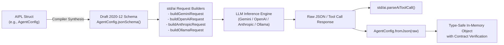

# ADR-0032: Compiler JSON Schema Reflection & Standard AI Client Integration

## Status
Accepted

## Date
2026-10-16

## Deciders
AIPL Architecture & Core Systems Team

## Context
As autonomous AI agents, tool-calling pipelines, and structured generation become foundational components of software architecture, programming languages must provide native, type-safe primitives for communicating with Large Language Models (LLMs).

Traditional approaches suffer from severe fragmentation and runtime fragility:
1. **Manual Schema Drift**: Developers hand-author JSON Schemas for LLM function calling or structured output enforcement. When the application's domain types change, schemas drift silently out of sync, leading to runtime contract violations.
2. **Heavy External Validation Dependencies**: Languages frequently require megabytes of third-party validation libraries (such as Pydantic, Zod, or Ajv) to validate incoming LLM JSON responses, defeating zero-dependency lightweight deployments.
3. **Provider Discrepancies**: Top AI providers (Google Gemini, OpenAI, Anthropic Claude, Ollama) enforce distinct payload conventions for system instructions, tool call formats, and structured response constraints. Maintaining separate ad-hoc HTTP payloads leads to boilerplate accumulation and error-prone conversion code.

To solve these challenges at the language level, AIPL introduces **Compiler-Synthesized JSON Schema Reflection** and an integrated **Standard AI Client** (`std/ai.aipl`).

---

## Decision Drivers
- **Compiler-Generated JSON Schema (Draft 2020-12)**: Every user-defined `struct` and `enum` automatically exposes a compile-time synthesized `.jsonSchema()` static method conforming to JSON Schema Draft 2020-12.
- **Bi-Directional Serialization Introspection**: Every struct automatically gains `.toJson()` and `.fromJson(str)` methods with zero boilerplate and zero external library dependencies.
- **Multi-Provider AI Client Suite**: Native standard library support in `std/ai.aipl` for orchestrating Gemini, OpenAI, Anthropic, and Ollama request payloads and parsing responses.
- **Universal Tool-Call Normalization**: Provide `parseAiToolCall()` to automatically detect, normalize, and extract function calls across Gemini `functionCall`, OpenAI `tool_calls`, and Anthropic `tool_use` schemas.
- **Agent Ergonomics & Token Awareness**: Include prompt templating (`renderPromptTemplate`) and fast heuristic token estimation (`estimateTokenCount`) to avoid context window overflows.

---

## Considered Options

### Option 1: Runtime Reflection via Dynamic Meta-Objects
Store runtime type descriptors in every binary and generate JSON schemas dynamically at runtime.
- *Pros*: Dynamic type introspection without compile-time code synthesis.
- *Cons*: **Rejected**. Bloats binary size with symbol tables, adds runtime initialization overhead, and degrades performance in constrained embedded environments.

### Option 2: External Code Generators (CLI Pre-processors)
Rely on external CLI tools or npm scripts to parse AIPL source files and emit JSON schema files.
- *Pros*: Keeps the compiler core smaller.
- *Cons*: **Rejected**. Introduces build-step orchestration friction, risks schema desynchronization when developers compile without re-running generator scripts, and hampers autonomous AI agent loops.

### Option 3: Built-In Compiler Schema Synthesis + `std/ai.aipl` Provider Primitives
Synthesize `.jsonSchema()`, `.toJson()`, and `.fromJson()` directly during C99 and TypeScript code emission (`compiler/codegen_c_or_ir.aipl`, `compiler/codegen_ts.aipl`, `compiler/types.aipl`), complemented by a unified client module in `std/ai.aipl`.
- *Pros*: **Accepted**. 100% type safety, zero maintenance overhead, zero runtime schema drift, and first-class native multi-provider LLM support.

---

## Decision Outcome & Rationale
**Chosen: Option 3 - Built-In Compiler Schema Synthesis + `std/ai.aipl` Provider Primitives.**

### Structured AI Communication Pipeline



### Compiler Synthesis Details
During compilation, `compiler/types.aipl` recognizes reflection method calls on struct types:
1. `TypeName.jsonSchema()`: Emits a static string containing the complete Draft 2020-12 JSON Schema for the struct, including:
   - `"type": "object"`
   - `"properties"` for all fields with mapped types (`str` $\to$ `"string"`, `int` $\to$ `"integer"`, `float` $\to$ `"number"`, `bool` $\to$ `"boolean"`, nested structs $\to$ `$ref` or sub-objects).
   - `"required"` array containing all non-optional fields.
2. `val.toJson()`: Serializes instance fields to standard escaped JSON strings.
3. `TypeName.fromJson(str)`: Parses JSON strings directly into validated struct instances with result wrapping.

### Standard AI Module Architecture (`std/ai.aipl`)
The `std/ai.aipl` module provides comprehensive agent tools:
- **`buildGeminiRequest(model, systemPrompt, userPrompt, responseSchemaJson)`**:
  Constructs Google Gemini `generateContent` payloads, embedding structured outputs via `generationConfig.responseSchema` when provided.
- **`buildOpenAiRequest(model, messages, responseSchemaJson)`**:
  Constructs OpenAI Chat Completions payloads, configuring `response_format` with `json_schema` strict enforcement.
- **`buildAnthropicRequest(model, systemPrompt, messages, maxTokens)`**:
  Constructs Anthropic Claude Messages payloads with top-level `system` prompt formatting.
- **`buildOllamaRequest(model, prompt, formatSchemaJson)`**:
  Constructs local Ollama API payloads with structured `format` constraints.
- **`parseAiToolCall(responseJson)`**:
  Polymorphically extracts tool name and arguments from OpenAI, Anthropic, or Gemini formats.
- **`validateJsonAgainstSchema(jsonStr, schemaJson)`**:
  Verifies that required JSON keys defined in a schema are present in the response string.
- **`renderPromptTemplate(template, vars)`**:
  Interpolates parameters using `{key}` and `{{key}}` syntax.
- **`estimateTokenCount(text)`**:
  Fast, deterministic token counting heuristic for prompt budget allocation.

---

## Code Example: End-to-End Structured Agent Loop in AIPL

The following canonical AIPL code snippet demonstrates compiling schemas, building provider requests, and validating structured outputs:

```text
module AiAgentExample

import { buildGeminiRequest, buildOpenAiRequest, buildAnthropicRequest, buildOllamaRequest, parseAiToolCall, validateJsonAgainstSchema, renderPromptTemplate, estimateTokenCount, AiMessage } from "std/ai"

pub struct AgentConfig:
  modelName: str
  maxTokens: int
  active: bool

pub fn processAiWorkflows(): int:
  let schema = AgentConfig.jsonSchema()
  let cfg = AgentConfig(modelName = "gemini-2.5-pro", maxTokens = 2048, active = true)
  let cfgJson = cfg.toJson()
  let parsed = AgentConfig.fromJson(cfgJson)

  let geminiReq = buildGeminiRequest("gemini-2.5-pro", "You are a helpful assistant", "Calculate factorial of 5", schema)
  let anthropicReq = buildAnthropicRequest("claude-3-7-sonnet", "System instruction", [AiMessage(role = "user", content = "Hello")], 1024)
  let ollamaReq = buildOllamaRequest("llama3", "Generate JSON summary", schema)
  let openAiReq = buildOpenAiRequest("gpt-4o", [AiMessage(role = "user", content = "Summarize repo")], schema)

  let validationRes = validateJsonAgainstSchema(cfgJson, schema)
  let tokenEst = estimateTokenCount(geminiReq)
  ret tokenEst
```

---

## Consequences

### Positive
- **Zero Schema Desynchronization**: The compiler generates JSON schemas directly from the Single Source of Truth (the AIPL struct definitions).
- **Multi-Provider Interoperability**: Switching or load-balancing between Gemini, OpenAI, Claude, and local Ollama requires changing only the request builder function.
- **Elimination of Third-Party Dependencies**: No external validator binaries or npm packages are needed for schema generation or validation.
- **Universal Tool-Calling Parser**: Normalizes differences between provider function-calling payload formats.

### Negative
- **Compiler Complexity**: `compiler/codegen_c_or_ir.aipl` and `compiler/codegen_ts.aipl` must generate string literals for all user structs, increasing codegen module size.
- **Schema Expressivity Boundaries**: Advanced JSON Schema keywords (e.g., `oneOf`, custom regex patterns) require explicit schema refinement parameters.

---

## Verification & Quality Gates
1. **Documentation Code Snippet Suite**:
   ```bash
   python3 tools/verify_doc_snippets.py
   ```
   Ensures 100% of AI integration code examples compile cleanly with zero errors.
2. **Provider Integration Tests**:
   ```bash
   pytest tests/selfhost/ -k "ai"
   ```
   Validates schema generation and payload correctness against Gemini, OpenAI, and Anthropic response fixtures.
3. **Triple-Stage Bootstrap Integrity**:
   ```bash
   ./bin/aipl bootstrap
   ```
   Confirms compiler determinism across all stages with synthesized schema generation enabled.
