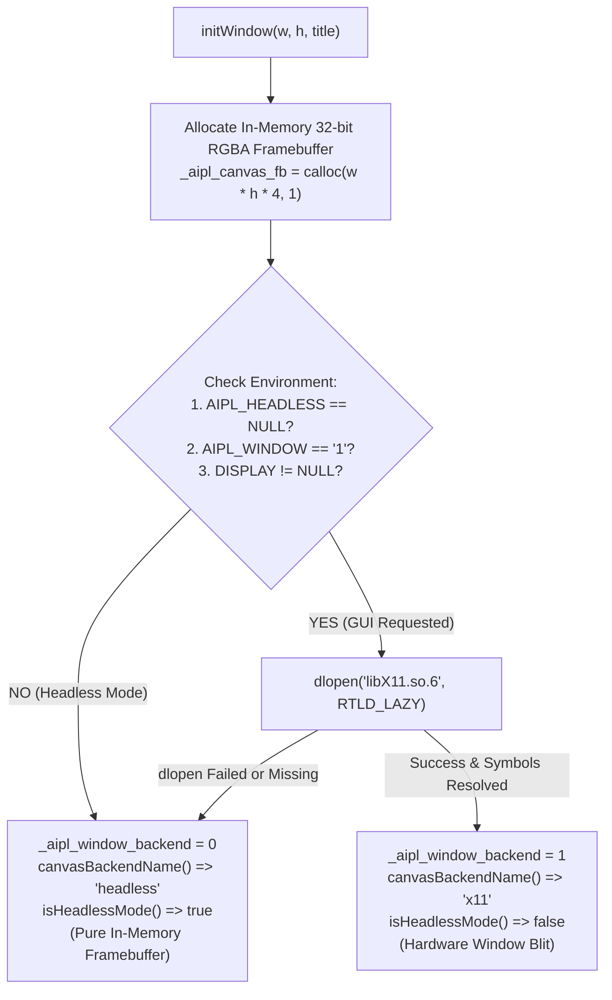

# ADR-0033: Zero-FFI Dynamic C Interop & Headless-First Desktop Canvas Blitter

## Status
Accepted

## Date
2026-10-17

## Deciders
AIPL Architecture & Core Systems Team

## Context
Modern systems languages face a persistent dilemma when interfacing with external shared libraries and visual rendering surfaces:
1. **Link-Time Dependency Fragility**: Linking statically or dynamically against GUI or graphics libraries (such as `libX11`, `libwayland`, or `SDL2`) at compile time breaks headless CI/CD environments, containerized Docker builds, and cloud server execution where graphics shared objects do not exist.
2. **Complex FFI Boilerplate**: Traditional Foreign Function Interfaces (FFI) require extensive header parsing, C toolchain bindings, ABI stub generation, and complex runtime glue just to invoke a few dynamic C library symbols.
3. **Headless Execution Bifurcation**: Developing interactive applications (games, visualization dashboards, visual proof tests) typically requires maintaining two distinct binaries or codebase branches: one for desktop graphical display and another for headless automated regression testing.

To eliminate link-time library lock-in and enable universal cross-environment visual computing, AIPL introduces **Zero-FFI Dynamic C Interop** (`std/ffi.aipl`) and a **Headless-First Desktop Canvas Blitter** (`std/canvas.aipl`).

---

## Decision Drivers
- **Zero Link-Time Dependencies**: The compiled C99 executable requires no compile-time flags like `-lX11` or `-ldl` (beyond standard libc), preserving instant sub-second compilation.
- **Dynamic POSIX Interop (`std/ffi.aipl`)**: Simple, runtime-dynamic symbol binding through `dlopen`, `dlsym`, and `dlclose` intrinsics for scalar and string signatures (`ffiOpen`, `ffiHasSymbol`, `ffiCallInt`, `ffiCallFloat`, `ffiCallStr`, `ffiClose`).
- **Opportunistic Windowing via `dlopen("libX11.so.6")`**: If a physical display server is available (`DISPLAY` set, `AIPL_WINDOW=1`), the runtime dynamically loads `libX11.so.6` at runtime to blit the framebuffer to a native window.
- **Seamless Headless Fallback**: When running in headless environments (e.g. CI runners, Docker containers, `AIPL_HEADLESS=1`), the system silently initializes an in-memory 32-bit RGBA pixel buffer (`_aipl_canvas_fb`), running all canvas operations with zero graphics errors.
- **Introspectable Backend State**: Expose runtime backend status via `isHeadlessMode(): bool` and `canvasBackendName(): str` (`"x11"` vs `"headless"`).

---

## Considered Options

### Option 1: Hard Compile-Time Linkage Against libX11 / OpenGL
Link all native binaries directly against `libX11.so` and `libGL.so` during `aipl build`.
- *Pros*: Direct compile-time symbol resolution.
- *Cons*: **Rejected**. Fatal failure in headless Linux CI environments and Alpine containers lacking X11 development headers and libraries.

### Option 2: Full libffi Integration with C Header Pre-Parsers
Incorporate `libffi` and a Clang-based C header parser to generate complex C call frames dynamically.
- *Pros*: Supports arbitrary aggregate C struct parameters by value.
- *Cons*: **Rejected**. Adds massive external dependencies ($>10\text{MB}$), breaks cold-start bootstrap simplicity, and increases compiler complexity.

### Option 3: Zero-FFI Dynamic Loader with Headless-First Software Canvas
Implement direct dynamic loading intrinsics (`std/ffi.aipl`) backed by POSIX `dlopen`/`dlsym`, combined with an in-memory RGBA software canvas (`std/canvas.aipl`) that dynamically attempts `dlopen("libX11.so.6")` on desktop environments and falls back cleanly to headless rendering.
- *Pros*: **Accepted**. 100% portable, zero build-time library dependencies, identical rendering logic across headless CI and desktop, and lightweight dynamic C library calling.

---

## Decision Outcome & Rationale
**Chosen: Option 3 - Zero-FFI Dynamic Loader with Headless-First Software Canvas.**

### Runtime Canvas Initialization & Fallback Architecture



### Dynamic Interop Architecture (`std/ffi.aipl`)
The `std/ffi.aipl` module provides immediate dynamic library invocation without header compilation:
- `ffiOpen(libPath: str): int`: Loads a shared object (`.so`, `.dylib`, `.dll`) via `dlopen(..., RTLD_LAZY)`.
- `ffiHasSymbol(handle: int, symbol: str): bool`: Queries symbol existence using `dlsym`.
- `ffiCallInt(handle: int, symbol: str, args: [int]): int`: Invokes a dynamic C function with integer arguments and return value.
- `ffiCallFloat(handle: int, symbol: str, args: [float]): float`: Invokes a dynamic C function with floating-point arguments.
- `ffiCallStr(handle: int, symbol: str, arg: str): str`: Invokes a string-based C function.
- `ffiClose(handle: int): bool`: Unloads the dynamic library via `dlclose`.

### Canvas Engine, Dual Window Modes & Headless Fallback (`std/gfx2d/shape2d.aipl` / `std/canvas.aipl`)
1. **Native 32-Bit BGRA Framebuffer with Transparent RGBA Readback**:
   The canvas stores `_aipl_canvas_fb` in native X11 32-bit `BGRA` (`0xFFRRGGBB` little-endian) with analytical scanline span rasterization (`drawEllipse`, `drawTriangle`, `drawCircleOutline`), eliminating per-frame RGBA-to-BGRA swizzling while keeping `getPixel`, `readCanvasPixel`, `readPixels`, and `saveScreenshot` 100% RGBA-compatible.
2. **Headless Transparency**:
   In headless CI or Docker environments, tests draw onto the in-memory buffer, snapshot pixel contents via `getPixel(x, y)`, and perform visual regression assertions with zero display server dependencies.
3. **Dual Window Modes (`setWindowMode("x11" | "glx" | "auto")`, `getWindowMode()`, `--window-mode=x11|glx|auto`)**:
   - **Normal Desktop Application Mode (`"x11"` / `"app"`)**: Dynamically loads `libX11.so.6` and `libXext.so.6` (`XShmCreateImage`, `XShmAttach`, `XShmPutImage`) with SysV shared memory (`shmget`/`shmat`) for zero-copy frame presentation (`examples/ex_251`–`ex_252`).
   - **Game Hardware Mode (`"glx"` / `"game"`)**: Dynamically loads `libGL.so.1` (`glXChooseVisual`, `glXCreateContext`, `glDrawArrays(GL_TRIANGLES, ...)`, `glXSwapBuffers`) for GPU-batched 2D/3D rendering with lazy `glReadPixels` sync (`examples/ex_253`–`ex_255`).
4. **Conditional GUI/Audio Archive Linking & Multi-Backend Synthesizer (`runtime/rt_gui_audio.c`)**:
   The X11 MIT-SHM windowing, OpenGL/GLX batch renderer, and multi-backend polyphonic audio synthesizer (`libpulse-simple.so.0` -> `libasound.so.2` ALSA -> `libSDL2-2.0.so.0` SDL2, `examples/ex_256`–`ex_258`) reside in `runtime/rt_gui_audio.c`, precompiled with `-DAIPL_ENABLE_GUI_AUDIO=1` into `.aipl/cache/v1/libaipl_rt_gui-<hash16>.a`. Non-graphical CLI programs link against the lean headless archive (`.aipl/cache/v1/libaipl_rt-<hash16>.a`), while programs importing or invoking GUI/audio intrinsics automatically link against `libaipl_rt_gui-<hash16>.a`.

---

## Code Example: Dynamic FFI & Canvas Backend Inspection in AIPL

The following canonical AIPL code snippet demonstrates loading a dynamic library symbol, calling an intrinsic, and querying canvas backend status:

```aipl
module FfiCanvasExample

import { ffiOpen, ffiHasSymbol, ffiCallInt, ffiCallFloat, ffiCallStr, ffiClose } from "std/ffi"
import { isHeadlessMode, canvasBackendName, initWindow, closeWindow } from "std/canvas"

pub fn runFfiAndCanvas(): bool:
  let handle = ffiOpen("libm.so.6")
  let hasSqrt = ffiHasSymbol(handle, "sqrt")
  let intRes = ffiCallInt(handle, "abs", [42])
  let floatRes = ffiCallFloat(handle, "sqrt", [16.0])
  let strRes = ffiCallStr(handle, "getenv", "PATH")
  let closed = ffiClose(handle)

  initWindow(800, 600, "AIPL Canvas")
  let headless = isHeadlessMode()
  let backend = canvasBackendName()
  closeWindow()
  ret headless
```

---

## Consequences

### Positive
- **100% Hermetic Portability**: Binaries compile and run without needing X11 development headers, static graphics libraries, or external package managers.
- **Zero CI Breakage**: Headless environments automatically run graphics tests, UI layout verification, and game physics loops without virtual display servers (like `xvfb`).
- **Dynamic C Ecosystem Access**: Call C library symbols dynamically without writing C header wrapper files.
- **Deterministic Rendering State**: Framebuffers are directly addressable in memory for pixel audits, diffs, and visual tests.

### Negative
- **Type Checking at Symbol Boundary**: Dynamic FFI invocations perform runtime signature binding; incorrect argument counts or types in `ffiCall*` must be caught via defensive runtime checks.
- **X11 Scope Restriction**: Dynamic desktop blitting on Linux currently targets X11 protocols; Wayland native surfaces fall back to headless or rely on XWayland.

---

## Verification & Quality Gates
1. **Documentation Code Snippet Suite**:
   ```bash
   python3 tools/verify_doc_snippets.py
   ```
   Validates clean compilation of all FFI and canvas code snippets in documentation.
2. **Headless Canvas Verification**:
   ```bash
   AIPL_HEADLESS=1 ./bin/aipl test tests/selfhost/
   ```
   Ensures tests run in pure headless mode without attempting X11 display connections.
3. **Triple-Stage Bootstrap Integrity**:
   ```bash
   ./bin/aipl bootstrap
   ```
   Confirms bootstrap determinism and zero-regression compilation.
