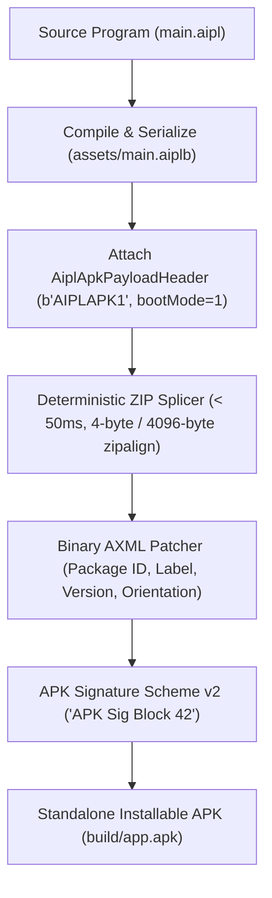

# ADR-0036: Single-App Android Container & Zero-NDK APK Packager

## Status
Accepted

## Date
2026-10-17

## Deciders
AIPL Core Architecture & Mobile Systems Team

## Context
Standard Android application deployment traditionally requires a massive and slow toolchain:
1. **Toolchain Footprint**: Installing the Android SDK, Android NDK, JDK, Gradle build system, and Android Gradle Plugin requires over 15 GB of disk space and complex environment variable configuration.
2. **Build Latency**: Even trivial incremental changes take 30 to 120 seconds to compile, package, align, and sign through Gradle.
3. **Distribution Barrier**: Developers targeting mobile devices cannot quickly generate test APKs or distribute production builds from resource-constrained developer machines or continuous integration runners lacking Android SDKs.
4. **Security & App Isolation**: A general-purpose mobile runtime or interpreter on Android risks running untrusted code if an application's entrypoint is open to external URIs or file pickers.

To solve this, AIPL provides a **Single-App Android Container & Zero-NDK APK Packager** (`std/asset/apk_container_format.aipl`, `std/compress/apk_zip_writer.aipl`, `std/encoding/axml_manifest.aipl`, `std/crypto/apk_Sig_v2.aipl`, and `aipl build --target apk`).

---

## Decision Drivers
- **Zero-NDK Compilation & Packaging**: Package any `.aipl` program into a fully compliant, installable Android APK in `< 50ms` on any desktop or CI host without installing Android SDK, NDK, or Gradle.
- **Pre-Compiled Native Template**: Utilize a pre-compiled native container template containing `NativeActivity`, `libaipl_runner.so`, and default resources.
- **Locked Single-App Execution (`BOOT_LOCKED_SINGLE_APP = 1`)**: Lock the container to execute strictly `assets/main.aiplb` (`b"AIPLAPK1"` header). Disable development file pickers, watcher drawers, and block external URI overrides (`externalOverrideBlocked = true`).
- **Deterministic ZIP Splicing & `zipalign`**: Inject assets into the APK archive with bit-for-bit determinism (`dosTimestamp = 0`), aligning uncompressed entries (`resources.arsc`, `assets/main.aiplb`) to 4-byte boundaries and native libraries (`lib/arm64-v8a/*.so`) to 4096-byte page boundaries for direct kernel `mmap`.
- **Binary AXML Manifest Patcher**: Directly patch the binary `AndroidManifest.xml` string pool and attribute table to customize package ID (`com.aipl.app.<slug>`), app label (`android:label`), version code (`android:versionCode`), and screen orientation (`android:screenOrientation`).
- **APK Signature Scheme v2 (`"APK Sig Block 42"`)**: Append a standards-compliant APK Signing Block with ID `0x7109871a` (`1896449818`) and trailer `"APK Sig Block 42"` containing SHA-256 chunk digests across ZIP entries, Central Directory, and EOCD.

---

## Considered Options

### Option 1: Invoke Gradle and Android NDK from CLI
Delegate APK compilation to `gradle assembleRelease` or `cmake` via child processes.
- *Pros*: Standard Android studio toolchain workflow.
- *Cons*: **Rejected**. Requires multi-gigabyte SDK/NDK installations, minutes of build time, and fails in lightweight containerized environments.

### Option 2: Pure-Web Progressive Web App (PWA) Only
Only target mobile browsers via HTML5 and WebAssembly.
- *Pros*: Zero Android packaging needed.
- *Cons*: **Rejected**. Lacks native Android ecosystem integration, background lifecycle services, APK sideloading, Google Play Store distribution, and direct hardware surface blitting.

### Option 3: Pre-Compiled Native Container Template with Pure-AIPL Splicer & v2 Signer
Ship a minimal, universal pre-compiled Android native container template and splice the user's compiled AIPL bytecode (`assets/main.aiplb`) into it, adjusting binary AXML and signing blocks in pure AIPL.
- *Pros*: **Accepted**. Packaging takes `< 50ms`, requires zero external dependencies, guarantees 4-byte/4096-byte alignment, enforces single-app lockdown, and emits installable APKs directly.

---

## Decision Outcome & Rationale
**Chosen: Option 3 - Pre-Compiled Native Container Template with Pure-AIPL Splicer & v2 Signer.**

### Architecture & Pipeline Overview

### Key Technical Invariants

1. **Payload Header Magic & Version**:
   - Magic: `b"AIPLAPK1"` (8 bytes)
   - Format Version: `1`
   - Boot Mode: `BOOT_LOCKED_SINGLE_APP = 1`
   - Integrity: 32-bit CRC32 checksum over the embedded bytecode payload.

2. **ZipAlign Specifications**:
   - Uncompressed entries (`resources.arsc`, `assets/main.aiplb`): 4-byte aligned file offsets (`offset % 4 == 0`).
   - Native shared libraries (`lib/arm64-v8a/*.so`): 4096-byte page aligned (`offset % 4096 == 0`).

3. **APK Signature Scheme v2**:
   - Scheme ID: `0x7109871a` (`1896449818`).
   - Magic Trailer: 16-byte `"APK Sig Block 42"`.
   - Invariant: `sizeOfBlockHead == sizeOfBlockTail`.

4. **Single-App Isolation**:
   - `lockedMode = true`
   - `filePickerEnabled = false`
   - `watcherDrawerEnabled = false`
   - `allowedEntryPath = "assets/main.aiplb"`
   - `externalOverrideBlocked = true`

---

## Verification & Proof
The architecture is comprehensively verified through:
- Unit tests: `tests/functions/asset/apk_container_format_test.aipl`
- Unit tests: `tests/functions/compress/apk_zip_writer_test.aipl`
- Unit tests: `tests/functions/encoding/axml_manifest_test.aipl`
- Unit tests: `tests/functions/crypto/apk_sig_v2_test.aipl`
- CLI tests: `tests/functions/os/cli_build_apk_container_test.aipl`
- End-to-end integration tests: `tests/complex/android_03_single_app_apk_container_e2e_test.aipl`
- Documentation code snippet verification: `python3 tools/verify_doc_snippets.py docs/reference/`
