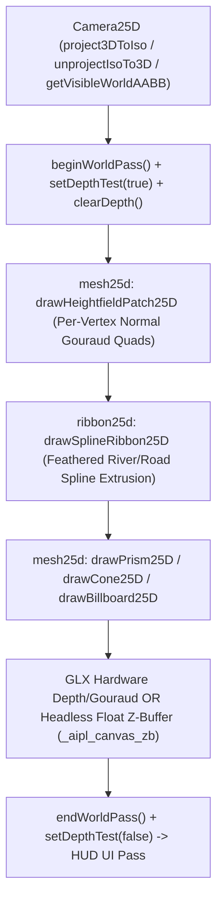

# ADR-0037: Continuous 2.5D/3D World Engine, Hardware/Software Z-Buffering & Per-Vertex Gouraud Pipeline

## Status
Accepted

## Date
2026-11-09

## Deciders
AIPL Core Architecture, Graphics Runtime & Autonomous Agent Systems Team

## Context
Building expansive, organic 2.5D and 3D continuous worlds (terrains, rivers, forests, bridges, buildings, and moving characters) previously encountered five systemic bottlenecks across the runtime, standard library, and autonomous verification tooling:
1. **Flat-Shaded Diamond Seams & Manual Layer-Sorting Bugs**: Relying on flat-colored 2D triangles (`drawTriangle`) and manual painter's-algorithm Y-sorting caused visible diagonal seams across heightfield terrain patches and depth-order popping when tall structures, bridges, or trees overlapped moving agents.
2. **X11 32-Bit Visual Alpha Bleed**: Drawing translucent primitives (`a < 255`, such as water ripples, shadows, or foliage) in GLX mode overwrote destination framebuffer alpha (`alpha_dst < 1.0`), causing desktop compositors (Mutter, KWin, Picom) to bleed the desktop wallpaper through the game window.
3. **World-Space Geometry Polluting UI Hitbox Telemetry**: Drawing thousands of world-space circles and rectangles (tree canopies, drop shadows, particles) in immediate mode registered each primitive in `/tmp/aipl_windows/win_<pid>.state.json`, triggering false-positive `smallHitboxWarnings` in automated UI audits.
4. **In-Loop Screenshot Readback & Exit Clobbering**: Calling `saveScreenshot` mid-loop under GLX read stale CPU memory unless `glReadPixels` synchronized VRAM first, and `--screenshot` unconditionally overwrote the file at program exit.
5. **HEBAR Autonomous Referee Handshake & Trajectory Bounds**: External referee bots required deterministic IPC window discovery (`connectTargetWindow`) and strict 5-bound human-equivalence enforcement (`150-250ms` reaction latency, `<= 15 Hz` action frequency, `<= 780 px/s` cursor velocity, `<= 2*PI rad/s` angular slew, and zero state tampering).

To solve these challenges cohesively, AIPL introduces the **Continuous 2.5D/3D World Engine (`std/gfx25d/`)**, **Hardware/Software Z-Buffering & Per-Vertex Gouraud Shading (`runtime/rt_gui_audio.c`)**, **Postfix Functional Struct Updates (`orig { field = val }`)**, and the **5-Bound HEBAR Referee (`std/hebar/referee.aipl`)**.

---

## Decision Drivers
- **Zero-Seam Continuous Terrain & Volumetric Interleaving**: Render smooth per-vertex Gouraud-interpolated triangles and quads (`drawTriangleGouraud`, `drawTriangle3DGouraud`, `drawQuad3DGouraud`) backed by hardware `GL_DEPTH_TEST` (`GL_LEQUAL`) in GLX and an identical 32-bit float Z-buffer (`_aipl_canvas_zb`) in headless software mode.
- **Invertible 2.5D Isometric Camera with Elevation-Aware Culling**: Provide exact closed-form `project3DToIso` and `unprojectIsoTo3D` transforms alongside `getVisibleWorldAABB(cam, minElevation, maxElevation)` so high mountain peaks and deep river gorges are never prematurely clipped.
- **X11 Compositor Destination Alpha Lock**: Lock destination alpha to `1.0` via `glColorMask(1, 1, 1, 0)` after `glClear` so translucent blends never punch transparency holes into X11 windows.
- **World Pass Telemetry Isolation**: Bracket 2.5D/3D world rendering with `beginWorldPass()` and `endWorldPass()` (`setUiTracking(false/true)`) so only true HUD/UI widgets populate window state telemetry.
- **Ergonomic Value-Safe Struct Updates**: Support `orig { field = val }` postfix functional struct updates and `cloneStruct(s)` deep cloning to eliminate accidental pointer aliasing across simulation ticks.

---

## Considered Options

### Option 1: Painter's Algorithm Y-Sorting in Pure 2D
Sort all terrain tiles, trees, and entities by screen Y coordinate every frame using flat 2D polygons.
- *Pros*: Requires no Z-buffer or 3D vertex pipeline changes.
- *Cons*: **Rejected**. Fails on intersecting 3D volumes (bridges over rivers, multi-tile buildings, steep cliffs), produces visible flat-shaded polygon seams, and incurs $O(N \log N)$ per-frame sorting overhead.

### Option 2: External Heavyweight 3D Scene Graph Dependency
Embed an external C++ 3D engine (e.g., Ogre3D or Three.js wrapper) via FFI.
- *Pros*: Built-in mesh loaders and shaders.
- *Cons*: **Rejected**. Violates AIPL's zero-dependency C99/GLX runtime design, breaks bit-for-bit headless software rasterizer parity, and bloats compile times.

### Option 3: Unified GLX/Software Z-Buffer + Per-Vertex Gouraud Intrinsics + `std/gfx25d/` Package
Upgrade the native GLX and software canvas blitter with per-vertex $(x, y, z, r, g, b, a)$ Gouraud interpolation and depth testing, paired with a pure-AIPL `std/gfx25d/` standard library domain (`camera25d`, `mesh25d`, `ribbon25d`).
- *Pros*: **Accepted**. Guarantees pixel-level parity between hardware GLX and headless CI software rendering, eliminates terrain seams and depth-sorting bugs in $O(1)$ per pixel, preserves `< 50ms` compilation, and integrates cleanly with HEBAR verification.

---

## Decision Outcome & Rationale
**Chosen: Option 3 — Unified GLX/Software Z-Buffer + Per-Vertex Gouraud Intrinsics + `std/gfx25d/` Package.**

### Architecture & Pipeline Overview

### Key Technical Invariants

1. **Dual-Backend Z-Buffer, 4 Blend Modes, Alpha-Tested Cutouts, Gouraud & UV Texture Parity (`runtime/rt_gui_audio.c`)**:
   - `_AiplGlVertex` stores `{ float x, y, z, u, v; uint8_t r, g, b, a; }`, and `_AiplImageSlot` caches lazy-uploaded hardware `gl_tex_id` (`GL_REPEAT` wrap `0x2901`, `GL_LINEAR` filter `0x2601`).
   - `setDepthTest(true)` enables `GL_DEPTH_TEST` with `GL_LEQUAL` on the 16-bit GLX depth buffer and activates barycentric Z-interpolation against `_aipl_canvas_zb` (`z <= zb[idx]`) in the software rasterizer.
   - `setBlendMode(mode)` and `getBlendMode()` support 4 canonical blend modes across GLX (`glBlendFunc` + `glDepthMask(0)` when `mode != 0`) and software (`_aipl_blend_pixel`): `0` (`blendModeAlpha()`), `1` (`blendModeAdditive()`), `2` (`blendModeMultiplied()`), and `3` (`blendModeScreen()`).
   - Alpha-tested Z-buffer cutouts (`GL_ALPHA_TEST` with `glAlphaFunc(GL_GREATER, 0.05f)` in GLX; `pa > 12` check before `zrow[px] = pz` in software) ensure transparent sprite corners never punch rectangular depth holes into geometry behind them.
   - `drawTriangle3DTextured` and `drawQuad3DTextured` modulate `GL_REPEAT` wrapped texels (`u - floor(u)`, `v - floor(v)`) with per-vertex Gouraud colors (`(texelChannel * vertexChannel) / 255`) in both GLX and software mode.
   - `createTextureFromRgba`, `createProceduralTexture` (`"grass"`, `"rock"`, `"cliff"`, `"dirt"`, `"cobble"`, `"water"`, `"wood"`, `"bark"`, `"foliage"`, `"brick"`, `"roof"`, `"sand"`, `"snow"`, `"light_cookie"`, `"radial_light"`, `"mist"`, `"fog"`, `"palisade"`, `"spiked_log"`), `createIsometricSpriteSheet` (`"hero_knight"`, `"paladin"`, `"rogue"`, `"skeleton"`, `"demon"`, `"campfire"`, `"gothic_tree"`, `"dead_tree"`), and `saveTextureToPpm` provide zero-dependency procedural/bitmap texture synthesis, 3D-raymarched isometric sprite sheets, and binary P6 PPM persistence.
   - `clearDepth()` clears `GL_DEPTH_BUFFER_BIT` and resets `_aipl_canvas_zb[i] = 1.0e30f`.

2. **X11 Compositor Alpha Protection (`runtime/rt_gui_audio.c`)**:
   - `aipl_rt_clearScreen` clears RGBA with `a = 1.0f` and immediately calls `glColorMask(1, 1, 1, 0)` so subsequent `GL_SRC_ALPHA, GL_ONE_MINUS_SRC_ALPHA` blends never overwrite the window's opaque destination alpha channel.

3. **Camera25D Invertibility, Elevation Culling, Multi-Biome Splatting, 2.5D Lighting, 8-Dir Sprite Rigs & Weather (`std/gfx25d/`)**:
   - For any world coordinate $(wx, wy, wz)$, projecting via `p = project3DToIso(cam, wx, wy, wz)` and unprojecting via `u = unprojectIsoTo3D(cam, p.x, p.y, wz)` satisfies $|u.x - wx| < 10^{-3}$ and $|u.y - wy| < 10^{-3}$.
   - `getVisibleWorldAABB(cam, minElevation, maxElevation)` expands the ground-plane frustum footprint by both `minElevation` and `maxElevation` vertical offsets so tall geometry never pops at screen edges.
   - `drawHeightfieldPatchTextured25D`, `drawHeightfieldSplat25D`, `drawGroundDecal25D`, `drawSplineRibbonTextured25D`, `drawPrismTextured25D`, `drawIndexedMeshTextured25D`, `renderLightingPass25D` (`std/gfx25d/light25d`), `drawIsoSpriteRig25D` & `drawBillboardCutout25D` (`std/gfx25d/sprite25d`), and `drawMistPlanes25D` & `drawWeatherParticles25D` (`std/gfx25d/weather25d`) combine normal-shaded Gouraud lighting with multi-biome alpha-splatted terrain textures, UV-scrolled rivers/roads, textured architectural volumes, ambient multiply + additive light cookies, 8-directional character rigs, and atmospheric weather.

4. **5-Bound HEBAR Referee (`std/ai/hebar_referee.aipl`, `std/hebar/referee.aipl`)**:
   - Enforces `150..250ms` FIFO reaction latency, `<= 15 Hz` action frequency (`>= 66ms` interval), `<= 780 px/s` cursor trajectory velocity (`hebarStepCursorTrajectory`), `<= 2*PI rad/s` angular slew (`hebarClampAngularSlew`), and zero memory tampering (`hebarVerifyZeroTampering`).

---

## Verification & Proof
The architecture is comprehensively verified through:
- Unit tests: `tests/functions/gfx25d/camera25d_test.aipl`
- Unit tests: `tests/functions/gfx25d/mesh25d_test.aipl`
- Unit tests: `tests/functions/gfx25d/ribbon25d_test.aipl`
- Unit tests: `tests/functions/gfx25d/light25d_test.aipl`
- Unit tests: `tests/functions/gfx25d/sprite25d_test.aipl`
- Unit tests: `tests/functions/gfx25d/weather25d_test.aipl`
- Unit tests: `tests/functions/gfx2d/shape2d_test.aipl`
- Unit tests: `tests/functions/ai/hebar_referee_test.aipl` & `tests/functions/hebar/referee_test.aipl`
- Canonical 2.5D showcases & twin tests: `examples/ex_259_continuous_world_25d.aipl` (`tests/examples/ex_259_continuous_world_25d_test.aipl`), `examples/ex_260_textured_25d_village_and_river_window.aipl` (`tests/examples/ex_260_textured_25d_village_and_river_window_test.aipl`), `examples/ex_261_textured_3d_gallery_and_uv_mesh_window.aipl` (`tests/examples/ex_261_textured_3d_gallery_and_uv_mesh_window_test.aipl`), `examples/ex_262_dark_fantasy_encampment_arpg_window.aipl` (`tests/examples/ex_262_dark_fantasy_encampment_arpg_window_test.aipl`), and `examples/ex_263_isometric_8dir_rig_and_lighting_lab_window.aipl` (`tests/examples/ex_263_isometric_8dir_rig_and_lighting_lab_window_test.aipl`)
