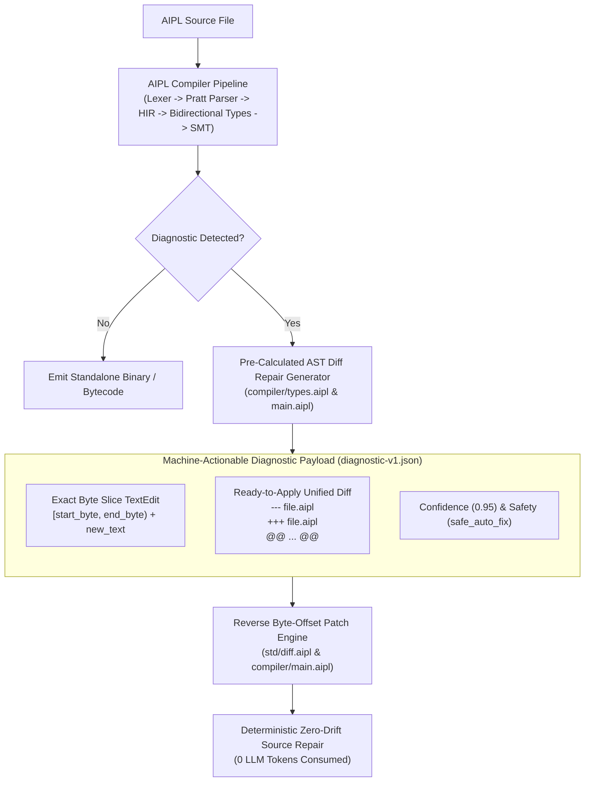
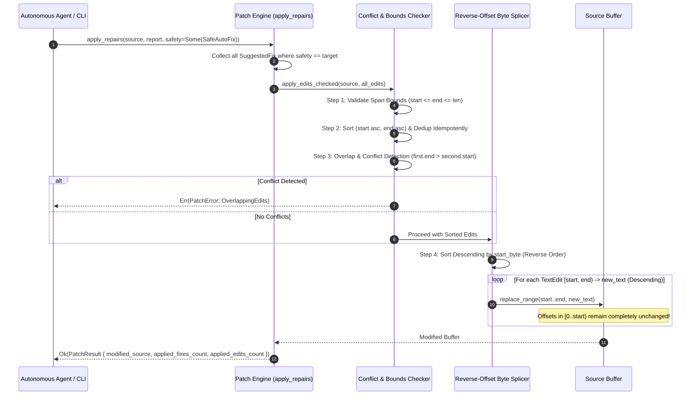
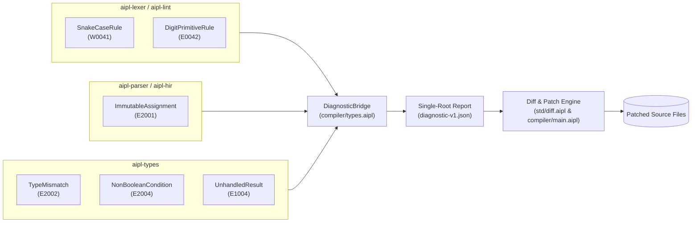

# AIPL Agent Tooling & Pre-Calculated AST Diff Repair Specification

This document provides the authoritative technical reference for the **Agent-First Auto-Repair & Diff Patching Engine** in the AI-Programming Language (AIPL). It defines the philosophy, repair catalog, mathematical drift prevention, patch engine mechanics, and CLI interfaces implemented across [`compiler/types.aipl`](../compiler/types.aipl), [`std/regex/text_diff.aipl`](../std/regex/text_diff.aipl), [`compiler/main.aipl`](../compiler/main.aipl), and [`compiler/hir.aipl`](../compiler/hir.aipl).

---

## 1. Executive Overview: Agent-First Auto-Repair Philosophy

Autonomous AI coding agents operate within constrained compute, token, and latency budgets. In traditional compiler workflows (e.g., GCC, Clang, `rustc`, `tsc`), encountering an error triggers a destructive and inefficient cycle:

```
[Agent Emits Code] -> [Compiler Fails] -> [Raw Terminal Log Printed] 
                   -> [Agent Reads Log] -> [Full File Regeneration] -> [New Syntax/Type Errors]
```

This traditional cycle introduces severe failure modes for autonomous systems:
1. **Token Budget Depletion**: Re-prompting the LLM with conversational error messages and demanding full-file regenerations consumes thousands of context tokens per trivial bug.
2. **Context Latency Inflation**: Every inference round-trip incurs seconds of generation latency, degrading interactive agent workflows.
3. **Hallucination Cascades & Drift**: When regenerating entire source files to fix a minor type mismatch or missing keyword, LLMs frequently introduce subtle hallucinations, erase unrelated logic, or break formatting in previously valid sections.
4. **Caret Pointer Brittleness**: Human-oriented ASCII art carets (`^~~~`) and terminal escape sequences (`\x1b[`) cause token fragmentation and off-by-one column errors across varying LLM tokenizer vocabularies.

### The AIPL Philosophy: The Compiler as an Automated Repair Synthesizer

In AIPL, the compiler is not merely an error validator; it is a **deterministic, machine-actionable repair engine**. Whenever the compiler or linter identifies a syntax, tokenomics, scoping, or type violation for which a canonical semantic correction exists, it pre-calculates the exact fix before emitting the diagnostic report.



### Dual-Representation Architecture

To serve both programmatic toolchains and human-in-the-loop oversight, every [`CandidateRepair`](../compiler/types.aipl) provides dual payloads:

1. **Exact Byte-Slice [`TextEdit`](../compiler/types.aipl)**:
   - Defined by half-open byte offsets `[start_byte, end_byte)` paired with replacement string `new_text`.
   - Optimized for sub-millisecond, in-memory patch engines, programmatic agent tool runners, and Language Server Protocol (LSP) integrations without string re-encoding.
2. **Self-Contained Unified Diff (`diff_unified`)**:
   - Standard unified diff format (`--- file\n+++ file\n@@ -L,C +L,C @@`).
   - Enables standard patch tools (`git apply`, `patch -p1`), human visual verification in pull requests, and direct display in agent reasoning traces.

### The Candidate Repair Contract

Every candidate repair emitted by AIPL adheres to four strict operational invariants:
- **Calibrated Confidence**: Numeric score between `0.0` and `1.0`. Deterministic compiler transformations carry `confidence: 0.95` or `1.0`.
- **Verified Safety Level**: Categorized under [`FixSafety`](../compiler/types.aipl):
  - `safe_auto_fix`: Guaranteed semantic preservation, zero side-effects, safe for unattended batch application by autonomous agents.
  - `requires_intent`: Multiple semantically valid alternatives exist; requires agent decision.
  - `potentially_breaking`: May alter runtime semantics (e.g. adding structural field defaults).
- **Exact Byte Locators**: Grounded in zero-indexed byte offsets matching the SHA-256 source file hash (`file_hash`).
- **Zero ANSI Contamination**: Clean strings devoid of `\x1b[` escapes or formatting carets.

---

## 2. Auto-Repair Rule Catalog

The AIPL compiler and linter suite natively implements six primary automated repair rules. Each rule resolves a fundamental language invariant with `safety: safe_auto_fix` and `confidence: 0.95`.

---

### Rule 1: Missing `mut` Keyword (`AIPL_E2001_IMMUTABLE_ASSIGNMENT`)

#### Invariant & Semantic Rationale
AIPL enforces immutability by default. Variables declared with `let` cannot be reassigned or mutated. When a variable is reassigned (`=`) or modified via compound assignment (`+=`, `-=`, `*=`, `/=`), it must be declared with `mut`. 

Rather than requiring the agent to locate the declaration site across dozens of lines of code, the compiler traces the identifier through [`HirResolver`](../compiler/hir.aipl), identifies the originating binding statement, and synthesizes a patch that promotes `let` to `mut`.

#### Technical Specifications
- **Diagnostic Code**: `AIPL_E2001_IMMUTABLE_ASSIGNMENT`
- **Severity**: `error`
- **Confidence**: `0.95`
- **Safety**: `safe_auto_fix`
- **Subsystem Origin**: [`compiler/hir.aipl`](../compiler/hir.aipl) & [`compiler/types.aipl`](../compiler/types.aipl)

#### Before and After
```aipl-invalid
// --- BEFORE (Violation: AIPL_E2001_IMMUTABLE_ASSIGNMENT) ---
fn calculateTotal(base: int): int:
  let total = base
  total = total + 10
  ret total
```

```aipl
// +++ AFTER (Repaired) +++
fn calculateTotal(base: int): int:
  mut total = base
  total = total + 10
  ret total
```

#### Diagnostic JSON Payload
```json
{
  "id": "ERR-1001",
  "code": "AIPL_E2001_IMMUTABLE_ASSIGNMENT",
  "severity": "error",
  "role": "primary_fault",
  "cascade": false,
  "message": "Cannot assign to immutable variable 'total'. Variables declared with 'let' are immutable; declare with 'mut' to allow reassignment.",
  "rule": {
    "id": "AIPL_E2001_IMMUTABLE_ASSIGNMENT",
    "description": "AIPL Canonical HIR Semantic & Scoping Invariant"
  },
  "location": {
    "start_byte": 55,
    "end_byte": 60,
    "start": { "line": 3, "column": 3, "utf16_offset": 55 },
    "end": { "line": 3, "column": 8, "utf16_offset": 60 },
    "ast_path": ["program", "functions", "calculateTotal", "body", "stmts", "1", "target"]
  },
  "context": {
    "enclosing_symbol": "calculateTotal",
    "snippet": "  total = total + 10",
    "focus_line": 3
  },
  "suggested_fixes": [
    {
      "title": "Promote variable 'total' declaration from 'let' to 'mut'",
      "confidence": 0.95,
      "safety": "safe_auto_fix",
      "edits": [
        {
          "start_byte": 36,
          "end_byte": 39,
          "new_text": "mut"
        }
      ],
      "diff_unified": "--- src/math.aipl\n+++ src/math.aipl\n@@ -2,1 +2,1 @@\n-  let total = base\n+  mut total = base\n"
    }
  ]
}
```

---

### Rule 2: Casing Invariant (`AIPL_W0041_SNAKE_CASE_TOKEN_PENALTY`)

#### Invariant & Tokenomics Justification
AIPL strictly enforces `camelCase` for variable names, function identifiers, parameters, and record fields, and `PascalCase` for nominal types (structs, enums, type aliases). The underscore character `_` is banned in identifiers, reserved exclusively as an anonymous discard pattern.

> [!NOTE]
> **SentencePiece 256k Tokenomics Justification**:
> Modern LLM tokenizers (such as SentencePiece 256k unigram models) treat underscores as independent boundary tokens. When an agent emits snake_case identifiers such as `user_account_balance`, the tokenizer fragments the string into 5 distinct tokens (`user`, `_`, `account`, `_`, `balance`). In contrast, camelCase (`userAccountBalance`) matches common fused BPE vocabulary tokens, saving up to 60% of subword tokens per identifier. Enforcing camelCase preserves agent context windows and accelerates inference throughput.

#### Technical Specifications
- **Diagnostic Code**: `AIPL_W0041_SNAKE_CASE_TOKEN_PENALTY`
- **Severity**: `warning`
- **Confidence**: `0.95`
- **Safety**: `safe_auto_fix`
- **Subsystem Origin**: [`compiler/lexer.aipl`](../compiler/lexer.aipl) & [`compiler/main.aipl`](../compiler/main.aipl)

#### Before and After
```aipl-invalid
// --- BEFORE (Violation: AIPL_W0041_SNAKE_CASE_TOKEN_PENALTY) ---
let user_name: str = "Alice"
let max_retry_count: int = 3
```

```aipl
// +++ AFTER (Repaired) +++
let userName: str = "Alice"
let maxRetryCount: int = 3
```

#### Diagnostic JSON Payload
```json
{
  "id": "WARN-1002",
  "code": "AIPL_W0041_SNAKE_CASE_TOKEN_PENALTY",
  "severity": "warning",
  "role": "primary_fault",
  "cascade": false,
  "message": "Identifier 'user_name' contains forbidden underscores (AIPL_W0041_SNAKE_CASE_TOKEN_PENALTY). In SentencePiece 256k, underscores cause severe token fragmentation. Rename to 'userName'.",
  "rule": {
    "id": "AIPL_W0041_SNAKE_CASE_TOKEN_PENALTY",
    "description": "AIPL Tokenomics & Lexical Formatting Invariant"
  },
  "location": {
    "start_byte": 4,
    "end_byte": 13,
    "start": { "line": 1, "column": 5, "utf16_offset": 4 },
    "end": { "line": 1, "column": 14, "utf16_offset": 13 },
    "ast_path": ["program", "stmts", "0", "pattern", "ident"]
  },
  "context": {
    "snippet": "let user_name: str = \"Alice\"",
    "focus_line": 1
  },
  "suggested_fixes": [
    {
      "title": "Rename 'user_name' to 'userName'",
      "confidence": 0.95,
      "safety": "safe_auto_fix",
      "edits": [
        {
          "start_byte": 4,
          "end_byte": 13,
          "new_text": "userName"
        }
      ],
      "diff_unified": "--- src/user.aipl\n+++ src/user.aipl\n@@ -1,1 +1,1 @@\n-let user_name: str = \"Alice\"\n+let userName: str = \"Alice\"\n"
    }
  ]
}
```

---

### Rule 3: Digit Primitive Ban (`AIPL_E0042_DIGIT_PRIMITIVE_FORBIDDEN`)

#### Invariant & Semantic Rationale
AIPL completely eliminates hardware-centric digit-suffixed primitive types (`i32`, `i64`, `u32`, `u64`, `f32`, `f64`, `u8`, `int32`, `uint64`). Instead, AIPL provides four canonical, digit-free primitives:
- `int`: Arbitrary/64-bit signed integer.
- `float`: IEEE 754 64-bit floating point.
- `byte`: Unsigned 8-bit byte.
- `num`: SMT-constrained polymorphic numeric type.

Digit suffixes fragment LLM tokens and lead to pointless mental model friction for coding agents. When an agent trained on Rust or C++ outputs `i32` or `u64`, the lexer and linter immediately intercept the token and substitute the canonical AIPL primitive.

#### Technical Specifications
- **Diagnostic Code**: `AIPL_E0042_DIGIT_PRIMITIVE_FORBIDDEN`
- **Severity**: `error`
- **Confidence**: `0.95`
- **Safety**: `safe_auto_fix`
- **Subsystem Origin**: [`compiler/lexer.aipl`](../compiler/lexer.aipl) & [`compiler/main.aipl`](../compiler/main.aipl)

#### Canonical Type Mapping Table
| Banned Type Identifier | Canonical AIPL Replacement | Classification |
|:---|:---|:---|
| `i32`, `i64`, `int32`, `int64`, `u32`, `u64`, `uint32`, `uint64` | `int` | Integer Primitive |
| `f32`, `f64`, `float32`, `float64` | `float` | Floating Point Primitive |
| `u8`, `uint8`, `i8`, `int8` | `byte` | Byte Primitive |
| `isize`, `usize` | `int` | Architecture Pointer Sized Integer |

#### Before and After
```aipl-invalid
// --- BEFORE (Violation: AIPL_E0042_DIGIT_PRIMITIVE_FORBIDDEN) ---
fn computeChecksum(buffer: List[u8], length: i32): u64:
  ret 0
```

```aipl
// +++ AFTER (Repaired) +++
fn computeChecksum(buffer: List[byte], length: int): int:
  ret 0
```

#### Diagnostic JSON Payload
```json
{
  "id": "ERR-1003",
  "code": "AIPL_E0042_DIGIT_PRIMITIVE_FORBIDDEN",
  "severity": "error",
  "role": "primary_fault",
  "cascade": false,
  "message": "Digit-suffixed primitive type 'i32' is strictly forbidden (AIPL_E0042_DIGIT_PRIMITIVE_FORBIDDEN). Replace with digit-free primitive 'int'.",
  "rule": {
    "id": "AIPL_E0042_DIGIT_PRIMITIVE_FORBIDDEN",
    "description": "AIPL Tokenomics & Lexical Formatting Invariant"
  },
  "location": {
    "start_byte": 45,
    "end_byte": 48,
    "start": { "line": 1, "column": 46, "utf16_offset": 45 },
    "end": { "line": 1, "column": 49, "utf16_offset": 48 },
    "ast_path": ["program", "functions", "computeChecksum", "params", "length", "type"]
  },
  "context": {
    "snippet": "fn computeChecksum(buffer: List[u8], length: i32): u64:",
    "focus_line": 1
  },
  "suggested_fixes": [
    {
      "title": "Replace 'i32' with 'int'",
      "confidence": 0.95,
      "safety": "safe_auto_fix",
      "edits": [
        {
          "start_byte": 45,
          "end_byte": 48,
          "new_text": "int"
        }
      ],
      "diff_unified": "--- src/crypto.aipl\n+++ src/crypto.aipl\n@@ -1,1 +1,1 @@\n-fn computeChecksum(buffer: List[u8], length: i32): u64:\n+fn computeChecksum(buffer: List[u8], length: int): u64:\n"
    }
  ]
}
```

---

### Rule 4: Unhandled Result (`AIL_E1004_UNHANDLED_RESULT`)

#### Invariant & Semantic Rationale
AIPL functions that return `Result[T, E]` enforce mandatory handling. Standalone expressions yielding a `Result` cannot be silently dropped as statement expressions. This prevents silent failure bugs common in systems scripting.

When an agent invokes a fallible function inside an error-propagating context (a function returning compatible `Result[U, E]`), the compiler synthesizes the canonical postfix `?` try operator, desugaring the expression into early error propagation.

#### Technical Specifications
- **Diagnostic Code**: `AIL_E1004_UNHANDLED_RESULT`
- **Severity**: `error`
- **Confidence**: `0.95`
- **Safety**: `safe_auto_fix`
- **Subsystem Origin**: [`compiler/types.aipl`](../compiler/types.aipl)

#### Before and After
```aipl-invalid
// --- BEFORE (Violation: AIL_E1004_UNHANDLED_RESULT) ---
fn syncData(path: str): Result[void, IoError]:
  writeFile(path, "payload")
  ret Ok(nil)
```

```aipl
// +++ AFTER (Repaired) +++
fn syncData(path: str): Result[void, IoError]:
  writeFile(path, "payload")?
  ret Ok(nil)
```

#### Diagnostic JSON Payload
```json
{
  "id": "ERR-1004",
  "code": "AIL_E1004_UNHANDLED_RESULT",
  "severity": "error",
  "role": "primary_fault",
  "cascade": false,
  "message": "Unhandled result: expression evaluates to 'Result[void, IoError]' as a standalone statement without being handled. Result values must be handled via postfix '?', pattern matched with 'match', or explicitly bound with 'let'.",
  "rule": {
    "id": "AIL_E1004_UNHANDLED_RESULT",
    "description": "AIPL Algebraic Result Handling Invariant"
  },
  "location": {
    "start_byte": 49,
    "end_byte": 74,
    "start": { "line": 2, "column": 3, "utf16_offset": 49 },
    "end": { "line": 2, "column": 28, "utf16_offset": 74 },
    "ast_path": ["program", "functions", "syncData", "body", "stmts", "0"]
  },
  "context": {
    "enclosing_symbol": "syncData",
    "snippet": "  writeFile(path, \"payload\")",
    "focus_line": 2
  },
  "suggested_fixes": [
    {
      "title": "Propagate error using postfix '?'",
      "confidence": 0.95,
      "safety": "safe_auto_fix",
      "edits": [
        {
          "start_byte": 74,
          "end_byte": 74,
          "new_text": "?"
        }
      ],
      "diff_unified": "--- src/io.aipl\n+++ src/io.aipl\n@@ -2,1 +2,1 @@\n-  writeFile(path, \"payload\")\n+  writeFile(path, \"payload\")?\n"
    }
  ]
}
```

---

### Rule 5: Literal Type Mismatch (`AIPL_E2002_TYPE_MISMATCH`)

#### Invariant & Semantic Rationale
AIPL enforces **zero implicit coercion**. Unlike JavaScript or Python, AIPL will never auto-coerce strings to integers or integers to floats:
- Passing string literal `"20"` where an `int` is expected is rejected.
- Passing integer literal `20` where a `float` is expected is rejected.

When the compiler detects a literal AST node whose parsed value unambiguously satisfies the expected target type (e.g. `"20"` to `20`, or `100` to `100.0`), it synthesizes an exact literal transformation.

#### Technical Specifications
- **Diagnostic Code**: `AIPL_E2002_TYPE_MISMATCH`
- **Severity**: `error`
- **Confidence**: `0.95`
- **Safety**: `safe_auto_fix`
- **Subsystem Origin**: [`compiler/types.aipl`](../compiler/types.aipl)

#### Before and After
```aipl-invalid
// --- BEFORE (Violation: AIPL_E2002_TYPE_MISMATCH) ---
let timeoutSeconds: int = "30"
let targetRate: float = 10
```

```aipl
// +++ AFTER (Repaired) +++
let timeoutSeconds: int = 30
let targetRate: float = 10.0
```

#### Diagnostic JSON Payload
```json
{
  "id": "ERR-1005",
  "code": "AIPL_E2002_TYPE_MISMATCH",
  "severity": "error",
  "role": "primary_fault",
  "cascade": false,
  "message": "Mismatched types: expected 'int', found 'str'. Zero implicit coercion: string literal cannot be assigned to integer.",
  "rule": {
    "id": "AIPL_E2002_TYPE_MISMATCH",
    "description": "AIPL Sound Bidirectional Type System Invariant"
  },
  "location": {
    "start_byte": 26,
    "end_byte": 30,
    "start": { "line": 1, "column": 27, "utf16_offset": 26 },
    "end": { "line": 1, "column": 31, "utf16_offset": 30 },
    "ast_path": ["program", "stmts", "0", "rhs", "literal"]
  },
  "context": {
    "snippet": "let timeoutSeconds: int = \"30\"",
    "focus_line": 1
  },
  "suggested_fixes": [
    {
      "title": "Convert string literal '\"30\"' to integer literal 30",
      "confidence": 0.95,
      "safety": "safe_auto_fix",
      "edits": [
        {
          "start_byte": 26,
          "end_byte": 30,
          "new_text": "30"
        }
      ],
      "diff_unified": "--- src/config.aipl\n+++ src/config.aipl\n@@ -1,1 +1,1 @@\n-let timeoutSeconds: int = \"30\"\n+let timeoutSeconds: int = 30\n"
    }
  ]
}
```

---

### Rule 6: Non-Boolean Condition (`AIPL_E2004_NON_BOOLEAN_CONDITION`)

#### Invariant & Semantic Rationale
AIPL strictly forbids "truthiness" semantics. Conditions in `if` statements, `while` loops, and ternary expressions must evaluate strictly to nominal type `bool`. Passing numbers, strings, collections, or pointers directly into conditions triggers `AIPL_E2004_NON_BOOLEAN_CONDITION`.

The type checker inspects the operand's concrete type and synthesizes a strict comparison:
- `List[T]` or `Buffer`: rewrites `items` to `items.len() > 0`
- `int`: rewrites `count` to `count != 0` or `count > 0`
- `str`: rewrites `name` to `name.len() > 0`
- `Option[T]`: rewrites `opt` to `opt != nil`

#### Technical Specifications
- **Diagnostic Code**: `AIPL_E2004_NON_BOOLEAN_CONDITION`
- **Severity**: `error`
- **Confidence**: `0.95`
- **Safety**: `safe_auto_fix`
- **Subsystem Origin**: [`compiler/types.aipl`](../compiler/types.aipl)

#### Before and After
```aipl-invalid
// --- BEFORE (Violation: AIPL_E2004_NON_BOOLEAN_CONDITION) ---
fn processBatch(items: List[int]): void:
  if items:
    dispatch(items)
```

```aipl
// +++ AFTER (Repaired) +++
fn processBatch(items: List[int]): void:
  if items.len() > 0:
    dispatch(items)
```

#### Diagnostic JSON Payload
```json
{
  "id": "ERR-1006",
  "code": "AIPL_E2004_NON_BOOLEAN_CONDITION",
  "severity": "error",
  "role": "primary_fault",
  "cascade": false,
  "message": "Condition must evaluate strictly to 'bool', found 'List[int]'. AIPL forbids non-boolean truthiness.",
  "rule": {
    "id": "AIPL_E2004_NON_BOOLEAN_CONDITION",
    "description": "AIPL Sound Bidirectional Type System Invariant"
  },
  "location": {
    "start_byte": 46,
    "end_byte": 51,
    "start": { "line": 2, "column": 6, "utf16_offset": 46 },
    "end": { "line": 2, "column": 11, "utf16_offset": 51 },
    "ast_path": ["program", "functions", "processBatch", "body", "stmts", "0", "condition"]
  },
  "context": {
    "enclosing_symbol": "processBatch",
    "snippet": "  if items:",
    "focus_line": 2
  },
  "suggested_fixes": [
    {
      "title": "Check collection non-empty: 'items.len() > 0'",
      "confidence": 0.95,
      "safety": "safe_auto_fix",
      "edits": [
        {
          "start_byte": 46,
          "end_byte": 51,
          "new_text": "items.len() > 0"
        }
      ],
      "diff_unified": "--- src/batch.aipl\n+++ src/batch.aipl\n@@ -2,1 +2,1 @@\n-  if items:\n+  if items.len() > 0:\n"
    }
  ]
}
```

---

## 3. Diff Application Guide & Patch Mechanics

The core repair application engine resides in [`std/regex/text_diff.aipl`](../std/regex/text_diff.aipl). It provides deterministic patch execution through two complementary functions:
1. [`apply_repairs(source, report, safety_filter)`](../std/regex/text_diff.aipl): In-memory AST byte-slice application directly from a diagnostic report.
2. [`apply_unified_diff(source, diff_str)`](../std/regex/text_diff.aipl): Direct parsing and hunk application of standard unified diffs.



---

### Zero Coordinate Drift: Mathematical Proof

When multiple edits are applied sequentially from beginning to end (forward order), any edit that alters text length shifts the byte offsets of all subsequent code. Applying subsequent edits using their original byte coordinates results in **coordinate drift**, corrupting the source file.

AIPL eliminates coordinate drift mathematically by enforcing **reverse byte-offset sorting**.

#### Mathematical Formulation & Proof
Let $S_0$ be the initial source string of byte length $L_0 = |S_0|$.

Let $E = \{e_1, e_2, \dots, e_n\}$ be a set of $n$ disjoint, non-overlapping text edits, where each edit $e_i$ is defined by:
$$e_i = (s_i, t_i, R_i)$$
where $s_i$ is the start byte, $t_i$ is the end byte, $0 \le s_i \le t_i \le L_0$, and $R_i$ is the replacement string with byte length $|R_i|$.

The non-overlapping invariant guarantees that for any two distinct edits $e_j, e_k$ with $s_j < s_k$:
$$t_j \le s_k$$

Sort the edits in descending order of their start byte:
$$s_1 \ge s_2 \ge \dots \ge s_n$$
Because the edits are non-overlapping, this strict partial order yields:
$$L_0 \ge t_1 \ge s_1 \ge t_2 \ge s_2 \ge \dots \ge t_n \ge s_n \ge 0$$

Define the inductive state after applying edit $e_i$ to buffer $S_{i-1}$:
$$S_i = S_{i-1}[0 \dots s_i) \mathbin{\Vert} R_i \mathbin{\Vert} S_{i-1}[t_i \dots |S_{i-1}|)$$

**Lemma (Prefix Invariance)**:
For any edit $e_i$, the byte slice $S_i[0 \dots s_i)$ is identical to $S_{i-1}[0 \dots s_i)$.

**Inductive Invariant**:
For every pending edit $e_k$ where $k > i$:
$$t_k \le s_k \le s_i$$
Since all coordinates of $e_k$ lie strictly within the interval $[0, s_i)$, and by the Prefix Invariance Lemma $S_i[0 \dots s_i) \equiv S_0[0 \dots s_i)$, the byte offsets $s_k$ and $t_k$ in $S_i$ reference the exact same character sequence as they did in original source $S_0$.

**Conclusion**:
Sorting edits in descending byte order ($b.start\_byte.cmp(\&a.start\_byte)$) guarantees that all pending byte offsets remain 100% stable and valid throughout execution. Coordinate drift is identically zero:
$$\Delta_{\text{drift}}(e_k) = 0 \quad \forall k \in \{1 \dots n\}$$

---

### Conflict Detection & Idempotency Invariants

[`apply_edits_checked`](../std/regex/text_diff.aipl) enforces four rigorous validation barriers:

#### 1. Out-of-Bounds & Inverted Span Guard
Before modifying any memory, every edit is validated against the source length:
```rust
for edit in edits {
    if edit.start_byte > edit.end_byte {
        return Err(PatchError::InvalidSpan {
            start_byte: edit.start_byte,
            end_byte: edit.end_byte,
        });
    }
    if edit.end_byte > source.len() {
        return Err(PatchError::OutOfBounds {
            byte_offset: edit.end_byte,
            source_len: source.len(),
        });
    }
}
```

#### 2. Idempotency via Deduplication
Autonomous agents frequently re-run linters or compile multiple times in a loop. If duplicate identical edits are submitted, the engine deduplicates them before verification:
```rust
deduped.sort_by(|a, b| {
    a.start_byte
        .cmp(&b.start_byte)
        .then_with(|| a.end_byte.cmp(&b.end_byte))
        .then_with(|| a.new_text.cmp(&b.new_text))
});
deduped.dedup();
```

#### 3. Overlapping Edit Collision Detection
Two distinct edits must never attempt to mutate overlapping byte ranges:
```rust
for i in 0..deduped.len().saturating_sub(1) {
    let first = &deduped[i];
    let second = &deduped[i + 1];

    // Overlap occurs if the earlier edit ends after the subsequent edit starts
    if first.end_byte > second.start_byte {
        return Err(PatchError::OverlappingEdits {
            first: first.clone(),
            second: second.clone(),
        });
    }
    // Identical insertion point with competing replacement strings
    if first.start_byte == second.start_byte
        && first.end_byte == second.end_byte
        && first.new_text != second.new_text
    {
        return Err(PatchError::OverlappingEdits {
            first: first.clone(),
            second: second.clone(),
        });
    }
}
```

#### 4. Idempotency Check Function ([`is_fix_applied`](../std/regex/text_diff.aipl))
The engine can pre-check if a fix has already been applied, preventing redundant patch cycles:
```rust
pub fn is_fix_applied(source: &str, fix: &SuggestedFix) -> bool {
    if fix.edits.is_empty() { return false; }
    for edit in &fix.edits {
        let expected_end = edit.start_byte + edit.new_text.len();
        if expected_end > source.len() { return false; }
        if &source[edit.start_byte..expected_end] != edit.new_text {
            return false;
        }
    }
    true
}
```

---

## 4. CLI Usage & Automation Workflows

AIPL exposes the auto-repair engine directly via the compiler command-line interface (`aipl fix`), enabling seamless integration into continuous integration, pre-commit hooks, and agent harness scripts.

### Command Line Interface

```bash
# Basic usage: Auto-repair a source file in place
aipl fix src/main.aipl

# Dry run mode: Print the unified diff to stdout without modifying files
aipl fix --dry-run src/main.aipl

# Filter by safety classification: Apply strictly safe fixes (default)
aipl fix --safety=safe_auto_fix src/service.aipl

# Filter by minimum confidence threshold (0.0 - 1.0)
aipl fix --confidence=0.95 src/service.aipl

# Machine-readable JSON output for agent runners and IDE extensions
aipl fix --dry-run --format=json src/service.aipl

# Recursive batch repair across an entire project
aipl fix --safety=safe_auto_fix src/**/*.aipl
```

### CLI Flags Reference

| Flag | Argument | Default | Description |
|:---|:---|:---|:---|
| `--dry-run` | None | `false` | Computes repairs and prints unified diff to stdout without altering files on disk. |
| `--safety` | `safe_auto_fix`, `safe`, `requires_intent`, `all` | `safe_auto_fix` | Restricts applied fixes to the specified safety threshold. |
| `--confidence` | Float (`0.0` - `1.0`) | `0.95` | Rejects fixes with confidence below this threshold. |
| `--format` | `text`, `diff`, `json` | `text` | Sets stdout formatting. `diff` prints pure patch; `json` outputs `AiplDiagnosticReport`. |
| `--backup` | None | `false` | Creates `.bak` snapshot before applying changes to disk. |

### Exit Codes & Headless Agent Contract

To allow autonomous agents to make deterministic branching decisions, `aipl fix` produces standardized POSIX exit codes:

| Exit Code | Symbol | Meaning | Recommended Agent Action |
|:---:|:---|:---|:---|
| `0` | `SUCCESS_CLEAN` | All diagnostics were repaired successfully; source is now valid. | Proceed to next task / commit code. |
| `1` | `ERRORS_REMAINING` | Auto-repairs were applied, but unfixable errors remain (e.g. unknown symbol). | Re-prompt LLM with remaining primary errors only. |
| `2` | `PATCH_CONFLICT` | Conflicting or overlapping edits detected; file was left untouched. | Investigate conflicting AST paths. |
| `3` | `IO_ERROR` | File could not be read, parsed, or written. | Verify file path permissions. |

---

## 5. End-to-End Architectural Integration

The auto-repair engine ties directly into the four foundational layers of the AIPL compiler infrastructure:



By providing deterministic, machine-actionable repairs with zero offset drift, AIPL allows AI coding agents to fix compiler and linter errors instantaneously—turning costly multi-turn conversational debugging into a single-pass, sub-millisecond automated operation.

---

## 6. Surgical AST Splicing (`aipl splice`) & Semantic Skeletonization (`aipl outline`)

To solve the dual problems of **full-file overwrite drift** and **context window depletion**, AIPL equips agents with two specialized high-precision CLI and programmatic tools:

### 6.1 `aipl splice`: CST Lens-Guided Symbol Splicing

- **Exact Byte Targeting**: Replaces target symbols (e.g. `takeDamage`, `Player.takeDamage`, structs, systems) directly at the CST node span.
- **Zero Drift Guarantee**: Guarantees zero diff lines outside the target symbol. Surrounding trivia, comments, and whitespace remain 100% byte-for-byte identical.
- **Bidirectional Lens Validation**: Automatically verifies classical lens laws (`Put(s, Get(s)) = s` and `Get(Put(s, v)) = v`) on every splice.

```bash
aipl splice src/player.aipl Player.takeDamage --content \
"fn takeDamage(amount: int): void:
    if amount <= 0:
      ret
    let blocked = amount.min(self.shield)
    self.shield -= blocked
    let rem = amount - blocked
    self.health -= rem"
```

### 6.2 `aipl outline`: Semantic Context Skeletonization

- **$\ge 80\%$ Token Reduction**: Strips function bodies, loop implementations, and computational logic to `= ...`, reducing token counts by over 80% on 1,500+ line modules.
- **Complete Signature Retention**: Preserves module declarations, imports, type aliases, enums, structs (fields + method signatures), interfaces, ECS systems, and shaders.
- **Machine-Actionable Schema (`--json`)**: Emits structured symbol graphs and reduction statistics for programmatic agent digestion.

```bash
aipl outline src/game/engine.aipl --json
```

For complete CLI invocation syntax, refer to [`docs/CLI_REFERENCE.md`](CLI_REFERENCE.md) and [`docs/ADR/ADR-0025-surgical-ast-splicing-skeletonization.md`](ADR/ADR-0025-surgical-ast-splicing-skeletonization.md).

---

## 7. Structured LLM Tooling & Compiler-Synthesized JSON Schema (Draft 2020-12)

Autonomous AI agents depend heavily on structured generation and tool calling. To eliminate manual schema drafting and JSON serialization boilerplate, the AIPL compiler synthesizes complete reflection, serialization, and validation facilities directly on user-defined data structures:

### 7.1 Universal Draft 2020-12 Schema Synthesis (`TypeName.jsonSchema()`)

Every nominal `struct` and `enum` automatically exposes a static `.jsonSchema()` method producing a compliant Draft 2020-12 JSON Schema (`"$schema": "https://json-schema.org/draft/2020-12/schema"`):
- **Object Schema Mapping**: Struct field types are mapped directly to standard JSON Schema constructs:
  - `str` $\rightarrow$ `{"type": "string"}`
  - `int` $\rightarrow$ `{"type": "integer"}`
  - `float` $\rightarrow$ `{"type": "number"}`
  - `bool` $\rightarrow$ `{"type": "boolean"}`
  - `[T]` $\rightarrow$ `{"type": "array", "items": <itemSchema>}`
  - Nested structs $\rightarrow$ recursive object definitions
- **Strict Invariants**: All declared fields are marked in `"required"`, and `"additionalProperties": false` is enforced by default to prevent LLM schema hallucinations.
- **Enum Synthesis**: Enums are synthesized as `{"type": "string", "enum": ["VariantA", "VariantB"]}`.

### 7.2 Zero-Boilerplate Serialization & Deserialization (`.toJson()` & `.fromJson()`)

- **`instance.toJson() -> str`**: Emits compact, standard RFC 8259 JSON strings.
- **`TypeName.fromJson(jsonStr: str) -> Result[TypeName, str]`**: Deserializes JSON strings into typed structs with comprehensive error handling, returning `Ok(instance)` or `Err("...")`.

---

## 8. Multi-Provider AI Runtime & HEBAR Referee (`std/ai/*`, `std/hebar/*`)

The standard library barrels [`std/ai/ai_mod.aipl`](../std/ai/ai_mod.aipl) and [`std/hebar/hebar_mod.aipl`](../std/hebar/hebar_mod.aipl) (re-exporting [`std/hebar/referee.aipl`](../std/hebar/referee.aipl)) deliver a unified, zero-dependency layer for frontier LLM tool-calling loops, vector RAG embeddings, game AI planners, and 5-bound biological fairness verification:
### 8.1 Multi-Provider Request Builders
- **`buildGeminiRequest(model, systemPrompt, userPrompt, responseSchemaJson)`**: Constructs standard Gemini REST API payloads with structured `responseSchema` generation configurations.
- **`buildOpenAiRequest(model, messages, responseSchemaJson)`**: Constructs OpenAI chat completion payloads with `response_format: { type: "json_schema", ... }`.
- **`buildAnthropicRequest(model, systemPrompt, messages, maxTokens)`**: Constructs Anthropic Messages API payloads with system instructions.
- **`buildOllamaRequest(model, prompt, formatSchemaJson)`**: Formats requests for local Ollama instances with format schemas.

### 8.2 Tool Calling & Schema Validation
- **`parseAiToolCall(responseJson: str) -> Result[AiToolCall, str]`**: Robust parser extracting tool name and argument JSON across OpenAI (`tool_calls`), Gemini (`functionCall`), and Anthropic formats.
- **`validateJsonAgainstSchema(jsonStr: str, schemaJson: str) -> Result[bool, str]`**: Validates whether a response payload satisfies required schema keys without external dependencies.
- **`renderPromptTemplate(template: str, vars: Map[str, str]) -> str`**: Substitutes template variables supporting both single `{var}` and double `{{var}}` interpolation braces.
- **`estimateTokenCount(text: str) -> int`**: Pure-AIPL heuristic token estimator calibrated against SentencePiece 256k and BPE vocabularies for prompt budgeting.

```text
import { buildGeminiRequest, buildOpenAiRequest, parseAiToolCall, estimateTokenCount } from "std/ai/ai_mod"

pub struct AgentToolParams:
  query: str
  limit: int

pub fn generateAgentRequests(): str:
  let schema = AgentToolParams.jsonSchema()
  let geminiPayload = buildGeminiRequest("gemini-2.5-pro", "You are an agent", "Find results", schema)
  let tokens = estimateTokenCount(geminiPayload)
  ret geminiPayload
```


