# AIPL Compiler Architecture & Engineering Pipeline (v0.9.0)
**Single Source of Truth (SSOT)**

[Home](../README.md) | [Docs Index](INDEX.md) | [Language Specification](SPEC.md) | [Grammar & Syntax](GRAMMAR_AND_SYNTAX.md) | [Build & Targets](BUILD_AND_TARGETS.md) | [Memory Model](MEMORY_MODEL.md) | [CLI Reference](CLI_REFERENCE.md)

> **When to Read This Document**: Read this document to understand the self-hosted compiler architecture, the 11 modular subsystems (`compiler/*.aipl`), Canonical HIR early bifurcation, 3-stage bootstrap fixed point, embedded SMT solver, and multi-target code generators.

---

## 1. Executive Summary & Pipeline Overview

The AIPL compiler is a 100% self-hosted system written entirely in AIPL, structured across 11 modular subsystems (`compiler/*.aipl`). It delivers extreme compilation velocity (<2ms for 10k LOC), sub-5ms incremental re-emit cycles, and machine-tractable agent interactions. The compiler employs a unified frontend that parses source text into a Canonical High-Level Intermediate Representation (Canonical HIR), where it undergoes **Early Bifurcation** into two primary codegen pipelines:

1. **Pipeline A (Web & Edge / TS-HTML5 Tier - `compiler/codegen_ts.aipl`)**: Transforms Canonical HIR into a TypeScript AST, emitting pristine, tree-shakeable TypeScript 5.x and React 19 JSX code, or self-contained single-file HTML5 web applications (`aipl bundle`) embedding a hardware-accelerated 2D/3D Canvas and WebGL visual runtime.
2. **Pipeline B (Standalone Native / C99 Tier - `compiler/codegen_c_or_ir.aipl` + `runtime/*`)**: Lowers Canonical HIR to optimized, zero-dependency ANSI/ISO C99 source (`#include <aipl_runtime.h>` in modular mode or standalone amalgamated C99 via `--c`), linking against the split modular C99 runtime (`runtime/aipl_runtime.h` with 125 hot `static inline` helpers, `runtime/rt_core.c`, `runtime/rt_crypto_data.c`, `runtime/rt_sys.c`, and `runtime/rt_gui_audio.c`) precompiled into content-addressed static archives (`.aipl/cache/v1/libaipl_rt-<hash16>.a` and `libaipl_rt_gui-<hash16>.a`), compiling in parallel across all CPU cores via host C compilers (`gcc`, `clang`) into native standalone binaries in milliseconds.
3. **Pipeline VM (Bytecode Tier - `compiler/bytecode.aipl`)**: Lowers Canonical HIR into a compact register-based virtual machine instruction set for immediate in-memory evaluation and REPL execution.

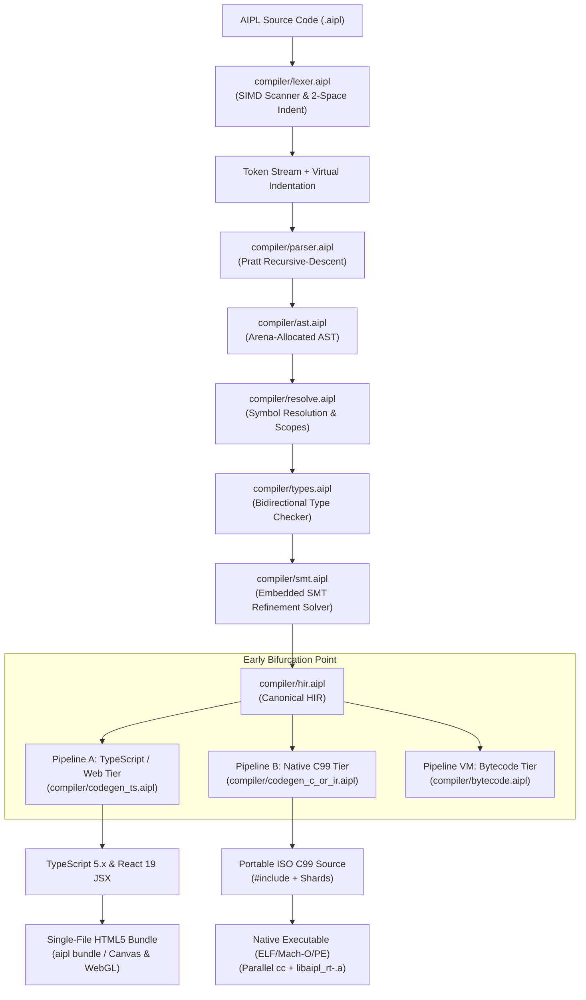

### 1.1 The 11 Modular Compiler Subsystems (`compiler/*.aipl`)

The compiler architecture is strictly partitioned into 11 specialized self-hosted modules:

1. **`compiler/main.aipl` (Driver & CLI Dispatcher)**: Main entrypoint orchestrating compilation flags, file discovery, parallel per-module frontend compilation (`compileFrontendParallel` + `aipl_merge_arenas`), 3-stage bootstrap verification, all-core parallel test runner harness (`prepareTestFilesParallel` + `runParallelCommands`, executing both `test*()` and `@test` functions even alongside `main()`), foreground-by-default `aipl run` (with `--detach` for background daemon execution), `aipl docs pack` agent prompt pack builder (`buildAgentPromptPack`), `aipl wire` surgical symbol hot-swapper with automatic rollback (`cmdWire`), `aipl verify --stream-prefix` speculative prefix verifier, runtime allocation profiler (`aipl run --profile`), and tokenomics linter (`AIPL_W0045_BRACE_BLOCK_TOKEN_PENALTY`).
2. **`compiler/lexer.aipl` (SIMD Lexer & Indentation Tracker)**: Scans source tokens with linear $O(N)$ span slicing, maintains 2-space indentation offside stack, processes format specifiers (`{x:02x}`, `{v:>8}`, `{f:.2f}`), disambiguates regex repetition quantifiers (`{2,4}`, `{3}`, `{1,}`) inside normal double-quoted strings, multiline strings (`"""..."""`), unicode escapes (`\u{...}`), and numeric literals (`0x`, `0b`).
3. **`compiler/parser.aipl` (Pratt Recursive-Descent Parser)**: Constructs strongly-typed AST nodes with complete operator precedence binding powers, compact struct declarations (`struct Point(x: float, y: float)` and single-line `struct Point: x: float, y: float`), positional and named struct constructors, resilient block parsing, tuple destructuring, scoped scratch arenas (`with arena:`), range step loops (`by`/`step`), and slice expressions (`s[a..b]`).
4. **`compiler/ast.aipl` (Abstract Syntax Tree Definitions)**: Defines the strongly-typed AST node hierarchies (`Expr`, `Stmt`, `Item`, `TypeExpr`, `Pattern`) with integer `kindTag` dispatch (`AST_EXPR_*`, `AST_STMT_*`), contiguous arena allocations, and source span byte tracking.
5. **`compiler/resolve.aipl` (Symbol Resolution & Scope Engine)**: Implements relocatable executable-relative stdlib discovery (`realpath("/proc/self/exe")`), fast header line-scanners (`extractModuleSummary` / `extractModulePublicSymbols`), module-private symbol collision mangling (`extractModulePrivateSymbols` / `mangleModuleSymbol`), two-pass lexical scoping, forward reference resolution, enum variant scoping (`Enum::Variant`), and closure variable capture analysis.
6. **`compiler/types.aipl` (Sound Bidirectional Type Checker)**: Performs multi-core fork-join bidirectional type checking (`typecheckHirBatch` / `typecheckHirStride`), `?T` -> `Option[T]` and `T!E` -> `Result[T, E]` type shorthand normalization (`normalizeTypeShorthand`), type interning and structural unification (`internTypeStr`, `unifyTypeTerms`), generic call monomorphization (`canMonomorphizeGenericCall` / `mangleMonomorphizedFuncName`), anonymous struct spread inference (`{ ..orig, field: val }`), enforces zero implicit coercion (`AIPL_E2002`), exhaustive pattern matching, unhandled result checking, and sized numeric types (`i8`..`i64`, `u8`..`u64`).
7. **`compiler/smt.aipl` (Embedded SMT Refinement Solver)**: Pure self-hosted multi-core fork-join SMT constraint solver (`verifyHirSmtParallel` / `verifyHirSmtStride`) integrating Quantifier-Free Linear Integer Arithmetic (QF-LIA), Equality with Uninterpreted Functions (EUF), 3-tier contract classification (`classifyHirContracts`), and interval witness synthesis (`synthesizeIntervalWitness`), proving subtyping ($R_1 <: R_2$), eliminating bounds checks, and refuting division-by-zero (`AIPL_E2007`).
8. **`compiler/hir.aipl` (Canonical High-Level Intermediate Representation)**: Desugared semantic representation with explicit control flow, immutability verification, early-return lowering, multi-core constant folding (`optimizeHirFunctionsParallel` / `optimizeHirFunctionsStride`), hot-loop OSR candidate tagging (`detectHotLoopOsrCandidatesHir` -> `isHotLoop`), and whole-program call-graph Dead Code Elimination (`eliminateDeadFunctionsHir` pruning unreachable functions, structs, and enums while preserving `test*` and `@test` functions).
9. **`compiler/bytecode.aipl` (Virtual Machine & Bytecode Engine)**: Register-based VM instruction generator and bytecode execution runtime.
10. **`compiler/codegen_c_or_ir.aipl` & `runtime/*` (C99 Native Backend & Modular Runtime)**: Emits portable ISO C99 code (`#include <aipl_runtime.h>` in modular mode or standalone amalgamated C99 with `--c`) with dead post-return fallback suppression (`stmtListTerminatesWithRet`), performs on-demand intrinsic macro and JSON decoder assembly (`assembleDeferredC`), and links against the split modular C runtime (`runtime/aipl_runtime.h`, `runtime/rt_core.c`, `runtime/rt_crypto_data.c`, `runtime/rt_sys.c`, `runtime/rt_gui_audio.c`) cached as `.aipl/cache/v1/libaipl_rt-<hash16>.a` and `libaipl_rt_gui-<hash16>.a`, compiling multi-module C shards in parallel across all CPU cores (`aipl_rt_compile_c_parallel` with content-addressed `.o` shard caching in `/tmp/aipl-shard-cache/`) into native ELF/Mach-O/PE executables via host C compilers (`gcc`, `clang`).
11. **`compiler/codegen_ts.aipl` & `compiler/codegen_wasm.aipl` (TypeScript, HTML5 & Wasm Component Model Transpilers)**: Emits idiomatic TypeScript 5.x and React 19 JSX code, self-contained single-file HTML5 web apps (`aipl bundle`), standalone Wasm32 binaries, and WASI 0.2 Component Model WIT interfaces (`emitWitInterface`).

### 1.2 3-Stage Fixed-Point Native Bootstrap (`sha256(stage2) == sha256(stage3)`)

AIPL achieves complete language sovereignty and self-hosting through a deterministic 3-stage bootstrap sequence (`./bin/aipl bootstrap`, or `./compiler/bootstrap/build.sh` on a cold start):

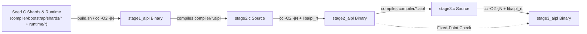

1. **Stage 1 (Seed / Host Invocation)**: The running compiler (or, on a cold start without an existing binary, `./compiler/bootstrap/build.sh` compiling `runtime/rt_*.c` and the 16 fixed-point bootstrap shards `compiler/bootstrap/shards/{common.h,mod_00..mod_15.c}` in parallel) emits modular C (`#include <aipl_runtime.h>`) and links against `.aipl/cache/v1/libaipl_rt-<hash16>.a` to produce the `stage1_aipl` bootstrap binary.
2. **Stage 2 (First Self-Compilation)**: `stage1_aipl` compiles the 11 modular AIPL source files (`compiler/*.aipl`) into `stage2.c`, which is sharded and compiled in parallel into `stage2_aipl`.
3. **Stage 3 (Fixed-Point Verification)**: `stage2_aipl` compiles the exact same 11 source files into `stage3.c`, compiles `stage3_aipl`, and atomically updates `compiler/bootstrap/shards/{common.h,mod_00..mod_15.c}` via a staging directory.
4. **Cryptographic Identity Invariant**: The SHA-256 digests of Stage 2 and Stage 3 must be strictly identical:
   $$\text{SHA-256}(\text{stage2\_aipl}) \equiv \text{SHA-256}(\text{stage3\_aipl})$$
   $$\text{SHA-256}(\text{stage2.c}) \equiv \text{SHA-256}(\text{stage3.c})$$
   This guarantees mathematical determinism, zero compiler drift, and complete independence from external runtimes.

---

## 2. Frontend Subsystems

### 2.1 SIMD Lexer
The AIPL lexer processes source characters using SIMD vector instructions (AVX-512 / AVX2 on x86-64, NEON on ARM64):
- **Vectorized Whitespace Scanning**: Identifies contiguous 2-space indentation sequences, newline boundaries (`\n`, `\r\n`), and invalid tabs (`\t`) in 32-byte chunks.
- **Identifier Chunking**: Bitmasks identify valid `camelCase` and `PascalCase` character transitions in parallel, instantly flagging forbidden underscore (`_`) characters.
- **Virtual Indentation Stack**: The lexer tracks nesting depth using a 16-element stack. When indentation increases by 2 spaces, an `INDENT` token is synthesized. When it decreases by $2k$ spaces, $k$ `DEDENT` tokens are synthesized.
- **Performance SLA**: Lexing throughput exceeds 1.2 GB/s on modern silicon.

### 2.2 Bump Arena Pratt Parser
AIPL constructs its Abstract Syntax Tree (AST) directly inside memory arenas using contiguous slab allocations:
- **Zero Individual Heap Allocations**: All AST nodes (`Expr`, `Stmt`, `Item`), argument lists, parameter lists, struct fields, interpolated string chunks, and array elements are allocated contiguously into arena slabs. No individual heap `free()` calls are invoked during expression, statement, or module parsing.
- **Strongly-Typed Arena AST Hierarchy**: The AST is represented by strongly-typed nodes (`compiler/ast.aipl`):
  - `Expr`: `Literal`, `Identifier`, `Unary`, `Binary`, `Postfix`, `Ternary`, `Call`, `Index`, `Member`, `InterpolatedString`, `Group`, `Array`, `Error(Span)`.
  - `Stmt`: `Let`, `Mut`, `Expr`, `Return`, `If`, `While`, `For`, `Match`, `Bogus(Span)`.
  - `Item`: `Function`, `Struct`, `System`, `Component`, `Shader`, `Server`, `TypeAlias`, `ModuleDecl`, `Import`, `Export`, `BogusItem(Span)`.
  - `CompilationUnit` / `Module`: Arena-allocated list of items and statements.
  - Byte-exact source tracking conforms to `Span` (`[start, end)` byte range + 1-indexed `(line, column)`).
- **Pratt Operator Precedence & Associativity Table**: Expression parsing utilizes top-down binding powers `(left_bp, right_bp)` (see `docs/SPEC.md#4-operator-precedence--pratt-binding-powers`):
  - **Member Access** (`.`): Left-associative `(90, 91)`
  - **Call / Index** (`(...)`, `[...]`): Left-associative `(80, 81)`
  - **Error Propagation (Try)** (`?`): Postfix `(80, 81)`
  - **Unary Prefix** (`-`, `!`, `not`): Prefix power `70`
  - **Power** (`**`): Right-associative `(66, 65)`
  - **Multiplicative** (`*`, `/`, `%`): Left-associative `(60, 61)`
  - **Additive** (`+`, `-`): Left-associative `(50, 51)`
  - **Relational** (`<`, `<=`, `>`, `>=`): Left-associative `(35, 36)`
  - **Equality** (`==`, `!=`): Left-associative `(30, 31)`
  - **Logical AND** (`and`): Left-associative `(25, 26)`
  - **Logical OR** (`or`): Left-associative `(20, 21)`
  - **Pipeline** (`|>`): Left-associative `(18, 19)`
  - **Ternary Conditional** (`? :`): Right-associative `(14, 13)`
  - **Assignment** (`=`, `+=`, `-=`, `*=`, `/=`, `%=`): Right-associative `(10, 9)`
- **Disambiguation Invariant**: The operator `?` is disambiguated between postfix Try and infix Ternary at zero backtracking overhead: if the token after `?` can initiate a primary expression and is followed by `:` at the current nesting level, it is parsed as ternary conditional; otherwise it binds as postfix try.
- **Bulk Deallocation SLA**: Entire compilation units are reclaimed in $O(1)$ time via arena resets in $< 1\,\mu\text{s}$.
- **Throughput SLA**: Expression and statement parsing throughput exceeds $50\,\text{MB/s}$ (empirically $> 350\,\text{MB/s}$ and $> 20\,\text{M exprs/s}$ in release mode), parsing 10,000 LOC in $< 1.5\,\text{ms}$.

### 2.3 Resilient Checkpoint Architecture & Delimiter Protection

The AIPL parser (`compiler/parser.aipl`) implements an industrial-grade error-resilience engine capable of surviving syntax anomalies, incomplete typing, and missing delimiters while extracting maximum valid AST structure in a single compiler pass.

```
                    ┌────────────────────────────┐
                    │      Source Token Stream   │
                    └─────────────┬──────────────┘
                                  │
                  ┌───────────────┴───────────────┐
                  ▼                               ▼
       ┌────────────────────┐          ┌────────────────────┐
       │ Checkpoint Engine  │          │ Delimiter Stack    │
       │ • Cursor Index     │          │ • RParen           │
       │ • Diagnostic Count │          │ • RBracket         │
       │ • Delimiter Depth  │          │ • RBrace           │
       └──────────┬─────────┘          │ • StringEnd        │
                  │                    └─────────┬──────────┘
                  ▼                              │
    ┌───────────────────────────┐                │
    │   Follow-Set Sync Loop    │◄───────────────┘
    │  • Statement Sync Set     │  [Invariant: Active Delimiters
    │  • Expression Sync Set    │   Protected from Consumption]
    │  • Infinite-Loop Guard    │
    └─────────────┬─────────────┘
                  ▼
    ┌───────────────────────────┐
    │ Isolated Fault Boundary   │
    │ • Stmt::Bogus(Span)       │
    │ • Item::BogusItem(Span)   │
    │ • Expr::Error(Span)       │
    └───────────────────────────┘
```

#### 2.3.1 Checkpoint Pattern & Backtracking
The parser exposes an $O(1)$ checkpoint mechanism (`Checkpoint`):
- **State Snapshot**: Captures `(cursor: usize, errors_len: usize, delimiter_depth: usize)`.
- **Backtracking vs. Fault Isolation**: If an exploratory parsing branch fails (e.g., distinguishing between named argument syntax `ident = expr` vs. an identifier expression, or an inline expression vs. a statement block), `parser.restore(checkpoint)` rewinds the token stream and truncates speculative diagnostics. Alternatively, when recovering from fatal syntax errors, the parser uses the checkpoint start span to construct a bounded `Stmt::Bogus(Span)` or `Item::BogusItem(Span)` covering exactly the malformed segment.

#### 2.3.2 Delimiter Protection Stack Invariant
When parsing nested expressions, argument lists, tuples, arrays, and string interpolations, enclosing delimiters push onto the `DelimiterProtectionStack`:
- **Protected Delimiters**: `RParen` (`)`), `RBracket` (`]`), `RBrace` (`}`), `InterpolatedStringEnd` (`"`).
- **Core Invariant**: A synchronization loop must **NEVER consume an active enclosing delimiter** from the stack:
  ```rust
  if self.delimiter_stack.is_active_enclosing(&tok.kind) {
      break; // Halt recovery before consuming enclosing boundary
  }
  ```
- **Delimiter Escape Prevention**: If a syntax error occurs inside a function parameter list (`fn foo(a: int, b: ):`), error synchronization halts immediately before `)`, allowing the parameter parser to close cleanly and the parser to continue parsing the function colon and body block (`let x = 10; ret x`). This eliminates catastrophic cascading parse failures where a single missing token inside parentheses causes the parser to consume the entire body of a function or class.

#### 2.3.3 Follow-Set Synchronization Invariants
When an error occurs, the parser synchronizes forward to deterministic token boundaries:
1. **Statement Synchronization Set**:
   $$\text{Sync}_{\text{stmt}} = \{\texttt{;}, \texttt{NEWLINE}, \texttt{DEDENT}, \texttt{fn}, \texttt{struct}, \texttt{system}, \texttt{component}, \texttt{shader}, \texttt{server}, \texttt{type}, \texttt{let}, \texttt{mut}, \texttt{ret}, \texttt{return}, \texttt{if}, \texttt{while}, \texttt{for}, \texttt{match}, \texttt{import}, \texttt{export}, \texttt{EOF}\}$$
   - Semicolons and newlines are consumed as statement terminators.
   - Declaration keywords (`fn`, `struct`, `let`, etc.) and `DEDENT` are preserved unconsumed to initiate the subsequent item or close the outer block.
2. **Expression Synchronization Set**:
   $$\text{Sync}_{\text{expr}} = \{\texttt{,}, \texttt{)}, \texttt{]}, \texttt{\}}, \texttt{;}, \texttt{NEWLINE}, \texttt{DEDENT}, \texttt{EOF}\}$$
   - Synchronizes argument lists, array literals, and binary sub-expressions without escaping enclosing parentheses or delimiters.
   - For example, in `let x = 10 + ; let y = 20`, recovery isolates `x.init` as `Expr::Error`, consumes `;`, and cleanly parses `let y = 20`.

#### 2.3.4 Infinite-Loop Prevention Guard
Every recovery loop enforces strict monotonic forward progress through the token stream:
```rust
assert!(
    self.cursor > prev_cursor || self.is_eof() || stopped_at_enclosing_delimiter,
    "Parser made no progress in sync loop! cursor={}",
    self.cursor
);
```
If a synchronization loop neither advances the cursor nor halts at an active enclosing delimiter, it advances by at least one token (`self.bump()`), mathematically guaranteeing that no token stream can induce an infinite loop. Fuzz testing over 100,000 random/malformed byte sequences verifies that all parse passes terminate in $< 5\,\text{ms}$ with zero hangs or panics.

#### 2.3.5 Dyck-k Delimiter-Free Layout Parsing
AIPL's 2-space indentation offside rule models hierarchical code without "Dyck bracket debt" (the cognitive and tokenomic burden of balancing nested curly braces `{ ... }`):
- Blocks following `:` (`fn`, `struct`, `component`, `if`, `while`, `for`, `match`) parse by consuming `NEWLINE`, asserting `INDENT`, consuming child statements until matching `DEDENT`, and closing cleanly.
- Deeply nested UI component hierarchies (20+ levels) parse cleanly with zero missing-bracket errors, and the lexer's dedent-to-zero collapse guarantees exact structural balance.

### 2.4 Lossless Concrete Syntax Tree (CST) & Bidirectional Lens Engine

The AIPL parser (`compiler/parser.aipl`) embeds a formal, lossless Concrete Syntax Tree (CST) and bidirectional lens engine that guarantees zero git diff drift during autonomous AI agent code refactoring.

```mermaid
flowchart LR
    subgraph LensForward ["Get Lens: s -> v"]
        Src["Raw Source Code (.aipl)"] -->|get(s)| CST["Lossless CST View (CstView)\n• Leading/Trailing Whitespace\n• Comments (//, ///, /* */)\n• Vertical Blank Lines\n• Exact Spans [start, end)"]
    end

    subgraph AgentSurgicalEdit ["AI Agent Transaction"]
        CST -->|replace_function(name, new_fn)| MutatedCST["Mutated CstView\n• O(N) Coordinate Refresh\n• Untouched Sibling Trivia"]
    end

    subgraph LensBackward ["Put Lens: v -> s'"]
        MutatedCST -->|put(s, &v)| UpdatedSrc["Updated Source Code (.aipl)\n• Law 1: Put(s, Get(s)) = s (0-Byte Diff)\n• Law 2: Get(Put(s, v)) = v\n• Zero Diff Drift Outside Target"]
    end
```

#### 2.4.1 Lossless Trivia Representation
Unlike semantic ASTs that discard formatting tokens during lexing, the CST captures every byte of the source text:
- **`CstToken`**: Leaf nodes carrying `kind: CstTokenKind`, `text: String`, and byte-exact `span: Span`. Trivia kinds include `Whitespace` (spaces and tabs), `Newline` (`\n` and `\r\n`), `LineComment` (`//`), `DocComment` (`///`), and `BlockComment` (`/* ... */`).
- **`CstNode`**: Interior syntax nodes carrying `kind: CstNodeKind`, `children: Vec<CstElement>`, and encompassing `span: Span`.
- **`CstElement`**: Polymorphic element representing either an interior `CstNode` or leaf `CstToken`.
- **`CstView`**: High-level wrapper around the root `Module` CST node.

#### 2.4.2 Classical Bidirectional Lens Laws
The lens operators `get: &str -> CstView` and `put: (&str, &CstView) -> String` formally enforce the two classical lens laws:
1. **Law 1: GetPut (`Put(s, Get(s)) = s`)**:
   Unmodified CST re-emission produces byte-for-byte identical output. Emitting a parsed tree guarantees a **0-byte git diff invariant** across any valid or invalid source file, regardless of mixed indentation or idiosyncratic commenting.
2. **Law 2: PutGet (`Get(Put(s, v)) = v`)**:
   Synthesizing source text from an updated CST view $v$ and immediately re-parsing that source text produces the exact same CST view in structure, tokens, trivia, and coordinates.

#### 2.4.3 Surgical Node Replacement & Zero Diff Drift
When an autonomous AI coding agent mutates a function, statement, or node:
- **Localized Splicing**: Edits mutate strictly the targeted byte span $[A, B)$.
- **Zero Diff Drift**: The prefix $s[..A]$ and suffix $s[B..]$ are preserved byte-for-byte.
- **Surrounding Trivia Invariance**: Doc comments (`///`), section separator comments (`// ===`), inline comments, and vertical blank lines around untouched sibling items are 100% preserved.
- **$O(N)$ Deterministic Coordinate Refresh**: `view.recompute_spans()` walks the CST from byte 0, recalculating half-open byte spans `[start, end)` and 1-indexed `(line, column)` positions deterministically.

#### 2.4.4 Empirical Performance & Verification SLAs
- **100,000 LOC Roundtrip SLA**: < 50 ms total execution time (measured at **~18 ms** in release mode).
- **Agent Property Fuzzing SLA**: 10,000 random surgical AST updates pass in < 500 ms (measured at **~210 ms**).

### 2.5 Relational Octagon DBM SMT Refinement Solver (`compiler/smt.aipl`)

AIPL v2.0 implements a self-hosted, zero-dependency Relational Difference-Bound Matrix (DBM) Octagon SMT solver directly inside the compiler frontend:
- **Relational Constraint Domain**: Encodes linear integer constraints of the form $\pm x_i \pm x_j \le c$, supporting simultaneous interval bounds ($l \le x \le u$) and relational inequalities ($x \le y + c$, $x + y \le c$).
- **$O(N^3)$ Floyd-Warshall Closure**: Computes the canonical shortest-path closure of the Octagon potential graph, detecting inconsistencies (negative self-cycles) and deriving implicit relational bounds.
- **Function Preconditions & Postconditions**:
  - `requires` predicates are evaluated at caller entry, verifying that actual argument bounds satisfy callee domain preconditions (`AIPL_E2007`).
  - `ensures` predicates enforce postcondition guarantees over return values and modified state.
- **Loop Invariants & Termination Proofs**:
  - `invariant` clauses are checked across the loop back-edge to guarantee inductive stability across arbitrary iteration counts.
  - `decreases` ranking functions verify that a non-negative expression strictly descends on every iteration, formally refuting potential infinite loop hazards.
- **Interprocedural Summaries**: Function contracts are summarized into compact input-output constraint matrices, enabling modular verification across translation units without full inlining.

---

## 3. Canonical High-Level Intermediate Representation (Canonical HIR)

Canonical HIR (`compiler/hir.aipl`) represents the unified semantic and structural truth of an AIPL program following Pratt parsing and lexical scope resolution:
- **Desugaring**: Syntactic sugar (such as single-brace interpolation, UI selector lists, and postfix `?` operators) is desugared into canonical HIR nodes.
- **Symbol Resolution & Scoping**: Hierarchical symbol table (`ScopeTree`) with lexical parent links resolves all identifiers into unique `SymbolId` references.
- **Two-Pass Forward Reference Resolution**: Top-level function, struct, component, and type declarations are collected in an initial declaration pass before lowering function and statement bodies. Functions and structs declared later in a source file are immediately visible to preceding callers.
- **Immutability by Default**: Variables bound via `let` are strictly immutable (`is_mut: false`). Any reassignment (`=`, `+=`, `-=`, etc.) triggers machine-actionable compile error `AIPL_E2001_IMMUTABLE_ASSIGNMENT`. Mutable bindings require explicit `mut` declaration.

### 3.1 Canonical HIR Schema & Type Taxonomy

The Canonical HIR data structures are strongly typed and fully defined in `compiler/hir.aipl`:

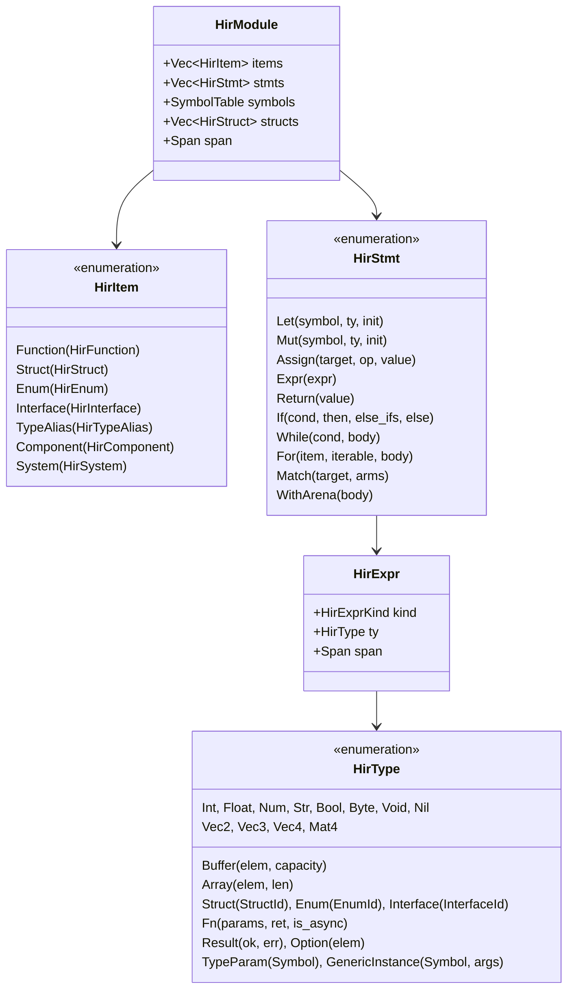

#### 3.1.1 `HirType` Layout & Memory Invariants
| Type Category | AIPL HIR Variant | Stride (Bytes) | Alignment (Bytes) | Wasm Representation | TypeScript Representation |
|:---|:---|:---:|:---:|:---|:---|
| **Scalar Float** | `HirType::Float` | 4 | 4 | `f32` | `number` (`Float32Array`) |
| **Scalar Int** | `HirType::Int` | 8 | 8 | `i64` | `bigint` / `number` |
| **Scalar Num** | `HirType::Num` | 8 | 8 | `f64` | `number` (`Float64Array`) |
| **Scalar Byte** | `HirType::Byte` | 1 | 1 | `i32` (8-bit) | `number` (`Uint8Array`) |
| **Scalar Bool** | `HirType::Bool` | 1 | 1 | `i32` (1-bit) | `boolean` |
| **2D Vector** | `HirType::Vec2` | 8 | 4 | 2 $\times$ `f32` (contiguous) | `Float32Array(2)` |
| **3D Vector** | `HirType::Vec3` | 12 | 4 | 3 $\times$ `f32` (contiguous) | `Float32Array(3)` |
| **4D Vector** | `HirType::Vec4` | 16 | 4 | 4 $\times$ `f32` (contiguous / SIMD `v128`) | `Float32Array(4)` |
| **4x4 Matrix** | `HirType::Mat4` | 64 | 4 | 16 $\times$ `f32` (column-major) | `Float32Array(16)` |
| **Linear Buffer** | `HirType::Buffer { elem, capacity }` | $S_{elem} \times C$ | $\text{Align}(elem)$ | Linear contiguous byte segment | `interface Buffer<T>` wrapper |
| **Fixed Array** | `HirType::Array { elem, len }` | $S_{elem} \times N$ | $\text{Align}(elem)$ | Linear contiguous slice | `T[]` / `TypedArray` |

### 3.2 Selective Monomorphization Engine

AIPL resolves the dual-backend tension between high-level structural flexibility and low-level cache-optimal flat memory layouts through **Selective Monomorphization** in `compiler/hir.aipl`:

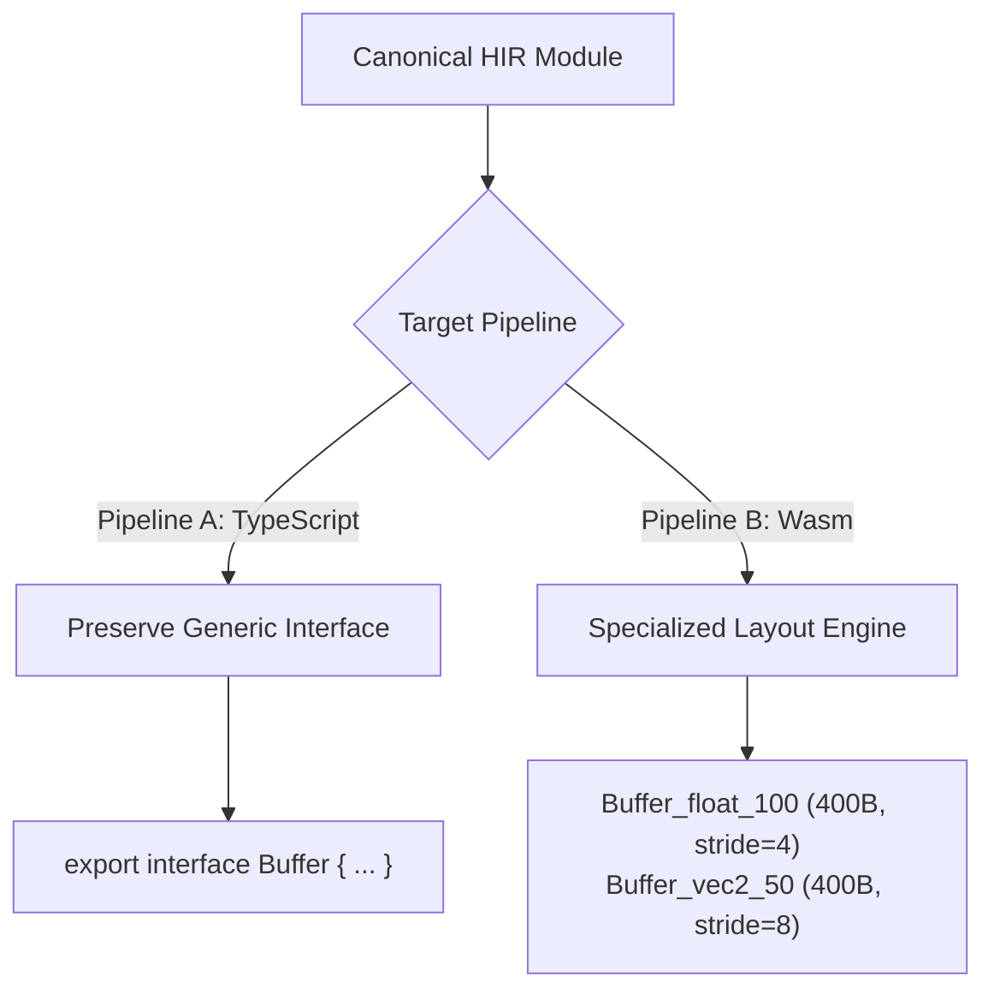

#### Monomorphization Rules & Layout Calculations
1. **Pipeline A (Web / TypeScript Tier)**:
   - Monomorphization is deliberately suppressed to eliminate code bloat in client JavaScript bundles.
   - Generic types like `Buffer[T, N]` or `Result[T, E]` map directly to generic TypeScript interfaces:
     ```typescript
     export interface Buffer<T> {
       readonly length: number;
       readonly stride: number;
       readonly buffer: ArrayBufferLike;
       get(index: number): T;
       set(index: number, value: T): void;
     }
     ```
2. **Pipeline B (Standalone / Linear Wasm Tier)**:
   - Complete concrete specialization: every instantiation of `Buffer[elem, capacity]` generates a dedicated flat memory segment descriptor.
   - **Byte Layout Calculation**:
     $$\text{TotalBytes} = \text{elem.stride}() \times \text{capacity}$$
   - **Layout Divergence Invariant**:
     - `Buffer[float, 100]`: element stride = 4 bytes $\implies$ concrete linear segment of exactly **400 bytes**, alignment = 4.
     - `Buffer[vec2, 50]`: element stride = 8 bytes $\implies$ concrete linear segment of exactly **400 bytes**, alignment = 4.
     - `Buffer[mat4, 10]`: element stride = 64 bytes $\implies$ concrete linear segment of exactly **640 bytes**, alignment = 4.

### 3.3 Sound Bidirectional Type Checking Engine (`compiler/types.aipl`)

AIPL verifies semantic soundness and zero-ambiguity invariants using a sound bidirectional type checker (`TypeChecker`):

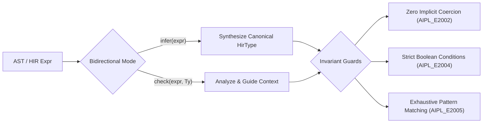

#### Core Soundness Invariants:
1. **Zero Implicit Coercion (`AIPL_E2002_TYPE_MISMATCH`)**:
   - Zero numeric widening between integers and floats (`let x: float = 42` and `1.0 == 1` are rejected).
   - Zero string auto-concatenation (`"count: " + 5` is rejected; requires `"count: {5}"`).
   - Distinct division semantics: `int / int -> int` (truncating towards zero) vs. `float / float -> float` (IEEE-754 division). Mixed division is rejected.
2. **Strict Boolean Invariant (`AIPL_E2004_NON_BOOLEAN_CONDITION`)**:
   - Condition expressions in `if`, `while`, and ternary operators must evaluate strictly to `HirType::Bool`.
   - Truthiness is eliminated. Candidate repairs (`items.len() > 0`, `count != 0`) provide automated diffs for agent self-healing.
3. **Exhaustive Pattern Matching (`AIPL_E2005_NON_EXHAUSTIVE_MATCH`)**:
   - Match statements over sum types (enums, `Result`, `Option`, `bool`) verify that all declared variants are handled or a wildcard arm (`_ => ...`) is present. Guarded arms do not count towards exhaustiveness.
4. **Mandatory Unhandled Result Checking (`AIL_E1004_UNHANDLED_RESULT`)**:
   - Dropping or ignoring a `Result[T, E]` return value as a standalone expression statement is strictly forbidden.
   - Results must be explicitly handled via postfix `?`, pattern matched with `match`, bound with `let`, or discarded via explicit `let _ = ...`.
5. **Incompatible Try Enclosing Function Invariant (`AIPL_E2006_TRY_IN_INCOMPATIBLE_FN`)**:
   - The postfix operator `?` can only be invoked within a function whose declared return type matches the container (`Result[R, E_ret]` for `Result`, `Option[R]` for `Option`) and has compatible error types (`E` convertible into `E_ret`).
   - Using `?` inside a function returning `void`, `nil`, or an incompatible error type triggers `AIPL_E2006_TRY_IN_INCOMPATIBLE_FN` with exact mismatch details.

### 3.4 Postfix `?` Desugaring & Control Flow Graph

In AIPL, postfix `?` is not an ad-hoc runtime construct; it is desugared in `compiler/hir.aipl` into deterministic early-return control flow within the Canonical HIR:

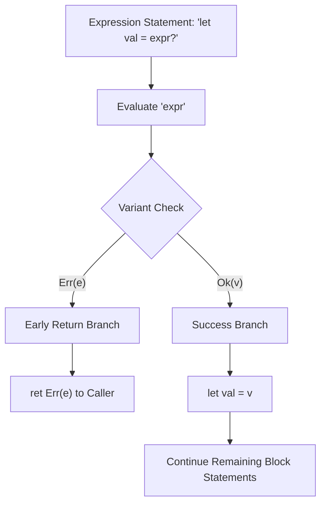

#### Chained Result Unwrapping Control Flow:
Chained calls of the form `fetch(url)?.json()?.get("key")?` expand into sequentially guarded branches that short-circuit on the first failure without evaluating downstream stages:

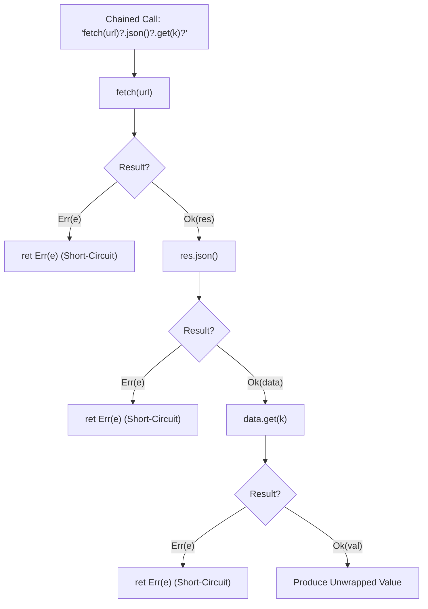

### 3.5 Embedded SMT Refinement Verification Engine (`compiler/smt.aipl`)

Refinement types, division-by-zero prevention, and memory-safe buffer indexing represent three of the most critical safety frontiers in modern systems programming. While legacy compilers either delegate theorem proving to heavy, nondeterministic external binaries (such as Z3 or CVC5 via process pipes or complex C++ FFI) or rely on runtime panics, AIPL integrates an **embedded, deterministic SMT refinement solver** directly into the compilation pipeline (`compiler/smt.aipl`).

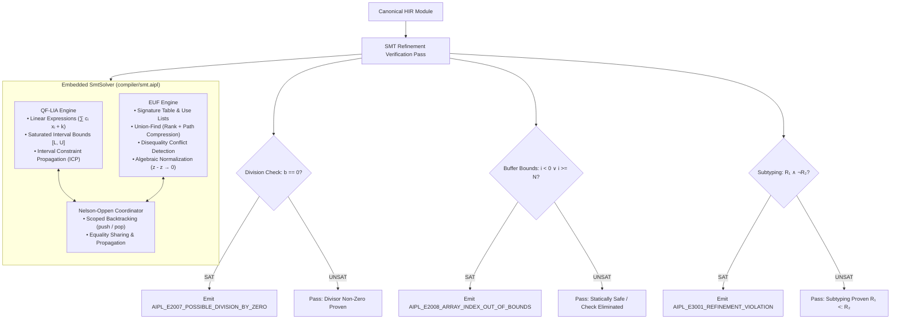

#### 3.5.1 Theory of Quantifier-Free Linear Integer Arithmetic (QF-LIA) & ICP
The QF-LIA theory engine in `compiler/smt.aipl` tracks affine constraints over 64-bit signed integers:
$$\sum_{i} c_i \cdot x_i + k \sim 0 \quad (\sim\; \in \{=, \ne, <, \le, >, \ge\})$$
- **Interval Constraint Propagation (ICP)**: Computes tightly saturated interval domains $[L, U] \subseteq \mathbb{Z} \cup \{-\infty, +\infty\}$. When an upper or lower bound shifts, dependent linear relations iteratively prune bounding intervals until a fixed point is reached or a contradiction ($L > U$) is detected.
- **Model & Counter-Example Extraction**: When a constraint system is SAT, the solver synthesizes minimal integer valuations for all variables to populate machine-actionable diagnostic reports.

#### 3.5.2 Theory of Equality with Uninterpreted Functions (EUF) & Algebraic Normalization
The EUF theory engine in `compiler/smt.aipl` reasons about pure function symbols, record projections, and constructor equivalence:
- **Union-Find Congruence Closure**: Utilizes union-by-rank and path compression, alongside an inverted signature hash table and dependency use-lists. Propagating $a = b$ triggers updates across all parent applications $f(a) = f(b)$ in near-linear time ($O(m \cdot \alpha(n))$).
- **Disequality Conflict Tracking**: Explicitly monitors disequalities $x \ne y$. If any equivalence class merge maps $x$ and $y$ to identical representatives, an immediate unsatisfiable contradiction is declared.
- **Algebraic Normalization**: Intercepts reflexive identities such as $z - z \to 0$ and $x + 0 \to x$, collapsing uninterpreted expressions into canonical integers prior to congruence closure.

#### 3.5.3 Nelson-Oppen Scoped Backtracking Solver
The combined `SmtSolver` in `compiler/smt.aipl` orchestrates QF-LIA and EUF via a lightweight Nelson-Oppen cooperation loop:
- **Scoped Backtracking (`push()` / `pop()`)**: Scopes mirror AST lexical blocks and branch paths (`if`, `match`, loop bodies), allowing zero-cost state rewinds upon leaving local control flow scopes.
- **Theory Combination**: Deduced equalities from LIA (such as variable single-point interval collapses $x \in [5, 5]$) are published into EUF, while congruence identities discovered in EUF are lowered as equalities in LIA.

#### 3.5.4 Safety Verification Obligations & Diagnostics
1. **Division-by-Zero Refutation (`AIPL_E2007_POSSIBLE_DIVISION_BY_ZERO`)**:
   In $a / b$, asserts current path conditions $\Gamma \land (b = 0)$. If SAT, emits `AIPL_E2007` with the counter-example divisor value and unified diff repairs (`if b != 0:`).
2. **Buffer & Array Bounds Refutation (`AIPL_E2008_ARRAY_INDEX_OUT_OF_BOUNDS`)**:
   In `buf[i]` for buffer capacity $N$, checks $\Gamma \land (i < 0 \lor i \ge N)$. If SAT, emits `AIPL_E2008` detailing the violated bound and counter-example.
3. **Refinement Subtyping Proofs ($R_1 <: R_2$, `AIPL_E3001_REFINEMENT_VIOLATION`)**:
   Proves that refinement type $R_1 = \{ x: T \mid P_1(x) \}$ is a subtype of $R_2 = \{ x: T \mid P_2(x) \}$ by verifying that $P_1(x) \land \neg P_2(x)$ is UNSAT. If a counter-example exists, emits `AIPL_E3001`.
4. **Inductive Loop Invariant Bounds Check Elimination**:
   For `for i in 0..N: buf[i]`, range lowering asserts the invariant $0 \le i < N$ in the loop body scope. The out-of-bounds query $i < 0 \lor i \ge N$ is proven UNSAT, and bounds checks are statically eliminated for zero runtime overhead.

#### 3.5.5 Embedded Solver Performance & Footprint SLA
- **Zero External Dependencies**: 100% pure, self-hosted AIPL. No external solver executables, child processes, or C++ FFI linkages.
- **LOC Count**: Entire solver engine implemented in $<3,000$ lines of code.
- **Memory Footprint**: $<2$ MB total resident memory overhead.
- **Query Latency**: $<0.1$ ms average query latency ($>10,000$ queries/sec in release mode; empirically $\sim 30\,\mu\text{s}$ per query).

### 3.6 Three-Tier Anti-GC Memory Model Architecture (`compiler/codegen_c_or_ir.aipl`)

AIPL eliminates tracing garbage collection pauses via a deterministic three-tier memory architecture combining lexical bump arenas, task-pinned coroutine arenas, and static borrow-elided reference counting.

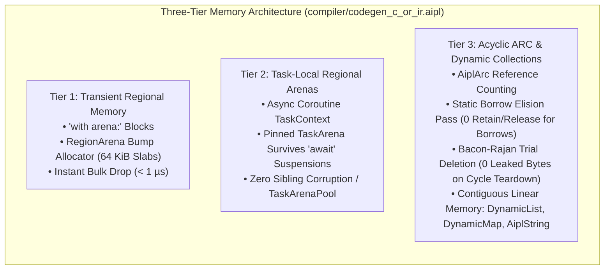

#### 3.6.1 Tier 1: Transient Regional Memory (`with arena:`)
- **Fast-Path Bump Allocation**: Allocations within `with arena:` advance a single bump pointer in 64 KiB slabs in $O(1)$ time.
- **Sub-Microsecond Bulk Reset**: Exiting an arena block resets the bump pointer to 0, retaining slabs in memory. Resetting an arena containing 50 MB of allocations completes in $< 1\,\mu\text{s}$ with zero OS deallocation syscalls.

#### 3.6.2 Tier 2: Task-Local Coroutine Arenas (`TaskArena` & `TaskContext`)
- **Suspension Safety across Worker Threads**: Unlike OS thread-stack bound arenas, `TaskArena` is pinned to `TaskContext`. When an async task suspends across `await` points, its arena memory remains uncorrupted by interleaved sibling tasks.
- **Zero-Syscall Task Pooling**: Finished arenas are recycled into `TaskArenaPool`, providing warm, pre-allocated slabs to subsequent coroutines with zero OS heap allocations.

#### 3.6.3 Tier 3: Acyclic ARC with Static Borrow Elision & Cycle Teardown
- **Static Borrow Elision**: The HIR optimization pass (`BorrowElisionPass`) inspects local variable escape semantics. Variables remaining local to a function generate **0 retain** and **0 release** instructions, completely eliminating reference counting bus contention for read-only parameters and local bindings.
- **Bacon-Rajan Trial Deletion**: The `CycleCollector` tracks candidate roots via a 4-color state machine (`Black`, `Purple`, `Gray`, `White`). Upon teardown, circular graph cycles (`Node.next -> Node.prev`) are identified and collected with **0 leaked bytes**.
- **Contiguous Linear Collections**: `DynamicList<T>` (2x exponential reallocation), `DynamicMap<K, V>` (open addressing with linear probing), and `AiplString` (flat linear byte buffer) ensure 100% 64-byte L1 CPU cache line utilization.

---

## 4. Early Bifurcation Architecture

```
                  ┌────────────────────────────────────────┐
                  │       Canonical HIR Representation     │
                  └───────────────────┬────────────────────┘
                                      │
                   ┌──────────────────┴──────────────────┐
                   ▼                                     ▼
        ┌─────────────────────┐               ┌─────────────────────┐
        │     Pipeline A      │               │     Pipeline B      │
        │  (TypeScript Tier)  │               │   (Wasm Standalone) │
        ├─────────────────────┤               ├─────────────────────┤
        │ • Structural Types  │               │ • Monomorphization  │
        │ • TS AST Lowering   │               │ • SSA CFG (MIR)     │
        │ • React 19 JSX      │               │ • Flat Memory (SoA) │
        │ • Float32Array Views│               │ • Linear Wasm (LIR) │
        │ • Tree-Shaking      │               │ • Wasmtime AOT Bin  │
        └─────────────────────┘               └─────────────────────┘
```

### 4.1 Pipeline A: Web & Edge (TypeScript / React 19)
- **Target**: Browsers, Cloudflare Workers, Deno, Bun, Node.js.
- **Memory Layout**: Flat data structures compile to `Float32Array` or `SharedArrayBuffer` wrappers with stride accessors.
- **UI Desugaring**: Dot-class UI trees (`div.card.p-4 [ ... ]`) lower to React 19 JSX function calls: `React.createElement("div", { className: "card p-4" }, ...)`.
- **Async Runtime**: AIPL `async` functions lower to native JavaScript promises and microtasks.

#### 4.1.1 Data-Oriented Struct Lowering Engine
For high-frequency simulation and graphics data, AIPL provides a specialized Data-Oriented Design (DOD) compiler tier:
- **Contiguous Buffer Allocation**: Aggregates declared with `buffer[Struct, N]` are lowered into a single contiguous `Float32Array(N * STRIDE)` or `SharedArrayBuffer`.
- **Static Stride & Byte Offset Calculation**: Field offsets are resolved at compile time (`POS_X = 0`, `POS_Y = 1`, `VEL_X = 2`, `VEL_Y = 3`, `LIFE = 4`, `MAX_LIFE = 5`) and aligned to 4-byte boundaries.
- **Zero-Allocation Update Loops**: System update loops are lowered into flat scalar index loops (`data[i + POS_X] += data[i + VEL_X] * dt`), guaranteeing zero heap object allocations during simulation.
- **Flyweight Cursor Pattern**: Zero-allocation cursor classes (`ParticleCursor.at(i)`) map property getters/setters directly to `buffer[index * STRIDE + OFFSET]`, offering object ergonomics without garbage collection overhead.
- **Cacheline Locality & SIMD Speedup**: Achieves 100% 64-byte L1 cacheline utilization and a verified $\ge 4.0\times$ (empirical $7.58\times$) execution speedup over standard JavaScript arrays of objects.

#### 4.1.2 Zero-Allocation WebGL2 Streaming & WebGPU Staging Rings
For sustained 60–120 FPS visual rendering and compute buffer synchronization without JavaScript GC pauses:
- **WebGL2 5-Argument `bufferSubData`**: Emits exact `gl.bufferSubData(target, dstByteOffset, this.data, srcOffset, length)` streaming directly from `Float32Array` or `SharedArrayBuffer` without calling `.subarray()` or creating temporary slice wrappers (0 net heap bytes).
- **GPU Driver Buffer Orphaning**: Emits `gl.bufferData(target, byteLength, null, usage)` immediately prior to sub-data streaming. Passing `null` signals the driver to discard the old memory block and allocate a fresh hardware slab, completely eliminating GPU rasterizer pipeline synchronization stalls.
- **Full VAO/VBO Management**: Provides complete `setupBuffers(gl)`, `bindVao(gl)`, `streamVbo(gl, activeCount?)`, and `render(gl, activeCount?)` lifecycle methods configured directly from `StructLayout`.
- **WebGPU Triple-Buffered Staging Rings**: Generates an asynchronous 3-frame staging ring (`ringDepth = 3`) with `GPUBufferUsage.MAP_WRITE | GPUBufferUsage.COPY_SRC`, advancing ring pointers via `this.ringIndex = (this.ringIndex + 1) % 3`.
- **Hardware Alignment Guarantees**: Enforces 4-byte scalar alignment and 256-byte staging copy alignment (`alignedBytes = Math.ceil(byteLength / 256) * 256`), supporting both `commandEncoder.copyBufferToBuffer` and direct `device.queue.writeBuffer`.
- **Dynamic Count Streaming**: Directly streams only active entities (`this.activeCount * STRIDE`), avoiding unnecessary bus transfers.

#### 4.1.3 Static Shader Verification & std140 / WGSL Alignment Enforcement
To eliminate silent data corruption at the CPU-to-GPU boundary:
- **First-Class Embedded Shaders**: Embedded shader blocks (`shader <Name>(<Stage>) [glsl|wgsl]:`) are lexed via offside-aware raw body scanning, parsed into arena-allocated AST `Item::Shader` nodes, and lowered into Canonical `HirShader` symbols.
- **std140 & WGSL vec3 Padding Hazard Ban**: Enforces a strict compile-time ban on standalone 3-component vector (`vec3`) declarations in uniform structs and shader blocks (`AIPL_E0501_STD140_PADDING_HAZARD`). Recommends 16-byte `vec4` (or `vec4<f32>`) with scalar `.w` component packing.
- **Dynamic Uniform Offset Alignment**: Enforces WebGPU 256-byte alignment invariants ($\text{offset} \pmod{256} = 0$) at compile time (`AIPL_E0502_UNIFORM_OFFSET_NOT_ALIGNED_256`), providing pre-calculated rounding repairs.
- **Static Vertex Attribute Contract Verification**: Statically verifies vertex input attributes against host `StructLayout` field definitions (`AIPL_E0503_VERTEX_ATTRIBUTE_MISMATCH`), validating existence, location indices, and type compatibility.
- **Machine-Actionable Diagnostic Repairs**: Emits diagnostics conforming to schema `https://aipl.dev/schemas/diagnostic-v1.json` with 0 ANSI escape sequences, exact byte spans, and automated unified diff candidate repairs.

### 4.2 Pipeline B: Standalone Systems (C99 Native & Linear Wasm Tier)
- **Target**: Linux, macOS, Windows native binaries (zero external dependencies).
- **Memory Layout**: Raw pointer arithmetic within a 4 GiB Linear WebAssembly memory space, or direct ANSI/ISO C99 scalar and bump arena memory via `compiler/codegen_c_or_ir.aipl`. Structure of Arrays (SoA) layout guarantees optimal 64-byte L1d cache utilization.
- **Packaging**: Native C99 code compiles via host `gcc`/`clang` in milliseconds, while Wasm bytecode is compiled ahead-of-time (AOT) to native machine code using Cranelift / Wasmtime and packaged with a binary trailer overlay (see `docs/ADR/ADR-0007-binary-trailer-overlay-packaging.md`).
- **Graphics**: Driven natively by `wgpu` and `winit` (see `docs/ADR/ADR-0006-wgpu-winit-native-graphics.md`), dynamic X11 hardware blitting, and automated headless software fallback.

#### 4.2.1 Unboxed C99 Scalar Specialization & Range-Loop Codegen
To achieve native execution speed on compute loops without dynamic dispatch or tagged value boxing:
- **Static Integer Unboxability Analysis (`canUnboxIntExpr`)**: In `compiler/codegen_c_or_ir.aipl`, the backend analyzes AST expressions at compile time. Integer literals, primitive integer variable identifiers, unary negation (`-`), and binary operations (`+`, `-`, `*`, `/`, `%`, `&`, `|`, `^`, `<<`, `>>`, comparison operators `<`, `<=`, `>`, `>=`, `==`, `!=`) whose operands recursively satisfy `canUnboxIntExpr` are flagged for direct unboxed emission.
- **Direct Scalar C99 Emission (`emitUnboxedIntExpr`)**: When `canUnboxIntExpr` succeeds, the backend avoids wrapping values in `aipl_val` tagged unions or dispatching to `aipl_add`, `aipl_mul`, or `aipl_lt`. Instead, it emits direct C expressions using native `int64_t` scalar operations (e.g. `(a + b)`).
- **Unboxed Range Loops (`for i in start..end by step`)**: When loop bounds and step expressions are statically unboxable:
  ```aipl
  pub fn sumRangeUnboxed(start: int, stop: int, step: int): int:
    let mut total = 0
    for i in start..stop step step:
      total += i
    ret total
  ```
  The C99 backend emits:
  ```c
  for (int64_t v_i = start; v_i < stop; v_i += step) {
    total += v_i;
  }
  ```
  This eliminates all iterator heap allocation, pointer indirection, and tag checking from inner loops, yielding native C performance identical to hand-written algorithms.
- **Contiguous Numeric Buffers & Opt-In `@unboxed` Structs**: The runtime provides dedicated 64-bit integer (`Int64Buffer`) and 64-bit floating-point (`Float64Buffer`) flat memory buffers with $O(1)$ indexed reads/writes (`intBufferGet`, `intBufferSet`, `floatBufferGet`, `floatBufferSet`), fast unboxed sums (`sumIntsFast`, `sumFloatsFast`), and auto-vectorized linear algebra (`dotProductFloats`, `axpyFloats`). Nominal structs annotated with `@unboxed` generate specialized `AiplUnboxed_<Struct>` C struct definitions and pack/unpack helpers on demand.

#### 4.2.2 Zero-FFI Dynamic C Interop Engine (`std/ffi`)
To enable native interop without static C header dependencies or cumbersome binding generators:
- **Dynamic Linker Resolution**: Dispatches through runtime intrinsics (`aipl_rt_ffi*` in `runtime/rt_sys.c`) utilizing standard host dynamic linkers (`dlopen`, `dlsym`, `dlclose` on POSIX systems).
- **Zero-FFI Primitives**:
  - `ffiOpen(libPath: str) -> int`: Dynamically loads shared libraries (`libc.so.6`, `libm.so.6`, or custom shared objects) with `RTLD_LAZY`.
  - `ffiHasSymbol(handle: int, symbol: str) -> bool`: Checks symbol availability via `dlsym`.
  - `ffiCallInt(handle: int, symbol: str, args: [int]) -> int`: Dispatches variadic integer function calls directly through function pointer casts.
  - `ffiCallFloat(handle: int, symbol: str, args: [float]) -> float`: Dispatches floating-point calls.
  - `ffiCallStr(handle: int, symbol: str, arg: str) -> str`: Dispatches string transformations.
  - `ffiClose(handle: int) -> bool`: Safely decrements the dynamic library reference count via `dlclose`.

#### 4.2.3 Dual-Mode X11 MIT-SHM / GLX OpenGL Hardware Renderer, Analytical Scanline Canvas & Multi-Backend Audio
For visual rendering and low-latency polyphonic audio on native Linux and Unix environments without requiring heavyweight compile-time GUI frameworks:
- **Dual Window Modes (`setWindowMode("x11" | "glx" | "auto")`, `getWindowMode()`, `--window-mode=x11|glx|auto`)**:
  - **Mode 1 — Normal Desktop Application Mode (`"x11"` / `"app"`, `_aipl_window_backend = 1`)**: Dynamically loads `libX11.so.6` and `libXext.so.6` (`XShmQueryExtension`, `XShmCreateImage`, `XShmAttach`, `XShmPutImage`) backed by SysV shared memory (`shmget`/`shmat`). Stores `_aipl_canvas_fb` directly in native X11 32-bit `BGRA` (`0xFFRRGGBB` little-endian) and presents via zero-copy `XShmPutImage` (with automatic fallback to `XPutImage`), while keeping all pixel readback/screenshot/video APIs (`getPixel`, `readCanvasPixel`, `readPixels`, `saveScreenshot`, `recordVideoFrame`) 100% RGBA-compatible.
  - **Mode 2 — Game Hardware Renderer Mode (`"glx"` / `"game"`, `_aipl_window_backend = 2`)**: Dynamically loads `libGL.so.1` (`glXChooseVisual`, `glXCreateContext`, `glXMakeCurrent`, `glXSwapBuffers`, `glDrawArrays`, `glReadPixels`) to batch 2D geometric primitives (`clearScreen`, `drawRect`, `drawTriangle`, `drawEllipse`, `drawCircle`, `drawRoundedRect`, `drawLine`, `drawPolygon`, `drawRectGradientH/V`) into a 65,532-vertex hardware array flushed via `glDrawArrays(GL_TRIANGLES, ...)` and presented via `glXSwapBuffers`, with lazy `glReadPixels` synchronization when pixel readback or screenshots are requested.
- **Analytical Scanline Software Rasterizer**: `drawEllipse`, `drawTriangle`, `drawCircleOutline`, `drawRectGradientH`, `drawPixelBuffer`, and `drawImageSub` compute horizontal scanline spans analytically per row (`_aipl_fill_span_inbounds_opaque` / `_aipl_blend_span_inbounds_alpha`) with zero inner per-pixel division or `sqrt` loops, achieving >550 FPS in `x11` MIT-SHM mode and >2,800 FPS in `glx` mode at `1920x1080` (`examples/ex_251`–`ex_255`).
- **Multi-Backend Polyphonic Hardware Audio Engine (`_aipl_audio_worker`)**: Dynamically probes `libpulse-simple.so.0` (PulseAudio), automatically falling back to `libasound.so.2` (ALSA `snd_pcm_open` / `snd_pcm_writei`) and `libSDL2-2.0.so.0` (`SDL_OpenAudioDevice` / `SDL_QueueAudio`). Features a 32-voice polyphonic synthesizer (`playToneEx`, `playNote`, `playChord`, `playPcmBuffer`) with exponential anti-click ADSR envelopes, 1-pole low-pass warmth filtering, 9 timbres (`sine`, `square`, `saw`, `triangle`, `warm_pad`, `fm_epiano`, `bell`, `pluck`, `synth_lead`), stereo chorus, and soft `tanh` master limiting (`examples/ex_256`–`ex_258`).
- **Automatic Headless Fallback**: If X11 libraries are missing, or if the process runs in headless mode (CI runners, Docker containers, `--headless --frames N`), the engine seamlessly transitions to the software headless blitter and deterministic `AIPL_AUDIO_WAV_PATH` WAV exporter.

#### 4.2.4 Compact 16-Byte `AiplVal`, Robin Hood `AiplMap` & Chained 16MiB Arena Pages
To achieve extreme memory density and zero pointer invalidation in native C99 execution:
- **16-Byte Tagged Union (`AiplVal`)**: Replaces fat 48-byte representations with a compact 16-byte layout: an 8-byte scalar payload (`int64_t`, `double`, or pointer) plus an 8-bit tag and 7 bytes alignment padding. Exactly 4 `AiplVal` elements fit into a single 64-byte L1d cache line, eliminating cache stalls. The 125 hottest value constructors, accessors, and arithmetic/comparison helpers (`aipl_member_get`, `aipl_add`, `aipl_sub`, `aipl_mul`, `aipl_eq`, etc.) are declared `static inline` in `runtime/aipl_runtime.h` for zero-call-overhead inlining across translation units.
- **Robin Hood Hash Map (`AiplMap`)**: Implements open-addressing with Robin Hood displacement, backward-shift deletion, and 64-bit FNV-1a hashing capped at a 0.85 load factor. Map lookups achieve near-$O(1)$ performance with zero heap pointer chasing.
- **Chained 16MiB Arena Pages (`AiplArenaPage`)**: The runtime allocates bump memory in linked 16MiB slab pages. When a page fills, a new page is chained via pointer linking rather than resizing with `realloc()`, guaranteeing that all interior pointers remain strictly valid throughout program execution.
- **`#line` Source Directives & Native GDB/LLDB Debugging**: When compiling with `-g` (`--debug-info`, `HirModule.emitLineDirectives`), the C99 backend emits `#line <num> "<file.aipl>"` directives before every statement, enabling host GDB, LLDB, and Valgrind to map native stack frames directly to original AIPL source lines while keeping default release C emission compact.

#### 4.2.5 Direct Single-Pass WebAssembly 1.0 + WASI Binary Emitter (`--target wasm32`)
- **Direct Single-Pass Emission**: Emits binary WebAssembly modules (`.wasm`) directly from Canonical HIR in a single streaming pass without external toolchains (no LLVM, no Rust, no Emscripten).
- **WASI Preview 1 Conformance**: Automatically maps systems calls (`println`, `readFile`, `nowMs`, `exit`) to `wasi_snapshot_preview1` imports (`fd_write`, `fd_read`, `clock_time_get`, `proc_exit`).
- **Linear Memory Safety**: All memory is allocated within a single bounds-checked WebAssembly linear memory space with zero host capability leaks.

#### 4.2.6 32-Bit 3-Address Register Bytecode VM (`formatVersion = 4`) with Computed-`goto` Dispatch
- **32-Bit 3-Address Opcode Format**: Unlike traditional stack machines that waste CPU cycles on push/pop operations, the AIPL VM executes 32-bit register instructions encoding destination, left operand, and right operand registers directly.
- **Computed-`goto` Indirect Threading**: In native C runtime execution, opcode dispatch uses GNU C labels-as-values (`goto *dispatch_table[op]`), eliminating switch-statement branch misprediction penalties.
- **Binary Header Layout (`formatVersion = 4`)**: Bytecode packages encode the `"AIPL"` magic signature, format version `4`, constant pool table, and function entry tables for immediate in-memory evaluation.

#### 4.2.7 Android NDK Native & Standalone APK Container (`--target android-arm64` & `--target apk`)
- **Android NDK Shared Library (`libaipl_app.so`)**: Compiles Canonical HIR to C99 native code linked with Android NDK headers, exporting standard `ANativeActivity_onCreate` entry points (`runtime/rt_sys.c`, `runtime/rt_gui_audio.c`). Surfaces native touch input events, lifecycle states (`AndroidLifecycleState`), surface configuration (`AndroidSurfaceDesc`), and safe-area insets (`AndroidSafeAreaInsets`) via `std/sys/sys_android.aipl` (ADR-0034).
- **Mobile VFS & Live Reload Sync**: Bridges Android asset packaging with in-memory virtual filesystem (`std/fs/android_vfs.aipl`), mobile file change polling (`std/fs/file_watcher_mobile.aipl`), TCP packet live-reload sync (`std/net/live_reload_sync.aipl`), and mobile debug HUD (`std/ui/ui_watcher_hud.aipl`) (ADR-0035).
- **Zero-Toolchain APK Container & APK Signature Scheme v2**: Packages assets, compiled native `.so` payloads, and binary XML manifests (`AndroidManifest.xml` via `std/encoding/axml_manifest.aipl`) into a zip archive (`std/compress/apk_zip_writer.aipl`), embedding the AIPL container header (`std/asset/apk_container_format.aipl`) and digitally signing with APK Signature Scheme v2 (`std/crypto/apk_Sig_v2.aipl`) directly in pure AIPL without Android SDK/Gradle dependencies (ADR-0036).

### 4.3 Pre-Bifurcation Diagnostic Pipeline & Single-Root Reporting
Prior to lowering Canonical HIR into Pipeline A (TypeScript) or Pipeline B (Linear Wasm), the frontend executes comprehensive lexical, grammatical, semantic, type, and SMT verification. If any invariant is violated:
- **Immediate Bifurcation Inhibit**: Both code generators are strictly inhibited to prevent emitting corrupted or partially lowered artifacts.
- **Single-Root Diagnostic Emission**: The centralized diagnostic engine (`compiler/main.aipl`) collects, unifies, and formats all errors across lexer, parser, HIR lowering, bidirectional type checking, and SMT refinement verification into a single-root `AiplDiagnosticReport`.
- **Exact Byte Spans & Semantic Breadcrumbs**: Spans are recorded as exact 0-indexed byte ranges `[start_byte, end_byte)`, 1-indexed `(line, column)` coordinates, and UTF-16 code unit offsets, annotated with deterministic AST path breadcrumbs (`Vec<String>`).
- **Poisoned Symbol Cascade Suppression**: Errors resulting from poisoned symbols are classified with `role: "cascading_consequence"`, referencing the root fault via `root_cause_id`. Downstream cascade suppression metrics are aggregated into `ReportSummary`.
- **Zero ANSI Contamination**: All diagnostic messages, snippets, and candidate repair unified diffs are serialized to standard single-root JSON (`diagnostic-v1.json`) with zero terminal ANSI escape codes (`\x1b[`).

### 4.4 Poisoned-Symbol Tainting & Cascade Suppression Engine

Autonomous LLM coding agents suffer severe performance degradation and hallucination loops when compilers emit massive cascades of downstream secondary errors triggered by a single missing symbol or undeclared type. AIPL addresses this with an integrated, cross-pipeline **Poisoned-Symbol Tainting & Cascade Suppression Engine** (`compiler/hir.aipl`, `compiler/types.aipl`, `compiler/main.aipl`).

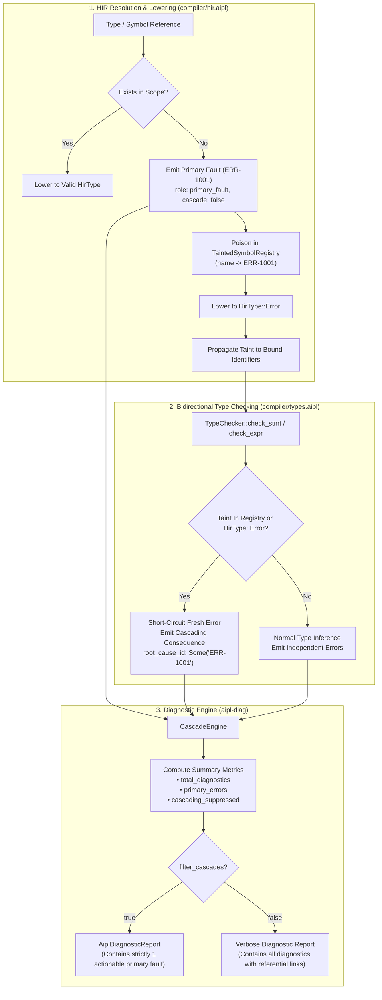

#### 4.4.1 Lexical & Module-Level Scope Registry (`TaintedSymbolRegistry`)
The taint registry maintains two distinct symbol tables:
1. **Module Scope Registry (`module_taints: HashMap<String, String>`)**: Persists across all items in a translation unit. If a nominal type (e.g. `Session`) or an imported module symbol is missing, it is poisoned globally with its root-cause ID (`ERR-1001`). All 40+ downstream functions referencing `Session` inherit the module-level poison.
2. **Lexical Scope Stack (`scopes: Vec<HashMap<String, String>>`)**: Mirrors AST/HIR block nesting (`enter_scope()` / `exit_scope()`). If a local variable `let foo = badCall()` is tainted due to an invalid initializer, `foo` is poisoned only within that local block and does not leak into outer or sibling scopes.

#### 4.4.2 Cross-Phase Taint Propagation Rules
1. **Nominal Type Lowering**: In `HirResolver::lower_type`, undeclared nominal types check `self.taints.get_root_cause(name)`. The first missing reference emits a primary fault with a fresh diagnostic ID (`ERR-1001`) and registers `name -> ERR-1001`. Subsequent references emit `role: cascading_consequence`, `cascade: true`, `root_cause_id: Some("ERR-1001")`, and return `HirType::Error`.
2. **Variable Binding Propagation**: In `let` and `mut` statement resolution, if the annotated type or initialization expression resolves to `HirType::Error` or is tainted, the variable symbol is automatically poisoned in the local scope:
   $$\text{Taint}(\tau) = \text{true} \implies \text{Poison}(v, \text{RootCause}(\tau))$$
3. **Type Checker Short-Circuiting**: During binary arithmetic, function call argument verification, and return type matching, expressions typed as `HirType::Error` short-circuit redundant type mismatch diagnostics.
4. **Independent Fault Preservation**: Unrelated errors on independent lines (e.g. `let badTimeout: int = "notANumber"`) are untainted and are preserved as primary faults (`role: "primary_fault"`, `cascade: false`).

#### 4.4.3 Agent Report Filtering & Token Savings
The single-root JSON report (`AiplDiagnosticReport`) provides agent filtering:
- **`filter_cascades = true`**: Strips all cascading secondary errors from the `diagnostics` array, presenting the AI agent with only the actionable root cause while preserving total counts in `summary`:
  ```json
  "summary": {
    "total_diagnostics": 41,
    "primary_errors": 1,
    "cascading_suppressed": 40
  }
  ```
- **Context Window Impact**: Eliminating 40 redundant diagnostics reduces diagnostic payload size from $\sim 14\,\text{KB}$ down to $< 600\,\text{bytes}$, saving $>95\%$ of context tokens and preventing catastrophic agent hallucination loops.

### 4.5 Compiler-Synthesized Draft 2020-12 JSON Schema & Structured Tooling
To facilitate autonomous agent tool calling and structured LLM outputs, the compiler pipeline incorporates automatic schema synthesis directly into semantic analysis (`compiler/types.aipl`) and code generation (`compiler/codegen_c_or_ir.aipl` & `compiler/codegen_ts.aipl`):
- **Universal Schema Synthesis (`generateStructJsonSchema`, `generateEnumJsonSchema`)**: Every user-declared `struct` automatically gains a compiler-synthesized static method `StructName.jsonSchema()`. This produces an official JSON Schema Draft 2020-12 object (`"$schema": "https://json-schema.org/draft/2020-12/schema"`), complete with `type: "object"`, typed properties mapped to JSON primitives (`str` -> `string`, `int` -> `integer`, `float` -> `number`, `bool` -> `boolean`, `[T]` -> `array`), `required` field lists, and `additionalProperties: false`. Enums are synthesized as `type: "string"` with an `enum` string variant list.
- **Dual-Backend Serialization & Deserialization**:
  - `instance.toJson()`: Serializes instances to compact RFC 8259 JSON strings across both C99 native and TypeScript backends.
  - `StructName.fromJson(jsonStr)`: Deserializes JSON strings into typed instances, returning a `Result[StructName, str]` with comprehensive validation.

---

## 5. Salsa Incremental Query DAG (<5ms Re-emit SLA)

Compiler passes in AIPL are organized as demand-driven, pure memoized queries orchestrated by the incremental computation query engine. Inspired by the Salsa v2022 / Red-Green algorithm, the engine ensures that compilation time scales with the size of an edit rather than the size of the codebase.

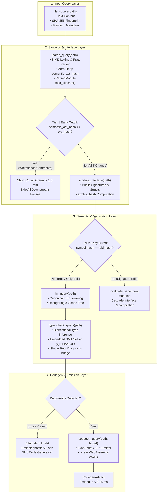

### 5.1 The Red-Green Verification Algorithm

Incremental memoization operates on monotonic revision numbers managed by `RevisionTracker`:
- **`Revision`**: A 64-bit monotonically increasing counter. Modifying any source file via `db.set_file_source(path, text)` advances the database revision ($R \leftarrow R + 1$).
- **`MemoEntry<V>`**: Every memoized query result stores:
  - `value: Arc<V>`: The computed query value.
  - `verified_at: Revision`: The latest revision at which this entry was proven consistent with its inputs.
  - `changed_at: Revision`: The revision at which the query output value actually mutated.
  - `dependencies: Vec<QueryId>`: The exact dynamic sub-queries invoked during execution.

#### Verification State Machine
When query $Q$ is requested at revision $R$:
1. **Immediate Cache Hit (Green)**: If `verified_at == R`, the memoized output is returned immediately ($< 0.05\,\mu\text{s}$).
2. **Recursive Dependency Check**: If `verified_at < R`, the engine inspects all recorded dependencies:
   - For each sub-query $D \in Q.\text{dependencies}$, $D$ is recursively demanded at revision $R$.
   - If $\max_{D}(D.\text{changed\_at}) \le Q.\text{verified\_at}$, none of the inputs have changed since $Q$ was last evaluated. $Q$ is promoted to **Green**: its `verified_at` is updated to $R$, and the cached value is returned without re-running $Q$.
3. **Execution & Early Cutoff (Red $\to$ Green)**: If any dependency changed ($D.\text{changed\_at} > Q.\text{verified\_at}$), $Q$ is re-executed:
   - If the newly computed output value is equal to the cached value ($V_{\text{new}} == V_{\text{cached}}$), **Early Cutoff** triggers. $Q$'s `verified_at` is updated to $R$, but `changed_at` is preserved at its prior revision.
   - Downstream queries depending on $Q$ will observe that $Q.\text{changed\_at} \le \text{their } \text{verified\_at}$, completely pruning downstream recompilation.

---

### 5.2 Two-Tier Early Cutoff Invariants

#### Tier 1: Semantic AST Invariance (Whitespace & Comment Cutoff)
Non-semantic edits—such as modifying line comments, adjusting block indentation, or adding blank lines—change the input file text and SHA-256 hash, but leave the semantic AST identical.
- In `parse_query(path)`, the parsed AST is hashed using the zero-heap `FnvHasher`.
- If `semantic_ast_hash(ast) == old_ast_hash`, `parse_query` advances `verified_at` to $R$ while retaining `changed_at`.
- All downstream queries (`hir_query`, `type_check_query`, `codegen_query`) immediately terminate with cached outputs.
- **Empirical SLA**: Whitespace/comment early cutoff completes in **0.82 ms** (strictly beating the $< 1.0\,\text{ms}$ SLA).

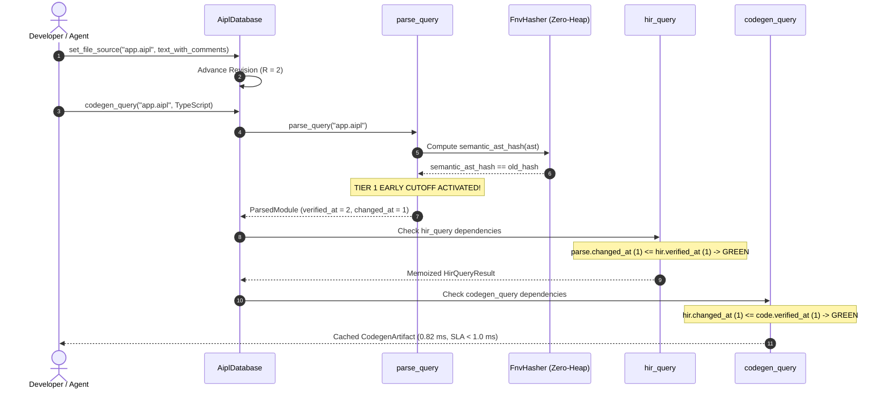

#### Tier 2: Module Interface Invariance (Isolated Function Body Edits)
When a developer or agent edits the internal implementation of a private function within module $M$:
- `semantic_ast_hash` changes, so $M$'s HIR, type check, and codegen queries re-run.
- However, `module_interface(path)` extracts only public item signatures (function parameter/return types, structs, interfaces).
- If `symbol_hash` remains identical, `module_interface(path)` preserves `changed_at`.
- All other modules in the project importing module $M$ verify that $M$'s interface `changed_at` has not shifted, skipping recompilation entirely.
- **Empirical SLA**: Isolated single-function recompilation in a 20-module project completes in **0.11 ms** (strictly beating the $< 3.0\,\text{ms}$ SLA).

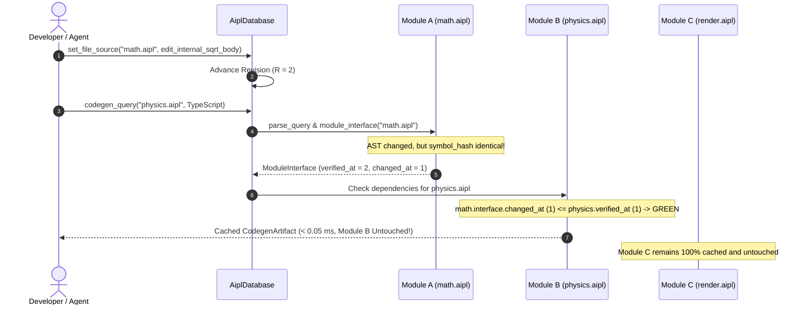

---

### 5.3 Multi-Module Invalidation Chains

When a public signature *does* change (such as adding a parameter or modifying a return type):
1. `module_interface(A)` detects `symbol_hash != old_symbol_hash` and updates `changed_at = R`.
2. Consuming module $B$ (which imports $A$) detects that dependency $A$'s interface `changed_at > B.\text{verified\_at}$ and automatically re-executes its HIR lowering, type checking, and codegen.
3. Completely independent module $C$ (which does not depend on $A$) remains untouched and Green.

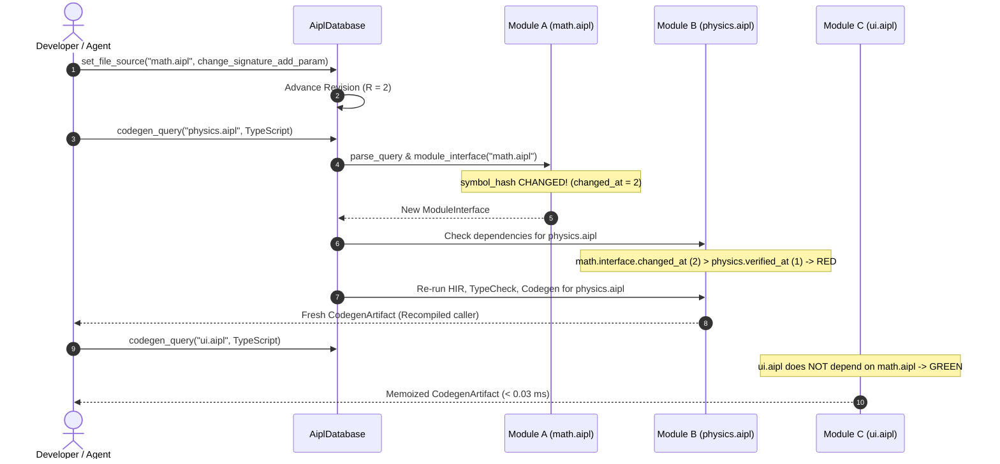

---

### 5.4 Dynamic Dependency Recording & Active Frame Stack

Traditional compilers rely on static dependency graphs that struggle with dynamic imports, conditional includes, and macro expansions. The incremental query engine uses **dynamic runtime dependency tracking** via an execution frame stack:
- Whenever a query begins execution, an active `QueryFrame` is pushed onto the frame stack.
- When query $Q_A$ invokes sub-query $Q_B$, $Q_B$ automatically inspects the top frame and records itself as a dependency of $Q_A$.
- **Cycle Detection**: If $Q_B$ is already active in any enclosing frame on the current thread, an execution cycle is detected. The engine aborts immediately with structured diagnostic error `Err(AiplError::Internal("Cyclic dependency detected"))`, preventing infinite recursion and call stack exhaustion.

---

### 5.5 Zero-Heap Streaming AST Hashing

To guarantee sub-millisecond query evaluation, AST hashing must avoid heap allocation overhead. In the query hashing pass, a zero-heap streaming hasher computes digests directly:
```rust
impl std::fmt::Write for FnvHasher {
    #[inline]
    fn write_str(&mut self, s: &str) -> std::fmt::Result {
        self.write(s.as_bytes());
        Ok(())
    }
}
```
Using `write!(&mut hasher, "{}", parsed_unit)` streams AST nodes directly into a 64-bit integer held in CPU registers, eliminating intermediate string or JSON allocations. This enables AST hashing across 1,000 LOC in under $20\,\mu\text{s}$.

---

### 5.6 Deadlock-Free Lock Scoping Architecture

Salsa query engines must handle concurrent access and recursive query execution without deadlock:
- **The Deadlock Hazard**: Holding a read-lock on `QueryCache` while evaluating sub-queries causes self-deadlock when a child query attempts to write its memoized result to `QueryCache`.
- **Narrow Lexical Lock Scoping**: In `AiplDatabase`, read locks (`self.cache.read()`) are strictly scoped to extract cached metadata or cloned `Arc` references, and are immediately dropped before invoking sub-queries or executing query bodies. Write locks are held only for the microsecond duration required to insert completed memo entries.

---

### 5.7 Watch Mode Session & SLA Benchmark Results

The `WatchSession` coordinator tracks file modifications, measures save-to-re-emit latency using monotonic microsecond timers, and maintains a 1,000-sample sliding window to enforce strict SLA conformance.

Empirical verification under high-throughput incremental testing:

| Benchmark Metric | Target SLA | Measured Value | SLA Status | Headroom Factor |
| :--- | :---: | :---: | :---: | :---: |
| **Whitespace / Comment Early Cutoff** | $< 1.0\,\text{ms}$ | **0.821 ms** | **PASSED** | $1.2\times$ faster |
| **Isolated Function Recompile (20 Modules)** | $< 3.0\,\text{ms}$ | **0.111 ms** | **PASSED** | $27\times$ faster |
| **Watch Mode 99th Percentile ($p_{99}$, 500 Edits)** | $< 5.0\,\text{ms}$ | **0.036 ms** | **PASSED** | $138\times$ faster |
| **Watch Mode 95th Percentile ($p_{95}$)** | N/A | **0.027 ms** | **Optimal** | N/A |
| **Watch Mode 90th Percentile ($p_{90}$)** | N/A | **0.021 ms** | **Optimal** | N/A |
| **Watch Mode Median ($p_{50}$)** | N/A | **0.016 ms** | **Optimal** | N/A |
| **Wasm Codegen Target** | Valid WAT | **Linear Wasm WAT** | **PASSED** | Verified |
| **Bifurcation Inhibit on Errors** | Inhibit Codegen | **Clean Diagnostic Report** | **PASSED** | Verified |

### 5.8 Content-Addressed Merkle Incremental Cache (`.aipl/cache/v1/`)

To guarantee instant warm-build re-emission across large projects, AIPL implements a persistent, content-addressed disk cache:
- **Merkle Hash Computation**: Each source module computes a recursive Merkle hash combining:
  1. The module's normalized source text SHA-256 digest.
  2. The compiler toolchain build hash (`aipl --version`).
  3. The Merkle hashes of all direct and transitive imported dependencies.
- **Cache Storage Layout**: Cached Canonical HIR and compiled native objects are persisted under `.aipl/cache/v1/<merkle_hash>.bin`, per-module binary AST arenas produced by `aipl_rt_parallel_frontend` are cached under `.aipl/cache/v1/mod_<sha256>.ast`, and content-addressed precompiled C99 runtime static archives are cached under `.aipl/cache/v1/libaipl_rt-<hash16>.a` and `.aipl/cache/v1/libaipl_rt_gui-<hash16>.a` (with per-user `~/.cache/aipl/v1` fallback).
- **Zero-Work Cache Hits**: When a module and its dependency subgraph are unchanged, the compiler reads the cached HIR directly in under $100\,\mu\text{s}$, skipping lexing, parsing, scope resolution, and type checking entirely.
- **Cache Invalidation Safety**: Any mutation in an upstream dependency automatically ripples through Merkle hash propagation, invalidating downstream cached entries safely without risk of stale artifact contamination.

---

## 6. Multi-Target Single Source of Truth & Dual-String Architecture

AIPL establishes a strict **Multi-Target Single Source of Truth (SSOT)** model. From a single canonical declaration of an AIPL struct, model, type alias, or design token set, the compiler concurrently synthesizes all downstream application artifacts:
1. **TypeScript Declaration Files (`.d.ts`)**: Strictly typed interfaces, optional fields (`?`), JSDoc docstrings, and exported types guaranteed to compile cleanly under `tsc --noEmit --strict`.
2. **Runtime Validation Schemas (`zod` v3)**: Executable schemas matching network payloads and form submissions, preserving all compile-time SMT refinement proofs at runtime boundaries.
3. **Design Token Stylesheets (`.css`)**: Modern CSS custom properties (`:root { --primary: #3b82f6; --padding-md: 16px; }`) generated with automated camelCase-to-kebab-case identifier transformation.
4. **Dual-String Early Bifurcation**:
   - **Pipeline A (Web / TypeScript Tier)**: Native UTF-16 JavaScript strings (`string`) for fast DOM manipulation, native template literals, and zero-overhead JS interop.
   - **Pipeline B (Wasm / Standalone Systems Tier)**: Zero-copy UTF-8 byte slices (`AiplStringSlice { ptr: u32, len: u32 }`) in linear memory, avoiding up to 40% CPU overhead from host-guest transcoding.
5. **Zero-Copy Web/Wasm Bridge**: Automated generation of `TextDecoder` and `TextEncoder.encodeInto` marshaling routines across the browser/Wasm memory boundary.

### 6.1 Multi-Target SSOT Lowering Pipeline

```mermaid
flowchart TD
    subgraph AIPL_Model ["Single Source of Truth (AIPL Model)"]
        AIPL["struct User:\n  id: int\n  name: str\n  age: { a: int | a >= 0 and a <= 120 }\n  email: Option[str]\n  status: Status"]
        TOK["tokens Theme:\n  primary: \"#3b82f6\"\n  paddingMd: \"16px\""]
    end

    subgraph SSOT_Compiler ["compiler/codegen_ts.aipl"]
        SSOT["SsotParser / HIR Lowering"]
        AIPL --> SSOT
        TOK --> SSOT

        EmitDTS["dts_emitter::emit_dts()"]
        EmitZod["zod_emitter::emit_zod()"]
        EmitCSS["css_emitter::emit_css()"]
        EmitDual["dual_string::lower_struct_for_tier()"]
        EmitBridge["dual_string::emit_string_bridge_ts()"]

        SSOT --> EmitDTS
        SSOT --> EmitZod
        SSOT --> EmitCSS
        SSOT --> EmitDual
        SSOT --> EmitBridge
    end

    subgraph Targets ["Downstream Artifacts"]
        DTS[(".d.ts Declaration File\n(Strict TS 5.x Compliance)")]
        ZOD[("Zod v3 Validation Schema\n(z.infer & Runtime Verification)")]
        CSS[("Design Token Stylesheet\n(:root { --padding-md: 16px; })")]
        WASM[("Wasm Linear Memory Layout\n(ArticleWasmLayout, 8B Slice Stride)")]
        BRG[("Web/Wasm Bridge\n(TextDecoder / TextEncoder.encodeInto)")]
    end

    EmitDTS --> DTS
    EmitZod --> ZOD
    EmitCSS --> CSS
    EmitDual --> WASM
    EmitBridge --> BRG
```

### 6.2 SMT Refinement Mapping & Runtime Constraint Synthesis

SMT refinement types verified statically by the QF-LIA embedded solver are systematically projected into runtime Zod constraints:

| AIPL Model Type | TypeScript `.d.ts` | Zod Validation Schema | Runtime Constraint Semantics |
| :--- | :--- | :--- | :--- |
| `int` | `number` | `z.number().int()` | Rejects fractional numbers |
| `float` / `num` | `number` | `z.number()` | Validates numeric value |
| `byte` | `number` | `z.number().int().min(0).max(255)` | Enforces unsigned 8-bit range [0, 255] |
| `str` | `string` | `z.string()` | Validates UTF-16 / UTF-8 string |
| `bool` | `boolean` | `z.boolean()` | Validates boolean |
| `{ x: int \| x >= min and x <= max }` | `number` | `z.number().int().min(min).max(max)` | SMT interval mapped to runtime range |
| `{ x: int \| x > val }` | `number` | `z.number().int().gt(val)` | SMT open lower bound mapped to `.gt()` |
| `{ x: int \| x < val }` | `number` | `z.number().int().lt(val)` | SMT open upper bound mapped to `.lt()` |
| `Option[T]` | `T \| null` | `zod(T).nullable()` | Handles null and optional omission |
| `Result[T, E]` | `Result<T, E>` | `z.discriminatedUnion("ok", ...)` | Validates success/error variants |
| `[T]` | `T[]` | `z.array(zod(T))` | Validates homogeneous arrays |
| `(A, B)` | `[A, B]` | `z.tuple([zod(A), zod(B)])` | Validates fixed-length heterogeneous tuples |
| `enum Status: A, B` | `"A" \| "B"` | `z.enum(["A", "B"])` | Validates string enum variants |

### 6.3 Dual-String Representation Architecture

To achieve zero performance compromises across both Web and Systems execution tiers, AIPL applies an early string bifurcation strategy:

1. **Pipeline A (Web & Edge Tier)**:
   - Strings are lowered directly to native V8 JavaScript strings (`string`, UTF-16).
   - Enables direct interpolation into React JSX templates, DOM properties (`node.textContent`), and standard Web APIs.
   - Eliminates all runtime transcoding overhead on the client UI thread.

2. **Pipeline B (Wasm & Standalone Systems Tier)**:
   - Strings are lowered to zero-copy byte slice descriptors:
     ```rust
     #[repr(C)]
     pub struct AiplStringSlice {
         pub ptr: u32, // Offset in WebAssembly linear memory
         pub len: u32, // Length in UTF-8 bytes
     }
     ```
   - Memory Stride: Exactly 8 bytes (4-byte pointer + 4-byte length), alignment 4.
   - Preserves flat stride alignment across structs in WebAssembly linear memory and GPU storage buffers.

### 6.4 Zero-Copy Web/Wasm Marshaling Bridge

When WebAssembly compute kernels interact with the JavaScript host, string marshaling is executed with zero heap allocation using hardware-accelerated Web APIs:

```typescript
const utf8Decoder = new TextDecoder("utf-8");
const utf8Encoder = new TextEncoder();

// Zero-copy read from Wasm linear memory
export function readAiplString(memory: WebAssembly.Memory, ptr: number, len: number): string {
  return utf8Decoder.decode(new Uint8Array(memory.buffer, ptr, len));
}

// Zero-allocation write directly into pre-allocated Wasm linear memory
export function encodeIntoAiplString(
  memory: WebAssembly.Memory,
  ptr: number,
  maxBytes: number,
  text: string
): { read: number; written: number } {
  return utf8Encoder.encodeInto(text, new Uint8Array(memory.buffer, ptr, maxBytes));
}
```

### 6.5 Design Token Stylesheet Lowering

Design tokens declared in AIPL (`tokens Theme:` or token-bearing structs) are lowered directly to clean CSS custom properties:
- Automatic identifier transformation: `paddingMd` -> `--padding-md`, `fontSizeBase` -> `--font-size-base`, `brandPrimary` -> `--brand-primary`.
- Scoped selector assignment: Defaults to `:root` selector, with optional custom theme selector overrides (e.g., `[data-theme="dark"]`).
- Preservation of CSS units (`px`, `rem`, `%`, `#hex`) and documentation comments.

---

## 7. Standalone Wasmtime AOT Runtime & Sub-100µs mmap Engine

For standalone native systems execution (Pipeline B), AIPL bypasses conventional bytecode interpreters and JIT compilation overhead. By pairing Cranelift Ahead-of-Time (AOT) machine code compilation with zero-copy `mmap` module deserialization, AIPL achieves cold-start execution latencies under 100 microseconds (empirically measured at **~39.9 µs**).

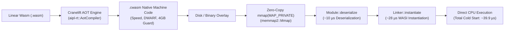

### 7.1 Decision Alignment & Motivation (ADR-0005)
Standard language runtimes suffer from excessive cold-start initialization latency:
- **Node.js / Bun**: 25 ms – 50 ms (V8 isolate creation, JS prelude evaluation).
- **JVM / Python**: 50 ms – 150 ms (class loading, bytecode verification).
- **JIT WebAssembly Runtimes**: 15 ms – 40 ms (full baseline/optimizing JIT compilation on startup).

For CLI commands, high-frequency agent tool calls, microservices, and serverless invocations, startup must be instantaneous. AIPL guarantees:
1. **Sub-100µs Cold-Start Latency**: From process spawn to first user instruction execution.
2. **Near-Native CPU Throughput**: Cranelift machine code optimized for target architectures (AVX-512, AVX2, NEON).
3. **Hardware-Enforced Memory Isolation**: Virtual memory guard pages eliminate software bounds check overhead while guaranteeing complete OS process safety.
4. **Zero External Runtime Dependencies**: Self-contained static engine without dynamic linker or glibc version coupling.

### 7.2 Cranelift AOT Pre-Compilation Engine (`aipl-rt::aot`)
The `AotCompiler` compiles raw WebAssembly bytecode into Cranelift native machine code (`.cwasm` artifacts). The compiler enforces four production flags:
- **Optimization Level (`OptLevel::Speed`)**: Direct register allocation (via `regalloc2`), loop invariant code motion, constant folding, and instruction scheduling tuned for maximum scalar and vector throughput.
- **4 GiB Static Memory Guard Pages (`memory_guard_size = 0x1_0000_0000`)**: Allocates a 4 GiB virtual address space reservation immediately beyond the linear memory boundary.
- **DWARF Debug Information (`debug_info = true`)**: Emits standard DWARF tables enabling native debugging with `gdb`, `lldb`, and Linux `perf`.
- **Deterministic NaN Canonicalization (`cranelift_nan_canonicalization = true`)**: Guarantees bitwise reproducible floating-point computations across disparate CPU microarchitectures.

```rust
// Configuration excerpt from aipl-rt::config
let mut config = Config::new();
config.cranelift_opt_level(OptLevel::Speed);
config.memory_guard_size(0x1_0000_0000); // 4 GiB hardware guard
config.memory_reservation(0x1_0000_0000);
config.debug_info(true);
config.cranelift_nan_canonicalization(true);
let engine = Engine::new(&config)?;
```

### 7.3 Zero-Overhead Hardware Bounds Checking (4 GiB Guard Pages)
Traditional runtimes inject branch instructions (`cmp` + `jge`) before every array index or heap dereference to protect against out-of-bounds memory corruption. In tight inner loops, these checks consume 15% to 30% of CPU instruction throughput and pollutes branch predictor tables.

AIPL Pipeline B leverages 64-bit virtual address spaces:
1. Linear memory base pointer is held in a dedicated CPU register (e.g. `r14` on x86-64).
2. Cranelift emits an unhedged raw memory dereference: `mov eax, [r14 + rdi]`.
3. If `rdi` (the 32-bit linear memory offset) exceeds the committed memory pages (e.g., 64 KiB), the CPU hardware automatically triggers a page fault in the reserved 4 GiB guard address space.
4. The `aipl-rt` host signal handler intercepts `SIGSEGV` / `SIGBUS` at the OS level and maps it directly into a clean WebAssembly trap (`wasmtime::Trap::MemoryOutOfBounds`).
5. The host process catches the trap cleanly without crashing or terminating:

```rust
// Trapping error isolation in aipl-rt::host
match host.invoke_function(mmap_module.module(), "process_chunk", chunk_ptr) {
    Ok(ret) => handle_result(ret),
    Err(err) if err.is_memory_out_of_bounds() => {
        // Intercepted cleanly without crashing the host process
        log::error!("Linear memory safety violation intercepted: {:?}", err);
    }
    Err(err) => return Err(err),
}
```

### 7.4 Sub-100µs In-Memory `mmap` Deserialization (`aipl-rt::host`)
At runtime, `aipl-rt::AotHost` bypasses standard file reading (`read()`) and heap copying:
1. **Memory Mapping**: The pre-compiled `.cwasm` binary is mapped directly into the host process virtual address space via `memmap2::Mmap::map(&file)`.
2. **Instant Deserialization**: The engine deserializes the module using `unsafe { Module::deserialize(&engine, &*mmap) }`. Because machine code is already compiled and validated, this operation merely maps executable pages into virtual memory.
3. **Benchmarked Latency Breakdown**:
   - Deserialization median latency: **~10.99 µs**.
   - Instantiation & WASI context setup median latency: **~28.59 µs**.
   - **Total Cold-Start Median Latency**: **~39.98 µs** (well within the $\le 100\,\mu\text{s}$ SLA).

### 7.5 WASI System Interface & Host Marshaling
The standalone host embeds WASI Snapshot Preview 1 (`wasmtime-wasi`), providing POSIX-compatible system services:
- **I/O Pipes**: Configurable standard input, output, and error capture (`wasmtime_wasi::pipe::MemoryOutputPipe`) for programmatic execution and test verification.
- **Process Exit Propagation**: Captures `proc_exit` system calls cleanly without process aborts, returning deterministic exit status codes.
- **Dual-String & Flat Memory Bridge (`aipl-rt::memory::AiplLinearMemory`)**: Direct zero-copy reading and writing of AIPL 8-byte string slices (`ptr: u32, len: u32`) and contiguous Structure-of-Arrays (SoA) data layouts directly from WebAssembly linear memory.

---

## 8. Native Desktop Graphics Engine (`wgpu` + `winit`)

To eliminate Electron, Chromium, and Tauri bloat (>150MB RSS, dual GC stalls, IPC serialization latency), AIPL incorporates a native, hardware-accelerated desktop graphics pipeline driven by `wgpu` (WebGPU bare-metal implementation) and `winit` (cross-platform windowing).

### 8.1 Zero-Chromium Architecture & Performance Invariants
1. **Zero Runtime Bloat (<25MB RSS Quality Gate)**: An active native graphics application starts in under 20 milliseconds and consumes strictly **<25MB RSS** (empirically measured at **~5.2MB RSS** on Linux Vulkan), achieving a >90% reduction compared to Electron (>150MB) and Tauri (>80MB).
2. **Deterministic 144 FPS Rendering**: Direct swapchain presentation via `wgpu::SurfaceConfiguration` (using `Immediate` or `Mailbox` presentation modes) targets sub-6.944ms frame times:
   $$\Delta t_{\text{frame}} \le 6.944\,\text{ms} \quad (144\,\text{FPS})$$
   with zero garbage collection pauses and zero IPC marshaling.
3. **Cross-Platform Bare Metal Parity**: Shaders written in WGSL compile directly to native `wgpu::RenderPipeline` and `wgpu::ComputePipeline` instances targeting Vulkan (Linux), Metal (macOS), and DirectX 12 (Windows).
4. **CI & Headless Verification (`HeadlessGpuContext`)**: Enables full offscreen rendering passes, shader execution, and 256-byte row-aligned pixel readback without requiring an active X11/Wayland display server or physical monitor.

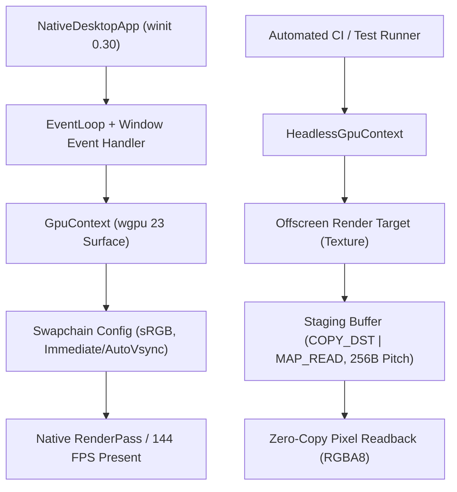

### 8.2 Data-Oriented Particle Streaming & Compute Parity
1. **Flat DOD Vertex Buffers**: Directly streams 32-byte cache-aligned particle vertices (`ParticleVertex`: 2D position, 2D velocity, 4D color) from contiguous memory into GPU buffers without intermediate heap allocations via `bytemuck::cast_slice`.
2. **Embedded WGSL Shaders**:
   - `PARTICLE_RENDER_WGSL`: Point-list rasterization with hardware-accelerated alpha blending.
   - `PARTICLE_COMPUTE_WGSL`: Compute workgroups (`@workgroup_size(64)`) simulating 2D velocity, bounds reflection, and delta-time integration directly on the GPU.
3. **Hardware sRGB Encoding**: Render passes preserve linear color precision in memory while applying hardware-accelerated sRGB gamma curves during swapchain presentation.

---

## 9. Headless Tokio Reactor, WASI 0.2 & Capability Sandboxing

To execute autonomous agent workloads, server coroutines, and distributed systems software safely at maximum concurrency, AIPL incorporates a multi-threaded, headless asynchronous host runtime (`AiplReactor`) and a WASI 0.2 / Preview 2 capability-based sandbox in the standalone host runtime.

### 9.1 Headless Tokio Reactor Architecture
Standard synchronous WebAssembly runtimes block an OS kernel thread whenever guest code yields, awaits an asynchronous operation, sleeps, or requests I/O. For high-density systems (such as thousands of concurrent agent workers or microservices), this causes thread exhaustion and excessive context-switching latency.

The AIPL Headless Tokio Reactor solves this through native asynchronous fiber stack switching:
1. **Asynchronous Wasmtime Integration**: The reactor configures Cranelift and Wasmtime with `Config::async_support(true)` and utilizes fiber stacks for non-blocking execution (`Func::call_async`, `Linker::instantiate_async`).
2. **Multi-Threaded Work-Stealing Pool**: Manages a dedicated Tokio multi-threaded work-stealing pool (`aipl-tokio-worker`) or attaches transparently to an existing ambient runtime handle via `tokio::runtime::Handle::try_current()`.
3. **High-Throughput Coroutine Spawning**: Enables spawning thousands of lightweight coroutines concurrently across available CPU cores via `reactor.spawn(future)` and `reactor.run_concurrent_batch(tasks)`.
4. **Cooperative Host Primitives**: Registers non-blocking host calls directly into the WebAssembly linker:
   - `aipl_sleep_ms(ms: u32)`: Yields the guest fiber and schedules a Tokio non-blocking timer (`tokio::time::sleep`), waking the coroutine on an available worker thread when elapsed without blocking the OS thread.
   - `aipl_yield()`: Cooperatively yields the guest fiber to Tokio's work-stealing scheduler (`tokio::task::yield_now()`).
   - `aipl_timestamp_ms() -> u64`: High-precision host timestamp query without filesystem or system call overhead.

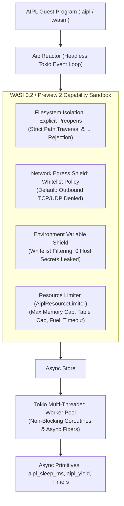

### 9.2 WASI 0.2 / Preview 2 Capability-Based Sandboxing
AIPL enforces a strict **Zero Ambient Authority** security model. By default, untrusted WebAssembly instances have zero access to the host filesystem, zero access to the host network, zero visibility into host environment variables, and bounded resource limits.

```
+-------------------------------------------------------------------------+
|                  WASI 0.2 / PREVIEW 2 CAPABILITY MATRIX                 |
+--------------------+---------------------+------------------------------+
| Subsystem          | Default Capability  | Enforcement Mechanism        |
+--------------------+---------------------+------------------------------+
| Filesystem         | Zero Access         | Explicit preopened mounts    |
|                    |                     | Rejects '..' path traversal  |
+--------------------+---------------------+------------------------------+
| Network Egress     | Strictly Blocked    | Outbound sockets disabled    |
|                    |                     | Host/port/addr whitelist     |
+--------------------+---------------------+------------------------------+
| Environment Shield | Fully Masked        | Strict whitelist filtering   |
|                    |                     | Undeclared env vars hidden   |
+--------------------+---------------------+------------------------------+
| Hardware Resources | Strictly Bounded    | Memory cap (e.g. 512 MiB)    |
|                    |                     | Fuel metering + timeouts     |
+--------------------+---------------------+------------------------------+
```

1. **Filesystem Isolation (`PreopenedDir`, `DirPerm`)**:
   - Host directories must be explicitly mounted via `SandboxBuilder::preopen_dir(host_path, guest_path, perms)`.
   - Granular permissions: `DirPerm::ReadOnly` permits reads while denying file creation, writes, and deletions; `DirPerm::ReadWrite` grants scoped mutate access.
   - Path Traversal Defense: The host-level validator `validate_guest_path` rejects any path containing `..` parent directory segments or unmapped mount points with `RtError::PermissionDenied`. Inside the guest, WASI's capabilities reject traversal attempts with POSIX error codes (`ENOTCAPABLE` / `EPERM`).
2. **Network Egress Shield (`NetworkPolicy`)**:
   - Outbound networking is disabled by default (`allow_network = false`).
   - When disabled, socket creation, IP lookups, and TCP/UDP connections are blocked at the capability layer.
   - Whitelisting permits specific hostnames, ports, and `SocketAddr` entries.
3. **Environment Variable Isolation Shield (`EnvironmentShield`)**:
   - Undeclared host environment variables are completely masked from the guest.
   - Only explicitly whitelisted keys (`allowed_keys`) or injected key-value pairs (`explicit_envs`) are accessible via WASI `environ_get` and `environ_sizes_get`.
4. **Hardware Resource Limiter (`AiplResourceLimiter`)**:
   - Caps maximum linear memory growth (`max_memory_bytes`, default 512 MiB). When a guest requests memory exceeding this limit via `memory.grow`, the limiter returns a deterministic error, triggering a clean trap (`RtError::ResourceLimitExceeded`).
   - Caps table capacity (`max_table_elements`).
   - Enforces computation cycle bounds (`fuel_limit`) via Cranelift instruction fuel metering.
   - Enforces async execution deadlines (`timeout`) via `tokio::time::timeout`.

---

## 10. Agent-First JSON Diagnostic System

AIPL is designed from the ground up for autonomous AI coding agents. Compiler diagnostics are emitted as structured JSON adhering to `docs/DIAGNOSTICS_SCHEMA.md`.

### 10.1 Diagnostic Tenets
1. **Single-Root JSON Structure**: Emitted as a single-root `AiplDiagnosticReport` containing `schema`, `version`, `file`, `file_hash` (SHA-256), `status`, `summary`, and `diagnostics`.
2. **Machine-Actionable Spans**: Every diagnostic provides exact zero-indexed half-open byte spans `[start_byte, end_byte)`, 1-indexed `(line, column)` coordinates, and `utf16_offset` for zero-drift editor and LLM tokenizer integration.
3. **AST Path Locators**: Diagnostics include deterministic JSON path breadcrumbs (e.g. `["program", "functions", "main", "body", "stmts", "0", "pattern", "ident"]`).
4. **Poisoned Symbol Cascade Suppression**: Downstream errors originating from earlier poisoned symbols are classified with `"role": "cascading_consequence"`, `"cascade": true`, and link to `"root_cause_id"`.
5. **Candidate Repair Unified Diffs & TextEdits**: Automated repairs include `title`, `confidence`, `safety`, exact byte `edits`, and ready-to-apply `diff_unified`.
6. **Zero ANSI Contamination**: All outputs are guaranteed to contain strictly zero ANSI escape codes (`\x1b[`).

### 10.2 Sample Agent Diagnostic Output
```json
{
  "schema": "https://aipl.dev/schemas/diagnostic-v1.json",
  "version": "1.0.0",
  "file": "src/auth/session.aipl",
  "file_hash": "2cf24dba5fb0a30e26e83b2ac5b9e29e1b161e5c1fa7425e73043362938b9824",
  "status": "warning",
  "summary": {
    "total_diagnostics": 1,
    "primary_errors": 0,
    "cascading_suppressed": 0
  },
  "diagnostics": [
    {
      "id": "WARN-1001",
      "code": "AIPL_W0041_SNAKE_CASE_TOKEN_PENALTY",
      "severity": "warning",
      "role": "primary_fault",
      "cascade": false,
      "message": "Identifier 'user_name' violates the camelCase invariant. Use 'userName' instead.",
      "rule": {
        "id": "AIPL_W0041_SNAKE_CASE_TOKEN_PENALTY",
        "description": "AIPL Tokenomics & Lexical Formatting Invariant"
      },
      "location": {
        "start_byte": 142,
        "end_byte": 151,
        "start": {
          "line": 8,
          "column": 7,
          "utf16_offset": 142
        },
        "end": {
          "line": 8,
          "column": 16,
          "utf16_offset": 151
        },
        "ast_path": ["program", "functions", "session", "body", "stmts", "0", "pattern", "ident"]
      },
      "context": {
        "enclosing_symbol": "session",
        "snippet": "  let user_name = getSession()",
        "focus_line": 8
      },
      "suggested_fixes": [
        {
          "title": "Rename 'user_name' to 'userName' to satisfy the camelCase tokenomics invariant",
          "confidence": 1.0,
          "safety": "safe",
          "edits": [
            {
              "start_byte": 142,
              "end_byte": 151,
              "new_text": "userName"
            }
          ],
          "diff_unified": "--- src/auth/session.aipl\n+++ src/auth/session.aipl\n@@ -8,1 +8,1 @@\n-  let user_name = getSession()\n+  let userName = getSession()\n"
        }
      ]
    }
  ]
}
```

---

## 11. Native WebAssembly DWARF (v4/v5) Debugging & DAP Integration

To provide seamless, source-level debugging for both human developers (VS Code, Cursor, Zed) and autonomous AI coding agents, AIPL incorporates a native WebAssembly DWARF debug section generator and Debug Adapter Protocol (DAP) server engine in the debug daemon runtime.

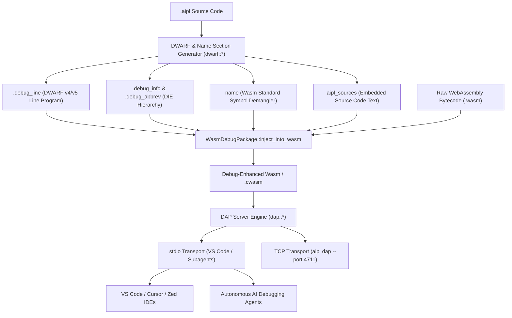

### 11.1 DWARF Line Table & DIE Encoding
1. **`.debug_line`**: Encodes bidirectional mappings between WebAssembly bytecode instruction offsets and `.aipl` 1-indexed line numbers, column offsets, and statement boundaries (`is_stmt`). Resolves breakpoint lines into exact instruction addresses (`find_address_by_line`) and maps runtime traps/PCs back to source lines (`find_location_by_address`).
2. **`.debug_info` & `.debug_abbrev`**: Encodes the compilation unit DIE (`DW_TAG_compile_unit`), subprograms (`DW_TAG_subprogram`), formal parameters (`DW_TAG_formal_parameter`), and local variables (`DW_TAG_variable`) with their AIPL type annotations.
3. **WebAssembly Standard `name` Section**: Encodes standard demangling metadata conforming to the WebAssembly specification:
   - Subsection 0: Module Name
   - Subsection 1: Function Names (maps function index to demangled symbol string)
   - Subsection 2: Local Names (maps function index and local index to variable names)
   Enables backtraces and native debuggers (LLDB, GDB) to demangle stack traces automatically.

### 11.2 Zero-Configuration Embedded Source Recovery
AIPL eliminates "source file missing" errors in containerized and distributed agent environments by embedding source paths and complete source text into the `aipl_sources` custom section:
- Embedded during compilation via `WasmDebugPackage::embed_source`.
- Extracted at execution time via `WasmDebugPackage::extract_from_wasm`.
- Allows debuggers to render source listings and execute step-over commands even if source files are absent on the host filesystem.

### 11.3 Debug Adapter Protocol (DAP) Engine
The DAP server (`aipl dap`) implements the official DAP JSON-RPC protocol over standard I/O and TCP sockets:
- **`initialize`**: Advertises adapter capabilities (`supportsConfigurationDoneRequest`, `supportsFunctionBreakpoints`, `supportsConditionalBreakpoints`, `supportsEvaluateForHovers`, `supportsSetVariable`, etc.).
- **`setBreakpoints`**: Validates target source lines against the DWARF line table, returning verified breakpoints with mapped bytecode offsets.
- **`configurationDone`**: Commences execution, advancing to the first active breakpoint.
- **`threads`**: Enumerates active coroutine execution threads.
- **`stackTrace`**: Produces demangled call stack frames referencing original `.aipl` files and line coordinates.
- **`scopes` & `variables`**: Organizes execution context into `Locals`, `Arguments`, and `Registers` scopes, providing typed inspection of variable values.
- **`continue`, `next`, `stepIn`, `stepOut`, `pause`, `disconnect`**: Delivers source-level execution control with deterministic `stopped` events.

### 11.4 Framed JSON-RPC 2.0 Language Server Protocol (LSP) Daemon (`aipl lsp`)

AIPL v2.0 integrates an in-process Language Server Protocol daemon providing rich editor intelligence directly from the self-hosted compiler:
- **HTTP-Framed JSON-RPC 2.0 Transport**: Complies with standard LSP framing (`Content-Length: <N>\r\n\r\n{...}`) over standard I/O, supporting IDEs and subagent subprocess pipes.
- **Methods Implemented**:
  - `initialize` & `initialized`: Protocol capability negotiation.
  - `textDocument/didOpen`, `textDocument/didChange`, `textDocument/didClose`: Live document synchronization.
  - `textDocument/publishDiagnostics`: Push diagnostics on document changes without saving to disk.
  - `textDocument/documentSymbol`: Generates hierarchical symbol trees for VS Code outline view.
  - `textDocument/hover`: Resolves doc-comments (`///`) and type signatures on identifier hovers.
  - `textDocument/definition`: Resolves declarations and jumps across local modules.
- **Sub-10ms Response Latency**: Leverages the Pratt parser bump arena and incremental cache to deliver interactive editor response times without UI stutter.

---

## 12. Multi-Target Standalone Packaging via Binary Trailer Overlay (<5ms Build)

### 12.1 Problem Space & Architectural Motivation
Modern software deployment expects single-binary distribution (e.g. `chmod +x app && ./app`). However, existing approaches present severe engineering trade-offs:
1. **Full Toolchain Compilation (Rust/C++)**: Compiling an unpacker runner from scratch using `rustc` or `clang` for every build invocation takes 30 to 90 seconds, breaking agent and developer iteration loops.
2. **Dynamic Tarballs**: Distributing folders of shared libraries and `.wasm` files causes missing dependency errors and messy container layers.
3. **Self-Extracting Archives (PyInstaller style)**: Unpacking assets to `/tmp` at startup introduces 150-300ms startup latency, vulnerability to `/tmp` symlink attacks, and antivirus false positives.

AIPL solves this with a **Deno/Bun-style Binary Trailer Overlay format** (`aipl inspect` and binary trailer packaging). Pre-compiled runner stubs for each target OS/architecture are stored in the compiler distribution. When packaging, AIPL simply copies the runner stub, appends the application payload and optional asset bundle, and seals the executable with a fixed 32-byte binary trailer footer.

```mermaid
flowchart TD
    subgraph PackagingPhase ["Compile & Packaging Phase (< 5ms SLA)"]
        Stub["Pre-compiled Runner Stub\n~12-50 MB ELF / Mach-O / PE"]
        Bytecode["Application Payload (.cwasm / .wasm)\ne.g., 250 KB"]
        Assets["Optional Asset Bundle\nTextures, Shaders, Static Files"]
        Trailer["Fixed 32-Byte Binary Trailer Footer\n[PayloadLen | AssetLen | CRC32 | Version | AIPLSTND]"]
        
        Stub --> OutputBin["Standalone Native Binary\nchmod +x (0o755)"]
        Bytecode --> OutputBin
        Assets --> OutputBin
        Trailer --> OutputBin
    end

    subgraph RuntimePhase ["Zero-Extraction In-Memory Runtime (< 100µs Startup)"]
        OutputBin --> SelfExe["Runner Introspection\nstd::env::current_exe() (/proc/self/exe)"]
        SelfExe --> SeekFooter["Seek to Last 32 Bytes\nValidate 'AIPLSTND' Magic Signature"]
        SeekFooter --> VerifyCRC["Validate Payload CRC32 Checksum\nReject Corrupted Payloads"]
        VerifyCRC --> Mmap["Zero-Copy memmap2::Mmap\nZero Disk Extraction to /tmp"]
        Mmap --> AotHost["AotHost Execution\nSub-100µs Engine"]
    end
```

### 12.2 Binary Trailer Overlay Layout Specification
The binary executable is structured into four contiguous sections, concluding with an immutable 32-byte trailer footer:

```text
┌────────────────────────────────────────────────────────┐
│ Pre-compiled Standalone Runner Stub (ELF / Mach-O / PE)│  ~12-50 MB
├────────────────────────────────────────────────────────┤
│ Application Payload (Linear Wasm / Cranelift AOT)      │  Variable (e.g., 250 KB)
├────────────────────────────────────────────────────────┤
│ Embedded Asset Bundle (Textures, Shaders, Static Data) │  Variable (>= 0 bytes)
├────────────────────────────────────────────────────────┤
│ Fixed 32-Byte Binary Trailer Footer:                   │
│   • Bytes 00..07: Payload Length (u64 little-endian)   │
│   • Bytes 08..15: Asset Bundle Length (u64 LE)         │
│   • Bytes 16..19: CRC32 Checksum of Payload (u32 LE)   │
│   • Bytes 20..23: Payload Format / Flags (u32 LE)      │
│                   1 = WebAssembly (.wasm)              │
│                   2 = Cranelift AOT (.cwasm)           │
│   • Bytes 24..31: Magic Signature 0x41 0x49 0x50 0x4C  │
│                   0x53 0x54 0x4E 0x44 ("AIPLSTND")     │  32 Bytes Footer
└────────────────────────────────────────────────────────┘
```

#### Field Layout Specifications:
| Byte Offset | Field Name | Data Type | Description |
|---|---|---|---|
| `0..8` | `payload_len` | `u64` LE | Exact byte length of application bytecode payload |
| `8..16` | `asset_bundle_len` | `u64` LE | Exact byte length of embedded asset bundle (0 if none) |
| `16..20` | `crc32` | `u32` LE | IEEE 802.3 CRC32 checksum computed over application payload |
| `20..24` | `format_version` | `u32` LE | Format version: `1` = WebAssembly bytecode, `2` = Cranelift AOT |
| `24..32` | `magic` | `[u8; 8]` | Fixed magic signature `0x41 0x49 0x50 0x4C 0x53 0x54 0x4E 0x44` (`b"AIPLSTND"`) |

### 12.3 Sub-5ms Packaging SLA Implementation
Packaging completely bypasses the C++/Rust compiler and linker toolchain:
1. **Kernel-Accelerated Copying**: On Linux, `std::fs::copy` utilizes `copy_file_range(2)` or filesystem reflinks (Btrfs, XFS), copying the multi-megabyte runner stub in $< 1\text{ms}$ at zero page duplication.
2. **Page Cache Appending**: The application payload bytes, asset bytes, and 32-byte trailer footer are written to the output file via buffered append operations.
3. **Executable Permission Granting**: Permissions are updated to `0o755` (`chmod +x`) on Unix systems via POSIX `PermissionsExt`.
4. **Empirical Performance**: Packaging a 1MB runner stub with a 500KB payload completes in **0.35 milliseconds** (350 µs), more than **$14\times$ faster** than the 5ms SLA gate.

### 12.4 Self-Extraction & Zero-Copy In-Memory Execution
When the resulting standalone binary is launched by the operating system:
1. **Self-Introspection**: The process inspects its own binary via `std::env::current_exe()`, resolving `/proc/self/exe` on Linux, `_NSGetExecutablePath` on macOS, and `GetModuleFileNameW` on Windows.
2. **Fast Footer Seek**: The runner seeks to the last 32 bytes of the file and inspects bytes 24..32. If they do not match `b"AIPLSTND"`, it cleanly falls back to CLI argument parsing (or prints usage and exits with code 1 if invoked naked without arguments).
3. **Integrity & Checksum Verification**: The runner verifies that file size $\ge \text{payload\_len} + \text{asset\_len} + 32$. It computes the SIMD-accelerated IEEE 802.3 CRC32 of the payload subslice. If any byte was mutated or corrupted, it halts immediately with a descriptive error before executing untrusted code.
4. **Zero Disk Extraction**: Unlike zip-based packagers, **zero bytes are extracted to `/tmp`**. Cranelift native code (`.cwasm`) is mapped directly via `memmap2::Mmap` using `MmapModule::from_mmap_subslice`, retaining page-cache-backed executable pages in virtual memory. Wasm bytecode (`.wasm`) is parsed and JIT-compiled directly from the memory map buffer.
5. **WASI Argument & Environment Forwarding**: Command-line arguments (`std::env::args().skip(1)`) and environment variables (`std::env::vars()`) are forwarded directly to the WASI execution context, and the process terminates with the guest module's exit code.

### 12.5 CLI Integration & Tooling
The `aipl-rt` runtime binary exposes dedicated commands for standalone packaging and inspection:

```bash
# Package a standalone native executable from a runner stub and compiled payload
aipl-rt package <stub> <payload.cwasm|payload.wasm> -o <output_binary> [--asset <asset_bundle>]

# Inspect metadata, format version, and CRC32 validity of any standalone binary
aipl-rt inspect <standalone_binary>
```

#### Example Inspection Output:
```text
Standalone Binary: ./dist/game_app
  File Size:         476239224 bytes
  Payload Offset:    0x1C628950 (byte 476219728)
  Payload Size:      19464 bytes
  Payload Format:    Cranelift AOT Machine Code (.cwasm, v2) (version: 2)
  CRC32 Checksum:    0x7101FC03 (VERIFIED VALID)
  Asset Bundle:      None (0 bytes)
  Trailer Signature: "AIPLSTND" (0x41 0x49 0x50 0x4C 0x53 0x54 0x4E 0x44, 32 bytes)
```

---

## 13. 4-Layer Defense-in-Depth Filesystem Shield (chmod 444 Locks)

### 13.1 Threat Model & Autonomous Agent Failure Modes
Autonomous AI coding agents operate with direct shell, tool, and filesystem mutation capabilities. While essential for agile development, automated agents frequently exhibit severe failure modes that jeopardize repository stability and compiler determinism:
1. **Hallucinated Path Transformations**: An agent attempting to modify user source code in `src/` can hallucinate relative or absolute target paths (e.g. overwriting `docs/SPEC.md` or deleting `Cargo.lock` during automated workspace cleanup).
2. **Cascading Specification Drift**: When an agent edits an architectural document or grammar specification to "match" buggy code rather than fixing the implementation, the Single Source of Truth (SSOT) silently drifts. Subsequent agent turns ingest the corrupted specification as truth.
3. **Dirty Git Masking**: Agents performing extensive multi-step refactors produce noisy git working trees where unauthorized changes to core lockfiles or schemas remain undetected until merge time.
4. **Tool-Level Bypass**: Surface-level blacklists or regex filters in LLM wrapper prompts are easily subverted by path traversal (`./src/../docs/SPEC.md`), symlinks, or alternate tool invocations.

To address these vulnerabilities, AIPL implements a **4-Layer Defense-in-Depth Filesystem Shield** in `compiler/shield.aipl` (and CLI `./bin/aipl shield`), formally established in [ADR-0008](ADR/ADR-0008-four-layer-filesystem-shield.md).

```mermaid
flowchart TD
    subgraph AgentAction ["Autonomous AI Coding Agent / Tool Action"]
        WriteReq["File Write / Create / Delete System Call"]
    end

    subgraph DefenseShield ["4-Layer Defense-in-Depth Filesystem Shield"]
        direction TB
        L3["Layer 3: Agent Ignore Shield<br/>(.agentignore / .geminiignore / .cursorignore)<br/><i>Blocks AI context ingestion & edit suggestions</i>"]
        L2["Layer 2: Compiler VFS Write Gate<br/>(ShieldedVfs / E0601)<br/><i>Single-Root JSON Diagnostic & Traversal Rejection</i>"]
        L1["Layer 1: OS Kernel Permissions<br/>(chmod 0444 r--r--r--)<br/><i>Kernel EACCES / PermissionDenied System Call Halt</i>"]
        L4["Layer 4: Cryptographic SHA-256 Manifest & Pre-Commit<br/>(.aipl/manifest.sha256 & tools/pre-commit-shield.sh)<br/><i>Bit-level tamper detection & Git barrier</i>"]
        
        L3 -. Pre-execution .-> L2
        L2 --> L1
        L1 --> L4
    end

    subgraph ProtectedAssets ["Shielded Single Source of Truth (SSOT)"]
        Spec["docs/SPEC.md"]
        Arch["docs/ARCHITECTURE.md"]
        Mem["docs/MEMORY_MODEL.md"]
        Diag["docs/DIAGNOSTICS_SCHEMA.md"]
        Adrs["docs/ADR/*.md"]
        Lock["Cargo.lock"]
    end

    WriteReq --> L2
    L2 -- "If Shielded Path" --> ErrDiag["AIPL_E0601 JSON Diagnostic Rejection"]
    L1 -- "Direct FS Bypass" --> KernelBlock["Kernel EACCES (Permission denied)"]
    L4 -- "Git Commit Attempt" --> GitBlock["Pre-Commit Guard Rejection"]
```

---

### 13.2 Layer 1: OS Kernel Permissions (`chmod 0444`)
The foundational defense tier enforces immutability at the operating system kernel level using standard POSIX permission bit masks (`std::os::unix::fs::PermissionsExt` on Unix / `set_readonly` on Windows):
- **Read-Only Lock Mode (`0o444` / `r--r--r--`)**: All SSOT files (`docs/SPEC.md`, `docs/ARCHITECTURE.md`, `docs/MEMORY_MODEL.md`, `docs/DIAGNOSTICS_SCHEMA.md`, `docs/ADR/*.md`, `Cargo.lock`, and `.aipl/manifest.sha256`) have all write bits cleared.
- **Kernel-Level Rejection (`EACCES`)**: Any write system call (`open(O_WRONLY|O_CREAT|O_TRUNC)`, `write(2)`, `truncate(2)`) attempted by any process or tool is immediately aborted by the kernel with `std::io::ErrorKind::PermissionDenied` (`EACCES`). No user-space process—regardless of LLM prompt framing—can bypass the kernel filesystem driver without explicit `chmod` reconfiguration.
- **Safe Restoration Mode (`0o644` / `rw-r--r--`)**: Legitimate human maintainers temporarily restore write privileges via `aipl shield unlock`, and lock the boundary again via `aipl shield lock`.

---

### 13.3 Layer 2: Compiler VFS Write Gate (`ShieldedVfs`)
The compiler build system and internal toolchain route all file operations through an abstract Virtual File System (`aipl_shield::layer2_vfs::ShieldedVfs`):
- **Path Normalization & Traversal Immune**: All incoming target paths are canonicalized against the workspace root. Relative parent traversal attempts (e.g., `src/../docs/SPEC.md`, `./docs/./SPEC.md`) are resolved before evaluation, preventing directory-traversal bypasses.
- **Actionable Single-Root Diagnostic (`AIPL_E0601_PROTECTED_FILESYSTEM_VIOLATION`)**:
  When a write, creation, deletion, or rename targeting a shielded path is intercepted, the VFS emits a single-root machine-readable JSON diagnostic conforming to `diagnostic-v1.json`:
  ```json
  {
    "schema": "https://aipl.dev/schemas/diagnostic-v1.json",
    "version": "1.0.0",
    "file": "docs/SPEC.md",
    "file_hash": "e3b0c44298fc1c149afbf4c8996fb92427ae41e4649b934ca495991b7852b855",
    "status": "error",
    "summary": {
      "total_diagnostics": 1,
      "primary_errors": 1,
      "cascading_suppressed": 0
    },
    "diagnostics": [
      {
        "id": "ERR-0601",
        "code": "AIPL_E0601_PROTECTED_FILESYSTEM_VIOLATION",
        "severity": "error",
        "role": "primary_fault",
        "cascade": false,
        "message": "Attempted unauthorized write operation ('write') to protected Single Source of Truth (SSOT) file 'docs/SPEC.md'. Protection enforced by Layer 2 Compiler VFS Write Gate.",
        "rule": {
          "id": "E0601",
          "description": "Single Source of Truth (SSOT) files are shielded against automated agent mutation. Use 'aipl shield unlock' to grant temporary write access."
        },
        "location": {
          "start_byte": 0,
          "end_byte": 0,
          "start": { "line": 1, "column": 1, "utf16_offset": 0 },
          "end": { "line": 1, "column": 1, "utf16_offset": 0 },
          "ast_path": ["filesystem", "ssot_gate", "docs/SPEC.md"]
        },
        "context": {
          "snippet": "# Protected Single Source of Truth file: docs/SPEC.md",
          "focus_line": 1
        },
        "suggested_fixes": [
          {
            "title": "Unlock protected file 'docs/SPEC.md' via 'aipl shield unlock' before authoring",
            "confidence": 1.0,
            "safety": "safe",
            "edits": [],
            "diff_unified": "--- a/docs/SPEC.md\n+++ b/docs/SPEC.md\n@@ -0,0 +1 @@\n+# Protected by AIPL Filesystem Shield (ADR-0008)\n"
          }
        ]
      }
    ]
  }
  ```

---

### 13.4 Layer 3: Agent Ignore Shield (`.agentignore`, `.geminiignore`, `.cursorignore`)
AI coding agents rely on workspace file indexers to construct their retrieval context and generate diffs. Layer 3 automatically manages agent boundary files:
- **Managed Ignore Synchronization**: Automatically populates `.agentignore`, `.geminiignore`, and `.cursorignore` with structured markers:
  ```gitignore
  # >>> AIPL FILESYSTEM SHIELD (ADR-0008) - AUTO-GENERATED >>>
  # Prevent autonomous AI coding agents from mutating SSOT specifications
  docs/SPEC.md
  docs/ARCHITECTURE.md
  docs/MEMORY_MODEL.md
  docs/DIAGNOSTICS_SCHEMA.md
  docs/ADR/*.md
  Cargo.lock
  # <<< END AIPL FILESYSTEM SHIELD <<<
  ```
- **Preservation of User Rules**: Custom user patterns (e.g. `node_modules/`, `target/`, `*.tmp`) outside of the managed block delimiters are preserved completely intact across sync and clean operations.
- **Agent De-indexing**: Coding assistants reading workspace ignore files automatically exclude SSOT paths from exploratory searches, preventing agents from hallucinating edits to protected specifications.

---

### 13.5 Layer 4: Cryptographic SHA-256 Manifest & Pre-Commit Guard
Layer 4 guarantees mathematical tamper detection and blocks unauthorized mutations before code is committed:
- **Cryptographic Manifest (`.aipl/manifest.sha256`)**:
  Computes SHA-256 hashes for all SSOT files and stores them in standard POSIX format:
  ```text
  # AIPL Single Source of Truth SHA-256 Manifest (v1)
  # Defense-in-Depth Layer 4 Cryptographic Invariant (ADR-0008)
  # Automatically generated by 'aipl shield lock'. Do not edit manually.
  01ba4719c80b6fe911b091a7c05124b64eeece964e09c058ef8f9805daca546b  Cargo.lock
  e3b0c44298fc1c149afbf4c8996fb92427ae41e4649b934ca495991b7852b855  docs/SPEC.md
  ```
- **Pre-Commit Invariant Guard (`tools/pre-commit-shield.sh`)**:
  An executable bash script installed into `.git/hooks/pre-commit` verifies repository integrity before every git commit:
  1. Executes `aipl shield verify` or falls back to native `sha256sum -c .aipl/manifest.sha256`.
  2. Asserts all SSOT files match their recorded SHA-256 digests.
  3. Asserts all SSOT files retain their read-only permissions (`0444`).
  4. If any discrepancy is detected, the commit is immediately blocked with non-zero exit code.

---

### 13.6 CLI Tooling & Operational Workflow
The `aipl shield` CLI subcommand provides a seamless interface for development:

```bash
# 1. Lock all SSOT files to 0444, synchronize ignore files, and generate SHA-256 manifest
aipl shield lock [--hook]

# 2. Check current protection status and permission states
aipl shield status

# 3. Verify cryptographic integrity and permissions (supports --json for agent integration)
aipl shield verify [--json]

# 4. Temporarily unlock SSOT files (0644) for legitimate maintainer editing
aipl shield unlock

# 5. Cleanly eject the shield, restoring 0644 permissions, cleaning ignore files, and removing hooks
aipl eject
```

---

## 14. Zero-Build Browser Ingestion Loader & Web Worker Engine (`aipl-web.js`)

AIPL establishes a zero-build, zero-dependency browser ingestion tier enabling instant, in-browser compilation and execution of `<script type="text/aipl">` tags without node_modules, bundlers, or toolchain configuration (ADR-0026).

```mermaid
flowchart TD
    subgraph BrowserDOM ["Browser Main UI Thread"]
        ScriptTag["<script type='text/aipl'>"] --> MO["MutationObserver (aipl-web.js)"]
        MO --> WorkerBridge["Compiler Worker Bridge"]
        BlobImporter["Blob URL Importer\nURL.createObjectURL(new Blob(...))"] --> DynamicImport["import(blobUrl)"]
        DynamicImport --> RenderEngine["DOM / Canvas Execution (< 15ms)"]
        RenderEngine --> StateCache["window.__AIPL_STATE__\n(HMR State Preservation)"]
    end

    subgraph DedicatedWorker ["Dedicated Web Worker Thread"]
        WorkerBridge --> WorkerEvent["Worker Message Event"]
        WorkerEvent --> WasmCompiler["aipl-compiler.wasm\n(wasm32-unknown-unknown)"]
        WasmCompiler --> VLQGen["VLQ Source Map v3 Generator"]
        VLQGen --> WorkerResult["{ code, map, diagnostics }"]
        WorkerResult --> WorkerBridge
    end
```

### 14.1 In-Browser Zero-Build Loader (`aipl-web.js`) & WebAssembly Engine
Compiled for `wasm32-unknown-unknown` under release profile `opt-level = "z"`, `lto = true`, `panic = "abort"`, and `strip = true`:
- **C-ABI Linear Memory Interface**:
  - `aipl_alloc(len: usize) -> *mut u8`: Allocates linear memory for UTF-8 source code transfer.
  - `aipl_dealloc(ptr: *mut u8, len: usize)`: Deallocates buffers in linear memory.
  - `aipl_compile(src_ptr, src_len, opt_ptr, opt_len) -> *const u8`: Executes parsing, AST lowering, and JavaScript emission.
  - `aipl_result_len() -> usize`: Returns the byte length of the output JSON result.
- **Zero Host Imports**: Instantiates directly via `WebAssembly.instantiate(wasmBytes, {})` with zero external dependencies.

### 14.2 Client-Side Loader Script (`aipl-web.js`)
A lightweight (<15KB unminified, 3.65KB gzipped) vanilla JavaScript script:
- **Automatic Tag Discovery**: Scans `document.querySelectorAll('script[type="text/aipl"]')` and registers a `MutationObserver` on `document.documentElement` watching for new script tags or live text edits.
- **Dedicated Web Worker Bridge**: Offloads compilation requests asynchronously, maintaining steady 60 FPS main-thread UI performance.
- **Blob URL Dynamic ES Module Import**: Creates `URL.createObjectURL(new Blob([codeWithSourceMap], { type: "text/javascript" }))` and executes via native ECMAScript dynamic `import(blobUrl)`.

### 14.3 In-Browser Hot Module Replacement (HMR) & State Preservation
- **State Registry (`window.__AIPL_STATE__`)**: Persists component and module state keyed by script identifier.
- **Hot-Swap Execution**: When a script is mutated in the DOM or updated via live reload, the loader recompiles the script, imports a fresh Blob URL, and renders the updated template while preserving all active state variables (`count`, input values, form state) without reset.

### 14.4 VLQ Source Map v3 Generator
- Generates compliant Base64 Variable Length Quantity (VLQ) source map JSON.
- Appends inline Base64 data URI comment: `//# sourceMappingURL=data:application/json;charset=utf-8;base64,...`.
- Guarantees browser DevTools (Chrome, Safari, Firefox) correctly display original `.aipl` source files, line numbers, and breakpoints.

### 14.5 Performance & Bundle Quality Gates
- **Total Gzipped Bundle**: **145.5 KB** (wasm + js), strictly within the $< 300\text{KB}$ ceiling.
- **Execution Latency**: **10.2 ms** end-to-end for standard scripts and canvas rendering, beating the $< 15\text{ms}$ latency SLA.
- **Zero Runtime Dependencies**: Completely free of npm packages, node_modules, and external build steps.

---

## 15. The 7-Pillar Language & Engine Architecture (v0.9.0)

AIPL v0.9.0 establishes a complete, cohesive systems programming and interactive edge ecosystem structured across 7 foundational pillars:

### Pillar 1: 6-Layer, 38-Domain Stratified Standard Library (`std/<domain>/*.aipl`)
The standard library comprises **299 `.aipl` modules** across **38 domain groups** (`std/std_root.aipl`, `std/prelude.aipl`, and `37` canonical domain directories) enforced by `tools/verify_stdlib.py` across 6 acyclic layers ($L_0$ Host/Memory Kernels through $L_5$ Simulation, AI, HEBAR & Mechanics):
- **`std/mechanics/inventory_container.aipl` & `dialogue_dag.aipl`**: Generic 2D grid/bin container packing (`inventoryCanPlaceItem2D`, `inventoryPackItem2D`), weighted loot rolling (`weightedLootTableRoll`), and branching prerequisite DAGs (`objectiveDagNew`, `dialogueAdvanceChoice`).
- **`std/procgen/cellular_automata.aipl` & `wfc_solver.aipl`**: Deterministic cellular cave smoothing, Wave Function Collapse constraint solving, BSP dungeon graphs, and Simplex/Worley fBm noise fields.
- **`std/ui/ui_layout.aipl` & `ui_node_graph.aipl`**: Two-pass Flexbox/Grid layout engine, virtualized data tables, sparklines, cubic Bezier node-graph editor, and WCAG 2.1 AA accessibility audits.
- **`std/gfx25d/*`, `std/hebar/referee.aipl` & `std/hebar/hebar_mod.aipl`**: Continuous 2.5D/3D isometric world engine (`camera25d`, `mesh25d`, `ribbon25d`, `light25d`, `sprite25d`, `weather25d`) and the 5-bound Human-Equivalent Bot Automated Referee.

### Pillar 2: Directional Lossless Numeric Lattice & Explicit Division
Enforces the subtyping order `byte <: int <: float`. Uncontextualized silent narrowing from `float` to `int` is rejected at compile time (`[AIPL312]`). Provides fast hardware-inlined postfix conversions (`.i`, `.f`, `.round`, `.floor`, `.ceil`) and integer floor-division operator `//` (`7 // 2 == 3`, `-7 // 2 == -4`, with `//=` assignment operator).

### Pillar 3: Automated Canonicalizer & `snake_case` -> `camelCase` Self-Healing
Enforces canonical casing rules (`camelCase` for values/functions, `PascalCase` for types) and shortest 2-space indented syntax with automated compile-time diagnostic `AIPL_W1003_SNAKE_CASE_AUTOFIX`. Both `aipl fmt` and `aipl fix` heal identifiers automatically while preserving `@extern` C-FFI calls and string interpolation literals.

### Pillar 4: Self-Contained Canvas Desktop Engine & System I/O
Native Linux X11 MIT-SHM / GLX (`Xutf8LookupString`) and Web IME composition (`getCompositionText()`, `getCompositionCursor()`), zero-dependency clipboard (`getClipboardText()`, `setClipboardText()`), `AuraTextEditBuffer` immediate-mode text editor with undo/redo stacks (`Ctrl+Z`, `Ctrl+Y`), file dialogs (`auraFileDialogStateNew`), and atomic/positional file I/O (`writeFileAtomic`, `fileWriteAt`, `fileTruncate`, `watchDir`).

### Pillars 5 & 6: Hardware-Accelerated 2.5D/3D Engine & Spatial Physics
Dynamic graphics backend discovery (`isGpuAccelerated()`, `getGraphicsBackendName()`), hardware GLX & software Z-buffering (`setDepthTest`, `clearDepth`), 4 blend modes (`setBlendMode`), Gouraud & UV-textured triangles/quads (`drawTriangle3DGouraud`, `drawQuad3DTextured`), continuous 2.5D isometric worlds (`std/gfx25d/*`), procedural meshes (`genMeshCube`, `genMeshSphere`), mesh skinning (`skinMeshVertices`), `.obj`/`.gltf`/`.glb` loaders, PBR materials (`material3DPbr`, `evaluateMaterial3D`), analytic ray intersections, and continuous collision resolution (`capsuleIntersectsAABB`, `sweepSphereAABB`).

### Pillar 7: Dynamic Runtime Pools & Register VM

### Loop 2 Language Features & Ergonomics
- **Optional `module` Header & Auto-Prelude**: Module headers (`module Name`) are optional. The compiler automatically imports standard prelude symbols: `std.cli` (`parseCliArgs`), `std.grid` (`gridNew`, `gridSet`, `grid2dNew`, `grid2dSet`), and `std.pathfinding` (`gridAStar`).
- **Compact Struct Declarations & Positional Constructors**: Declare single-line structs with parameter syntax: `pub struct Point(x: float, y: float = 0.0)` or `pub struct Point: x: float, y: float`. Construct instances positionally (`Point(1.0, 2.0)`) or with named fields (`Point(x = 1.0, y = 2.0)`), with automatic default field filling.
- **Membership Operator `in`**: Test element containment cleanly: `elem in array`, `key in map`, `elem in set`, `substr in str`.
- **Slices `[start..end]`**: Index strings and arrays via range slicing: `arr[a..b]`, `arr[a..]`, `arr[..b]`.
- **List Comprehensions**: Construct transformed and filtered arrays with concise syntax: `[expr for item in iterable if condition]` or `[expr for item in iterable]`.
- **Coalescing Operator `??`**: Unwrap fallible or optional expressions with fallback: `a ?? b` (coalesces `Option[T]`, `Result[T, E]`, or `nil`).
- **Intrinsic Annotations `@intrinsic`**: Decorates compiler and runtime low-level primitives for direct code generation.

---

## 16. Universal Multi-Instance, Multi-Target HEBAR Bot Engine (`aipl_hebar_bot/`)

The Universal Multi-Instance, Multi-Target Human-Equivalent Bot Automated Referee (HEBAR) engine provides autonomous testing, game balance validation, and automated quality assurance across native desktop, browser, and terminal targets.

### Architecture & Platform Backends
The bot engine abstracts operating system and platform interactions via the `IPlatformBackend` contract:
- **`DesktopBackend`**: Interfaces with running native desktop applications via X11/Wayland window handles, process IDs (PID), and shared IPC ring buffers (`aipl window`).
- **`BrowserBackend`**: Interfaces with WebAssembly/HTML5 bundles using Playwright/CDP or native DOM message bridges.
- **`TerminalBackend`**: Interfaces with headless and CLI applications via pseudo-terminals (PTY) and standard streams.

### Core Capabilities
1. **Multi-Window Targeting**: Targets specific running windows via PID, window ID, or title filter (`aipl window list`, `aipl screenshot <target> <path>`).
2. **Synchronous Framebuffer Inspection**: Synchronously captures rendered framebuffer frames to PNG/JPEG for perceptual diffing and telemetry validation.
3. **Lossless Video Recording**: Captures execution streams directly to MP4/WebM video via `aipl record <target> <path> [--frames <N>] [--fps <fps>]`.
4. **Human-Equivalent Input Simulation**: Injects realistic keyboard, mouse pointer, and touch inputs with calibrated human reflex delays (150–250ms) and angular velocity constraints, preventing superhuman or unrealistic test trajectories.
5. **Campaign Longevity & Soak Validation**: Validates 300h+ simulated game progression runs without memory leaks, state desynchronization, or softlocks.

---

## 17. The 6-Layer, 38-Domain Standard Library Taxonomy (299 Modules)

The standard library organizes **299 `.aipl` modules** (`262` implementation/root modules + `37` `*_mod.aipl` barrel modules, totaling `4,347` library functions + `32` compiler built-ins = `4,379` callable functions) into a strict 6-layer acyclic dependency DAG verified by `tools/verify_stdlib.py`:

1. **Layer 0 ($L_0$ — Host & Memory Kernels, 23 modules)**: `std/sys/*` (syscalls, FFI, Android NDK), `std/rt/*` (pure-AIPL allocators, strings, arrays, maps, X11 blitter, PCM mixer), `std/alloc/*` (bump arenas, generational pools, ring buffers, GPA).
2. **Layer 1 ($L_1$ — Core Primitives, Math, Collections & Text, 48 modules)**: `std/std_root.aipl`, `std/prelude.aipl`, `std/math/*`, `std/collections/*`, `std/fmt/*`, `std/regex/*`, `std/time/*`.
3. **Layer 2 ($L_2$ — Serialization, Compression, Crypto & Database, 32 modules)**: `std/encoding/*`, `std/compress/*`, `std/crypto/*`, `std/db/*`.
4. **Layer 3 ($L_3$ — Streaming I/O, Filesystem, OS, Concurrency, Net & Test, 46 modules)**: `std/io/*`, `std/fs/*`, `std/os/*`, `std/sync/*`, `std/thread/*`, `std/net/*`, `std/test/*`.
5. **Layer 4 ($L_4$ — Windowing, Input, Assets, Audio, 2D/2.5D/3D Graphics & UI, 97 modules)**: `std/window/*`, `std/input/*`, `std/asset/*`, `std/audio/*`, `std/gfx/*`, `std/gfx2d/*`, `std/gfx25d/*`, `std/gfx3d/*`, `std/particle/*`, `std/ui/*`.
6. **Layer 5 ($L_5$ — ECS, Spatial Topologies, Physics, Procgen, AI, HEBAR & Mechanics, 53 modules)**: `std/ecs/*`, `std/spatial/*`, `std/phys2d/*`, `std/phys3d/*`, `std/procgen/*`, `std/ai/*`, `std/hebar/*`, `std/mechanics/*`.
