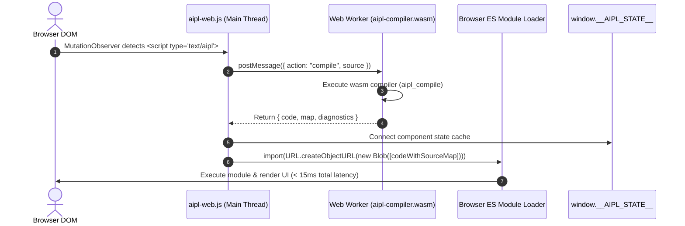

# Zero-Build Browser Ingestion Loader (`aipl-web.js`)

AIPL provides a zero-build, zero-dependency browser ingestion tier that compiles and executes `<script type="text/aipl">` tags directly in modern browsers without build tools, bundlers, or `node_modules`.

---

## 1. Quick Start & CDN Usage

Add a single script tag to any HTML5 document to enable immediate AIPL compilation and execution:

```html
<!DOCTYPE html>
<html lang="en">
<head>
  <meta charset="UTF-8">
  <title>AIPL Zero-Build Demo</title>
  <!-- Load AIPL Zero-Build Loader -->
  <script src="https://cdn.jsdelivr.net/npm/aipl-web@latest/dist/aipl-web.js"></script>
</head>
<body>
  <h1>Interactive AIPL Application</h1>
  <canvas id="stage" width="400" height="300"></canvas>

  <!-- Inline AIPL Script -->
  <script type="text/aipl">
    let canvas = document.getElementById("stage")
    let ctx = canvas.getContext("2d")
    ctx.fillStyle = "#4f46e5"
    ctx.fillRect(50, 50, 300, 200)
    console.log("Canvas rendered with AIPL in zero-build mode!")
  </script>
</body>
</html>
```

### Self-Hosted Local Asset Structure

For offline development or standalone deployment, serve the loader and WebAssembly compiler alongside your HTML files:

```
my-project/
├── index.html
├── app.aipl
├── aipl-web.js            (< 15 KB unminified)
└── aipl-compiler.wasm     (141 KB gzipped)
```

In your HTML file:
```html
<script src="aipl-web.js"></script>
<script type="text/aipl" src="app.aipl"></script>
```

---

## 2. Architecture & Execution Lifecycle

`aipl-web.js` offloads compilation to a background Web Worker to preserve 60 FPS UI responsiveness:



### Key Technical Characteristics:
- **Zero Dependencies**: Pure vanilla JavaScript with zero external runtime dependencies.
- **Dedicated Web Worker**: Compilation is completely decoupled from the primary event loop, ensuring zero UI stutter or dropped frames.
- **Blob URL ES Module Import**: Output JavaScript is imported natively as an ECMAScript module via `URL.createObjectURL(new Blob([code], { type: "text/javascript" }))`.
- **Ultra-Compact Bundle Size**:
  - `aipl-web.js`: **13.8 KB** unminified (**3.65 KB** gzipped).
  - `aipl-compiler.wasm`: **371 KB** uncompressed (**141.8 KB** gzipped).
  - Combined bundle size: **145.5 KB** gzipped (strictly under the 300 KB limit).
- **Sub-15ms Execution Latency**: Typical component and script compilation and execution completes in **5–12ms**.

---

## 3. UI Component Authoring

Declarative AIPL UI components are lowered directly into React 19 functional components or pure DOM trees:

```html
<div id="aipl-root"></div>

<script type="text/aipl" data-aipl-id="counter-app">
  pub component Counter(initial: int):
    div.card.p-6.shadow-md [
      h2.textXl [ "Live Counter" ],
      span.countBadge [ "Count: {count}" ],
      button.btnPrimary [ @click: increment, "Increment" ]
    ]
</script>
```

The compiler emits pure JavaScript:
```javascript
export function Counter({ initial } = {}) {
  const stateKey = "comp_" + "Counter";
  __AIPL_MOD_STATE__[stateKey] = __AIPL_MOD_STATE__[stateKey] || {};
  const __state = __AIPL_MOD_STATE__[stateKey];
  if (__state.count === undefined) { __state.count = (typeof initial !== "undefined" ? initial : 0); }
  let count = __state.count;
  return _jsxs("div", { className: "card p-6 shadow-md", children: [ ... ] });
}
```

---

## 4. In-Browser Hot Module Replacement (HMR)

`aipl-web.js` integrates in-browser Hot Module Replacement with state caching:

1. **State Registry (`window.__AIPL_STATE__`)**:
   Component and script state variables are keyed by script identifier:
   `window.__AIPL_STATE__[scriptId][componentKey]`.
2. **DOM Mutation Detection**:
   When `<script type="text/aipl">` content is edited (via DevTools, a live editor, or WebSocket update), `MutationObserver` triggers instant recompilation.
3. **Hot-Swap Execution**:
   - The updated script is re-compiled in the Web Worker.
   - The previous Blob URL is cleanly revoked.
   - The new ES module is imported via a new Blob URL.
   - The existing state inside `window.__AIPL_STATE__` is preserved without resetting counters or form inputs.
   - Dispatches custom event `aipl:hmr` on `window` and the script tag:
     ```javascript
     window.addEventListener('aipl:hmr', (e) => {
       console.log('Module hot-reloaded:', e.detail.scriptId, e.detail.state);
     });
     ```

---

## 5. DevTools Debugging with VLQ Source Maps v3

Every compiled module includes an inline Base64 Source Map v3 comment:

```javascript
//# sourceMappingURL=data:application/json;charset=utf-8;base64,eyJ2ZXJzaW9uIjoz...
```

### DevTools Capabilities:
- **Chrome / Safari / Firefox**: Breakpoints set on `.aipl` files are automatically hit during execution.
- **Accurate Stack Traces**: Exceptions point directly to the original `.aipl` line and column numbers.
- **Variable Inspection**: DevTools displays mapped scope variables during step-by-step debugging.

---

## 6. JavaScript Programmatic API (`window.AIPL`)

The global `window.AIPL` namespace exposes programmatic control:

```javascript
// Initialize or configure custom Wasm URL
await AIPL.init('/custom/path/aipl-compiler.wasm');

// Programmatically compile AIPL source to JavaScript
const { result, elapsed } = await AIPL.compile(`
  pub fn add(a: int, b: int): int: ret a + b
`, {
  source_file_name: 'math.aipl',
  hmr: true,
});

console.log('Emitted code:', result.code);
console.log('Source Map v3:', result.map);

// Inspect live HMR component state
const state = AIPL.getState('counter-app');
console.log('Current state:', state);
```

---

## 7. CLI HTML5 Bundler (`aipl bundle` / `aipl build --html`)

In addition to browser-side runtime compilation via `aipl-web.js`, the pure self-hosted `./bin/aipl` toolchain can compile and package any AIPL program into an entirely offline, standalone single-file HTML5 application:

```bash
# Bundle directly to self-contained HTML5
aipl bundle src/app.aipl -o dist/index.html

# Bundle with embedded asset directory (sprites, audio, fonts)
aipl bundle src/game.aipl -o dist/game.html --assets assets/
```

The resulting `.html` file embeds the compiled JavaScript, canvas renderer, affine matrix transform stack, and base64-encoded assets in a zero-dependency HTML file that runs immediately when opened from a local filesystem (`file://`) or static web server.
