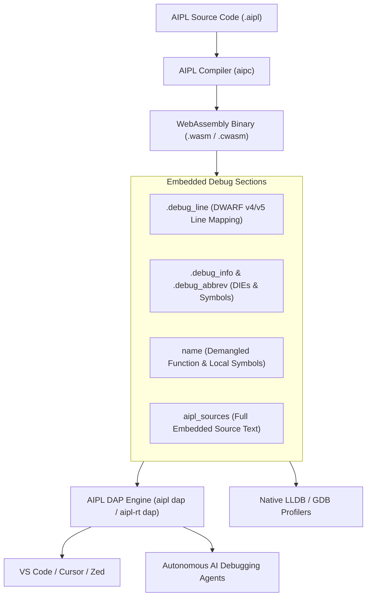
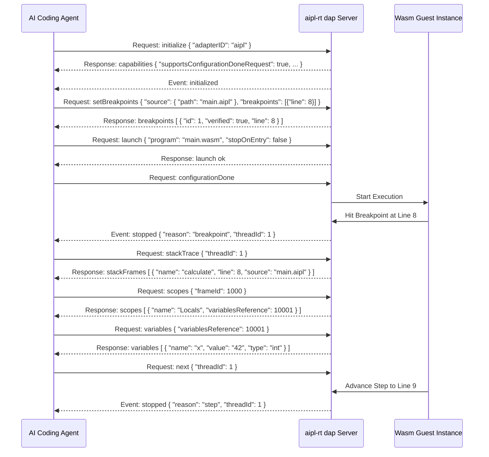

# AIPL Debugging Guide: Native WebAssembly DWARF (v4/v5) & DAP Integration

This living document details source-level debugging for the AIPL programming language. It covers VS Code, Cursor, and Zed Debug Adapter Protocol (DAP) integration, native debugging via LLDB and GDB, and automated headless debugging for autonomous AI coding agents.

---

## 1. Overview & Core Architecture

AIPL compiles high-level code into standalone WebAssembly binaries and native Ahead-Of-Time (`.cwasm`) artifacts. Unlike conventional bytecode environments that present obfuscated stack traces or require external symbol servers, AIPL features **Zero-Configuration Source-Level Debugging**:



### Key Capabilities
- **DWARF v4 / v5 Line Tables (`.debug_line`)**: Maps every WebAssembly bytecode instruction offset directly to 1-indexed source line numbers, column coordinates, and statement boundaries in `.aipl` files.
- **Symbol & Scope Metadata (`.debug_info`, `.debug_abbrev`, `.debug_str`)**: Encodes compilation units, subprograms (`DW_TAG_subprogram`), formal parameters (`DW_TAG_formal_parameter`), and local variables (`DW_TAG_variable`) with their AIPL type signatures.
- **WebAssembly Name Section Demangling (`name`)**: Conforms to standard WebAssembly binary specifications (subsection 0: module name, subsection 1: function names, subsection 2: local variable names), enabling instant native backtrace demangling in Wasmtime, LLDB, and terminal logs.
- **Zero-Configuration Embedded Sources (`aipl_sources`)**: Full source text is embedded directly within binary artifacts. Debuggers and agents can inspect source code context, display snippets, and set breakpoints even when original source files are absent on disk.
- **Standard Debug Adapter Protocol (DAP) Server Engine**: Speaks official DAP JSON-RPC over standard input/output (`stdio`) or TCP sockets (`127.0.0.1:<port>`).

---

## 2. VS Code & Cursor IDE Integration

AIPL integrates natively with Visual Studio Code, Cursor, and any DAP-compliant editor via standard `.vscode/launch.json` configurations.

### Configuration (`.vscode/launch.json`)

To launch and debug an AIPL application:

```json
{
  "version": "0.2.0",
  "configurations": [
    {
      "name": "Debug AIPL Application",
      "type": "aipl",
      "request": "launch",
      "program": "${workspaceFolder}/target/main.wasm",
      "stopOnEntry": false,
      "args": [],
      "cwd": "${workspaceFolder}"
    },
    {
      "name": "Attach to AIPL DAP Server",
      "type": "aipl",
      "request": "attach",
      "port": 4711
    }
  ]
}
```

### Extension Configuration
When authoring or using the AIPL VS Code extension, configure the debug adapter descriptor factory to launch `aipl-rt dap`:

```typescript
import * as vscode from 'vscode';

export class AiplDebugAdapterDescriptorFactory implements vscode.DebugAdapterDescriptorFactory {
    createDebugAdapterDescriptor(session: vscode.DebugSession): vscode.ProviderResult<vscode.DebugAdapterDescriptor> {
        // Launch aipl-rt in stdio DAP mode
        return new vscode.DebugAdapterExecutable('aipl-rt', ['dap', '--stdio']);
    }
}
```

---

## 3. CLI Debugging (`aipl dap`, `aipl-rt debug` & `aipl-rt dap`)

The unified `aipl` toolchain and `aipl-rt` binary include dedicated CLI commands for terminal debugging and IDE attachment.

### 1. `aipl dap` & `aipl-rt dap`
Starts the DAP JSON-RPC server listening on `stdio` or a TCP socket:

```bash
# Standard stdio mode (used by VS Code and subagent subprocesses)
aipl dap
# or
aipl-rt dap

# Explicit TCP socket mode for remote debugging
aipl dap --port 4711
```

### 2. `aipl-rt debug <artifact>`
Launches an interactive source-level terminal debugger:

```bash
aipl-rt debug target/math.wasm
```

#### Interactive Terminal Commands
| Command | Shorthand | Description |
|---|---|---|
| `break <line>` | `b <line>` | Set a breakpoint at target `.aipl` source line |
| `run`, `continue` | `r`, `c` | Execute until next breakpoint or program completion |
| `next` | `n` | Step over to the subsequent source line |
| `step` | `s` | Step into callee function scope |
| `backtrace` | `bt` | Print demangled call stack frames with source locations |
| `info locals` | — | Display all local variables and parameters in scope |
| `print <var>` | `p <var>` | Inspect value and type of a specific variable |
| `list` | `l` | Display source code context surrounding active PC |
| `quit`, `exit` | `q` | Terminate debug session |

#### Interactive Session Walkthrough
```text
=== AIPL Source Debugger (aipl-rt debug) ===
Target Artifact: math.wasm
--> Stopped at compute in math.aipl:1 (PC: 0x00000000)
Type 'help' for commands (b <line>, run, next, bt, print <var>, quit).

(aipl-dbg) b 3
Breakpoint set at line 3

(aipl-dbg) run
Execution stopped.
--> Stopped at compute in math.aipl:3 (PC: 0x00000014)

(aipl-dbg) list
  =>  3:   y = y + 10
      4:   ret y

(aipl-dbg) info locals
  counter (int) = 0
  $pc (u64) = 0x00000014

(aipl-dbg) next
--> Stopped at compute in math.aipl:4 (PC: 0x00000020)

(aipl-dbg) quit
Debugging session terminated.
```

---

## 4. Native Debugging with LLDB & GDB

Because AIPL emits standard DWARF (v4/v5) debug sections, Cranelift native machine code (`.cwasm`) and WebAssembly modules can be inspected with LLDB or GDB.

### LLDB Execution
When AOT compiling via `aipl-rt compile target/app.wasm -o app.cwasm`:
1. Cranelift translates WebAssembly DWARF line tables into native ELF/Mach-O DWARF line tables.
2. Launch with LLDB:
```bash
lldb -- aipl-rt run app.cwasm
```
3. Set source breakpoints:
```text
(lldb) breakpoint set --file app.aipl --line 15
(lldb) run
Process stopped at breakpoint at app.aipl:15.
```

---

## 5. Automated Debugging for AI Coding Agents

Autonomous AI coding agents can interact directly with `aipl-rt dap` over `stdio` without GUI dependencies.

### DAP Protocol Message Flow



### Agent Inspection Example (Python JSON-RPC Client)
```python
import subprocess, json

proc = subprocess.Popen(
    ["aipl-rt", "dap", "--stdio"],
    stdin=subprocess.PIPE,
    stdout=subprocess.PIPE,
    text=False
)

def send_msg(payload):
    body = json.dumps(payload).encode('utf-8')
    header = f"Content-Length: {len(body)}\r\n\r\n".encode('ascii')
    proc.stdin.write(header + body)
    proc.stdin.flush()

def read_msg():
    headers = {}
    while True:
        line = proc.stdout.readline().decode('ascii')
        if line == "\r\n" or not line:
            break
        if line.startswith("Content-Length:"):
            length = int(line.split(":")[1].strip())
    content = proc.stdout.read(length)
    return json.loads(content)

# Initialize handshake
send_msg({"seq": 1, "type": "request", "command": "initialize", "arguments": {"adapterID": "aipl"}})
res = read_msg()
print("Capabilities:", res["body"])
```
