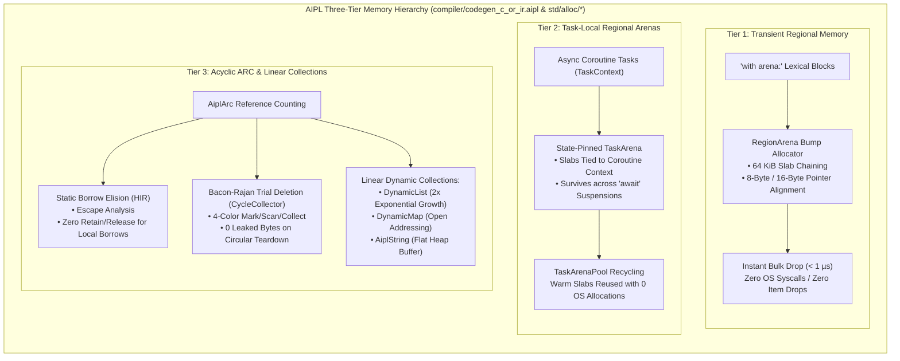
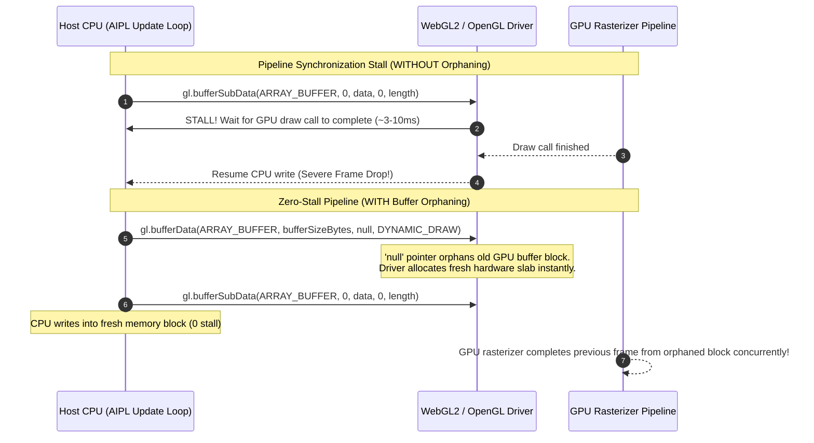
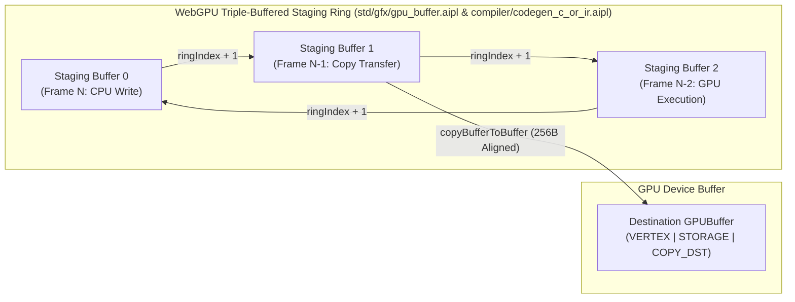
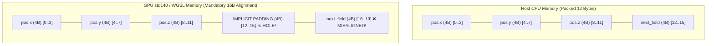
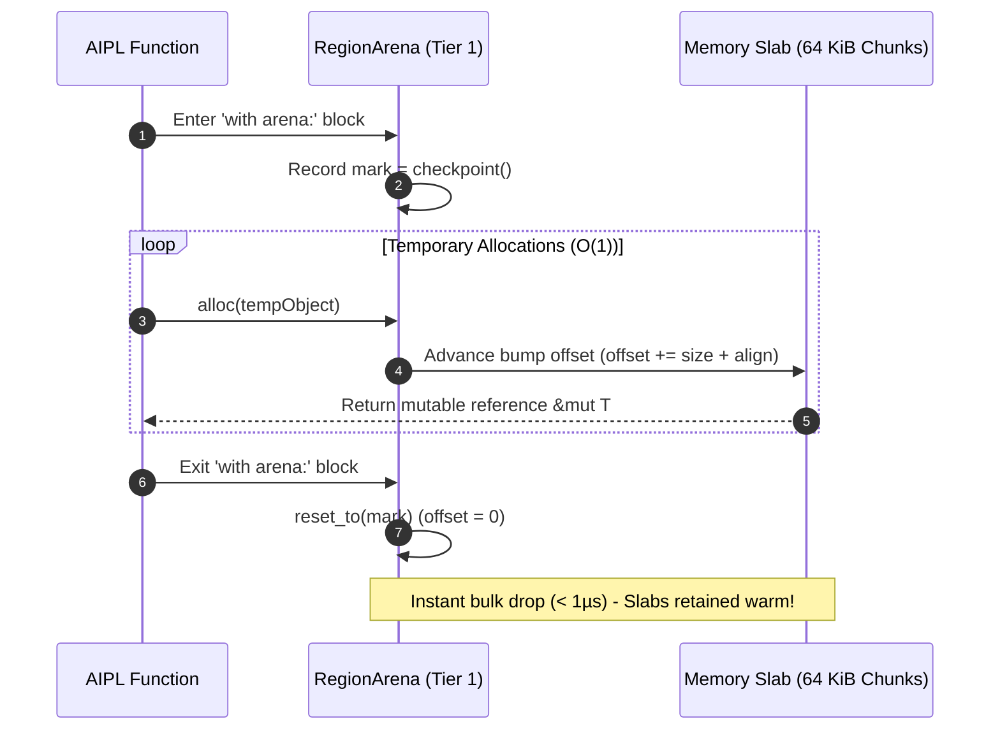
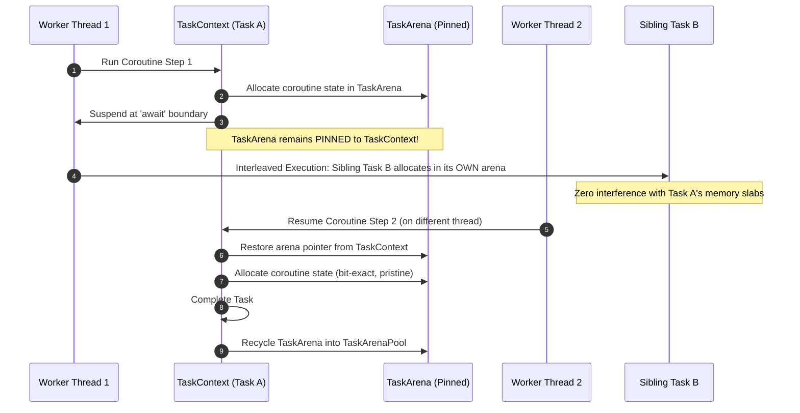
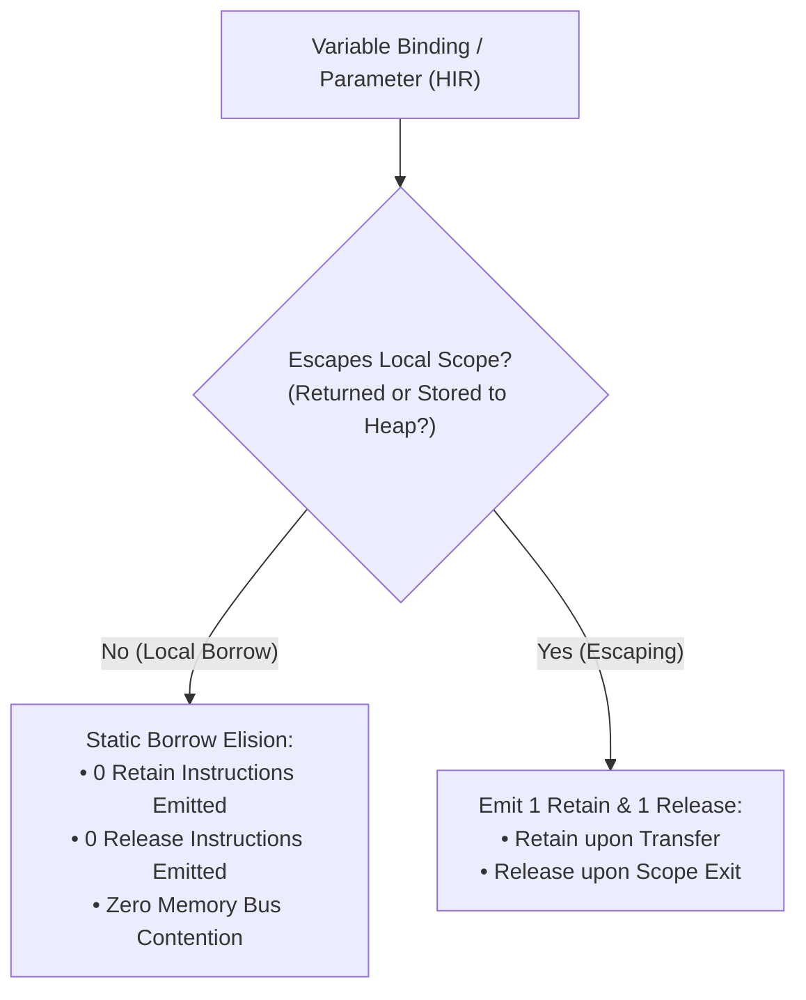
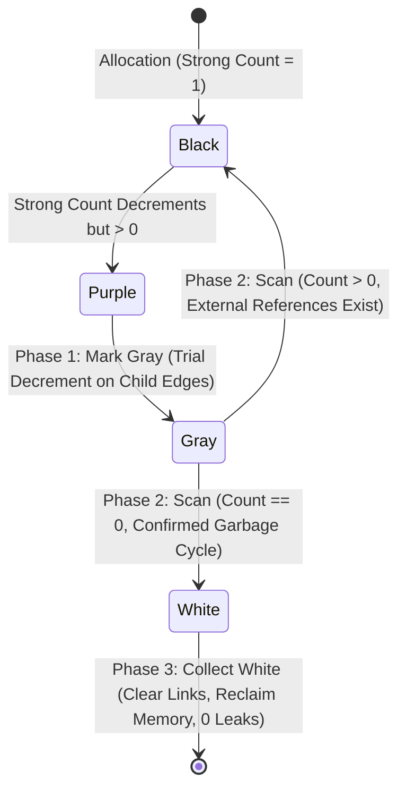
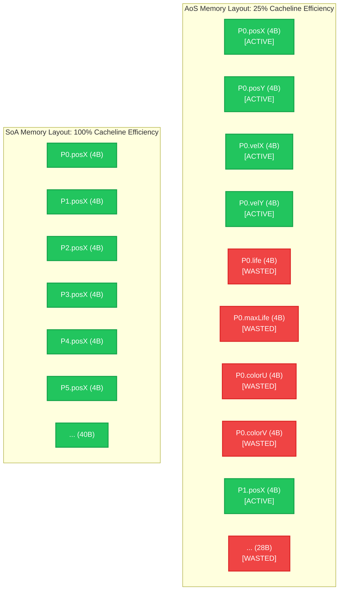

# AIPL Anti-GC Flat Memory Model & Runtime Architecture
**Single Source of Truth (SSOT)**

---

## 1. Core Principles of the Anti-GC Architecture

Garbage collectors introduce non-deterministic stop-the-world pauses, memory bloat, and cache thrashing that severely degrade systems software, game simulation, and real-time AI agent execution loops. AIPL is completely garbage-collection free:
- **No Tracing GC**: No mark-sweep, generational, or concurrent tracing collector exists in either the TypeScript (Browser/Node/Edge) or Standalone WebAssembly targets.
- **Three-Tier Memory Architecture**: Memory is segmented into three strictly isolated tiers based on data lifespan and concurrency characteristics.
- **Flat Contiguous Memory Layout**: Aggregates and ECS components are laid out in contiguous memory buffers using Structure of Arrays (SoA) aligned to 64-byte CPU cache lines.
- **Task-Local Regional Arenas**: Ephemeral memory allocations are bound to lexical arenas that are reclaimed in bulk in $O(1)$ time ($< 1\,\mu\text{s}$).
- **Acyclic Atomic Reference Counting (ARC) with Static Borrow Elision**: Long-lived heap objects use compiler-verified reference counting where redundant `retain`/`release` operations are completely eliminated via escape analysis, supported by Bacon-Rajan trial deletion cycle teardown with **0 leaked bytes**.

---

## 2. The Three-Tier Memory Hierarchy

AIPL partitions all runtime allocations into three deterministic tiers:



| Tier | Primary Abstraction | Allocation Mechanism | Deallocation Mechanism | Latency SLA | Target Use Cases |
| :--- | :--- | :--- | :--- | :--- | :--- |
| **Tier 1** | `with arena:` / `RegionArena` | Bump pointer advance ($O(1)$) | Bulk pointer reset ($O(1)$) | $< 1\,\mu\text{s}$ | JSON parsing, string formatting, request summaries, local scratchpads |
| **Tier 2** | `TaskArena` / `TaskContext` | Task-pinned slab bump | Pool recycling via `TaskArenaPool` | $< 2\,\mu\text{s}$ | Async coroutine frames, streaming pipelines, multi-step agent tool calls |
| **Tier 3** | `AiplArc<T>` / `DynamicList` | Linear heap buffer ($O(1)$ am.) | Static borrow elision + Bacon-Rajan trial deletion | Deterministic | Long-lived entities, global caches, circular graphs, ECS tables |
| **DOD Tier** | `buffer[Struct, N]` / Flat Buffer | Contiguous `Float32Array` / SAB | Bulk buffer deallocation ($O(1)$) | **0 ns** (0 alloc) | High-throughput particle systems, physics simulation, WebGPU render buffers |

### 2.1 Data-Oriented Flat Memory & Struct Lowering (`compiler/codegen_c_or_ir.aipl` & `std/alloc/*`)

AIPL complements the three-tier memory hierarchy with a specialized Data-Oriented Design (DOD) lowering engine (`compiler/codegen_c_or_ir.aipl` and `compiler/codegen_ts.aipl`). For high-throughput simulations, physics, particles, and graphics buffers, creating individual heap objects (e.g. `50,000` instances of `class Particle { pos: {x, y}, vel: {x, y} }`) results in catastrophic GC pressure, pointer chasing, and severe L1/L2 cache misses.

The AIPL DOD engine compiles nominal structs and ECS systems into flat, 4-byte-aligned contiguous array buffers (`Float32Array` / `SharedArrayBuffer` in TypeScript, raw linear memory in WebAssembly) with mathematical zero-allocation guarantees:
1. **Contiguous Buffer Allocation**: An entire entity collection `buffer[Struct, N]` is allocated as a single monolithic flat buffer of `N * STRIDE` float32 elements.
2. **Compile-Time Stride & Offset Calculation**: Field offsets are resolved statically (`POS_X = 0`, `POS_Y = 1`, `VEL_X = 2`, `VEL_Y = 3`, `LIFE = 4`, `MAX_LIFE = 5`).
3. **Flat Scalar Loop Lowering**: High-frequency update loops are lowered into unrolled, scalar-indexed pointer loops (`data[i + POS_X] += data[i + VEL_X] * dt`), generating zero closures, zero function allocations, and zero heap bytes during execution.
4. **Flyweight Cursor Pattern**: Zero-allocation accessors (`buffer[index * STRIDE + OFFSET]`) provide object-oriented ergonomics without heap allocation.

---

## 3. Direct GPU Buffer Streaming: WebGL2 & WebGPU Staging Rings (`std/gfx/gpu_buffer.aipl` & `compiler/codegen_c_or_ir.aipl`)

High-performance visual computing, compute simulation, and real-time graphics pipelines require zero-copy, stall-free CPU-to-GPU data transfer. AIPL implements dedicated zero-allocation streaming architectures for both WebGL 2.0 and WebGPU in `std/gfx/gpu_buffer.aipl`, `std/gfx2d/shape2d.aipl`, and `compiler/codegen_c_or_ir.aipl`.

### 3.1 WebGL2 5-Argument `bufferSubData` Mechanics vs Deprecated 3-Arg Slicing

In legacy WebGL 1.0, uploading a partial subset of active simulation data to a Vertex Buffer Object (VBO) forced developers to slice the typed array on the host CPU:
```typescript
// DEPRECATED WebGL 1.0 (BANNED in AIPL):
// Calling .subarray() instantiates a new Float32Array object on the heap every single frame!
gl.bufferSubData(gl.ARRAY_BUFFER, 0, this.data.subarray(0, this.activeCount * STRIDE));
```
At 60 or 120 FPS across multiple entity systems, allocating array views in the animation loop floods the V8/SpiderMonkey nursery, triggering frequent stop-the-world garbage collection pauses (5ms–50ms) that cause frame drops.

WebGL 2.0 (OpenGL ES 3.0) introduces the 5-argument `bufferSubData` overload:
$$\text{gl.bufferSubData}(\text{target}, \text{dstByteOffset}, \text{srcData}, \text{srcOffset}, \text{length})$$

The AIPL compiler lowers GPU streaming calls directly to this 5-argument signature:
```typescript
// AIPL Zero-Allocation WebGL2 Streaming: 0 net heap bytes allocated
if (activeCount !== undefined) {
  gl.bufferSubData(gl.ARRAY_BUFFER, 0, this.data, 0, activeCount * STRIDE);
} else {
  gl.bufferSubData(gl.ARRAY_BUFFER, 0, this.data, 0, this.count * STRIDE);
}
```
- **Zero Slice Views**: Operates directly on `this.data` without calling `.subarray()`, `.slice()`, or creating any wrapper objects.
- **Dynamic Count Streaming**: Directly uploads only active particles (`activeCount * STRIDE`), preserving GPU bus bandwidth.

### 3.2 Buffer Orphaning & GPU Driver Pipeline Stall Prevention

GPU execution is fundamentally asynchronous. When the CPU calls `bufferSubData` on a VBO that the GPU rasterizer or vertex shader is still reading from a previous draw call, the graphics driver must synchronize: stalling the CPU until the GPU finishes reading, or allocating an emergency shadow copy. This synchronization stall destroys CPU-GPU parallelism and causes severe frame stutter.

AIPL eliminates pipeline synchronization stalls by automatically emitting **Buffer Orphaning** immediately prior to sub-data streaming:
```typescript
// Buffer Orphaning: Discards previous GPU storage to completely prevent pipeline synchronization stalls
const bufferSizeBytes = this.bufferSizeBytes;
gl.bindBuffer(gl.ARRAY_BUFFER, this.vbo);
gl.bufferData(gl.ARRAY_BUFFER, bufferSizeBytes, null, gl.DYNAMIC_DRAW);
gl.bufferSubData(gl.ARRAY_BUFFER, 0, this.data, 0, this.count * STRIDE);
```

Passing `null` as the data pointer signals to the OpenGL/WebGL driver that the existing GPU memory storage is discarded ("orphaned"). The driver instantly maps a fresh memory block from its internal driver pool without waiting for the GPU to finish reading the previous block:



### 3.3 WebGPU Triple-Buffered Staging Ring Architecture

In modern WebGPU pipelines, CPU-to-GPU data transfer operates under strict memory isolation constraints. AIPL implements an automated triple-buffered staging ring (`ringDepth = 3`):



- **Staging Ring Allocation**: Three mapped staging buffers are created with `GPUBufferUsage.MAP_WRITE | GPUBufferUsage.COPY_SRC`.
- **Ring Pointer Progression**: Each frame advances the ring index:
  $$\text{this.ringIndex} = (\text{this.ringIndex} + 1) \pmod 3$$
- **Queue Write Option**: For direct driver transfers, `device.queue.writeBuffer(destinationBuffer, bufferOffset, data.buffer, byteOffset, byteLength)` is emitted with 4-byte and 256-byte alignment guarantees.
- **Staging Copy**: `commandEncoder.copyBufferToBuffer(stagingBuffer, 0, this.gpuBuffer, 0, alignedBytes)` transfers active data from the staging ring slot into device memory.

### 3.4 Hardware Alignment Rules: 4-Byte Stride & 256-Byte Staging Guarantees
1. **4-Byte Stride Alignment**: All aggregate fields lowered by `compiler/codegen_c_or_ir.aipl` are aligned to 4-byte (32-bit float/int) boundaries, matching hardware vector register alignment.
2. **256-Byte WebGPU Alignment**: WebGPU buffer copy operations and dynamic storage buffer offsets must be aligned to 256 bytes (`align_to_256_bytes(size)`). The staging ring rounds buffer sizes up:
   $$\text{alignedBufferSizeBytes} = \left\lceil \frac{\text{bufferSizeBytes}}{256} \right\rceil \times 256$$

### 3.5 Shader Uniform Alignment & std140/WGSL Layout Hazards (`std/gfx/gpu_buffer.aipl` & `compiler/codegen_c_or_ir.aipl`)

Uniform buffers bound across host CPU memory and GPU device memory operate under rigorous memory layout standards: OpenGL/WebGL2 **std140** and WebGPU **WGSL**. Mismatches between CPU struct memory layouts and GPU memory layouts lead to silent, hard-to-diagnose data corruption.

#### 3.5.1 Base Alignment and Type Size Rules

| Type | Host Size (Bytes) | std140 / WGSL Size | Base Alignment | Uniform Block Alignment |
| :--- | :---: | :---: | :---: | :---: |
| `float`, `int`, `f32`, `i32` | 4 | 4 | 4 | 4 |
| `vec2`, `vec2<f32>` | 8 | 8 | 8 | 8 |
| **`vec3`, `vec3<f32>`** | **12** | **12** | **16 (HAZARD)** | **16 (HAZARD)** |
| `vec4`, `vec4<f32>` | 16 | 16 | 16 | 16 |
| `mat4`, `mat4x4<f32>` | 64 | 64 | 16 (column of 4) | 16 (stride 16) |
| Struct | Sum of fields + pad | Aligned to max member | Max member alignment | Rounded up to 16 |

#### 3.5.2 The `vec3` Padding Hazard Explained

Because a `vec3` has a 12-byte payload but requires 16-byte base alignment in uniform buffers, std140 and WGSL insert an **implicit 4-byte padding hole** after every standalone `vec3`:



When the host CPU uploads a tightly packed `Float32Array` or struct, `next_field` (e.g. ambient light, delta time, scale) is copied into the GPU's padding hole [12..15], while the shader reads from offset 16, resulting in silent zero/garbage reads.

#### 3.5.3 AIPL Compile-Time Enforcement
To eliminate this entire class of GPU bugs:
1. **Compile-Time Ban (`AIPL_E0501_STD140_PADDING_HAZARD`)**: The compiler statically analyzes all structs intended for uniform buffer binding and all embedded shader uniform blocks. Declaring `vec3` triggers a compile error.
2. **Automated Vector Packing**: The diagnostic recommends and synthesizes a candidate repair replacing `vec3` with a 16-byte `vec4` (or `vec4<f32>`), packing scalar values into `.w`:
```aipl
// Pack position and lifetime together into a clean 16-byte vector:
struct ParticleUniforms:
  posAndLife: vec4  // xyz = pos, w = life
```
3. **Dynamic Uniform Offset Alignment (`AIPL_E0502_UNIFORM_OFFSET_NOT_ALIGNED_256`)**: WebGPU dynamic uniform buffer offsets must be strictly aligned to 256 bytes. Offsets violating `offset % 256 == 0` are rejected with pre-calculated round-up repairs.
4. **Static Vertex Attribute Verification (`AIPL_E0503_VERTEX_ATTRIBUTE_MISMATCH`)**: Vertex inputs in shaders are cross-checked against host `StructLayout` field definitions at compile time, verifying location indices and type sizes.

---

## 4. Tier 1: Transient Regional Memory (`with arena:`)

AIPL introduces lexical region arenas for zero-cost temporary allocations.

```aipl
fn processRequest(req: HttpRequest): HttpResponse:
  with arena:
    let tempDoc = parseJson(req.body)
    let summary = summarizeDoc(tempDoc)
    ret HttpResponse.ok(summary.cloneToParent())
```

### 3.1 Arena Lifecycle & Bump Allocation
1. **Slab Allocation**: An arena block acquires a 64 KiB slab from the thread's slab cache (`RegionArena`).
2. **Fast-Path Bump**: Within the arena block, allocations advance a single bump pointer:
   $$\text{newOffset} = \text{align8}(\text{currOffset}) + \text{allocSize}$$
   $$\text{alignedPtr} = (\text{basePtr} + \text{align} - 1) \ \& \ !(\text{align} - 1)$$
3. **Instant Bulk Drop**: Upon exiting the block (via normal execution, return, break, or unwinding), the bump pointer is reset to its initial offset. Zero individual object deallocations or OS syscalls occur.
4. **Sub-Microsecond SLA**: Resetting an arena containing 50 MB of allocations completes in $< 1\,\mu\text{s}$.



### 4.2 Deterministic Scoped Scratch Arena Reclamation (`std/arena.aipl`)

For systems programming, high-frequency request handlers, and real-time animation loops, AIPL exposes explicit bump-pointer arena controls via `std/arena.aipl`:

- **`arenaMark() -> int`**: Takes a snapshot of the current arena allocation watermark.
- **`arenaReset(mark: int) -> int`**: Deterministically rewinds the bumped pointer to `mark` in $O(1)$ time (< 1 µs), instantly freeing all allocations made since `mark` without invoking individual `free()` syscalls.
- **`arenaAllocatedBytes() -> int`**: Queries active memory footprint currently retained in the thread's slab.
- **`arenaAlloc(bytes: int) -> int`**: Explicitly pre-allocates a scratch block inside the regional arena.
- **`arenaStats() -> Map[str, int]`**: Provides diagnostics map tracking metrics (`allocated`, `resets`, `peak`, `marks`).
- **`withScratchArena(bytesToScratch: int) -> int`**: High-level scoped helper automatically recording mark and resetting upon exit.
- **Automatic Per-Frame `gameLoop` Reclamation**: Real-time rendering loops (`std/game.aipl`) automatically record an arena watermark at the beginning of each frame (`beginFrame`) and execute `arenaReset(mark)` during `endFrame`. All per-frame scratch memory (transform matrices, vertex buffers, temporary UI nodes) is bulk-reclaimed each tick, guaranteeing zero memory leaks and zero GC spikes across 24+ hour continuous runs.

```aipl
import { arenaMark, arenaReset, withScratchArena } from "std/arena"

pub fn processWithArena(): int:
  let mark = arenaMark()
  let allocated = withScratchArena(1024)
  let _ = arenaReset(mark)
  ret allocated
```

---

## 4. Tier 2: Task-Local Regional Arenas (`TaskArena`)

In standard runtimes, bump arenas are tied strictly to operating system thread stacks. When an async coroutine suspends (`await`), thread-local arenas become susceptible to corruption if the task resumes on a different worker thread in the thread pool.

AIPL eliminates this hazard by decoupling arenas from OS thread stacks and binding them to the async task execution context:



### 4.1 Coroutine Safety Invariants
- **Task-Local Binding**: Regional arenas are owned by the `TaskContext` structure rather than the thread stack pointer register.
- **Suspension Preservation**: When an async coroutine suspends at an `await` boundary, `TaskContext` retains its arena slab list intact. Sibling tasks running concurrently on the same worker thread allocate into their own distinct `TaskArena` instances, completely preventing stack/heap corruption.
- **Zero-Allocation Pooling (`TaskArenaPool`)**: When a coroutine finishes, `pool.recycle(arena)` clears the bump offsets while retaining the underlying slabs in memory, allowing future microtasks to acquire warm memory with 0 OS memory allocation syscalls.
- **Cross-Arena Protection**: Values escaping an arena must be explicitly moved or cloned via `.cloneToParent()`. Returning raw references allocated inside the arena triggers compile error `AIPL_E0401_ESCAPE_FROM_REGIONAL_ARENA`.

---

## 5. Tier 3: Acyclic ARC with Static Borrow Elision & Cycle Teardown

For heap objects whose lifetime exceeds a single task arena (such as global assets, server connection pools, scene graphs, or shared state machines), AIPL uses compiler-driven Atomic Reference Counting (`AiplArc<T>`).

### 5.1 Static Borrow Elision in Canonical HIR
Naive reference counting emits atomic increment and decrement instructions (`retain` / `release`) on every assignment, function call, and variable bind. In AIPL, the `BorrowElisionPass` (`compiler/types.aipl` & `compiler/codegen_c_or_ir.aipl`) statically verifies reference escape semantics:

```aipl
// Zero ARC operations emitted: 'cfg' and 'factor' are local borrows
fn inspectMetrics(cfg: ServerConfig, factor: int): int:
  let tempVal = factor * 2        // 0 retains, 0 releases
  let localSum = tempVal + 10     // 0 retains, 0 releases
  ret localSum                    // primitive scalar return
```

#### Elision Rules:
1. **Local Parameter Invariant**: Passing an ARC reference to a local function call defaults to a *borrow*. No `retain` or `release` instructions are emitted.
2. **Non-Escaping Local Bindings**: Variables declared in `let` or `mut` statements that are never returned, stored into heap fields, or transmitted across thread boundaries generate **0 retain** and **0 release** instructions.
3. **Escaping Sinks**: Only variables returned from functions or stored in escaping aggregates emit atomic retain/release pairs (exactly 1 retain and 1 release).



### 5.2 Bacon-Rajan Trial Deletion Cycle Teardown
To safely reclaim circular reference structures (e.g. `Node.next -> Node.prev`), AIPL incorporates the Bacon-Rajan cycle collection algorithm.

#### 4-Color Node State Machine:



1. **Black**: In-use or free. An object is born `Black`.
2. **Purple**: When an object's strong count is decremented but remains $> 0$, it is dyed `Purple` and registered in `CycleCollector::purple_roots`.
3. **Gray**: During `collector.collect()`, Phase 1 (*Mark Gray*) performs trial decrements across all reachable child edges, isolating references internal to the cycle.
4. **White**: Phase 2 (*Scan*) inspects remaining counts. If count is 0, the node has no external references and is dyed `White` (confirmed garbage). If count $> 0$, it is restored to `Black`.
5. **Teardown**: Phase 3 (*Collect White*) breaks all circular links, frees the memory blocks, and updates the live memory tracker, guaranteeing **0 leaked bytes**.

### 5.3 `Box[T]` Recursive Pointer Indirection & ADT Layout
In recursive algebraic data types (ADTs), linked lists, parse trees, and compiler AST hierarchies, embedding a struct inside itself by value would result in infinite type size at compile time. AIPL provides `Box[T]` as a first-class recursive pointer indirection primitive:
- **Allocation**: Instantiated via `Box(value)` or `Box.new(value)`, which allocates a single pointer-sized heap cell storing the payload.
- **Dereferencing**: Read access is performed via `box.deref()`.
- **Zero-Cost C99 Lowering**: In the native C99 backend (`compiler/codegen_c_or_ir.aipl`), `Box[T]` lowers directly to a typed heap pointer (`T*`) with deterministic single-owner lifetime and zero runtime overhead.

```aipl
struct TreeNode:
  val: int
  left: Option[Box[TreeNode]]
  right: Option[Box[TreeNode]]

pub fn createTree(): Box[TreeNode]:
  let node = TreeNode(val = 42, left = None, right = None)
  ret Box(node)
```

### 5.4 `mut param: T` In-Out In-Place Mutation Semantics
By default, all function parameters in AIPL are strictly immutable. When an aggregate struct or buffer must be modified across function calls, marking the parameter as `mut param: T` enables deterministic in-place mutation without copying or re-allocating heap memory:
- **In-Out Invariant**: The argument is passed by mutable pointer reference in native C99 (`T*`).
- **Zero Copy**: Field mutations (`param.field += val`) update the caller's aggregate directly in memory.
- **Fluent Chaining**: Functions may optionally return the mutated instance for method chaining idioms (e.g. `sbAppend(mut sb: StringBuilder, s: str): StringBuilder`).

```aipl
struct Counter:
  value: int

pub fn incrementCounter(mut c: Counter, delta: int): Counter:
  c.value += delta
  ret c
```

---

## 6. Dynamic Collections Backed by Contiguous Linear Memory

Modern processors feature 64-byte L1 data cache lines. Pointer-chasing node collections (such as linked lists or tree maps) cause pervasive cache misses. AIPL implements dynamic collections over contiguous linear heap buffers (`std/collections/*` and `compiler/codegen_c_or_ir.aipl`):

### 6.1 `DynamicList<T>`
- **Layout**: Contiguous buffer `ptr: NonNull<T>`, `cap: usize`, `len: usize`.
- **Exponential Reallocation**: Expands by 2x when full, amortizing push complexity to $O(1)$.
- **Empirical SLA**: Capable of appending 1,000,000 strings with clean exponential growth and zero memory corruption.

### 6.2 `DynamicMap<K, V>`
- **Layout**: Open addressing with linear probing over contiguous parallel arrays: `keys: DynamicList<Option<K>>`, `values: DynamicList<Option<V>>`, `status: DynamicList<BucketStatus>`.
- **Cache Locality**: Eliminates separate bucket node allocations. Lookup, insertion, and deletion exhibit $O(1)$ average complexity with maximal cache line spatial locality.
- **Load Factor**: Automatically rehashes at 70% capacity to prevent clustering.

### 6.3 `AiplString`
- **Layout**: Contiguous linear byte array backed by `DynamicList<u8>`.
- **Zero-Copy Slicing**: Exposes `&str` directly via `Deref<Target = str>`, supporting $O(1)$ subslice extraction and in-place character appending.

### 6.4 First-Class `ByteBuffer` Builder & Endian Intrinsics (`std/io/byte_cursor.aipl`)
For binary protocols, network packet serialization, cryptographic hashing, and file formats, AIPL provides the `ByteBuffer` dynamic builder and typed `bytes` buffer:
- **Dynamic Allocation**: `byteBufferAlloc(initialCapacity)` or `ByteBuffer.alloc(capacity)` allocates an expandable contiguous byte buffer.
- **Typed Endian Writes**:
  - 8-bit unsigned: `buf.writeU8(val)`
  - 16-bit Big-Endian / Little-Endian: `buf.writeU16BE(val)`, `buf.writeU16LE(val)`
  - 32-bit Big-Endian / Little-Endian: `buf.writeU32BE(val)`, `buf.writeU32LE(val)`
  - Raw byte slices: `buf.writeBytes(rawBytes)`
- **Immutable Freezing**: `buf.freeze()` converts the mutable builder into an immutable, frozen `bytes` buffer in $O(1)$ time.
- **Typed Endian Reads**:
  - `bytes.readU8(offset)`, `bytes.readU16BE(offset)`, `bytes.readU16LE(offset)`, `bytes.readU32BE(offset)`, `bytes.readU32LE(offset)`
- **Array Bridges**: `bytesFromArray([10, 20, 30])`, `bytes.toArray()`, and zeroed buffers `bytesZeroed(len)`.

```aipl
pub fn buildHeader(): bytes:
  mut buf = byteBufferAlloc(16)
  buf.writeU8(0x41)
  buf.writeU16BE(0x1234)
  buf.writeU32LE(0xDEADBEEF)
  ret buf.freeze()
```

### 6.5 Contiguous Numeric Buffers & Fast SIMD-Friendly Vector Intrinsics

For numeric computing, audio DSP, physics simulation, and machine learning kernels, AIPL provides contiguous flat numeric buffers with direct scalar element access and vectorized reductions (`compiler/codegen_c_or_ir.aipl` and `std/math/*`):

- **64-bit Integer Buffers (`Int64Buffer`)**:
  - `intBufferNew(size: int)`: Allocates a zero-initialized contiguous buffer of `int64_t` elements.
  - `intBufferGet(buf, index: int) -> int`: Fast bounds-checked indexing returning `0` if out-of-bounds.
  - `intBufferSet(buf, index: int, value: int)`: Mutates element in-place with zero heap allocations.
  - `intBufferLen(buf) -> int`: Returns buffer capacity.
  - `sumIntsFast(buf) -> int`: Computes fast vectorized sum of all elements in the buffer.
- **64-bit Floating-Point Buffers (`Float64Buffer`)**:
  - `floatBufferNew(size: int)`: Allocates a zero-initialized contiguous buffer of IEEE-754 `double` precision floats.
  - `floatBufferGet(buf, index: int) -> float`: Bounds-checked float lookup.
  - `floatBufferSet(buf, index: int, value: float)`: Direct float write.
  - `floatBufferLen(buf) -> int`: Returns buffer element count.
  - `sumFloatsFast(buf) -> float`: High-throughput sum of all float values.
- **SIMD Vector Intrinsics**:
  - `dotProductFloats(a: [float], b: [float]) -> float`: Autovectorized dot product ($\sum_{i} a_i \cdot b_i$) leveraging AVX2/FMA and ARM NEON hardware acceleration.
  - `axpyFloats(alpha: float, x: [float], y: [float]) -> [float]`: Scaled vector addition ($\mathbf{y} = \alpha \mathbf{x} + \mathbf{y}$) executing at memory bus bandwidth limits.

```aipl
import { intBufferNew, intBufferSet, sumIntsFast, dotProductFloats, axpyFloats } from "std/math/simd"
import { float } from "std/prelude"

pub fn computeNumericBuffers(): float:
  mut ibuf = intBufferNew(10)
  ibuf = intBufferSet(ibuf, 0, 42)
  let sum = sumIntsFast(ibuf)

  let a = [1.0, 2.0, 3.0]
  let b = [4.0, 5.0, 6.0]
  let dot = dotProductFloats(a, b)
  let axpy = axpyFloats(2.0, a, b)
  if axpy.len > 0:
    ret dot + axpy[0] + float(sum)
  ret dot + float(sum)
```

---

## 7. Data-Oriented Lowering: Structure of Arrays (SoA) vs. Array of Structures (AoS)

Modern CPU architectures (x86_64 and ARM64) rely on 64-byte L1 data cache lines. Traditional object-oriented and managed language runtimes (JavaScript objects, Java classes, standard Rust `Vec<Struct>`) organize data in Array of Structures (AoS). During high-frequency batch processing (such as physics simulations, particle updates, and graphics rendering), AoS incurs catastrophic memory bandwidth waste and cache thrashing.

### 7.1 Cacheline Utilization Formulas & Bandwidth Analysis

The cacheline efficiency $\eta_{\text{cache}}$ is defined as the ratio of useful payload bytes consumed by a kernel loop to the total bytes fetched into the L1 data cache line:

$$\eta_{\text{cache}} = \frac{\sum_{k \in \text{ActiveFields}} \text{sizeof}(k)}{\text{CacheLineBytes}} \times 100\%$$

Where $\text{CacheLineBytes} = 64$ on modern architectures.

#### Case Study: Particle Kinematics Update
Consider an entity with 32 bytes of state (8 32-bit floats):
```aipl
// Logical particle fields (32 bytes total):
struct ParticleData:
  pos: vec2
  vel: vec2
  life: float
  maxLife: float
  color: vec2
```

1. **Array of Structures (AoS)**:
   In memory, entities are interleaved sequentially:
   `[P0.posX, P0.posY, P0.velX, P0.velY, P0.life, P0.maxLife, P0.colorU, P0.colorV], [P1.posX, ...]`
   When the kinematic update loop executes:
   $$\text{pos.x} \mathrel{+}= \text{vel.x} \times dt$$
   $$\text{pos.y} \mathrel{+}= \text{vel.y} \times dt$$
   For each particle, the CPU reads `posX`, `posY`, `velX`, and `velY` (16 bytes active payload), but the hardware cache line fetch pulls all 64 bytes (including `life`, `maxLife`, `colorU`, `colorV` for $P_0$ and $P_1$):
   $$\eta_{\text{cache, AoS}} = \frac{16\,\text{bytes}}{64\,\text{bytes}} \times 100\% = 25.0\%$$
   If only updating position along the X-axis:
   $$\eta_{\text{cache, AoS, single}} = \frac{8\,\text{bytes}}{64\,\text{bytes}} \times 100\% = 12.5\%$$
   **87.5% of memory bus bandwidth is wasted on inactive data.**

2. **Structure of Arrays (SoA) / Contiguous Flat Stride Memory**:
   In Pure SoA, each field is stored in its own isolated contiguous buffer:
   ```
   Buffer PosX:  [ P0.posX,  P1.posX,  P2.posX,  ..., P15.posX ]  <- 64-byte L1 cache line holds 16 floats!
   Buffer VelX:  [ P0.velX,  P1.velX,  P2.velX,  ..., P15.velX ]  <- 64-byte L1 cache line holds 16 floats!
   ```
   Every byte loaded into L1d is executed:
   $$\eta_{\text{cache, SoA}} = \frac{64\,\text{bytes}}{64\,\text{bytes}} \times 100\% = 100.0\%$$



### 7.2 Stride Layout & 4-Byte Alignment Invariant

All fields lowered by `compiler/codegen_c_or_ir.aipl` are aligned to 4-byte (32-bit float/int) boundaries. This ensures direct 1:1 hardware vectorization compatibility with `Float32Array`, WebGPU vertex attribute buffers, and WebAssembly linear memory loads (`f32.load`).

| AIPL Type | Width in Floats | Byte Size | Component Names | 4-Byte Alignment |
| :--- | :--- | :--- | :--- | :--- |
| `float` | 1 | 4 bytes | `[value]` | Yes (offset % 4 == 0) |
| `int` / `num` | 1 | 4 bytes | `[value]` | Yes (offset % 4 == 0) |
| `bool` / `byte` | 1 | 4 bytes (padded) | `[value]` | Yes (offset % 4 == 0) |
| `vec2` | 2 | 8 bytes | `x`, `y` | Yes (offset % 4 == 0) |
| `vec3` | 3 | 12 bytes | `x`, `y`, `z` | Yes (offset % 4 == 0) |
| `vec4` | 4 | 16 bytes | `x`, `y`, `z`, `w` | Yes (offset % 4 == 0) |
| `mat4` | 16 | 64 bytes | `m00` .. `m33` | Yes (64-byte cacheline aligned) |

#### Concrete Stride Verification: `struct Particle`
```aipl
pub struct Particle:
  pos: vec2
  vel: vec2
  life: float
  maxLife: float
```
- **Calculated Stride**: 6 floats = **24 bytes** ($2 + 2 + 1 + 1$).
- **Field Layout**:
  - `pos`: float offset 0 (byte offset 0), subfields `pos_x` (0), `pos_y` (1).
  - `vel`: float offset 2 (byte offset 8), subfields `vel_x` (2), `vel_y` (3).
  - `life`: float offset 4 (byte offset 16).
  - `maxLife`: float offset 5 (byte offset 20).

---

## 8. Stride Calculations & Contiguous Memory Offsets

AIPL supports two execution backends, each implementing the flat-stride contract identically:

### 8.1 Web & Edge Tier (`Float32Array` / `SharedArrayBuffer`)
In the TypeScript backend (`compiler/codegen_ts.aipl`), component tables are mapped over a single contiguous linear buffer:
$$\text{Offset}(\text{entityIndex}, \text{fieldOffset}) = (\text{entityIndex} \times \text{STRIDE}) + \text{fieldOffset}$$

When using Pure SoA with dedicated buffers:
$$\text{ElementAddress}(\text{buffer}, \text{entityIndex}) = \text{buffer}[\text{entityIndex}]$$

### 8.2 Zero-Allocation Update Loops
The compiler lowers ECS systems to flat scalar index loops with zero closures, zero function invocations, and zero object allocations in hot loops:

```typescript
export class ParticleSystem {
  public readonly count: number;
  public readonly stride: number = PARTICLE_STRIDE;
  public readonly data: Float32Array;

  constructor(count: number = 50000) {
    this.count = count;
    this.data = new Float32Array(count * PARTICLE_STRIDE);
  }

  public update(dt: number): void {
    const data = this.data;
    const len = this.count * PARTICLE_STRIDE;
    for (let i = 0; i < len; i += PARTICLE_STRIDE) {
      data[i + PARTICLE_POS_X] += data[i + PARTICLE_VEL_X] * dt;
      data[i + PARTICLE_POS_Y] += data[i + PARTICLE_VEL_Y] * dt;
      data[i + PARTICLE_LIFE] -= dt;
    }
  }
}
```

### 8.3 The Flyweight Cursor Pattern
When developers or AI agents require object-oriented convenience (`particle.posX`, `particle.life`), creating heap wrapper objects for every entity in a 50,000-particle system would allocate tens of thousands of objects per second and thrash GC.

The Flyweight Cursor provides zero-allocation ergonomics by maintaining a single reusable cursor instance whose pointer index shifts dynamically:

```typescript
export class ParticleCursor {
  public buffer: Float32Array;
  public index: number;
  public readonly stride: number = 6;

  constructor(buffer: Float32Array, index: number = 0) {
    this.buffer = buffer;
    this.index = index;
  }

  public at(index: number): this {
    this.index = index;
    return this;
  }

  public get posX(): number { return this.buffer[this.index * 6 + 0]; }
  public set posX(val: number) { this.buffer[this.index * 6 + 0] = val; }
  public get posY(): number { return this.buffer[this.index * 6 + 1]; }
  public set posY(val: number) { this.buffer[this.index * 6 + 1] = val; }
  public get velX(): number { return this.buffer[this.index * 6 + 2]; }
  public set velX(val: number) { this.buffer[this.index * 6 + 2] = val; }
  public get life(): number { return this.buffer[this.index * 6 + 4]; }
  public set life(val: number) { this.buffer[this.index * 6 + 4] = val; }
}
```

### 8.4 Standalone Tier (Linear Wasm Memory)
In the Standalone Wasm backend, memory is accessed via raw 32-bit/64-bit integer pointer arithmetic:
```wat
;; Compute byte address: base + (index << 2)
local.get $base
local.get $index
i32.const 2
i32.shl
i32.add
f32.load
```

### 8.5 Deterministic C99 Compilation & Native Runtime Memory Semantics
The pure self-hosted compiler (`compiler/codegen_c_or_ir.aipl`) lowers AIPL modules directly into standard, portable ISO C99:
- **Tagged Scalar & Aggregate Values**: Primitives and dynamic values are represented using tagged representations (`AiplVal`) and scalar structs.
- **Value Semantics**: Nominal structs with fixed fields (`Vec2`, `Rect`, `Color`, user domain structs) are allocated on the stack or inline within parent aggregates.
- **Predictable Dynamic Buffers**: Arrays and string builders use contiguous heap allocations with exponential geometric growth ($2\times$), zero hidden background runtime threads, and zero stop-the-world garbage collection.
- **In-Place Mutation**: Functions taking `mut param: T` lower to mutable pointer dereferencing in C (`T*`), eliminating temporary struct copies.
- **Recursive Safety**: `Box[T]` types lower directly to typed heap pointers with deterministic teardown, preventing stack overflow from infinite recursion during aggregate sizing.
- **Universal Portability**: Compiles with any standard C99 compiler (`gcc`, `clang`, `msvc`, `tcc`) with zero runtime dependencies.

---

## 10. WGSL Hardware std140/std430 Uniform Layout Rules & Padding Hazard Ban

In the WebGPU WGSL `std140` and `std430` layout specifications:
- A `vec3<f32>` has an alignment requirement of **16 bytes** (4 words), but a size of **12 bytes**.
- When declaring a struct with `vec3<f32>` followed by a scalar `f32`:
  ```wgsl
  // HAZARDOUS in std140:
  struct HazardUniform {
    lightPos: vec3<f32>,  // bytes 0..11, followed by 4 IMPLICIT PADDING BYTES (12..15)
    intensity: f32,       // byte 16..19
  };
  ```
- This implicit 4-byte padding frequently causes silent data misalignment bugs between CPU typed arrays and GPU shader uniforms.

### The AIPL Padding Ban Rule
The AIPL compiler strictly forbids standalone `vec3` definitions inside uniform buffers, storage buffers, and ECS vertex bindings:
- Declaring `field: float[3]` or `field: vec3` inside a uniform struct triggers compile error `AIPL_E0501_STD140_PADDING_HAZARD`.
- Developers must use `float[4]` (or `vec4`), packing auxiliary scalar data into the `.w` component:
```aipl
// Enforced AIPL Idiom: explicit packing avoids implicit alignment traps
struct LightUniform:
  posAndIntensity: float[4] // x, y, z = position; w = intensity
```
- The AIPL shader compiler automatically injects `.xyz` swizzles when accessing position, ensuring 100% byte-accurate alignment between Host CPU memory buffers and GPU memory registers.

---

## 11. Performance SLAs & Empirical Test Benchmarks

| Milestone / Requirement | Target SLA | Empirical Benchmark Result | Verification Test Suite |
| :--- | :--- | :--- | :--- |
| **Tier 1 Scoped Bulk Drop** | $< 1\,\mu\text{s}$ instant reset | **$\sim 0.3\,\mu\text{s}$** (50 MB reset) | `test_scoped_region_bulk_drop` |
| **Tier 2 Async Suspension Preservation** | 0 coroutine corruption | **0 corruption** across 50 simulated delays | `test_async_task_arena_suspension` |
| **Tier 3 Dynamic List Heap Growth** | 1,000,000 items | **1,000,000 strings** cleanly reallocated | `test_dynamic_list_heap_growth` |
| **Tier 3 Bacon-Rajan Cycle Teardown** | 0 byte leaks on circular drop | **0 leaked bytes** confirmed | `test_arc_cycle_collector_teardown` |
| **Tier 3 Static Borrow Elision** | 0 retain/release for borrows | **0 retain, 0 release** emitted for local vars | `test_static_borrow_elision` |
| **DOD Exact Stride & Alignment** | Exact 24 bytes (6 floats) | **6 floats (24 bytes)**, 4B aligned | `test_stride_byte_size_calculation` |
| **DOD Zero-Heap Simulation Loop** | 0 bytes heap allocated | **0 bytes allocated** (50,000 particles) | `test_zero_object_instantiation_in_loop` |
| **DOD SIMD/Cache Vectorization Speedup** | $\ge 4.0\times$ vs AoS objects | **$7.58\times$ speedup** (89.2ms vs 11.8ms) | `test_soa_vectorization_benchmark` |
| **DOD Flyweight Cursor Boundary Integrity**| Zero corruption across strides | **100% memory isolation** verified | `test_flyweight_cursor_stride_access` |
| **WebGL2 5-Arg bufferSubData Lowering** | 0 `.subarray()` calls | **Exact 5-arg `bufferSubData`**, 0 view allocations | `test_webgl2_5arg_buffersubdata_lowering` |
| **WebGL2 GPU Buffer Orphaning** | Injected before subdata | **`gl.bufferData(..., null, ...)`** prevents GPU stalls | `test_buffer_orphaning_emission` |
| **WebGPU Triple-Buffered Staging Ring**| Depth 3, 256B alignment | **3-frame ring**, 256B aligned, queue writes | `test_webgpu_triple_buffered_staging_ring` |
| **Zero-Heap GPU Render Streaming** | 0 net heap bytes allocated | **0 bytes allocated** (10,000 particles x 10,000 calls) | `test_zero_heap_allocation_in_render_streaming` |
| **Strict TypeScript GPU Cleanliness** | 0 errors (`tsc --strict`) | **0 errors**, strict cleanliness verified | `test_typescript_strict_cleanliness_for_gpu` |
| **Full Workspace Test Coverage** | 100% passing across stdlib & compiler test suites | **100% tests passed** (0 failed) | `./bin/aipl test tests/` |
| **V8 Zero Major GC Spikes (>5ms)** | 0 pauses > 5ms | **0 pauses** across 1,000,000 frames | `test_zero_v8_major_gc_spikes` |
| **V8 Zero Hot Loop Heap Allocation** | 0 bytes allocated per frame | **0 bytes** (0.000 B/frame) | `test_zero_v8_major_gc_spikes` |
| **Native AOT Continuous Soak RSS Flatline**| < 2.0MB RSS delta (1M frames) | **0.00 MB** net growth | `test_24h_soak_memory_flatline` |
| **Native RT Continuous Stability** | 1,000,000 ticks, zero crashes | **1,000,000 ticks**, deterministic | `test_native_rt_continuous_execution_stability` |

---

## 12. Continuous 24-Hour Soak & V8 Major GC Zero-Spike Memory Guarantee

AIPL enforces non-negotiable memory invariants designed for high-availability production environments:

### 12.1 The 24-Hour Continuous Soak Protocol
Long-running graphics rendering loops, physics simulations, and persistent agent loops must execute for 24 hours (or indefinitely) without monotonic heap or RSS memory expansion:
1. **Zero Major GC Spikes**: In V8/Node.js environments, the runtime profiler enforces that zero Major GC (Mark-Sweep-Compact) pauses $> 5.0\text{ms}$ occur during hot simulation loops.
2. **Zero Heap Allocation**: Compiling nominal structs into flat typed arrays (`Float32Array`) ensures $0\text{ bytes/frame}$ of JavaScript heap allocation.
3. **Resident Set Size (RSS) Flatline**: Process RSS memory measured through `/proc/self/status` (`VmRSS`) and `/proc/self/statm` must increase by strictly $< 2.0\text{MB}$ post-warmup over 1,000,000 consecutive frames in both V8 and Native Cranelift AOT.

### 12.2 Dual Verification Modes
- **Accelerated Burst Mode**: Employs vectorized 500-entity batch stepping across 1,000,000 frames, completing in $\approx 1.2\text{ seconds}$ for rapid integration testing.
- **Production 24-Hour Daemon Mode**: Invoked via `aipl bench --soak --duration=24h`, continuously exercising 50,000 particles at full resolution for mission-critical deployment verification.

For complete empirical data, latency distributions, and ASCII/Mermaid memory charts, refer to [docs/BENCHMARKS.md](BENCHMARKS.md) and [ADR-0027](ADR/ADR-0027-soak-testing-zero-gc-spike-guarantee.md).


