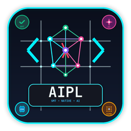

<p align="center">
  
</p>

# AIPL Language Support for VS Code & Cursor (`aipl-lang`)

Official Visual Studio Code and Cursor extension for the **AI-Programming Language (AIPL)**, integrating directly with the pure self-hosted `./bin/aipl` toolchain.

---

## Installation

Install the pre-packaged `.vsix` extension directly via the command line or VS Code extension manager:

```bash
code --install-extension editors/vscode-aipl/aipl-lang-0.8.0.vsix
```

Alternatively, in VS Code or Cursor:
1. Open the Command Palette (`Ctrl+Shift+P` / `Cmd+Shift+P`).
2. Run **Extensions: Install from VSIX...**.
3. Select `editors/vscode-aipl/aipl-lang-0.8.0.vsix`.

---

## Features

### 1. Six Agreeable, Low-Eye-Strain Color Themes (`themes/*.json`)
Selectable from the VS Code Theme Picker (`Ctrl+K Ctrl+T`) or via **AIPL: Select Color Theme** (`aipl.selectTheme` / `aipl.applyDarkStyle`) — none of which use harsh `#FFFFFF` white on `#000000` pure black:
- **AIPL Aura Dark** (`vs-dark`): Deep cyber-slate background (`#161922`) with soft mist-blue foreground (`#B8C4D9`), lavender, sky-blue, and sage pastels.
- **AIPL Nordic Frost** (`vs-dark`): Calm polar fjord background (`#242933`) with snow-mist foreground (`#D8DEE9`), glacier cyan (`#88C0D0`), and aurora green (`#A3BE8C`).
- **AIPL Evergreen Forest** (`vs-dark`): Organic woodland moss background (`#1E2522`) with warm parchment-sage foreground (`#D3C6AA`), fern green (`#A7C080`), and honey gold (`#DBBC7F`).
- **AIPL Rose Pine Dusk** (`vs-dark`): Soothing twilight velvet background (`#232136`) with lavender-foam foreground (`#E0DEF4`), rosebud (`#EA9A97`), and iris violet (`#C4A7E7`).
- **AIPL Espresso Warm** (`vs-dark`): Earthy roasted coffee background (`#24201E`) with warm oatmilk foreground (`#DDC7A1`), cinnamon orange (`#E78A4E`), and pistachio green (`#A9B665`).
- **AIPL Solarized Daylight** (`vs`): Low-glare warm cream parchment background (`#F4EFE6`) with soft charcoal-ink foreground (`#3B4252`), ocean blue (`#2A6F97`), and forest green (`#3B7A57`).
- **Automatic AIPL Token Color Defaults**: Even without changing your global editor theme, `.aipl` files automatically use soft pastel token colors (`#BB9AF7` lavender keywords, `#7AA2F7` sky-blue functions, `#56B6C2` cyan types, `#9ECE6A` sage strings, `#E0AF68` warm amber parameters/contracts, and `#636D83` muted slate comments).

### 2. Comprehensive High-Resolution Icon Suite
- **Shield & Neural AST Emblem** (`icon.png`, `icons/aipl-icon.svg`): Deep cyber-obsidian badge (`#0A0E1A` to `#131C31`) framed by a glowing cyan (`#00F0FF`) and electric violet (`#8B5CF6`) verification shield. Features an interconnected AI neural graph AST prism, code brackets `< λ >`, four corner micro-badges (SMT verification `✓`, AI neural spark, C99/WASM native chip, SIMD tensor grid), and high-contrast `AIPL` typography.
- **Dedicated File-Type Icons** (`icons/aipl-file-dark.svg`, `icons/aipl-file-light.svg`): Crisp 32x32 vector icons for `.aipl` source files in the file explorer, optimized for both dark and light themes.

### 3. AIPL v2.0 TextMate Syntax Highlighting (`syntaxes/aipl.tmLanguage.json`)
- **Control Flow & Declarations**: `fn`, `pub`, `struct`, `enum`, `type`, `let`, `mut`, `const`, `match`, `if`, `elif`, `else`, `while`, `for`, `in`, `step`, `by`, `ret`, `pass`, `discard`.
- **v2.0 Traits & Asynchrony**: `trait`, `impl`, `where`, `async`, `await`, `spawn`, `component`, `system`, `shader`, `ui`.
- **SMT Refinement Contracts & Invariants**: `requires`, `ensures`, `invariant`, `decrease`, `decreases`.
- **Sized Primitives & Builtin Types**: `i8`..`i64`, `u8`..`u64`, `f32`, `f64`, `ByteBuffer`, `Int64Buffer`, `Float64Buffer`, `Map`, `Set`, `Deque`, `RingBuffer`, `Grid2D`.
- **v2.0 Standard Library Types**: `Float32Tensor`, `Float64Tensor`, `MpscChannel`, `WorkStealingPool`, `AsyncTask`, `Database`, `DbStmt`, `ShrinkResultInt`, `ShrinkResultStr`, `HttpRequest`, `HttpResponse`.
- **Operators & Literals**: Range-step operators (`..`, `..=`, `|>`, `::`, `?`), raw strings (`r"""..."""`, `r#""#`), formatted interpolations (`{val:02x}`, `{val:.2f}`), and numeric literals (`0x`, `0b`).

### 4. Cross-File Symbol Navigation ("Go to Definition", References & Module Links)
- **Jump Across Files (`F12` / `Ctrl+Click`)**: Click any function, struct, enum, trait, or constant name to jump directly from one `.aipl` file to the exact file and line where it is defined — resolving single-line and multi-line `import { ... } from "..."`, `std/*` domain modules (`std/io/fs.aipl`, `std/gfx2d/canvas.aipl`, `std/core/env.aipl`, etc.), and workspace-wide `.aipl` symbols.
- **Clickable Import Paths (`DocumentLinkProvider`)**: Click any module path string in `import { ... } from "./module.aipl"` or `std/*` to open that file directly.
- **Cross-File Hover & Find All References (`Shift+F12`)**: Inspect full function signatures, docstrings, and clickable source links on hover, or find all callers across the workspace.

### 5. Built-In Code Beautifier & Streaming Formatter (`Shift+Alt+F` / Format on Save)
- **Canonical 2-Space Alignment & Spacing Beautifier**: Combines `aipl fmt --stdin` with a built-in structural AST/block beautifier (`DocumentFormattingEditProvider` & `DocumentRangeFormattingEditProvider`) that fixes misaligned indentation, normalizes keyword/comma/colon spacing, converts `) -> Type:` to `): Type:`, and preserves raw/multiline strings verbatim.

### 6. Live Highlighting for Wrongly Written & Misaligned Code
- **Misaligned Indentation Highlighting**: Immediately highlights tab indentation (`AIPL_ALIGN_TAB`), non-2-space odd indentation (`AIPL_ALIGN_ODD_INDENT`), unexpected block indentation without `:` (`AIPL_ALIGN_UNEXPECTED_INDENT`), missing block indentation after `:` (`AIPL_ALIGN_MISSING_INDENT`), and dangling dedents (`AIPL_ALIGN_DANGLING_DEDENT`) with visual editor decorations and Quick Fix actions (`Ctrl+.`).
- **Wrong Syntax & Type Highlighting**: Highlights invalid keywords (`function`, `def`, `var`, `elsif`), invalid literals/operators (`null`, `undefined`, `===`, `!==`), non-AIPL primitive types (`string`, `boolean`, `number`, `integer`), missing block colons (`AIPL_SYNTAX_MISSING_COLON`), unclosed strings, and unbalanced brackets alongside live `aipl lsp` diagnostics.

### 5. Source-Level Debugging (`aipl dap`)
- Debug Adapter Protocol integration supporting breakpoints, step-in/step-over, demangled call stacks, local variable evaluation, and hover inspection.

### 6. Autonomous Code Self-Repair (`aipl fix`)
- Integrates with the compiler's self-repair engine to format files, fix missing `mut` keywords, resolve literal mismatches, and autonomously prune unused imports (`LINT010`).

### 7. Curated & v2.0 Snippets (`snippets/aipl.json`)
- **Foundational**: Public functions (`fn`), structs (`struct`), algebraic enums (`enum`), match expressions (`match`), struct spread updates (`spread`), unit tests (`test`).
- **Memory & Serialization**: Scoped scratch arenas (`withScratchArena`, `arenaScope`), JSON schema generation (`jsonSchema`), JSON serialization/deserialization (`toJson`, `fromJson`).
- **Integrations & UI**: Dynamic C FFI (`ffiOpen`), Gemini structured AI requests (`geminiReq`), Material 3 AuraDS desktop/web applications (`auraApp`).
- **v2.0 Traits & Implementations** (`trait`): Interface contracts and struct implementations.
- **SMT Contract Functions** (`fnContract`): Precondition `requires` and postcondition `ensures` verification.
- **Hoare Verified While Loops** (`whileInvariant`): Inductive loop invariants and termination measures (`decreases`).
- **Embedded SQLite3 Database** (`sqliteDb`): Database connection, table creation, prepared statements, and cursor stepping (`std/db`).
- **SIMD Tensor Matrix Multiplication** (`tensorMatmul`): Hardware-accelerated tensor arithmetic (`std/tensor`).
- **Work-Stealing Threadpool & MPSC** (`threadChannel`): Concurrency pools and message-passing channels (`std/thread`).
- **Property-Based Testing with Shrinking** (`forallTest`): Automated property verification and counterexample shrinking (`std/fuzz`).

---

## Configuration

Set the path to your compiled AIPL binary in VS Code `settings.json`:

```json
{
  "aipl.executablePath": "./bin/aipl",
  "aipl.formatOnSave": true
}
```

---

## CLI Integration Shortcuts

The extension bridges seamlessly to the AIPL CLI toolchain:
- **Install extension**: `code --install-extension editors/vscode-aipl/aipl-lang-0.8.0.vsix`
- **Verify file**: `aipl verify <file.aipl> --json`
- **Format file (streaming)**: `aipl fmt --stdin < <file.aipl>`
- **Format file**: `aipl fmt <file.aipl> [--check]`
- **Auto-repair**: `aipl fix <file.aipl>`
- **Structural outline**: `aipl outline <file.aipl> [--json]`
- **Surgical splice**: `aipl splice <file.aipl> <symbol> <replacement.aipl>`
- **Run tests**: `aipl test tests/ --json`
- **Standard library reference**: `aipl docs std/<module>`
